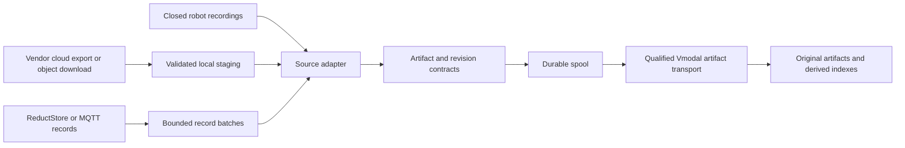

# Robot feed interoperability: local disk, MCAP, and cloud ingestion

Checked: 2026-09-06. This is a source-backed feasibility assessment and proposed integration design. No robot recordings, vendor credentials, or live ingestion tests were supplied. “Yes” below means a documented source interface exists; it does not mean this repository already implements the connector.

## 1. Findings at a glance

We can build connectors for Foxglove, Trossen, ReductStore, and AWS using their documented output interfaces. DexHub is conditional: its paper describes download access, but the current service and payload format could not be verified. MCAP is a useful shared recording input; preserve other native artifacts where conversion would lose information.

| Producer | Robot disk / local access | MCAP or intermediary | Cloud access without reading robot disk | Proposed connector |
|---|---|---|---|---|
| Foxglove SDK | Yes: finalized MCAP recordings | Native MCAP; ROS 1 bags also supported by the platform | Yes: recording/time/topic exports through cloud API or CLI | Shared MCAP file adapter + Foxglove export downloader |
| Trossen SDK | Yes: TrossenMCAP episode files | Native MCAP container with Trossen payloads; converter emits LeRobot v2 | Conditional: read files from the customer's storage destination; no vendor cloud download API verified | Shared MCAP file adapter with Trossen decoding, or version-aware LeRobot import |
| ReductStore | Yes through local server API; internal database blocks are not the file handoff | Original blobs, including stored MCAP; ROS-to-MCAP export depends on extension/version | Yes: query the cloud/central ReductStore instance containing replicated records | One ReductStore API reader configurable for local or remote endpoint |
| DexHub / DART | Unverified local spool/output contract | Downloadable log files described; encoding and MCAP support unverified | Paper describes authenticated `/get-my-data`; current availability unverified | Deferred download adapter after API and sample-file qualification |
| AWS IoT Device SDK | No standard recording directory from SDK alone; add/use a ROS recorder or application spool | Bridge-specific MQTT payloads, often JSON; separately recorded MCAP, S3 objects, or Kinesis video | Yes for live MQTT; historical data requires configured storage such as S3 or retained Kinesis video | S3 artifact reader, MQTT telemetry reader, optional Kinesis media reader |

Evidence and qualifications for every row follow below.

## 2. What is already available in this repository

The [robot MVP spec](initial/04_mvp_spes.md) identifies reusable artifact/revision contracts, a durable spool, scheduling, and transport boundaries under `../lerobot`.

Direct source inspection confirms:

- [LeRobotAdapter](../lerobot/src/vmodal_robot/adapters/lerobot.py) discovers explicit `*.ready.json` manifests. It requires `source_format=lerobot`, `source_version=v3`, artifact checksums/sizes, and an immutable metadata snapshot. Video artifacts must be MP4; telemetry artifacts must be Parquet.
- [VmodalTransport](../lerobot/src/vmodal_robot/transports/vmodal.py) uses the reference Python SDK's `collections.video_upload(reduce_size=False)` for video. Without an injected, qualified `artifact_api`, it blocks non-video artifacts and revision publication.
- [Common contracts](../lerobot/src/vmodal_robot/contracts.py) provide the boundary to reuse for new source adapters. Existing LeRobot validation must not be bypassed by labeling MCAP or v2 data as v3.

Consequently, none of the five feeds should be advertised as a complete production integration based on this assessment. Source adapters and cloud readers require implementation/qualification, and complete dataset delivery requires the generic artifact/revision transport gate to be resolved. Cloud downloading can run on a server and hand finalized files into the same ingestion core.

## 3. Per-platform assessment

### Foxglove SDK and Data Platform

**Local:** The SDK can record MCAP; Foxlet is a separate robot-side agent that monitors recording directories and resumes interrupted uploads. A proposed connector can consume the producer's closed recordings from those directories. Coordinate retention with Foxlet so files remain available until our durable handoff finishes. Live visualization alone does not establish a disk recording. [Foxglove data flow](https://docs.foxglove.dev/docs/data)

**Intermediary:** Preserve the original `.mcap`. Decode selected channels only when needed for video indexing or telemetry extraction. MCAP compatibility does not imply that every message uses ROS encoding.

**Cloud:** Export complete recordings or selected time ranges/topics as MCAP or ROS 1 bag. The export documentation states that MCAP downloads include associated metadata records and attachments. [Export documentation](https://docs.foxglove.dev/docs/data/exporting-data)

Use the REST API or `foxglove-client` with an organization API key and the required endpoint capabilities; the CLI is another supported integration surface. [API authentication and client](https://docs.foxglove.dev/api), [CLI](https://docs.foxglove.dev/docs/cli)

**Proposed handoff:** persist the recording ID and exact export selection, download to a temporary path, validate/hash, then publish an immutable artifact. A selected export is a derived artifact, not a byte-identical copy of the original recording. Required qualification: one full recording and one filtered export with custom messages and attachments.

### Trossen SDK

**Local:** The current project describes synchronized recording into TrossenMCAP and conversion to LeRobot v2. JSON config controls capture; it is not the sensor payload format, and the reviewed material does not establish automatic cloud synchronization. ROS is not required. [Trossen announcement](https://www.trossenrobotics.com/post/trossen-sdk-open-source-robotics-data-collection)

The repository documents one `.mcap` per episode, UUIDv7 episode names, a configurable storage root/dataset ID, and `trossen_mcap_to_lerobot_v2`. Its output contains Parquet, MP4, and dataset metadata. [Trossen SDK repository and conversion instructions](https://github.com/TrossenRobotics/trossen_sdk)

**Intermediary:** Two proposed routes:

1. Preserve TrossenMCAP directly; inspect its channels and encodings and use Trossen-compatible decoding for interpretation.
2. Use the official converter, then add a genuine v2 adapter or a validated v2-to-v3 migration before the existing v3 handoff. Changing a version string is insufficient.

**Cloud:** No Trossen-hosted historical-data API was verified. If the deployment already uploads recordings/datasets to S3, R2, or another repository, use that destination's download interface. Preserve the complete dataset revision, including metadata and all referenced videos. This is a proposed customer-storage integration.

**Required qualification:** a real episode, producer/converter versions, decoded state/action names and units, camera alignment, and the actual cloud destination if cloud ingestion is desired.

### ReductStore

**Local:** Read through a running ReductStore server/SDK. Records expose binary content, timestamps in microseconds, and labels. Use the supported Query API and read/batch endpoints; the older interval-query endpoint is deprecated. Do not treat internal storage blocks as independent sensor files. [Read API](https://www.reduct.store/docs/http-api/entry-api/read_data)

**Intermediary:** Download stored MCAP blobs unchanged where those were the original payloads. For individual records, preserve bytes plus content type, labels, and schema metadata. MCAP conversion requires an explicit payload mapping.

ReductStore's ROS guide describes ReductBridge recording ROS messages and schema attachments, and ReductROS exporting selected raw ROS messages as MCAP. **The reviewed guide is marked “Next”; ReductROS is a Pro extension.** Treat this export route as dependent on the installed version and entitlement. The ordinary record-reader route remains the fallback. [ROS integration guide, Next](https://www.reduct.store/docs/next/ros), [Extension system](https://www.reduct.store/docs/extensions)

**Cloud:** Use the same reader against the remote ReductStore instance. Replication can filter entries/labels and batches new records. Existing records need explicit backfill; normal replication does not automatically copy pre-existing history or mirror deletions. [Replication guide](https://www.reduct.store/docs/guides/data-replication)

**Retention:** FIFO quotas remove old blocks when capacity is reached. Inference: a sufficiently long outage can remove records before our consumer obtains them; replication is not an unlimited lossless queue. Track lag and retained coverage. [Storage engine and quota behavior](https://www.reduct.store/docs/1.15.x/how-does-it-work)

**Required qualification:** source/destination bucket mapping, sample payload types, timestamp meaning, schema availability, replication filter coverage, and a reconnect/backfill test. Persist record identity and checksums so overlapping reads do not duplicate ingestion.

### DexHub / DART

**Verified from the paper:** DART is an AR teleoperation system using cloud-hosted simulation. Section V describes `dexhub.log(obs, act)` for upload and an API-key-protected `/get-my-data` endpoint returning downloadable log links. Public access to the global dataset was described as pending curation. [DexHub/DART paper, sections I and V](https://arxiv.org/html/2411.02214v1)

**Not verified:** a documented local disk spool, durable offline buffering/retry guarantees, file encoding, MCAP export, or a currently functioning production download API. Attempts to open `dexhub.ai` and its project page failed in the research tool; this does not prove the service is down.

**Local/intermediary:** request an actual log and SDK version before choosing a decoder. Do not assume HDF5, Parquet, or ROS messages. A custom observation/action wrapper could write a local recording, but that would be new integration work rather than a verified DexHub output.

**Cloud:** provisionally feasible through the paper's download interface. First verify its current base URL, authentication, response schema, link lifetime, and a downloadable sample. This connector should remain unqualified until those checks succeed.

### AWS IoT Device SDK

**Local:** The referenced AWS example uses a separate ROS 2 node that subscribes to telemetry, transforms it into JSON, and publishes via MQTT. The Device SDK itself is not a native general ROS recorder or automatic ROS-to-cloud bridge. [AWS robot connectivity example](https://aws.amazon.com/blogs/robotics/how-to-connect-your-robots-to-the-aws-cloud-and-drive-data-driven-innovation/)

For disk ingestion, consume an existing ROS bag/MCAP recorder output or add application-level durable recording. Preserve original topic/type/time information before any bridge transformation discards it.

**Intermediary:** Bridge JSON can become JSONL/Parquet or schema-defined MCAP through a custom adapter. This cannot reconstruct ROS fields already omitted upstream. Keep camera media as media artifacts and link telemetry using source timestamps.

**Cloud:** Three distinct interfaces:

- Live telemetry: subscribe to the configured AWS IoT MQTT topics with the account's endpoint and authorized credentials. Subscription is not a general historical replay API.
- Historical telemetry/files: read S3 objects created by existing uploads or IoT Rules. AWS documents an S3 rule action; object keys must avoid overwriting earlier messages. A rule storing JSON does not automatically create MCAP. [S3 rule action](https://docs.aws.amazon.com/iot/latest/developerguide/s3-rule-action.html)
- Video: when the deployment uses Kinesis Video Streams with retained fragments, retrieve media through its archived-media API; the response is MKV media, requiring a separate media adapter. [GetMediaForFragmentList](https://docs.aws.amazon.com/kinesisvideostreams/latest/APIReference/API_reader_GetMediaForFragmentList.html)

**Offline handling:** AWS IoT supports QoS 0 and 1, not 2. QoS 1 can redeliver messages; persistent sessions retain eligible subscriber messages under service/session constraints. This does not guarantee durable recording of data generated while the publishing robot is offline. Use and test a producer-side durable spool where that is required. [AWS MQTT behavior](https://docs.aws.amazon.com/iot/latest/developerguide/mqtt.html)

**Required qualification:** bridge payload schema, robot/boot/message IDs, source clock, historical storage configuration, duplicate handling, and separate media-to-telemetry alignment.

## 4. MCAP and other common input formats

**MCAP is a container, not one universal robot schema.** It stores channels, schemas, serialized messages, log/publish times, and optional attachments/metadata. A reader must dispatch on declared message/schema encoding. Retaining original bytes can work even when semantic decoding is unsupported; searchable structured data requires the decoder. [MCAP specification](https://mcap.dev/spec)

| Input | Proposed handling | Contract requirement |
|---|---|---|
| ROS 2 MCAP | Read container and decode ROS 2 messages | CDR/schema support, custom message definitions, original clocks |
| Foxglove/custom/Trossen MCAP | Preserve file; dispatch per channel encoding | Do not assume all MCAP is ROS 2 |
| ROS 1 `.bag` | Read directly or convert to MCAP | Keep message definitions and source provenance |
| ROS 2 SQLite `.db3` bag | Use ROS tooling or compatible converter | Preserve the bag set and `metadata.yaml`; ensure custom type definitions exist |
| LeRobot | Preserve Parquet, media, and immutable metadata together | Explicit dataset version and episode/frame-to-video mapping |
| MP4/MKV/JPEG plus JSON/Parquet | Preserve media and structured sidecars | Camera identity, frame/time mapping, calibration and units |
| ReductStore raw records | API export with metadata/schema sidecars | Source bucket/entry, timestamp unit, content type and schema |
| DexHub logs | Opaque preservation until inspected | Obtain actual serialization and observation/action specification |

Official tooling supports ROS bag conversion to MCAP, including `ros2 bag convert`; compatibility depends on the bag's embedded definitions and installed ROS/message support. [ROS 2 MCAP guide](https://mcap.dev/guides/getting-started/ros-2), [MCAP CLI](https://mcap.dev/guides/cli)

Python MCAP tooling can read ROS 2 messages without requiring an entire live robot runtime, subject to supported schemas. [Python ROS 2 reader guide](https://mcap.dev/guides/python/ros2)

Do not force every feed into LeRobot. Proposed policy: preserve original recordings first; generate LeRobot or MP4/Parquet derivatives only for a defined training/indexing contract. Retain actions separately from observations, original timestamps and clock domains, calibration, coordinate frames, units, and missing-frame indicators. Never infer synchronization merely from record ordering or equal array lengths.

## 5. Shared integration design

The following is a proposal for extending the existing adapter boundary:

Shared handoff rules:

1. Accept closed files or bounded exports. A stable file size alone is not proof that recording finished; use producer completion, atomic rename, or validated export completion.
2. Record source platform/version, robot and dataset IDs, recording/episode ID, original locator, exact export selection, byte count, checksum, schema version, and clock domain.
3. Keep source time separate from download/ingestion time. Record conversions between MCAP nanoseconds, ReductStore microseconds, and application clocks explicitly.
4. Use immutable source identity plus content checksum for deduplication. Overlap polling windows to catch late data; advance checkpoints only after durable local handoff. Track destination receipts separately.
5. Preserve original files and attach derivatives to them. An extracted MP4 does not replace joint states, actions, depth, point clouds, or calibration.
6. Publish dataset completion only after every referenced artifact and metadata snapshot has a durable destination receipt. Successful video upload alone is insufficient.

For cloud readers, persist stable object/recording IDs rather than expiring download URLs. Support pagination, retry, expired-link renewal, and source retention limits. Cloud copies contain only what the producer uploaded or replicated; omitted topics and expired history cannot be recovered by the connector.

## 6. Suggested implementation order and acceptance checks

1. Qualify generic artifact delivery and revision receipts in the existing transport. This unlocks original MCAP, Parquet, and metadata delivery.
2. Add the shared finalized-MCAP adapter; qualify one ROS 2, one Foxglove/custom-schema, and one Trossen recording.
3. Add Foxglove cloud export and ordinary object-storage download as alternate acquisition paths into that adapter.
4. Add ReductStore API ingestion; qualify extension-based MCAP export only against the selected server release.
5. Add AWS S3 history ingestion, then MQTT or Kinesis only where those interfaces are actually deployed.
6. Qualify DexHub's service and sample format before implementing its adapter.

For each connector, compare source/download checksums, topic/record counts, time ranges, and episode/frame associations. Exercise interrupted download, process restart, duplicate discovery, partial datasets, and unavailable schemas. Verify both original-byte retrieval and interpretation of at least one camera/state/action sample where present.

**Validation performed for this document:** reviewed linked primary vendor documentation and the paper; inspected the local adapter/transport and MVP documentation. No live connector tests or runtime changes were performed. Earlier broad claims in `initial/00_inteface.md` and `info.md` are background proposals, not evidence of working integrations; the specific qualifications here govern this assessment.
