# V-Modal Robotics Data Interface — Simplified Architecture

| Field | Value |
| --- | --- |
| Status | Proposed architecture; design only |
| Revision | 2.1 — detailed contracts restored from baseline revision 2.5 |
| Date | 19 September 2026 |
| Baseline | [02_data_interface_raw.md](02_data_interface_raw.md), revision 2.5 |
| Objective | Simplify implementation and operation while keeping new camera feeds easy to integrate. |
| Default deployment | One robot-side process, one durable spool, one artifact upload worker, optional live output. |

The core design is **plug in a feed, preserve finalized recordings locally, and deliver recordings and current live media through separate outputs**. A single `Runtime` owns lifecycle, retries, bandwidth policy, and status. Camera drivers and recording formats remain behind a small `Feed` boundary.

This document replaces the baseline's proposed component structure, not its implemented code. It preserves offline recording, native bytes, stable identities, timestamps, safe retry, and bounded live buffering. The simplification deliberately assumes one runtime owns each spool and that the artifact backend provides durable idempotency. Multi-worker scheduling and separate connectivity/health services are unnecessary under those assumptions.

Sections 1–10 describe the simplified design. Sections 11–19 supply the detailed diagrams, integrations, records, operations, policies, failures, and implementation mapping. Section 20 accounts for every numbered baseline requirement; section 21 maps every baseline section and acceptance block to this version. Simplification applies to component ownership, not to the data contract or operational detail.

“Shall” and “must” indicate required behavior; “should” indicates a recommended default that deployment policy may change. Baseline requirement identifiers are retained in section 20 for traceability. Rows marked **Adapted** explicitly replace the baseline mechanism for the single-owner v2 design. The baseline lease model is retained as a conditional extension in section 14.7, not enabled by default.

## 1. Architecture and ownership

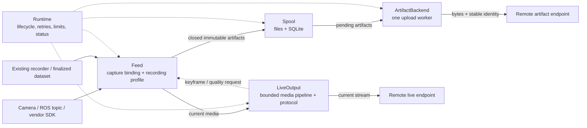

The two remote endpoints may be hosted together, but their availability is independent. A live outage must not prevent a healthy artifact endpoint from accepting recordings, and an upload outage must not stop live delivery.

| Component | Owns | Must not own |
| --- | --- | --- |
| `Feed` | Source identity, device/topic access, native timestamps, recording finalization, format-specific metadata. | Upload retry, remote credentials, spool retention. |
| `Spool` | Durable artifact bytes and records, deduplication, receipts, disk accounting, safe cleanup. | Camera SDKs, payload parsing, live media. |
| `ArtifactBackend` | Upload protocol, stable remote identity, receipt validation, backend-specific recovery. | Discovery, scheduling, deletion of local files. |
| `LiveOutput` | Bounded live buffering, media adaptation, network signaling, decoder refresh requests. | Historical replay or ownership of the camera device. |
| `Runtime` | Wiring, session lifecycle, feed supervision, spool admission, one upload loop, reconnect policy, status. | Vendor parsing, codecs, HTTP endpoint details. |

Only `Feed`, `ArtifactBackend`, and `LiveOutput` are extension contracts. `Runtime` and `Spool` are concrete components. Use ordinary constructor injection and a small name-to-factory table; a plugin framework, event bus, and separate services are not required.

### What changes from the baseline

| Baseline | Simplified v2 | Consequence |
| --- | --- | --- |
| Separate artifact and live source adapters | One `Feed` with optional recorded/live capabilities | One camera configuration and capture lifecycle; file-only feeds stay valid. |
| `UploadScheduler` | One upload loop inside `Runtime` | No worker pool, scheduling service, or claim leases. |
| `ConnectivityManager` | Independent endpoint results and backoff in `Runtime`/outputs | No extra reachability service or global online gate. |
| `HealthStatus` provider and subscriptions | Read-only `Runtime.status()` snapshot | No separate health lifecycle. |
| Separate public media and stream layers | `LiveOutput`, using a media library internally | Media handles and protocol details stay out of the runtime. |
| Many model modules | One `contracts.py` | Keep only records that cross a real boundary. |
| Claim, lease expiry, reconciliation state machine | Pending/acknowledged/blocked records plus idempotent remote delivery | Requires exclusive spool ownership and the remote contract in section 5. |

Physical separation of recorded and live output remains essential: they have different buffering, loss, and acknowledgement rules. Combining the orchestration does not combine their queues.

## 2. The feed extension point

A feed represents one independently managed input: a camera, a ROS subscription, a native recorder, or a dataset directory. It may expose several sources when a native recording contains multiple cameras or telemetry channels. Capabilities are `recorded`, `live`, or both; a file-only feed does not need a fake live implementation.

Reuse capture and recorder implementations already supplied by the device, ROS, vendor SDK, or media library. The feed binds those implementations to the common contract. A shared camera recording profile should handle chunking for camera drivers that do not already provide a recorder.

### Small method contract

| Method | Meaning |
| --- | --- |
| `open(config) -> FeedInfo` | Validate the driver/options; report sources, media formats, and capabilities. Do not start acquisition yet. |
| `start(session, media_sink=None)` | Bind new capture to the supplied session and start capture/recording or watch an existing producer. Previously finalized files retain their originating session. Send current media to the sink only when live output is enabled. |
| `ready(limit) -> artifacts` | Enumerate a bounded batch of finalized artifacts; safe to repeat after a restart. File hashing/discovery runs outside camera callbacks. |
| `accepted(producer_key, artifact_id)` | Idempotently confirm durable spool acceptance; advance the feed's persisted handoff checkpoint. |
| `control(source_id, event) -> result` | Optional keyframe/quality request; report `unsupported` when unavailable. |
| `stop()` | Stop new acquisition/chunks and finalize owned recording work within the shutdown budget. Remaining finalized files stay discoverable through `ready()`. |
| `close()` | Release resources after the final handoff pass. Preserve any files that were not accepted. |

`ready()` is a durable discovery contract, not an in-memory notification queue. The producer must retain finalized bytes and enough identity/session metadata to rediscover them until `accepted()` succeeds. Repeated discovery is expected and deduplicated by the spool. A feed may delete its own temporary files after acceptance under an explicit retention policy; it must not delete files owned by another recorder.

`stop()` controls only resources the feed owns. A feed watching an external recorder must declare whether it can ask that producer to pause/finalize. Without that cooperation, the runtime can stop admission and report storage pressure but cannot promise that the external recorder will stop writing or preserve its own backlog.

### Camera and recorder profiles

| Input | Binding behind `Feed` | Recording path | Live path |
| --- | --- | --- | --- |
| ROS camera topic | Topic/type options in a ROS feed | Existing bag recorder or shared recording profile | Current images/compressed media |
| USB or native device | Device driver binding | Shared recording profile | Current media |
| Encoded network camera | Network-source binding | Preserve compatible encoded media in closed chunks | Reuse encoded media when compatible |
| New vendor SDK | Small callback/handle adapter | Existing vendor recorder or shared recording profile | Adapt callback/handle to the agreed media contract |
| MCAP/rosbag/native files | Finalization-aware file feed | Original closed files and required sidecars | None required |
| LeRobot dataset | Version-aware dataset feed | Original media, tables, and immutable metadata revision | Separate camera feed if needed |

These are proposed integration profiles, not a claim that drivers already exist. Reuse a generic file feed only when its finalization and metadata contracts match the producer. A familiar file extension alone is insufficient.

### Shared capture, independent consumers

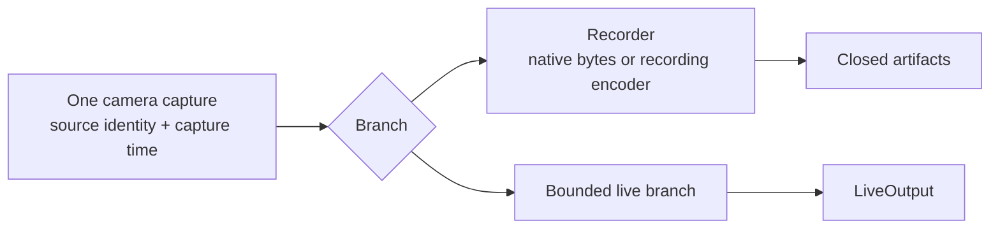

Share encoding too when recording and live output accept the same codec, quality, and keyframe cadence. If live adaptation needs a lower resolution or bitrate, isolate that conversion on the live branch; do not silently reduce recorded quality. Sharing encoding is an optimization, not a requirement that all media have one representation.

Camera callbacks must not perform disk copies, hashing, uploads, or unbounded waits. Use bounded native queues/handles with explicit buffer lifetime: an asynchronous consumer must retain the buffer or make its own bounded copy before the producer reuses it. Live congestion may drop current media; recorder overload must report recording gaps or stop recording explicitly rather than claim lossless capture.

## 3. Minimal data contract

The following are logical fields, not mandatory classes. Record a contract version for persisted and remote metadata.

| Record | Required information |
| --- | --- |
| `Session` | `session_id`, `robot_id`, start time, source descriptors, clock description; optional source-to-UTC anchor and uncertainty. |
| `Source` | `source_id`, feed identity, kind, native media/schema descriptor, optional calibration/units references. |
| `ArtifactInput` | Stable `producer_key`, originating `session_id`, `source_ids`, native `format_id`, `source_path`, `relative_path`, size, SHA-256, optional time range, `group_id`, and completion dependency keys. |
| `StoredArtifact` | Input metadata with immutable `artifact_id` and spool path; persisted destination identity, state, retry metadata, last error, optional durable receipt. |
| `MediaSample` | Session/source identity, capture timestamp and clock, sequence number, media descriptor, bounded payload or retained native handle. |
| `Receipt` | `artifact_id`, destination identity, durable remote reference, confirmed size/checksum. |

Session/source metadata needed to interpret recordings must be persisted with the spool and delivered to the endpoint, directly or as a referenced metadata artifact. A descriptor held only in runtime memory is insufficient for offline recovery.

### Identity and clocks

- A network reconnect keeps the same `session_id` and `source_id`. A process restart may resume a persisted session only if source clocks and identity remain continuous; otherwise start a new session for new capture. Old pending artifacts retain their original sessions.
- `source_id` names the physical/logical source, for example `left`, `right`, or `wrist_depth`. Do not add methods such as `send_left_camera()`.
- `source_ids` is a list because one native bag can contain several sources. Preserve that bag once; do not duplicate its bytes per camera.
- `producer_key` identifies one immutable native object/version across rediscovery and restart. It is not just the path or content hash. Reusing a key with changed bytes/metadata is a conflict; changed content requires a new producer version/key.
- Assign `artifact_id` once and persist the producer-key mapping. Namespace the key by robot/feed and originating session or dataset identity; rediscovery must not replace that namespace with the current capture session. Retain deduplication records after payload cleanup for the supported replay window.
- Preserve capture timestamps, original clock domains, sequence numbers, and missing-frame information. Arrival time, file modification time, upload order, and nominal FPS do not establish synchronization.
- Normalize clocks only when a valid mapping is available. Keep unknown timing explicitly unknown. If clocks cannot be correlated, preserve them separately and report that synchronized comparison is unavailable.
- Preserve mapping/anchor updates needed for long recordings. A reset or backward jump that cannot be mapped starts a new capture session; do not treat it as continuity. Retain original timestamps alongside any mapped values.

Raw/depth media descriptors must include pixel format, dimensions, stride, and units where applicable; encoded media must identify codec, initialization data, and decode timing when different from capture/presentation timing. Large calibration tables, frame mappings, and native schemas can remain sidecar artifacts. The runtime transports these descriptors without interpreting vendor schemas.

### Native bundles and dataset completion

Preserve `format_id`, `group_id`, and relative paths, including sidecars and immutable metadata snapshots. Do not assume one episode equals one file, or that an MCAP file necessarily contains ROS messages.

A feed emits an immutable completion manifest when a native group/revision is finalized. It lists exact member identities, relative paths, sizes, and checksums. Dependency keys in the common artifact metadata let the runtime resolve those identities to spool artifact IDs without parsing or rewriting native manifest bytes. Upload the manifest only after every referenced member has a durable receipt; carry the resolved references in the backend's completion request. The remote endpoint must validate those references before acknowledging completion. Bound dependency enumeration for large datasets rather than loading every member into memory.

Members may upload before the group is complete. A partial group must remain visibly incomplete; a successful video transfer does not complete a dataset. Changed metadata creates a new revision and manifest. Completion publication is idempotent under the same rules as artifact upload. A blocked member blocks its dependent completion, not unrelated groups.

## 4. Durable spool without worker leases

Keep the existing files-plus-SQLite approach. The spool exposes a small concrete API:

| Operation | Contract |
| --- | --- |
| `put(input) -> artifact_id` | Durably accept immutable bytes and metadata; return the existing ID for an identical repeated handoff. |
| `next_ready(now)` | Return an eligible pending item according to retry time and dependency ordering. |
| `acknowledge(id, receipt)` | Validate identity/integrity and persist durable remote acceptance. |
| `retry(id, delay, error)` | Keep pending, persist the error and next eligible time. |
| `block(id, reason)` | Preserve bytes and stop automatic attempts for this item. |
| `stats()` | Report pending/blocked/acknowledged storage and real filesystem headroom. |
| `cleanup(policy)` | Remove only acknowledged payloads allowed by retention and manifest dependencies. |

### Handoff and crash recovery

1. The feed proves finalization through a producer completion signal, ready manifest, or equivalent contract. A temporarily stable file size does not prove immutability.
2. The spool checks capacity and streams the source into spool-owned temporary storage, verifying size/checksum. It flushes the payload, atomically publishes it, and commits durable metadata with the required filesystem/SQLite durability settings.
3. Only after recoverable bytes and metadata exist does `put()` return. `Runtime` then calls `accepted()` on the feed.
4. Startup recovers temporary/orphaned files and metadata consistently. A crash between file publication and database commit must not lead to false acceptance or loss of the producer's sole copy.
5. A crash after acceptance but before the feed checkpoint causes rediscovery; the existing producer-key mapping returns the same artifact ID, even if its acknowledged payload has since been cleaned up.

A copy is the simple default. Move/reflink optimizations require explicit ownership and crash-recovery semantics. A hard link alone does not protect against later in-place producer writes.

### Three persistent states

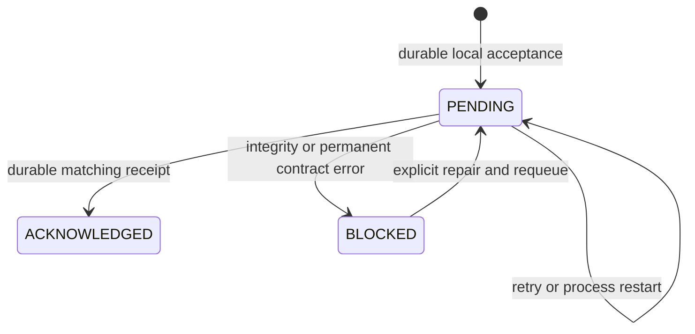

The active attempt is runtime status, not a fourth durable state. An artifact remains `PENDING` until its receipt is committed. After a crash, repeating delivery with the same ID is safe only because the endpoint contract below requires idempotency.

Acquire an OS-level exclusive lock for the spool before recovery or upload; a second owner must fail startup. Run one upload at a time. All requests have deadlines, and the runtime must not launch a replacement worker while an old local worker can still mutate state. If a worker cannot be cancelled safely, report the failure and restart the owning process after it exits. Remote requests may still finish late, so remote idempotency remains required even with this lock.

Lease removal is a deliberate scope restriction. Multiple processes or concurrent workers sharing a spool require a separate design for atomic claims, ownership fencing, and recovery. Do not add concurrency by merely increasing a configuration number.

## 5. Artifact delivery and endpoint contract

`ArtifactBackend.deliver(artifact) -> Receipt` is the only upload operation the runtime needs. The backend may use upload, lookup, reconciliation, or multipart resume internally. It never modifies the spool.

Required endpoint behavior:

1. Persist destination identity and `artifact_id` before the first attempt. Repeating the same ID, bytes, and metadata returns the same logical artifact/receipt, including after client restart or a lost response.
2. The same ID with conflicting bytes or interpretation metadata is rejected. Do not resolve conflicts by silently overwriting.
3. Return success only after durable storage and integrity verification. A transfer HTTP success or acceptance into asynchronous indexing is insufficient.
4. Keep deduplication identity for at least the declared local retention/replay window, including manual re-import. Configure and qualify that window together with local receipt retention.
5. Preserve original formats, relative paths, group membership, and source/time metadata. Support readback for byte-integrity and reconstruction checks.

If the existing endpoint cannot provide this behavior, the backend must implement a qualified equivalent using stable remote keys/reconciliation, or block delivery with an explicit capability error. The runtime must not blindly retry a non-idempotent create operation. Do not silently redirect old backlog when endpoint configuration changes; changing a backlog destination is an explicit migration.

The runtime uses capped exponential backoff with jitter for temporary failures. Auth/configuration failures pause that destination until configuration/credentials recover. Integrity or unsupported-artifact errors block the affected artifact. Network checks come from real connection/transfer results; an extra connectivity service is unnecessary.

### Scheduling and live priority

Start with oldest eligible artifact first; dependency manifests wait for their members. This provides a simple, starvation-resistant policy among ready items. One upload worker trades throughput and independent telemetry latency for simpler recovery. A large video can delay metadata; if a deployment requires an independent telemetry deadline, qualify a bounded second lane together with its ownership model instead of claiming this default provides it.

When live output is active, enforce an aggregate artifact-upload bytes/second limit, including multipart traffic. Pause backlog when live quality degrades, then resume after a stable recovery interval. If the backend cannot throttle active traffic, pause/cancel it safely or disable backlog upload during live use; limiting only new upload starts does not protect the uplink.

Restore current live output promptly after reconnect, with bounded handshake time. Artifact recovery/draining must not wait indefinitely for an unavailable live endpoint. File-only deployments skip live initialization entirely.

## 6. Live output without a second backlog

`LiveOutput` exposes `start(session, sources, control_sink)`, bounded `send(sample)`, and `stop()`. `send()` reports accepted, dropped/backpressure, or disconnected. The runtime registers configured sources at startup and can independently suspend/resume those channels. Automatic discovery and hot-plug of new physical devices remain optional later work; the channel-level operations are specified in section 14.4.

Use one selected live protocol per deployment. Keep protocol negotiation, signaling, and media conversion inside the output implementation. A media library such as the baseline's GStreamer option can own the pipeline; the architecture does not require Python byte copies of every frame.

- Bound every application/media queue by both capacity and age. Discard stale live data after disconnect; recording continues independently.
- Preserve capture/session/source metadata through an agreed receiver mapping or companion metadata channel. A local timestamp that never reaches the receiver cannot synchronize its view.
- For raw frames, prefer the newest frames under congestion. For predictive encoded video, use codec-aware recovery: flush stale dependencies, request a keyframe, and wait for a decodable refresh.
- Route receiver keyframe/quality requests to the feed's `control()` or the encoder owned by the live output. A quality request must respect recording-quality constraints on shared encoders.
- If a source cannot generate a requested keyframe, wait for the next natural refresh and expose the limitation. On reconnect, send required codec initialization and fresh decodable media.
- Recording may preserve depth/raw/vendor data even when the live output cannot display it. Reject an unsupported live profile explicitly; preview conversion is optional and must preserve the original recording.

On network loss, the live path holds only its configured bounded current media, then drops expired data. Historical delivery always comes from the spool. It is never replayed through `send()`.

## 7. Configuration and adding a camera

One YAML/JSON configuration selects feed factories, recording profiles, and outputs. Feed-specific options stay under their feed; credentials are references to existing SDK configuration. Do not add parallel environment variables for values already derivable from existing configuration.

Illustrative target configuration; these keys are proposed, not an existing CLI schema:

```yaml
robot_id: robot-07
spool:
  path: /var/lib/vmodal-robot/spool
  warning_ratio: 0.80
  stop_ratio: 0.90
  finalize_reserve_bytes: 1073741824
upload:
  backend: vmodal
  destination_ref: existing-sdk-destination
  max_bytes_per_second_when_live: 2000000
live:
  output: deployment_live_profile
  queue_max_frames: 3
  queue_max_bytes: 16777216
  queue_max_age_ms: 200
feeds:
  - source_id: left
    driver: ros_image
    options:
      topic: /camera/left/image_raw
    record:
      profile: camera_chunks
      chunk_seconds: 10
    live: true
  - source_id: right
    driver: ros_image
    options:
      topic: /camera/right/image_raw
    record:
      profile: camera_chunks
      chunk_seconds: 10
    live: true
```

The factory names, queue sizes, reserve, chunk length, and rate limit must be qualified against the target device and endpoint. Source clocks and media descriptors come from validated feed discovery; do not assume all cameras share a clock because they share this file. Multi-source file feeds report their source list in `FeedInfo` instead of using a single configured camera ID.

### Add another camera using an existing driver

Add one `feeds` entry with a unique `source_id`, device/topic options, and recording/live choices. Validate hardware/encoder/storage capacity and restart the runtime. No spool, backend, retry, or cloud routing change is needed if the new camera uses already qualified media and recording formats.

### Add a new camera SDK

1. Add one driver module and register its factory in the composition table.
2. Map device callbacks or media handles to `MediaSample`, including ownership, clocks, codec/pixel metadata, and errors.
3. Reuse the shared recording profile, or expose the vendor recorder's finalized immutable files through `ready()`. Preserve native bundles and sidecars.
4. Implement optional keyframe/quality handling and declare unsupported capabilities explicitly.
5. Add configuration and small fixtures covering capture metadata, finalization, rediscovery, and unsupported modes. Run the common acceptance cases in section 10.

For a file-only format, implement only discovery/finalization and artifact metadata; no live driver is required. For a new output protocol, add a `LiveOutput` implementation rather than changing each camera driver. A camera emitting an unsupported codec may require a new media conversion profile or receiver capability; the architecture cannot make codec compatibility configuration-only.

## 8. Runtime lifecycle and failure behavior

Startup validates configuration, obtains the spool lock, recovers local storage, checks backend capabilities, and opens feeds. It then starts capture plus independent live/upload tasks. Missing optional endpoints need not prevent local recording; invalid recording contracts or unsafe local storage must fail the affected feed explicitly.

Status is a read-only snapshot of feed readiness/errors, last frame time and gaps, recording state, each endpoint's state, pending/blocked counts and bytes, oldest backlog age, actual disk headroom, active upload/error, and live drops/latency. Reading status must not trigger network calls or control devices.

| Event | Required response and owner |
| --- | --- |
| Camera disconnects | Feed reports the source failure; runtime retries that feed with backoff. Other feeds continue. Preserve any finalized chunks and report recording gaps. |
| Artifact endpoint unavailable | Keep artifacts pending and retry with bounded backoff. Capture and healthy live output continue. |
| Live endpoint unavailable | Bound/drop live data and retry the connection. Recording and artifact delivery continue. |
| Upload stored remotely, response lost | Retry/reconcile the same artifact ID through the backend; commit a matching receipt before cleanup. |
| Runtime crash | Recover accepted artifacts; rediscover unaccepted finalized producer files; repeat pending delivery safely. Incomplete active recordings require recorder-specific recovery and must not be falsely finalized. |
| Partial/corrupt input | Feed or spool rejects it, retains the producer's copy, and reports the reason. Do not fabricate metadata or completion. |
| Partial dataset upload | Keep the revision incomplete until all dependencies and the completion manifest are acknowledged. |
| Disk pressure | Runtime stops new recording chunks, finalizes within reserve, then stops affected recording. Spool never deletes pending data to make room. |
| Live congestion | Live output keeps buffers bounded and restores decodable current media; runtime throttles or pauses artifact upload. |
| Shutdown deadline expires | Preserve pending files/state; do not record false upload or finalization success. |

Storage thresholds apply to real free space on every producer and spool volume, including active chunks, temporary copies, SQLite journals, and unrelated files. Require `0 <= warning_ratio < stop_ratio <= 1`. Stop before either the stop ratio is reached or the next operation would breach the absolute reserve. Reserve must cover all active sources' finalization plus staging needs; it cannot guarantee success if another process consumes that space unexpectedly.

On an actual write failure, keep existing accepted data, report the error, and let the recorder recover/quarantine incomplete output. Recording can resume only after headroom exceeds a defined resume margin. Disk pressure can stop recording while live output continues if the hardware permits those lifecycles to be separated.

Shutdown stops new chunks first, runs the final durable handoff pass, stops live output, and drains/cancels upload within a deadline. Unaccepted finalized files remain producer-owned and rediscoverable. Pending spool artifacts survive shutdown.

Manual evacuation is a maintenance operation: copy payloads plus identity/session/group metadata, verify checksums and the export manifest, then confirm export. It does not imply cloud acknowledgement. Retain local pending data by default; removal requires an explicit verified evacuation policy and enough exported state to resume delivery with the same identities.

## 9. Small package layout and reuse boundary

Proposed layout, relative to the existing robotics package. This is a design map, not an instruction to create another package or duplicate existing modules.

```text
src/vmodal_robot/
  contracts.py           # feed, artifact, media, receipt contracts
  config.py              # configuration records and startup validation
  runner.py              # Runtime: lifecycle, one upload loop, limits, status
  spool.py               # files + SQLite, acceptance, receipts, retention
  adapters/
    __init__.py          # explicit feed factory table
    files.py             # shared finalized-file handoff
    rosbag.py            # bag finalization and storage metadata
    lerobot.py           # dataset-version and revision mapping
    trossen.py           # optional metadata mapping over the MCAP file feed
    ros_camera.py        # optional ROS camera binding
    vendor_camera.py     # only when a concrete vendor integration is needed
  media.py               # reusable recording/live profiles, bounded queues
  transports/
    vmodal.py            # ArtifactBackend using the reference Python SDK
    live.py              # selected LiveOutput implementation
  utils.py               # reusable filesystem/hash helpers
  cli.py                 # thin Fire CLI
```

Reuse the artifact/receipt contracts, spool, runner, and V-Modal transport documented in the [existing MVP specification](initial/04_mvp_spes.md). Keep format validation in adapters and preserve existing persisted identities during any future migration. The proposal's single-worker/state simplification must not be applied to an existing spool by discarding unresolved claims or receipts.

The [local interoperability assessment](01_data_interface.md) documents an existing LeRobot v3 handoff and a V-Modal transport with a generic artifact/revision integration gate. This proposal does not establish that the gate has been resolved. Original MCAP, Parquet, metadata, completion receipts, and live media must each be qualified against the actual endpoint before advertising end-to-end support.

`uinterface/sdk_python` remains the reference for V-Modal API behavior. Add any missing qualified backend operations there before using them from the robotics wrapper. Do not invent cloud routes in camera adapters or treat video upload alone as complete native dataset ingestion.

## 10. Acceptance criteria and explicit limits

The later implementation must demonstrate these behaviors with fixtures/fake backends first and then the selected hardware/real endpoints:

1. Add a third camera using the existing driver through configuration only; add one new vendor driver without edits to spool, retry logic, or artifact transport.
2. Integrate a file-only native artifact and a multi-source recording without requiring camera capture, conversion, or duplicate payload copies per source.
3. Feed the same finalized object repeatedly, including after a restart and acknowledged-payload cleanup; recover the same artifact ID. Reject changed bytes under the old producer key.
4. Crash at the file/database/feed-checkpoint boundaries and verify durable recovery, no false acceptance, and preserved producer ownership until handoff.
5. Lose a remote upload response, restart, and verify one logical remote artifact with a matching receipt. Refuse unsafe non-idempotent backend operation.
6. Disconnect either endpoint independently. Recording continues while disk allows; current live output resumes without replaying historical media; healthy artifact upload is not gated forever on live recovery.
7. Saturate the live branch and uplink. Verify bounded memory, fresh decodable recovery, keyframe handling, enforced active-transfer rate limits, and unchanged recording quality.
8. Fill producer/spool volumes, including with unrelated files. Verify reserve-aware stop, retained unacknowledged data, explicit gaps/failures, and safe resume.
9. Partially upload a bundle and change its metadata revision. Verify exact native paths, immutable versions, and no completion until every referenced member has a durable receipt.
10. Exercise different clocks and a clock reset. Verify preserved original timing, explicit unknown correlation, and correct session boundaries.
11. Read back native artifacts byte-for-byte and reconstruct camera/telemetry associations. Show source/endpoint/storage failures through the status snapshot.
12. Attempt a second spool owner and a hung upload. Verify exclusive ownership, bounded operational failure handling, and no concurrent replacement worker mutating state.

Out of scope for this simplified default: distributed/multi-worker claims, guaranteed independent telemetry latency, seamless device hot-plug, mandatory format conversion, a universal live codec/protocol, and new cloud endpoint definitions. Add those only for a concrete deployment requirement and retain the same feed/data boundaries.

This is a documentation-only proposal based on the baseline and neighboring local specifications. It does not report implementation, hardware validation, or live cloud qualification.

## 11. Detailed architecture and data exchange diagrams

### 11.1 Integrated new camera data feed

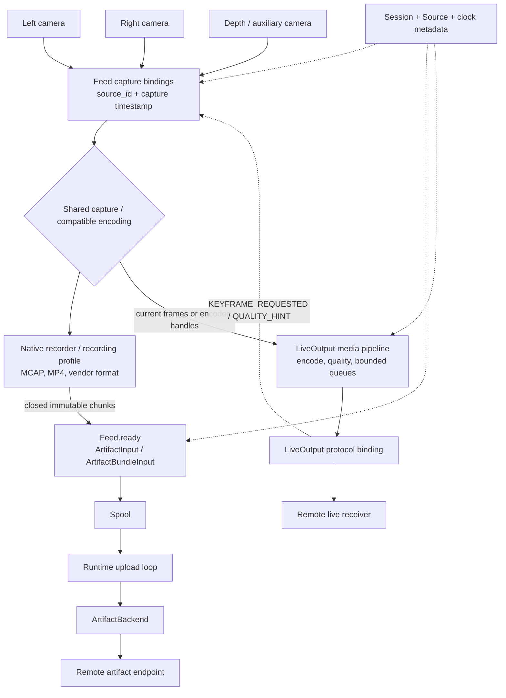

Each camera remains independently identified even when capture hardware or encoders are shared. Recorded and live data may differ in representation while retaining the same source/capture-time association. The diagram's media and protocol boxes are internal parts of `LiveOutput`, not additional public services.

### 11.2 Recorded and durable data exchange

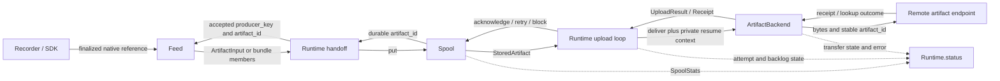

There is one local writer for delivery state. No claim token crosses the default v2 boundary. Backend resume tokens are opaque serialized values; feed checkpoints confirm local acceptance, whereas remote receipts confirm remote durability.

### 11.3 Live data and control exchange

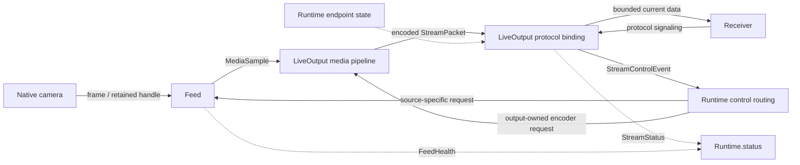

Control routing chooses the component that owns the encoder; it must not send incompatible quality changes to an encoder shared with recording. Receiving `REMOTE_CONNECTED` is not proof that the first decodable frame has reached the receiver.

### 11.4 Dependency boundaries

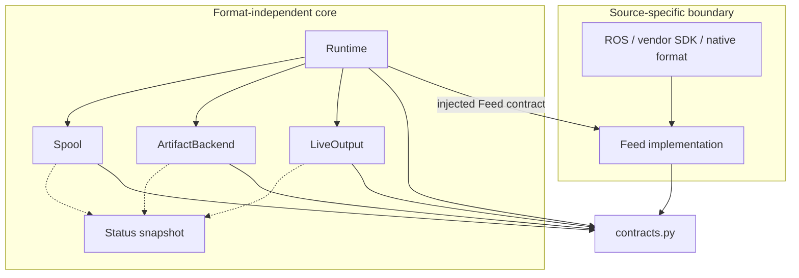

Arrows here describe allowed dependencies, rather than payload direction. Concrete feed factories are selected at the composition boundary. Common modules must not import vendor SDK classes. Dashed arrows are observation only; status reads do not change subsystem state.

### 11.5 Shared identity and timing

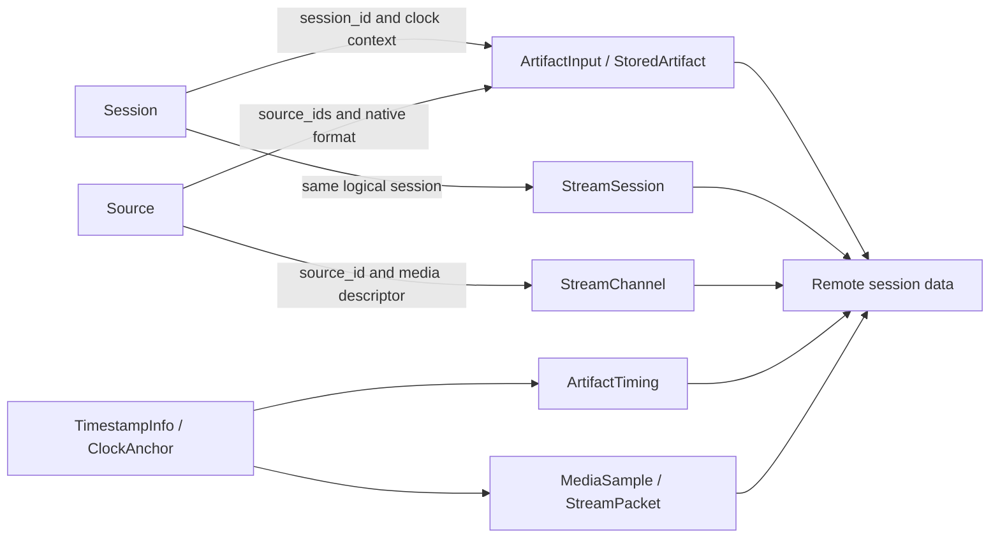

File/chunk boundaries may differ across left/right/depth sources. Artifacts may finalize and upload in any order. Source IDs and timestamps, plus native episode/frame mapping when present, establish association.

## 12. Detailed reference integrations and conversion policy

### 12.1 Ecosystem integration overview

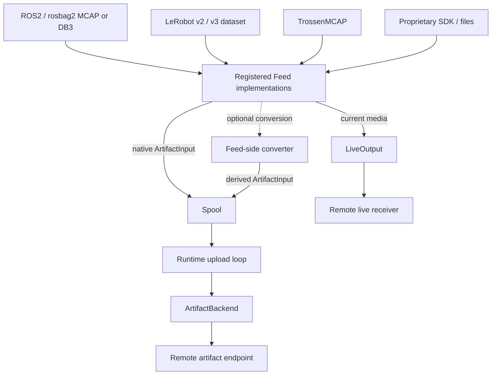

| Area | Choice and reason |
| --- | --- |
| Source integration | Registered feeds isolate vendor SDKs and native format versions. |
| Recorded data | Preserve native bytes; avoid conversion cost or fidelity loss solely for connectivity. |
| Normalization | Optional converter behind the feed; remote consumers may interpret native artifacts later. |
| Offline queue | One spool is the durable ownership boundary for every recorded format. |
| Artifact delivery | A backend handles endpoint-specific upload/receipt/recovery without format decoding. |
| Live media | Use an established media pipeline for capture binding, encoding, teeing, and codec-aware dropping. |
| Live protocol | One selected output binding contains signaling and receiver negotiation. |
| Connectivity/status | Runtime policy and read-only snapshots reuse observed endpoint results. |

### 12.2 ROS2 / rosbag2 / MCAP

```text
ROS2 topics -> existing rosbag2 recorder -> finalized bag / split segment
  -> RosbagFeed -> ArtifactInput(format_id = rosbag2/mcap or rosbag2/sqlite3)
  -> Spool -> Runtime -> ArtifactBackend

ROS2 image / compressed-image topic -> RosCameraFeed
  -> MediaSample -> LiveOutput media pipeline -> live receiver
```

Use native bag completion/storage metadata and closed split boundaries. Preserve required storage metadata/sidecars with the bag group. There is no need to decode frames simply to transfer an MCAP or SQLite3 payload. Optional conversion belongs outside the spool/backend. Generic MCAP handling may add schema/channel metadata, but must not assume every MCAP uses ROS serialization.

### 12.3 LeRobot datasets

```text
Versioned LeRobot dataset root -> LeRobotFeed
  -> finalized MP4 / Parquet / immutable metadata shards
  -> ArtifactInput(group_id = dataset revision or shard group,
                   relative_path = original dataset-relative path)
  -> Spool -> member receipts -> completion manifest receipt
```

The feed is version-aware. The baseline's v3 integration preserves the metadata that maps multiple episodes into shared video/table shards. Never assume one episode is one physical file, or relabel a v2 dataset as v3 to pass validation. Preserve original tasks, episode/frame mappings, schema/calibration references, and all metadata required to reconstruct the native dataset. A separate camera binding supplies live viewing when needed.

### 12.4 Trossen SDK / TrossenMCAP

```text
Trossen hardware / producers -> Trossen recorder backend
  -> finalized native episode .mcap -> MCAP feed + optional Trossen metadata mapping
  -> ArtifactInput(format_id = trossen/mcap) -> Spool

Optional preprocessing:
TrossenMCAP -> qualified Trossen converter -> LeRobot v2 feed -> Spool
```

Reuse the native producer/recorder rather than reproducing it in the connectivity layer. The baseline uses Trossen's registry-driven hardware/producers/backends as an integration example; neither its episode filename convention nor conversion support is a runtime-wide assumption. A live hardware/SDK callback can use the same feed contract without requiring LeRobot conversion.

### 12.5 Proprietary vendor formats

```text
Vendor recorder -> closed .vendorlog / bundle / sidecars
  -> VendorFeed.ready -> ArtifactInput members
  -> Spool -> ArtifactBackend

Vendor live callback / native media handle -> VendorFeed.start
  -> MediaSample -> LiveOutput
```

A single file can pass unchanged. A multi-file bundle uses a shared group identity and original relative paths, not a mandatory archive format. A callback-only camera needs a recorder/profile to generate finalized artifacts before durable handoff. Format interpretation stays in the feed or remote consumer; the core accepts opaque supported payloads with truthful common metadata.

### 12.6 Conversion and metadata-error decisions

| Policy/event | Required behavior |
| --- | --- |
| `NATIVE` | Preserve/upload qualified native format; do not normalize automatically. |
| `NORMALIZE_OPTIONAL` | Attempt the configured converter; native fallback is allowed only when the deployment explicitly permits it and the backend accepts the format. |
| `NORMALIZE_REQUIRED` | Conversion failure blocks that handoff; preserve the source and expose the error. Do not silently fall back to native delivery. |
| Metadata parse failure | Preserve source bytes and report the failing format/version/field. Opaque upload may continue only under explicit policy with valid minimum identity/integrity metadata; unavailable timing stays unknown. |
| Unsupported format/version | Reject the feed/profile during validation or discovery; do not fabricate a known format identifier. |

Conversion produces a distinct immutable artifact with provenance to its native input. A failed conversion must never delete the only source copy. `format_id` examples remain `rosbag2/mcap`, `rosbag2/sqlite3`, `lerobot/v3`, `trossen/mcap`, and `vendor-x/log-v2`; the core must not dispatch on vendor names.

Reference links carried forward from the baseline (not revalidated as part of this documentation update):

- [Trossen Robotics SDK](https://github.com/TrossenRobotics/trossen_sdk)
- [Trossen data collection SDK](https://www.trossenrobotics.com/data-collection-sdk)
- [ROS 2 rosbag2_storage_mcap](https://docs.ros.org/en/ros2_packages/kilted/api/rosbag2_storage_mcap/)
- [LeRobot dataset v3](https://huggingface.co/docs/lerobot/lerobot-dataset-v3)

## 13. Field-level data models

These are logical interface records in `contracts.py`, not a requirement to create one class/file per record. `?` means optional; absent timing means unknown, never zero by implication. Enums below use uppercase names; configuration aliases such as `recorded` and `live` map to their corresponding capability values.

### 13.1 Feed descriptors, native references, and bundles

```text
FeedInfo                         # replaces AdapterDescriptor + discovery calls
  feed_id: string                # configured instance, not a vendor class name
  driver: string                 # factory key
  vendor: string?
  capabilities: set<RECORDED_ARTIFACTS | LIVE_CHANNELS |
                    NATIVE_METADATA | OPTIONAL_CONVERSION>
  native_format_ids: List<string>
  sources: List<Source>
  channels: List<StreamChannel>
  supported_controls: set<KEYFRAME_REQUESTED | QUALITY_HINT>
  can_pause_recording: bool

ExternalArtifactRef             # optional internal feed discovery record
  native_id: string
  format_id: string
  group_id: string?
  finalized: bool
  metadata: map<string, scalar>

ArtifactBundleInput
  format_id: string
  group_id: string?
  members: List<ArtifactInput>   # bounded discovery page, not entire dataset RAM
```

`ready(limit)` combines native discovery and preparation into one public operation; a feed may keep `list_ready(cursor)` and `prepare(ref)` as private helpers. A bundle is not an atomic spool transaction: accept members independently, checkpoint each accepted member, and preserve the remaining members for retry. Group completion uses the explicit dependency manifest.

### 13.2 Session, source, and clocks

```text
Session                         # baseline SessionDescriptor
  contract_version: string
  session_id: string
  robot_id: string
  started_at_ns: int64
  timestamp_domain: TimestampDomain?
  clock_anchor: ClockAnchor?
  sources: List<Source>

Source                          # baseline SourceDescriptor
  source_id: string
  source_type: video | telemetry | metadata | other
  name: string
  feed_id: string                # baseline adapter_id
  native_format_id: string?
  format_or_codec: string
  clock_id: string
  timestamp_domain: TimestampDomain
  metadata: map<string, scalar>

TimestampDomain = ROBOT_MONOTONIC | ROS_TIME | UTC_EPOCH | OTHER

TimestampInfo
  timestamp_ns: int64
  timestamp_domain: TimestampDomain
  clock_id: string
  sequence_number: uint64

ArtifactTiming
  start_timestamp_ns: int64
  end_timestamp_ns: int64
  timestamp_domain: TimestampDomain
  clock_id: string

ClockAnchor
  clock_id: string
  source_timestamp_ns: int64
  utc_epoch_ns: int64
  uncertainty_ns: uint64?
```

The baseline assumes a common session clock where possible. V2 retains that recommendation and adds `clock_id` to distinguish two unrelated clocks of the same domain. If no common mapping exists, leave the session common domain unset and preserve per-source domains. Clock anchors and their updates are persisted metadata; hardware triggering, PTP, drift estimation, and tighter synchronization remain deployment-specific.

### 13.3 Producer input versus spool-owned artifact

```text
ArtifactInput
  contract_version: string
  producer_key: string
  session_id: string
  source_ids: List<string>       # one entry replaces baseline source_id
  artifact_type: string          # video, telemetry, metadata, opaque, completion
  format_id: string
  group_id: string?
  relative_path: string
  source_path: string            # producer-owned finalized file
  size_bytes: uint64
  checksum_sha256: string
  timing: ArtifactTiming?
  dependency_keys: List<string> # empty unless completion/dependency metadata
  metadata: map<string, scalar>

StoredArtifact
  artifact_id: string
  producer_key: string
  session_id, source_ids, artifact_type, format_id, group_id, relative_path
  size_bytes, checksum_sha256, timing, dependency_keys, metadata, contract_version
  spool_ref: string              # replaces source_path as delivery byte source
  destination_ref: string        # stable non-secret logical destination ID
  state: PENDING | ACKNOWLEDGED | BLOCKED
  attempts: uint64
  next_attempt_at_utc_ns: int64?
  last_error: ErrorInfo?
  receipt: Receipt?
```

Preserve baseline `source_id` when importing old records by mapping it to a one-element `source_ids`. Multiple clocks within one native recording remain in native metadata or an explicit per-source timing sidecar; do not invent a single cross-clock interval. Relative paths identify native layout; standalone files also receive a stable relative name.

`destination_ref` is not a credential, URL, or embedded endpoint configuration. Resolve it through deployment configuration. Any destination remapping requires an explicit backlog migration. Persisted retry timestamps use a restart-comparable clock; runtime waits use monotonic deadlines and re-evaluate due work after restart/time changes.

### 13.4 Delivery, reconciliation, and cancellation results

```text
UploadStatus = ACKNOWLEDGED | RETRYABLE_FAILURE | TERMINAL_FAILURE | CANCELLED
ReconcileStatus = ACKNOWLEDGED | NOT_FOUND | UNKNOWN | TERMINAL_FAILURE

Receipt                         # baseline UploadReceipt
  artifact_id: string
  destination_ref: string
  remote_ref: string
  size_bytes: uint64
  checksum_sha256: string
  durable: bool

UploadResult
  status: UploadStatus
  receipt: Receipt?
  error: ErrorInfo?
  retry_after_ms: uint64?

ReconcileResult
  status: ReconcileStatus
  receipt: Receipt?
  error: ErrorInfo?

ErrorInfo
  code: string
  message: string
  component: string
  source_id: string?
  artifact_id: string?
  retryable: bool
```

`deliver()` returns a receipt only on acknowledged success; failure is exposed as a structured result/error with the above classification. The backend may internally use `UploadResult` for every attempt. A successful cancel request is not proof that the remote write failed. Keep the artifact pending until a later safe delivery/reconciliation resolves it. Required multipart/resume state is backend-owned serialized bytes/token data; it may survive restart, but its contents are not interpreted by the runtime or feed.

### 13.5 Live sessions, channels, packets, and control

```text
StreamSession
  session_id: string
  robot_id: string
  timestamp_domain: TimestampDomain?
  channels: List<StreamChannel>

StreamChannel
  channel_id: string
  source_id: string
  media_type: string
  codec: string
  width: uint32?
  height: uint32?
  frame_rate: float?
  clock_id: string
  metadata: map<string, scalar>  # pixel format/stride/units or schema reference

MediaSample                     # Feed -> LiveOutput
  session_id: string
  source_id: string
  channel_id: string
  timestamp: TimestampInfo
  media_descriptor: StreamChannel
  payload_or_handle: bounded bytes | retained native media handle
  flags: set

StreamPacket                    # internal encoded output representation
  session_id: string
  channel_id: string
  timestamp_ns: int64
  timestamp_domain: TimestampDomain
  clock_id: string
  sequence_number: uint64
  decode_timestamp_ns: int64?
  payload: bounded bytes | retained encoded buffer
  flags: set                    # e.g. keyframe, discontinuity, codec config

SendStatus = ACCEPTED | DROPPED | BACKPRESSURE | DISCONNECTED
SendResult
  status: SendStatus
  reason: string?

StreamControlEventType = REMOTE_CONNECTED | REMOTE_DISCONNECTED |
                         KEYFRAME_REQUESTED | QUALITY_HINT
StreamControlEvent
  event_type: StreamControlEventType
  session_id: string
  channel_id: string?
  source_id: string?
  parameters: map<string, scalar>
```

`channel_id` identifies a logical media channel, and `source_id` identifies its physical/logical source. One source may expose more than one media representation. Keyframe/quality requests identify the affected channel/source. The backend may multiplex channels over one connection or use several connections without changing their session identities.

## 14. Complete operations and baseline interface mapping

### 14.1 Source adapter operations

| Baseline operation | V2 operation / placement | Input, result, and side effect |
| --- | --- | --- |
| Artifact `open(config)` | `Feed.open(config)` | Validate native SDK/parser/watch root and return `FeedInfo`; reject unsupported versions explicitly. |
| Artifact/live `descriptor()` | Fields returned by `open()` | Driver identity, vendor, native formats, capabilities; read-only after validation. |
| `discover_sources()` | `FeedInfo.sources` | Recorded sources and source interpretation metadata. |
| `list_ready(cursor?)` | Internal discovery used by `ready(limit)` | Bounded/paginated native references; do not mutate spool state. |
| `prepare(ref)` | Internal preparation used by `ready(limit)` | One native object becomes member inputs; optional staging/conversion preserves original ownership. |
| `confirm_handoff(ref, artifact_ids)` | `accepted(producer_key, artifact_id)` per member | Confirm only completed `Spool.put()` calls; persisted checkpoint prevents losing pending members. |
| `discover_channels()` | `FeedInfo.channels` | Current configured camera channels and supported media descriptors. |
| Live `start(channel_id, media_sink)` | `Feed.start(session, media_sink)` | Bind configured sources to bounded sinks; no historical queue. A per-channel native handle stays private to the feed. |
| `handle_control(event)` | `Feed.control(source_id, event)` | Translate generic request to device/encoder action or report unsupported. |
| Live `stop(handle)` | Stop/suspend selected feed source or its output channel | One camera may stop independently; release only owned capture resources. |
| Artifact/live `close()` | `Feed.close()` | Release resources after final handoff; preserve unaccepted source data. |

For an input containing several sources, selective source control is a declared capability. Independent network-channel suspension is always owned by `LiveOutput`; it does not require stopping a shared recorder. Large discovery pages, copies, and hashes run on bounded worker tasks outside capture callbacks.

### 14.2 Spool inspection, retention, and export

Section 4 specifies the delivery-state operations. The following operations restore the baseline's inspection and maintenance detail without adding another service.

| Operation | Inputs | Output / ownership effect |
| --- | --- | --- |
| `get(id)` | Artifact ID | `StoredArtifact` or not-found; read-only. |
| `list_pending(filter, cursor, limit)` | Optional session/source/type/group filter and bounded page | Pending records including delayed retries; no mutation. |
| `stats()` | None | `SpoolStats` with queue counts/bytes and each required volume's capacity. |
| `cleanup(policy)` | Retention policy | Counts/bytes removed and retained reasons. Baseline `cleanup_acknowledged` semantics apply; preserve unacknowledged bytes and required receipt/dependency records. |
| `export(path, filter, verify=true)` | Destination and selection | Export manifest, counts/bytes, checksum verification status, errors; preserve native paths and identities. |
| `requeue(id)` | Explicit repaired blocked item | Return to pending only after validating the repair; changed bytes require a new identity. |

Export uses copy → verify → confirm → optional authorized removal. Interrupted/unverified exports do not permit local deletion. Optional evacuation of pending artifacts is distinct from ordinary cleanup and must preserve a recoverable spool/identity manifest; it must not create a cloud receipt.

### 14.3 Artifact backend lifecycle and outcomes

| Operation | Placement in v2 | Contract |
| --- | --- | --- |
| `open(config)` | Backend initialization | Resolve endpoint/credentials and validate capabilities; configuration errors are explicit. |
| `upload(artifact, resume_state?)` | Private operation behind `deliver()` | Transfer immutable spool bytes with stable ID; return `UploadResult`, never mutate spool. |
| `reconcile(artifact)` | Private operation behind `deliver()` or migration recovery | Return acknowledged/not-found/unknown/terminal, with a validated receipt on success. |
| `deliver(artifact)` | Runtime-facing backend operation | Complete duplicate-safe upload/recovery and return a receipt, or a classified failure. |
| `cancel(artifact_id)` | Backend lifecycle operation | Request bounded cancellation; runtime decides retention/retry. Remote outcome can remain uncertain. |
| `status()` | Read-only backend snapshot | Readiness, transfer progress, endpoint state, last error; no spool mutation or network check on read. |
| `close()` | Shutdown | Release resources after attempt cancellation/drain. |

| Reconciliation result | Runtime/backend decision |
| --- | --- |
| `ACKNOWLEDGED` | Validate matching artifact/destination/checksum receipt, then acknowledge locally. |
| `NOT_FOUND` | Upload using the stable idempotent identity. A late previous request may still complete, so a lookup alone is not a concurrency guarantee. |
| `UNKNOWN` | Repeat only with a qualified idempotent delivery contract; otherwise block for explicit recovery. |
| `TERMINAL_FAILURE` | Block the affected item or pause the destination according to the classified error; preserve bytes. |

### 14.4 Live output lifecycle and independent channels

| Baseline operation | V2 placement | Input / result |
| --- | --- | --- |
| `open(config)` | Output initialization | Validate protocol/media configuration; report readiness/error. |
| `start_session(desc)` | `start(session, sources, control_sink)` | Create connection/session handles internally while retaining the logical robot session. |
| `add_channel(handle, desc)` | Internal registration during `start()`; optional explicit channel API | Map `StreamChannel` to a native transport handle. No camera-name-specific method. |
| `send(channel, packet)` | `send(sample)` | Route by channel identity, adapt media internally, return bounded `SendResult`. |
| `remove_channel(channel)` | `suspend_channel(channel_id)` / internal removal | Stop one configured channel independently; other channels remain active. |
| Resume configured channel | `resume_channel(channel_id)` | Restore current decodable media and codec initialization without replaying old media. |
| `end_session(handle)` | `stop()` | End live connection/session; logical robot recording session can continue. |
| `status(handle)` | `status()` | Per-channel connection/quality counters and last error. |
| `subscribe_control(cb)` | `control_sink` supplied to `start()` | Generic connected/disconnected/keyframe/quality events; protocol signaling remains internal. |
| `close()` | Output shutdown | Release pipeline/network resources; no durable artifact cleanup. |

These lifecycle operations may be private methods of one output implementation. They preserve the baseline's behavior without requiring an additional public transport/health/service hierarchy. Optional registration of new channels does not imply automatic hardware hot-plug support.

### 14.5 Runtime scheduling and control operations

| Operation | Behavior |
| --- | --- |
| `start()` | Acquire exclusive spool ownership, recover local state, validate feeds/outputs, start recording and independent output tasks. |
| `pause_uploads()` | Stop selecting new artifacts; local recording/handoff continues. Pause/cancel active transfer too when needed for live bandwidth. |
| `resume_uploads()` | Resume eligible backlog when endpoint/policy allows. |
| `recover_uncertain()` | Resolve migrated claims or uncertain outcomes through the backend's qualified recovery contract. In the default model all unacknowledged attempts remain pending. |
| `set_limits(max_upload_bps)` | Apply an aggregate active-transfer budget; concurrency remains exactly one. Reject unsupported requests to raise it. |
| `status()` | Read-only aggregate including worker, backlog, feeds, endpoint states, and storage. |
| `stop(deadline)` | Stop new capture/chunks and selection, finalize/handoff, drain/cancel, retain pending data. |

The baseline recommends metadata/control → telemetry → video priority, oldest first within each priority, equal priority for left/right cameras, and starvation prevention. V2's default is global oldest eligible first as stated in section 5. A deployment may select the baseline priority ordering inside the same upload loop, provided aging or a bounded service share prevents indefinite video starvation. Neither policy promises an independent telemetry deadline during an in-flight large upload.

### 14.6 Connectivity and health operations consolidated into Runtime

| Baseline operation | V2 equivalent |
| --- | --- |
| Connectivity `start(config)` / `stop()` | Runtime lifecycle starts/stops endpoint observations and retry timers. |
| `get_state()` / `get_status()` | Per-endpoint state and diagnostics in `Runtime.status()`. |
| Connectivity `subscribe(listener)` | Optional transition callback on runtime; not a new manager. Polling status is sufficient by default. |
| `force_check()` | Explicit `check_endpoint(kind)` action performs a bounded handshake/probe and updates observed state. It is separate from reading status. |
| Health `get_health()` | `Runtime.status().health` or the equivalent JSON snapshot. |
| Health `subscribe(listener)` | Optional read-only snapshot callback; no component control from the status provider. |

### 14.7 Baseline lease model: retained for migration or a future concurrency extension

The baseline's claim model is reproduced here as a conditional contract. It must not be mixed into the default single-worker state machine implicitly. If concurrent spool consumers are introduced, or existing claimed records are imported, these details must be addressed explicitly.

```text
Baseline ArtifactState = PENDING | CLAIMED | RETRY_WAIT | ACKNOWLEDGED | BLOCKED
ClaimLease
  claim_token: string
  claimed_at_ns: int64
  lease_deadline_ns: int64
ClaimedArtifact
  artifact: StoredArtifact
  lease: ClaimLease
ClaimLeasePolicy
  lease_duration_ms: uint64
  renew_before_expiry_ms: uint64
```

Lease deadlines are local monotonic times, not values that may be compared across process restarts. Persist ownership/token identity, treat abandoned startup claims as uncertain, and establish new runtime timing only after recovery.

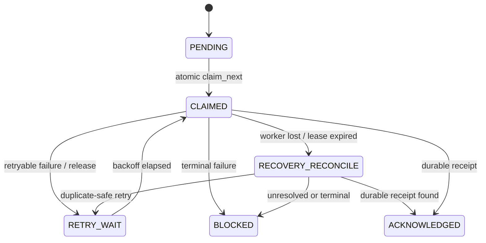

`RECOVERY_RECONCILE` is a recovery phase; the baseline persisted enum retains the claim until its outcome is resolved.

| Conditional operation | Required ownership semantics |
| --- | --- |
| `claim_next(filter?)` | Atomically select pending/due retry item and persist a fresh claim token. |
| `renew_claim(id, token, extend_by)` | Only current owner may extend before expiration; return the renewed lease. |
| `list_claimed(filter?)` | Read unresolved/expired claims and persisted ownership without mutation. |
| `acknowledge(id, token, receipt)` | Accept only current ownership and matching durable receipt. |
| `release(id, token, retry_after, reason)` | Current owner returns a retryable item to delayed retry. |
| `block(id, reason, token?)` | A claimed item requires the current token; nonclaimed items need no claim token. |

Expiration is not proof of remote failure. Invalidate superseded ownership, reconcile the remote result, and prevent stale workers from acknowledging/releasing a replacement claim. Do not change `CLAIMED` to `PENDING` solely because time elapsed.

Migration to v2 stops all old workers, acquires exclusive ownership, preserves IDs/receipts/resume state, and resolves every unresolved claim before removing lease fields. If duplicate-safe recovery cannot be established, retain/block the record and report the integration gate. Importing a database must not silently discard historical ownership evidence.

## 15. Capacity, endpoint, health, and configuration detail

### 15.1 Capacity models and recording stop policy

```text
SpoolCapacity                   # one record per required backing volume
  backing_filesystem_id: string?
  filesystem_used_bytes: uint64
  filesystem_free_bytes: uint64
  filesystem_capacity_bytes: uint64
  spool_owned_bytes: uint64
  usage_ratio: float
  storage_warning: bool
  storage_full: bool

StoragePolicy
  warning_threshold: float
  stop_threshold: float
  reserved_finalize_bytes: uint64
  resume_margin_bytes: uint64

SpoolStats
  pending_count, blocked_count, acknowledged_count: uint64
  pending_bytes, blocked_bytes, spool_owned_bytes: uint64
  oldest_pending_age_ms: uint64?
  volumes: List<SpoolCapacity>
```

The section 7 configuration aliases are `warning_ratio`, `stop_ratio`, and `finalize_reserve_bytes`. They map to the policy fields above; do not configure both spellings independently. Measure filesystem usage/free bytes, not just the sum of queued files. Deduplicate accounting when producer and spool paths share a volume; monitor both volumes when they differ.

On warning, report `storage_warning` and continue only while headroom/reserve allow it. At the stop condition, runtime stops new chunks, finalizes all active affected sources within reserve, and then stops recording. The spool reports acceptance/capacity but never directly drives cameras. Other files, temporary staging, cross-volume copies, and finalization overhead count toward capacity. Threshold validation and the absolute reserve are separate checks.

### 15.2 Endpoint states and hysteresis

```text
ConnectivityState = OFFLINE | CONNECTING | ONLINE | DEGRADED
ConnectivityStatus
  endpoint_kind: artifact | live
  state: ConnectivityState
  last_success_at_ns: int64?
  consecutive_successes: uint64
  consecutive_failures: uint64
  last_error: ErrorInfo?
  next_retry_at_ns: int64?
```

| State | Evidence and policy |
| --- | --- |
| `OFFLINE` | Endpoint operations failed or are unavailable; stop new attempts until backoff/probe time, preserve recording/spool. |
| `CONNECTING` | A bounded endpoint handshake/retry is in progress; it does not imply media or uploads are already working. |
| `ONLINE` | The configured endpoint is usable, not merely that Ethernet/Wi-Fi is connected. Enable its permitted work. |
| `DEGRADED` | Endpoint remains partly usable but sustained loss/latency/quality thresholds are exceeded; reduce live quality when supported and throttle/pause backlog. |

Apply configurable consecutive-result thresholds or minimum stable intervals to avoid state flapping. A live failure and an artifact failure remain distinct; a combined status may summarize them but cannot gate both outputs indiscriminately. Observation of endpoint state carries no payload bytes and owns no queue.

### 15.3 Health snapshot

```text
SystemHealth
  overall_state: HEALTHY | WARNING | ERROR
  connectivity: List<ConnectivityStatus>
  feeds: List<FeedHealth>         # baseline AdapterHealth
  spool: SpoolStats
  artifact_transport: ArtifactTransportHealth
  stream_transport: StreamHealth
  active_session_id: string?
  last_error: ErrorInfo?

FeedHealth
  feed_id: string
  ready: bool
  recording_state: string
  source_ids: List<string>
  last_frame_at_ns: int64?
  recording_gaps: uint64
  last_error: ErrorInfo?

ArtifactTransportHealth
  ready: bool
  paused: bool
  active_artifact_id: string?
  bytes_transferred: uint64
  effective_limit_bps: uint64?
  last_error: ErrorInfo?

StreamHealth
  state: string
  active_channels: List<string>
  dropped_samples: uint64
  queue_bytes: uint64
  oldest_sample_age_ms: uint64?
  last_error: ErrorInfo?
```

At minimum expose feed errors/readiness, filesystem free/capacity bytes, spool-owned bytes, storage warning/full flags, pending count, per-endpoint state, live state, and last transfer error. Represent per-channel quality when several cameras are active. The snapshot must fit an SDK method or lightweight JSON/HTTP endpoint; it does not require a monitoring platform. State severity policy should identify which subsystem needs attention rather than obscuring a blocked feed behind a healthy network summary.

### 15.4 Configuration records and validation

```text
SystemConfig
  device_identity: DeviceIdentity
  feeds: List<FeedConfig>
  artifact_endpoint_ref: string
  live_endpoint_ref: string?
  credentials_ref: string
  spool_config: SpoolConfig
  recording_config: RecordingConfig
  upload_config: UploadConfig
  stream_config: StreamConfig?
  endpoint_policy: ConnectivityConfig

DeviceIdentity
  robot_id: string
  device_id: string?

FeedConfig                      # baseline AdapterConfig
  feed_id: string
  driver: string
  source_id: string?             # single-source shortcut
  vendor_options: map<string, scalar>
  conversion_policy: NATIVE | NORMALIZE_OPTIONAL | NORMALIZE_REQUIRED
  recording_profile: string?
  live_enabled: bool
```

Startup validation checks unique feed/source/channel identities, supported driver and native format versions, required recording/live capabilities, media compatibility, legal thresholds/reserve, supported backend integrity/idempotency, valid endpoints, and resolvable credential references. Missing required configuration fails early. Temporary remote unavailability is an operational condition and must not by itself disable valid local recording.

Keep vendor settings under the feed configuration and endpoint/protocol settings under outputs. Credentials stay external to artifacts, session metadata, and spool payload metadata. Use authenticated encrypted remote communication where supported by the selected endpoint/protocol, as required in the baseline. Persist only non-secret destination references in artifacts. No new auth scheme or cloud API is defined here.

## 16. Detailed failure semantics and critical coupling

### 16.1 Complete baseline failure matrix mapped to v2

| Failure / event | Classification | Owner and required response |
| --- | --- | --- |
| Network unavailable / timeout | Retryable | Runtime retains durable artifacts and uses endpoint-specific backoff. Live output suspends/drops expired data. |
| Remote 5xx / temporary endpoint failure | Retryable | Runtime keeps `PENDING`, records error/next-attempt time, and applies bounded backoff. This replaces baseline `RETRY_WAIT`. |
| Authentication / authorization failure | Operator/config error | Backend reports the error; runtime pauses the affected destination until credentials/policy recover, avoiding repeated bandwidth-consuming retries. |
| Checksum mismatch / corrupt artifact | Terminal data error | Spool/backend blocks the affected artifact and preserves evidence/bytes; never delete silently. |
| Upload stored remotely but ACK lost | Uncertain outcome | Backend reconciles or repeats with stable idempotent identity; local acknowledgement requires matching durable receipt. |
| Process crashes with active/claimed item | Recovery | Default v2 item stays pending; safe backend delivery resolves it. Imported baseline `CLAIMED` items follow section 14.7. |
| Duplicate client retry | Idempotency | Same producer identity returns same spool ID; same remote ID/content returns one logical remote artifact. |
| Spool warning threshold reached | Capacity warning | Spool reports warning; runtime may continue recording only while reserve remains. |
| Spool stop threshold reached | Capacity stop | Runtime stops new chunks, finalizes active sources within reserve, then stops affected recording. |
| Manual export interrupted | Maintenance failure | Retain local copies; no optional deletion until checksums and export manifest are verified. |
| Live network congestion | Live degradation | LiveOutput bounds memory/age, uses codec-aware drop/rate/quality policy, and creates no historical backlog. |
| Upload worker hangs / claim lease expires | Recovery / uncertain outcome | V2 enforces deadline and no overlapping replacement worker; preserve pending bytes and recover safely after ownership ends. Conditional lease mode fences stale token and reconciles before state change. |
| Live send queue reaches capacity | Backpressure | Return `DROPPED`/`BACKPRESSURE`, bound queue growth, and resume from decodable current media. |
| Backlog upload degrades live stream | Shared-uplink contention | Runtime applies aggregate active-transfer throttling or safe pause/cancel; output reports live degradation. |
| Non-UTC source requires wall-time correlation | Timing | Feed provides a valid `ClockAnchor` plus uncertainty when known; persist drift updates. Report unavailable correlation if mapping is absent. |
| Active/temp/other files fill backing volume | Capacity stop | Spool/runtime inspect actual filesystem free space on every required volume and preserve finalization reserve. |
| Receiver requests decoder refresh | Live control | LiveOutput translates signaling to channel-specific `KEYFRAME_REQUESTED`; feed/output-owned encoder requests supported refresh. |
| Native object still open / growing | Feed readiness | Keep it out of `ready()` and `put()`; wait for producer completion. |
| Unsupported proprietary format/version | Feed/config error | Reject with explicit format/version detail; do not change core transports or mislabel the data. |
| Feed metadata parse failure | Feed/data error | Preserve source, expose error, and never invent timing/schema. Native opaque fallback requires explicit policy and valid minimum metadata. |
| Optional conversion fails | Conversion error | Preserve original and report failure; native fallback only when policy permits. Required normalization remains blocked. |
| Multi-file bundle partially finalized | Feed readiness | Expose only immutable finalized members and preserve group/path metadata; do not publish completion until native completion and remote dependencies are satisfied. |

### 16.2 Critical failure points

| Critical point | Why it matters | Owner / mitigation |
| --- | --- | --- |
| Backing-volume exhaustion | Logical spool size omits active/temp/unrelated bytes and may miss another volume. | Spool measures each backing filesystem; runtime stops recording before reserve is breached. |
| False finalization | Growing payloads can be accepted as corrupt/inconsistent native data. | Feed proves native completion; spool verifies immutable size/checksum during acceptance. |
| Lost ACK and duplicate creation | Remote write can succeed without a client receipt. | Backend uses durable identity/idempotency or qualified reconciliation; runtime cleans up only after acknowledgement. |
| Abandoned ownership / stale worker | A replacement may race the old owner or leave an item stranded. | Exclusive default owner and bounded attempt lifecycle; conditional claim mode persists/fences tokens and reconciles. |
| Partial native bundle | Missing metadata/media can make a dataset unreconstructable. | Feed preserves paths and revision semantics; runtime/backend validate completion dependencies. |
| Shared-uplink starvation | Backlog can consume bandwidth needed for live latency. | Runtime enforces aggregate active bytes/second and stronger degradation pause. |
| Decoder desynchronization / lost control | Receiver can remain unable to decode after loss/reconnect. | LiveOutput routes refresh requests; codec-aware pipeline resends initialization and a fresh keyframe when available. |
| Unsupported vendor version | Silent interpretation errors can corrupt source meaning. | Feed validates versions/capabilities; core continues to treat payloads as opaque. |

### 16.3 Critical coupling boundaries

| Boundary | Allowed / required dependency | Dependency to avoid |
| --- | --- | --- |
| Feed → common artifact records | Map native object, bundle, identity, timing, format, and relative paths. | Vendor SDK imports or proprietary schema parsing inside spool/runtime/backend. |
| Feed → LiveOutput | Bounded current media and generic source/channel control events. | Camera callbacks owning remote protocol state; output owning device lifecycle. |
| Spool → backing filesystem | Durable bytes/state, immutability, real free space, crash recovery. | Logical-queue-only capacity checks or assuming producer/spool share one volume. |
| Runtime upload loop → backend | Select/order/rate work and consume classified results/receipts. | Backend selecting/deleting spool items or implementing a second scheduling policy. |
| Runtime endpoint observations → outputs | Enable/pause/degrade work based on endpoint evidence. | A global status flag suppressing a healthy independent endpoint or becoming another queue. |
| Session/source/timing → both paths | Explicit association across cameras, artifacts, packets, and native metadata. | Synchronization inferred from filenames, arrival order, or upload order. |
| Remote endpoint → backend | Durable identity, receipts, reconciliation, and protocol mapping. | Cloud APIs or response formats leaking into feeds/spool. |
| Status snapshot → all components | Read-only aggregation of readiness, storage, delivery, and quality. | Status reads controlling observed components or performing blocking probes. |

## 17. Detailed end-to-end flows

### 17.1 Online operation

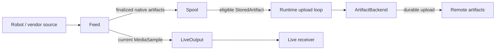

Online availability never bypasses the spool for recorded data. Capture/encoding may be shared before branching; receipt/retention state applies only to artifacts.

### 17.2 Offline operation

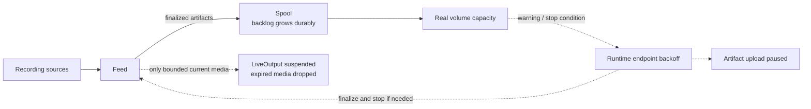

This diagram describes both endpoints unavailable. With only one unavailable, keep the healthy output working. All recording guarantees remain conditional on sufficient storage and producer retention/control.

### 17.3 Reconnect and recovery

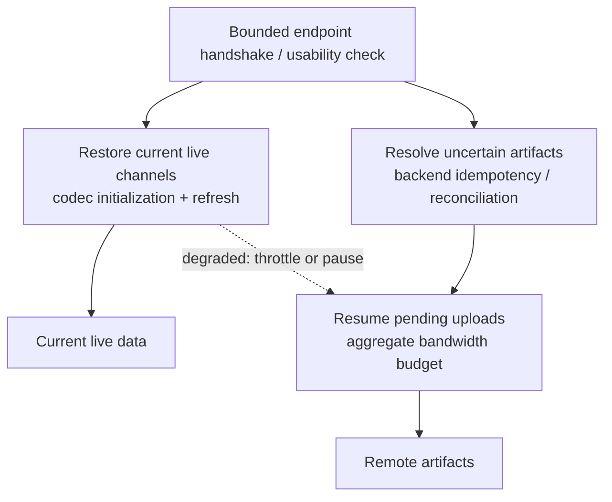

When both endpoints recover, give live restoration first opportunity, resolve uncertain artifact outcomes, then drain backlog under limits. Live handshakes are bounded; a failing live endpoint cannot hold artifact recovery indefinitely. Logical session/source IDs survive reconnect. No offline artifact is sent through the live packet interface.

### 17.4 Manual storage evacuation

```text
Operator selects export destination + artifact/group filter
-> Spool exports native/normalized payloads and identity/session metadata
-> Preserve group_id, relative_path, receipts and pending identities
-> Verify every destination checksum and export manifest
-> Confirm export with verification result
-> Optionally remove selected local bytes under explicit evacuation policy
```

Ordinary cleanup remains acknowledged-only. Export does not mark pending data acknowledged; re-import/resumed delivery must retain the same artifact and destination identities.

## 18. Repository mapping and class/function skeleton

### 18.1 Existing concepts to v2 owners

| Existing concept documented by the baseline | V2 mapping | Reuse / extension decision |
| --- | --- | --- |
| `LeRobotAdapter` | LeRobot `Feed` | Keep version-specific discovery and dataset interpretation here. |
| No generic recorded adapter equivalent | Common `Feed` recorded capability | Connect ROS2/MCAP, Trossen, and native bundles without core changes. |
| No generic live adapter equivalent | Common `Feed` live capability | Bind ROS topics or SDK callbacks to media handles/samples. |
| `Spool` | Concrete `Spool` | Reuse durable payload/metadata machinery; migrate schema/ownership explicitly. |
| `Runner` | `Runtime` in `runner.py` | Consolidate lifecycle, scheduling, recovery, endpoint policy, and status while delegating source/protocol work. |
| `VmodalTransport` | `ArtifactBackend` implementation | Reuse qualified reference SDK operations and preserve generic artifact/revision gates. |
| No live transport equivalent | `LiveOutput` | Add selected media/protocol implementation. |
| No connectivity-manager equivalent | Runtime endpoint observation/policy | No separate manager required. |
| Distributed status data | Runtime health snapshot | Aggregate read-only views; no independent health service. |

These mappings are design guidance from the local specifications, not a fresh code audit. They do not assert that proposed methods or vendor integrations are implemented.

### 18.2 Named models/classes/functions by file

| File | Models / classes | Operations / responsibility |
| --- | --- | --- |
| `contracts.py` | `Feed`, `FeedInfo`, `Session`, `Source`, `TimestampInfo`, `ArtifactTiming`, `ClockAnchor`, `ExternalArtifactRef`, `ArtifactInput`, `ArtifactBundleInput`, `StoredArtifact` | Shared source/data records and small extension contracts; no vendor imports. |
| `contracts.py` | `Receipt`, `UploadResult`, `ReconcileResult`, `StreamSession`, `StreamChannel`, `MediaSample`, `StreamPacket`, `StreamControlEvent`, `SendResult`, `ErrorInfo` | Delivery/live records; enums and immutable identity semantics. |
| `contracts.py` | `SpoolCapacity`, `SpoolStats`, `SystemHealth`, `FeedHealth`, `ConnectivityStatus`, `ArtifactTransportHealth`, `StreamHealth` | Read-only status/capacity records. |
| `adapters/files.py` | `FileFeed` | `open`, `start`, `ready`, `accepted`, `stop`, `close`; finalization helpers reused by native file feeds. |
| `adapters/rosbag.py` | `RosbagFeed` | Same recorded feed lifecycle; native bag completion and storage metadata. |
| `adapters/lerobot.py` | `LeRobotFeed` | Same recorded feed lifecycle; dataset version and completion dependencies. |
| `adapters/trossen.py` | `TrossenFeed` when needed | Reuse MCAP/file handling; add only Trossen-specific metadata/finalization. |
| `adapters/ros_camera.py` | `RosCameraFeed` | `open`, `start`, `ready`, `accepted`, `control`, `stop`, `close`; optional ROS dependency. |
| `adapters/vendor_camera.py` | Concrete vendor `Feed` | Same contract; native SDK/callback binding and capability declaration. |
| `adapters/__init__.py` | Feed factory table | Register concrete factories by name; import optional SDKs only for selected drivers. |
| `spool.py` | `Spool` | `put`, `next_ready`, `acknowledge`, `retry`, `block`, `requeue`, `get`, `list_pending`, `stats`, `cleanup`, `export`. |
| `runner.py` | `Runtime` | `start`, `pause_uploads`, `resume_uploads`, `recover_uncertain`, `set_limits`, `check_endpoint`, `status`, `stop`. |
| `transports/vmodal.py` | Concrete `ArtifactBackend` | `open`, `deliver`, `cancel`, `status`, `close`; private `upload`/`reconcile`/resume helpers. |
| `transports/live.py` | Concrete `LiveOutput` | `start`, `send`, `suspend_channel`, `resume_channel`, `status`, `stop`, `close`; internal registration/signaling/control callbacks. |
| `media.py` | Shared recording/live profiles | Established pipeline bindings for recording, teeing, encoding, quality, buffer lifetime, and codec-aware dropping. |
| `config.py` | `SystemConfig`, `FeedConfig`, `DeviceIdentity`, `StoragePolicy`, `SpoolConfig`, `RecordingConfig`, `UploadConfig`, `StreamConfig`, `ConnectivityConfig` | `validate`; resolve selected profiles and external config references. |
| `utils.py` | Shared utilities | Reusable filesystem, hashing, and path operations using project naming conventions. |
| `cli.py` | Thin Fire command wrapper | Run, status, flush/pause/export operations through runtime/spool APIs. |

This restores the baseline's named Python skeleton while keeping its many model, scheduler, connectivity, and health folders consolidated. Additional modules/classes are justified by actual implementation complexity, not by each logical record in the tables. Conditional `ClaimLease`/`ClaimedArtifact` models belong only to the explicit concurrency/migration design in section 14.7.

## 19. Expanded acceptance and scope checks

Apply section 10's executable scenarios plus the following baseline coverage checks:

| Acceptance area | Required demonstration |
| --- | --- |
| Generic recorded integration | At least one native ecosystem enters through `Feed` without edits to spool/backend/runtime state logic. |
| Proprietary native preservation | Single-file and multi-file examples retain bytes, format ID, group ID, native relative paths, and metadata. |
| Ecosystem fit | ROS2/rosbag2, versioned LeRobot, and Trossen-style outputs fit the same handoff; conversion remains optional. This is contract compatibility, not a claim of completed drivers. |
| Offline durability | Accepted recording survives network loss/process restart; unresolved active files are not falsely accepted. |
| Multi-camera association | Independent chunks retain session/source/timestamps and may share upstream capture/encoding. Multi-source native files remain single payloads. |
| Live source/control integration | Media binding supports bounded current data and generic keyframe/quality control. |
| Live reconnect | Current decodable channels resume without historical replay; backlog receives an enforced aggregate bandwidth budget. |
| Uncertain outcome | Lost ACK and abandoned default worker recover safely. Lease expiry/fencing tests are additionally required if the section 14.7 extension is enabled or migrated. |
| Capacity | Real producer/spool volumes and all active-source finalization reserve govern stop behavior. |
| New feed extension | A new proprietary integration requires no vendor branches in durable/live state machines. |
| Reviewable ownership | Each critical failure and coupling boundary in section 16 has an owner and observable outcome. |
| Design skeleton | Source, persistence, delivery, media, lifecycle, configuration, and status map to named files/classes/operations without implementing vendor SDK code in this document. |

The phase still does not choose a universal robot dataset format, require LeRobot/MCAP conversion, define final cloud routes, select the final live protocol, or implement vendor-specific drivers. Source-specific dependencies, final endpoint qualification, hardware throughput/latency, and exact policy values remain implementation/deployment work.


## 20. Complete numbered requirement ledger

All 100 numbered requirements from baseline revision 2.5 are represented below. **Retained** preserves the behavior with v2 owner/model names. **Adapted** states the replacement explicitly; it does not imply that baseline claim leases or separate managers are active in the default. These are normative v2 contracts, together with the detailed sections referenced for each group.

### 20.1 Scope and architecture

Detailed contract: sections 1, 11–12.

| Baseline ID | Disposition | V2 requirement |
| --- | --- | --- |
| ARC-01 | Retained | Native robot data formats shall be connected through explicit source/format adapters rather than vendor-specific logic inside Spool, ArtifactBackend, LiveOutput, or Runtime's endpoint policy. |
| ARC-02 | Retained | Recorded data shall pass through Spool before remote delivery, regardless of current connectivity state. |
| ARC-03 | Retained | The robot shall continue recording during connectivity loss while sufficient durable local storage remains available. |
| ARC-04 | Retained | Live delivery shall carry current data only. Historical/offline data shall be delivered through ArtifactBackend, not replayed through the live path. |
| ARC-05 | Retained | The core connectivity contracts shall not depend on one robot vendor, one recorded-data format, one cloud provider, or one live protocol. |
| ARC-06 | Retained | The logical separation between recorded and live paths shall not require duplicate camera capture or duplicate encoding. Implementations may share upstream capture and hardware-encoder resources when compatible. |
| ARC-07 | Retained | Format conversion is optional. A proprietary/native payload may be uploaded unchanged when the remote endpoint accepts it; normalization to MCAP, LeRobot, or another format belongs behind an adapter/converter boundary. |

### 20.2 Feed adapters and native formats

Detailed contract: sections 2, 12–14.

| Baseline ID | Disposition | V2 requirement |
| --- | --- | --- |
| ADP-01 | Retained | Vendor- or format-specific parsing shall remain inside an adapter. Core connectivity components shall treat payload bytes as opaque except for common size/checksum/timing/identity metadata. |
| ADP-02 | Retained | Adapters shall expose a stable format_id such as rosbag2/mcap, lerobot/v3, trossen/mcap, or vendor-x/log-v2. The core shall not branch on hard-coded vendor names. |
| ADP-03 | Retained | Native payload preservation is the default. Conversion may be enabled when required, but shall not be a prerequisite for spooling or uploading a supported native format. |
| ADP-04 | Retained | An adapter shall not expose an actively growing or incomplete native object as ready. Finalization semantics are defined by that ecosystem (closed bag, finalized dataset shard, closed episode file, vendor completion callback, etc.). |
| ADP-05 | Retained | Multi-file datasets/bundles shall be represented using group_id plus relative_path on member artifacts so remote storage can reconstruct the native layout without forcing one archive/container format. |
| ADP-06 | Retained | Adapters shall be selected through configuration/registration rather than changes to Spool or transport classes. Adding a new vendor format shall not require changes to the core durable or live state machines. |
| ADP-07 | Retained | If optional conversion fails, the adapter shall preserve the original native source unless policy explicitly permits otherwise; conversion failure shall not silently destroy the only source copy. |

### 20.3 Identity and artifact ownership

Detailed contract: sections 3, 13.

| Baseline ID | Disposition | V2 requirement |
| --- | --- | --- |
| DATA-01 | Retained | session_id shall remain stable across temporary network disconnects. A reconnect creates a new transport connection, not a new logical robot session. |
| DATA-02 | Retained | Camera identity shall be represented by source_id/channel identity. Camera-specific API methods such as send_left_camera() shall not be part of the core interface. |
| DATA-03 | Adapted | feed_id (the baseline adapter_id) identifies the feed that owns source interpretation; native_format_id identifies the source format when applicable. |
| DATA-04 | Adapted | source_path identifies producer-owned finalized bytes before acceptance. spool_ref identifies spool-owned durable bytes after successful put(); delivery shall read from spool_ref. |
| DATA-05 | Retained | artifact_id shall be stable across retries and process restarts and shall be used as the remote idempotency/reconciliation identity. |
| DATA-06 | Retained | Spool.put() shall be idempotent for the same logical finalized artifact. A repeated handoff after a lost local response shall return the same artifact_id rather than create duplicate spool records. |
| DATA-07 | Retained | format_id, group_id, and relative_path shall be preserved through spooling/upload so the remote side can retain or reconstruct native multi-file dataset layouts. |
| DATA-08 | Retained | Core spool/transport logic shall not require knowledge of the internal schema of a proprietary payload. Format-specific interpretation belongs to the adapter or remote consumer. |

### 20.4 Timing and synchronization

Detailed contract: sections 3, 11.5, 13.2.

| Baseline ID | Disposition | V2 requirement |
| --- | --- | --- |
| TIME-01 | Retained | All sources in the same session should be normalized to a common robot-side timestamp domain before data enters the spool or live transport when the source ecosystem provides sufficient timing information. |
| TIME-02 | Retained | Cross-source synchronization shall use timestamps and source identity, not file arrival order or upload order. |
| TIME-03 | Retained | Transport layers shall preserve source timestamps and shall not replace them with remote arrival time. |
| TIME-04 | Retained | When the session timestamp domain is not UTC_EPOCH and wall-clock correlation is required, Session shall provide a ClockAnchor that maps one source-clock instant to UTC. |
| TIME-05 | Retained | Long-running deployments may refresh ClockAnchor values when drift correction is required; relative cross-source synchronization shall continue to use the common source timestamp domain. |

### 20.5 Producer finalization and handoff

Detailed contract: sections 2, 4, 11.1, 14.1.

| Baseline ID | Disposition | V2 requirement |
| --- | --- | --- |
| PROD-01 | Retained | Only closed, immutable artifacts shall be admitted to Spool. |
| PROD-02 | Adapted | Before handoff, the feed/producer shall finalize byte length, checksum, time range when available, originating session_id, source_ids, and format_id. |
| PROD-03 | Retained | Video should be recorded in deployment-configurable chunks or finalized dataset shards rather than one unbounded file. |
| PROD-04 | Retained | Left and right camera artifacts may finalize independently and in parallel. They remain separate artifacts associated by session_id, source_id, timestamps, and optional group_id. |
| PROD-05 | Retained | After Spool.put() confirms durable acceptance, the adapter/producer may release its own temporary ownership/copy according to local policy. |
| PROD-06 | Retained | Large-file spool ingestion shall execute outside real-time camera capture callbacks/threads so durable handoff cannot stall frame acquisition. |
| PROD-07 | Retained | A conforming implementation shall not require a second encoder for live delivery when a compatible encoded stream can be shared. A media pipeline may tee or otherwise share capture/encoding resources before durable and live branches diverge. |
| PROD-08 | Retained | Chunk/file boundaries need not align across sources. Cross-source association shall use session/source/timestamps; format-specific manifests may be emitted as ordinary metadata artifacts when required by the native dataset format. |

### 20.6 Spool durability and ownership

Detailed contract: sections 4, 14.2, 14.7.

| Baseline ID | Disposition | V2 requirement |
| --- | --- | --- |
| SP-01 | Adapted | The default runtime shall hold exclusive spool ownership and run one upload worker, so two local workers cannot select/mutate the same artifact concurrently. A concurrency extension shall implement atomic claim_next() and ownership fencing as specified in section 14.7. |
| SP-02 | Retained | put() shall not return success until the spool-owned payload and spool state are durably committed. |
| SP-03 | Retained | Unacknowledged artifacts shall not be silently deleted by normal retention behavior. |
| SP-04 | Retained | Manual cleanup shall target acknowledged/safely disposable data by default. |
| SP-05 | Retained | Manual export shall follow copy -> checksum verification -> export confirmation -> optional local removal. Pending data shall not be removed before verification succeeds. |
| SP-06 | Adapted | Startup shall recover local durable state and preserve every unacknowledged outcome for duplicate-safe backend delivery. Imported unresolved CLAIMED items shall be exposed and resolved under section 14.7 before migration or any duplicate-prone upload. |
| SP-07 | Retained | put() shall define durability/immutability semantics, not a mandatory filesystem primitive. Byte copy, reflink, atomic move, or equivalent optimization may be used only when ownership, checksum integrity, crash durability, and source immutability are preserved. |
| SP-08 | Adapted | Default v2 has no claim lease: a failed/abandoned attempt stays PENDING and shall recover through qualified idempotent delivery/reconciliation. If lease mode is used, expiry is an uncertain remote outcome and shall be reconciled before duplicate-prone retry. |
| SP-09 | Adapted | The default shall prevent overlapping local owners through the spool lock and attempt lifecycle. Conditional lease mode shall persist claim tokens/ownership and reject stale workers' acknowledge/release operations. |
| SP-10 | Adapted | Neither an attempt deadline nor a conditional lease expiry proves remote failure. The backend shall resolve or safely classify the outcome; lease mode shall not silently change CLAIMED to PENDING solely on expiry. |
| SP-11 | Retained | Spool shall preserve format_id, group_id, and relative_path without requiring a parser for that native format. |

### 20.7 Storage capacity

Detailed contract: sections 8, 15.1.

| Baseline ID | Disposition | V2 requirement |
| --- | --- | --- |
| CAP-01 | Retained | warning_threshold and stop_threshold shall be evaluated against the backing filesystem/volume capacity and free space, not only logical spool-owned bytes. |
| CAP-02 | Retained | reserved_finalize_bytes shall cover all currently active recording sources plus an implementation safety margin. |
| CAP-03 | Retained | At stop_threshold for a storage volume required by recording/spooling, the controller shall stop starting new chunks, finalize active chunks that fit within reserve, and then stop recording until capacity becomes available. |
| CAP-04 | Retained | Spool reports capacity/acceptance state. It shall not directly control cameras or recording. |
| CAP-05 | Retained | The default policy shall not silently overwrite old unacknowledged robot data to make space. |
| CAP-06 | Retained | Backing-filesystem accounting shall include space consumed by active producer chunks, temporary files, spool data, and unrelated files on the same volume. |
| CAP-07 | Retained | source_path and spool_ref are not required to share a filesystem. If producer-active files and spool-owned files reside on different volumes, both volumes shall be monitored according to the operations that depend on them. |
| CAP-08 | Retained | StoragePolicy shall satisfy 0 <= warning_threshold < stop_threshold <= 1.0; reserved_finalize_bytes is an absolute byte reserve, not an additional ratio threshold. |

### 20.8 Artifact backend

Detailed contract: sections 5, 13.4, 14.3.

| Baseline ID | Disposition | V2 requirement |
| --- | --- | --- |
| TR-01 | Retained | A successful upload shall provide a durable acknowledgement before Spool marks the artifact ACKNOWLEDGED. |
| TR-02 | Retained | Upload attempts shall use stable artifact_id as an idempotency key where the remote endpoint supports idempotent creation. |
| TR-03 | Adapted | After a crash or lost acknowledgement, deliver() shall provide duplicate-safe recovery. The backend shall reconcile uncertain outcomes when using a reconciliation-based contract; imported unresolved claims follow section 14.7. Qualified remote idempotency may make separate lookup unnecessary. |
| TR-04 | Retained | A conforming implementation shall provide duplicate-safe recovery through remote idempotency, reconciliation, or both. Blind non-idempotent retry is not sufficient for lost-ACK recovery. |
| TR-05 | Retained | Resumable/multipart upload may be implemented when supported by the endpoint. Resume-state meaning remains transport-private. |
| TR-06 | Adapted | Transport credentials and endpoint configuration shall not be embedded in StoredArtifact. A non-secret destination_ref may be persisted to bind backlog to its original destination; its configuration/credentials are resolved externally. |
| TR-07 | Retained | Any resume state that must survive a process restart shall be represented as serialized bytes or another explicitly serializable token format. |
| TR-08 | Retained | ArtifactBackend shall transport native/proprietary artifacts without requiring format-specific decoding. Remote routing may use format_id and metadata. |

### 20.9 Runtime upload scheduling

Detailed contract: sections 5, 14.5.

| Baseline ID | Disposition | V2 requirement |
| --- | --- | --- |
| SCH-01 | Retained | After reconnect, live streaming shall receive priority over backlog upload. |
| SCH-02 | Adapted | Artifact backlog shall drain in the background under the configured aggregate bandwidth limits; concurrency is fixed at one in the default design. |
| SCH-03 | Adapted | The baseline's recommended metadata/control, telemetry, then video priority with oldest-first within a priority is retained as an optional runtime policy. V2 defaults to oldest eligible first across types. Either policy shall preserve equal camera priority and prevent indefinite starvation; dependencies remain ineligible until satisfied. |
| SCH-04 | Retained | Left and right camera artifacts shall have equal default priority. Upload order shall not define synchronization order. |
| SCH-05 | Retained | The scheduler should avoid indefinite starvation of lower-priority artifacts. |
| SCH-06 | Adapted | Startup shall complete local recovery and resolve imported uncertain claims before duplicate-prone retry. Default pending attempts shall pass through the backend's qualified duplicate-safe delivery contract; they are not blindly retried through a non-idempotent create API. |
| SCH-07 | Adapted | When live output is active, Runtime shall enforce an artifact-upload bandwidth budget on active traffic or safely pause/cancel backlog delivery, so it cannot consume the entire shared uplink. |
| SCH-08 | Adapted | When endpoint observations or LiveOutput report DEGRADED live operation, runtime policy should further throttle or temporarily pause backlog upload. OS/socket QoS may supplement this policy but is not required by the core contract. |
| SCH-09 | Adapted | max_upload_bps, when configured, shall limit aggregate bytes transferred by the artifact backend, including multipart traffic; limiting only new upload starts is insufficient. |

### 20.10 Live output

Detailed contract: sections 6, 13.5, 14.4.

| Baseline ID | Disposition | V2 requirement |
| --- | --- | --- |
| STR-01 | Retained | The interface shall support multiple logical channels without camera-specific methods. |
| STR-02 | Retained | A concrete implementation may map channels to one multiplexed connection or multiple connections; that choice shall not leak into the session model. |
| STR-03 | Retained | On network loss, live delivery shall stop/suspend. Missed data shall not accumulate in an unbounded LiveOutput queue. |
| STR-04 | Retained | After reconnect, live delivery resumes with current data. Historical/offline data remains the responsibility of ArtifactBackend. |
| STR-05 | Retained | Live buffering shall be bounded and send() shall report ACCEPTED, DROPPED, BACKPRESSURE, or DISCONNECTED when the transport cannot accept data normally. |
| STR-06 | Adapted | Where practical, LiveOutput should accept already encoded media and reuse it. Codec work belongs to the media-library pipeline, not custom protocol-layer codec implementations. |
| STR-07 | Retained | The default congestion policy should favor freshness over stale live video. Codec-aware dropping, rate reduction, or drop-until-keyframe behavior should be implemented in the media pipeline rather than arbitrarily discarding dependent encoded packets. |
| STR-08 | Retained | send() shall be non-blocking or bounded-time from the caller perspective; a saturated network path shall signal backpressure/drop status instead of propagating an unbounded memory queue. |
| STR-09 | Retained | Protocol-specific signaling shall remain inside the concrete LiveOutput. Actionable remote needs shall be translated into generic StreamControlEvent values rather than exposing protocol-specific signaling in the core interface. |
| STR-10 | Retained | When the selected live protocol requests decoder refresh or a newly connected receiver requires a refresh frame, LiveOutput shall emit KEYFRAME_REQUESTED for the affected channel so Feed's live capability/media pipeline can request an IDR/keyframe when supported. |

### 20.11 Endpoint connectivity

Detailed contract: sections 14.6, 15.2.

| Baseline ID | Disposition | V2 requirement |
| --- | --- | --- |
| CONN-01 | Retained | ONLINE shall mean the configured remote endpoint is usable, not merely that Wi-Fi/Ethernet exists. |
| CONN-02 | Retained | Connectivity state should use hysteresis or consecutive success/failure thresholds to avoid rapid state flapping. |
| CONN-03 | Adapted | Runtime's endpoint-observation policy publishes state and gates work; that policy shall not itself carry artifact bytes or live media. Actual delivery remains in ArtifactBackend and LiveOutput. |
| CONN-04 | Adapted | ONLINE enables work for the affected endpoint. OFFLINE suspends that endpoint's live delivery or new artifact attempts while Spool continues accepting finalized data; it shall not automatically disable a healthy independent endpoint. |
| CONN-05 | Retained | DEGRADED may keep live streaming active while throttling backlog upload or lowering stream quality when supported. |

### 20.12 Reconnect and recovery

Detailed contract: sections 5, 17.3.

| Baseline ID | Disposition | V2 requirement |
| --- | --- | --- |
| REC-01 | Retained | A temporary disconnect shall not create a new logical Session. |
| REC-02 | Retained | Backlog data shall never be replayed through the live-stream interface. |
| REC-03 | Adapted | On recovery, verify endpoint usability, give current live restoration first opportunity with a bounded handshake, recover uncertain artifacts through the backend, and resume backlog under limits. An unavailable live endpoint shall not indefinitely block a usable artifact endpoint. |
| REC-04 | Retained | Live traffic shall be protected from backlog saturation through enforced scheduler bandwidth/concurrency limits; DEGRADED live health may trigger stronger throttling or a temporary backlog pause. |

### 20.13 Health snapshot

Detailed contract: sections 8, 14.6, 15.3.

| Baseline ID | Disposition | V2 requirement |
| --- | --- | --- |
| HLTH-01 | Adapted | Runtime.status() and its health snapshot shall be read-only; reading or subscribing to status shall not directly control feeds, recording, outputs, or perform network probes. |
| HLTH-02 | Adapted | At minimum the snapshot shall expose feed readiness/errors, backing-filesystem free/capacity bytes, spool-owned bytes, storage_warning, storage_full, pending count, per-endpoint connectivity state, live state, and last transfer error. |
| HLTH-03 | Retained | The model shall be simple enough to expose through an SDK method or lightweight JSON/HTTP endpoint without requiring a separate monitoring platform. |

### 20.14 Configuration

Detailed contract: sections 7, 15.4.

| Baseline ID | Disposition | V2 requirement |
| --- | --- | --- |
| CFG-01 | Retained | Runtime configuration shall be external to the core interfaces and should be loadable from a simple YAML/JSON source. |
| CFG-02 | Retained | Adapter selection and vendor-specific options shall live in adapter configuration; core transport code shall not contain vendor dispatch logic. |
| CFG-03 | Retained | Credentials shall be referenced externally and shall not be stored in artifacts, session metadata, or spool payload metadata. |
| CFG-04 | Retained | Remote transports shall use authenticated encrypted communication where supported by the selected endpoint/protocol. |
| CFG-05 | Retained | Configuration shall be validated before startup so unsupported adapter/format versions, impossible storage thresholds, invalid endpoints, or missing credentials fail early. |

### 20.15 Code structure

Detailed contract: sections 9, 18.

| Baseline ID | Disposition | V2 requirement |
| --- | --- | --- |
| DES-01 | Adapted | Vendor-specific adapter modules may depend on their selected SDK/parser. Spool, runtime, backend, and common records shall use the shared contracts and shall not import proprietary SDK types. Source/media integration stays behind the feed or media profile boundary. |
| DES-02 | Adapted | The package structure shall stay small. Add files only when implementation complexity requires them; this phase requires no plugin framework, message bus, or separate service per module. |

## 21. Baseline section and block coverage

This map covers the original structural blocks as well as the numbered requirements. It records intentional consolidation so a missing service/class is not mistaken for missing behavior.

| Baseline block | Location in v2 | Treatment |
| --- | --- | --- |
| Document metadata, scope principle, normative language | Opening, sections 1, 20 | Native preservation and explicit required/recommended language retained. |
| Overview: integrated new camera feed | 11.1 | Full recorded/live branches, shared capture, identity, and upstream controls. |
| Overview: durable data exchange | 11.2 | Inputs, durable acceptance, receipts, results, status; default leases replaced explicitly. |
| Overview: live/control exchange | 11.3 | Current media, signaling translation, control owner, endpoint/status observations. |
| Overview: component coupling | 11.4, 16.3 | Dependency and observation boundaries retained with consolidated runtime. |
| Overview: identity/timing coupling | 11.5, 13.2–13.5 | Sessions, sources, clocks, artifact timing, channels, and packets. |
| 1. Scope and Design Position; 1.1 Normative language | Opening, 1, 20.1 | All ARC requirements retained. |
| 2. Target Integration Architecture and decision table | 1, 12.1 | All ecosystem inputs, optional conversion, opaque durable/live outputs, policy/status. |
| 3. Adapter descriptors/capabilities and both method tables | 2, 13.1, 14.1 | One Feed contract; full recorded/live operation mapping and capability detail. |
| 4. Reference integrations, four path blocks, source links | 12.2–12.6 | ROS2/MCAP/DB3, versioned LeRobot, Trossen, proprietary sources, optional conversion. |
| 5. Nine core interface/model responsibilities | 1, 14, 18.1 | All responsibilities mapped to five components and shared records. |
| 6. Session/source, clock, input/stored models | 3, 13.2–13.3 | Field-level records restored; source lists/clock IDs add explicit multi-source support. |
| 7. Handoff/finalization contract | 2, 4, 14.1, 20.5 | Immutable acceptance, ownership, chunks, timing, callbacks, shared encoding. |
| 8. Spool state diagram, lease records, operations | 4, 14.2, 14.7 | Default state model plus full conditional lease model and migration requirements. |
| 9. Capacity records and stop policy | 8, 15.1 | Real volume usage, both filesystems, thresholds, reserve, owner actions. |
| 10. Artifact transport statuses and full method table | 5, 13.4, 14.3 | Backend delivery facade preserves initialization, upload/reconcile, cancel/status/close. |
| 11. Scheduler methods and priority/bandwidth policy | 5, 14.5 | One worker; baseline priority option and v2 default explicitly distinguished. |
| 12. Stream models, send/control enums, method table | 6, 13.5, 14.4 | All channel lifecycle and control behaviors retained; device hot-plug remains optional. |
| 13. Connectivity enum and method table | 14.6, 15.2 | Per-endpoint runtime state, hysteresis, checks, optional subscriptions. |
| 14. Reconnect ordering and traffic protection | 5, 17.3 | Live first opportunity, duplicate-safe recovery, bounded backlog; independent endpoint failure handled. |
| 15. Health model and method table | 14.6, 15.3 | Full read-only snapshot, minimum metrics, optional callbacks. |
| 16. Configuration/security model and rules | 7, 12.6, 15.4 | Config records, conversion policies, credentials, encrypted/authenticated transport, validation. |
| 17.1 Detailed failure matrix | 16.1 | All 22 baseline events mapped to explicit v2 owners/actions. |
| 17.2 Critical failure points | 16.2 | All eight critical risks and mitigations retained. |
| 17.3 Critical coupling issues | 16.3 | All eight dependency boundaries retained and adapted. |
| 18. Online, offline, reconnect, evacuation flows | 17.1–17.4 | All four end-to-end blocks restored. |
| 19. Current repository mapping | 9, 18.1 | Existing LeRobotAdapter/Spool/Runner/VmodalTransport and missing capabilities mapped. |
| 20. Folder tree, class/model/method table, DES rules | 9, 18.2, 20.15 | Consolidated tree and named method skeleton; no vendor implementation code. |
| 21. Phase 1 acceptance criteria; 21.1 Out of scope | 10, 19 | All acceptance areas and phase exclusions retained, with default/conditional distinctions. |

Documentation impact: only this v2 proposal is expanded. The baseline remains unchanged. Its component names appear here as explicit mappings or conditional baseline references, not competing default owners. Neighboring integration/MVP documents remain references for the unresolved implementation and cloud qualification gates.
