# ROS Robot Video Upload SDK — Flow Diagrams v1

Date: 2026-09-05
Status: Proposed architecture companion
Source of truth: [`01_prop_v1.md`](01_prop_v1.md)

## 1. Purpose and diagram index

This document turns the architecture proposal into focused implementation and maintenance flows. It describes the target design; it does not claim that the Rust crates or C++ compatibility shims already exist.

Conventions:

- Solid arrows carry data or required control.
- Dashed arrows show optional paths, references, or fallback integration.
- `RawVideoFrame`, `EncodedVideoPacket`, and `MediaObject` are the only media payload contracts inside the Rust core.
- Non-video ROS data remains serialized in the rosbag2/MCAP sidecar.
- In dependency diagrams, `A --> B` means **A depends on B**.
- Every video source selects exactly one ingestion mode: `mini_batch` or `stream`.
- `mini_batch` writes five-minute local files and asynchronously uploads only closed files through the spool.
- `stream` sends continuously through a bounded handoff and does not create local batch files on its normal path.

| Area | Diagrams |
|---|---|
| Interface with input data | System context, input routing, ROS image mapping, source activation and mode selection |
| Internal component flow | Runtime failure domains, public lifecycle, observability correlation |
| Data transformation | Media-path selection, canonical transformations, original/normalized lanes |
| Code dependencies | Rust crate graph, external libraries, C/C++ compatibility boundary |
| Reliability | Mini-batch spool/upload, stream sessions, crash recovery, pressure handling, format changes |
| Maintenance | Change-impact routing, new-adapter workflow, verification gates |

## 2. Interface with input data

### 2.1 System context

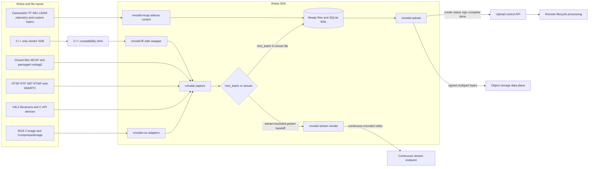

Maintenance rule: media inputs terminate at `vmodal-capture`, then the configured mode routes them either to the mini-batch spool or continuous stream sender. Telemetry terminates at MCAP. Capture adapters do not call upstream APIs directly.

### 2.2 Input routing into canonical contracts

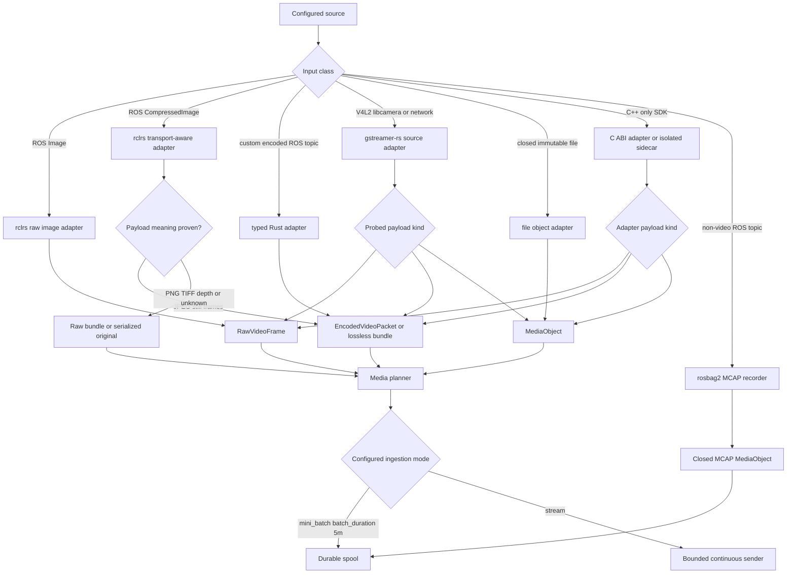

The adapter must reject an input if it cannot prove frame, packet, or complete-object boundaries. An unknown format name alone is not a reason to reject a safely bounded original object. `stream` additionally requires a continuously sendable frame/packet contract; complete objects and MCAP sidecars use `mini_batch`.

### 2.3 ROS image and calibration mapping

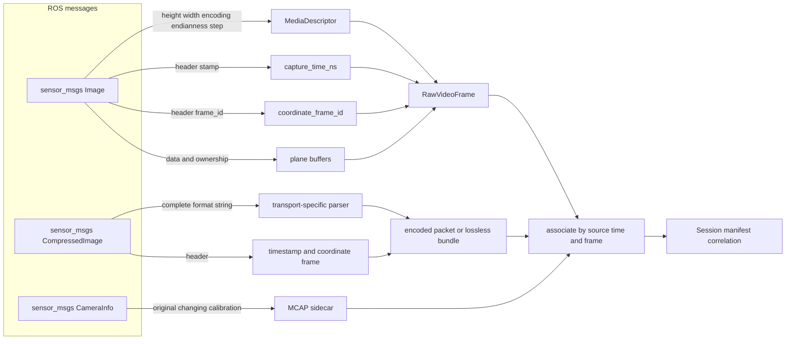

The coordinate `frame_id` is never reused as an image sequence number. `CameraInfo` remains time-varying ROS data rather than a single frozen field in the media descriptor.

### 2.4 Source configuration and atomic activation

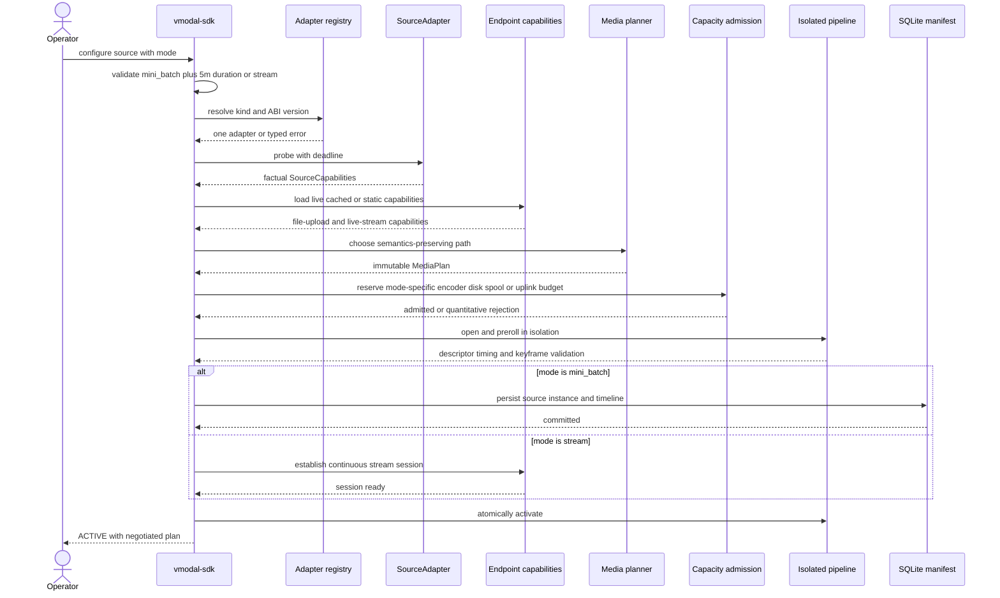

Any failure before activation destroys the candidate pipeline, releases its reservation, and leaves existing sources running.

## 3. Internal flow between components

### 3.1 Runtime processes and failure domains

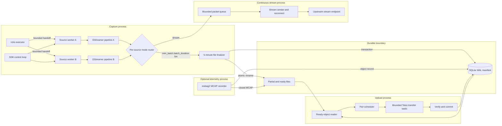

In `mini_batch`, only immutable files and manifest state cross into upload processing, so restarting the uploader does not interrupt capture. In `stream`, the bounded packet handoff is intentionally non-durable: sender/network stalls invoke the configured drop-or-stop policy instead of growing memory or writing an implicit batch file.

### 3.2 Public SDK lifecycle

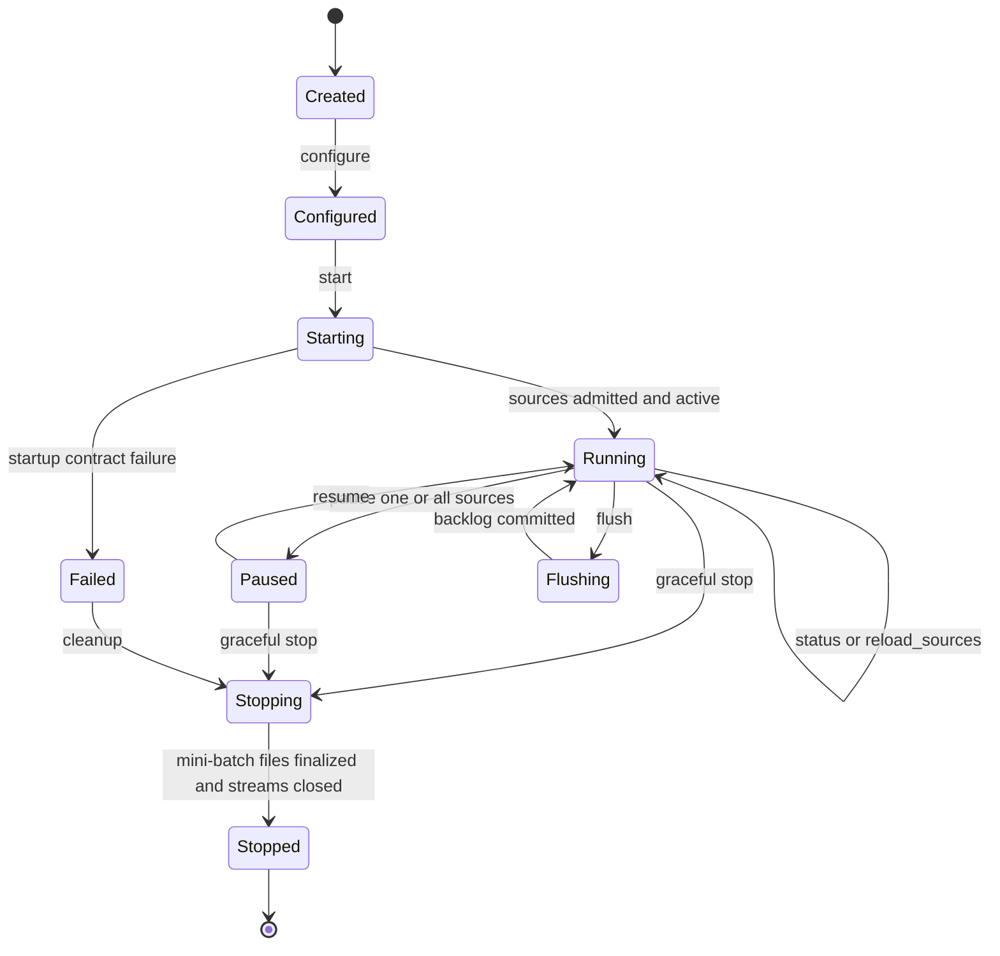

The C/C++ lifecycle facade forwards these operations to the Rust API. It does not create a second lifecycle implementation.

### 3.3 Observability and correlation

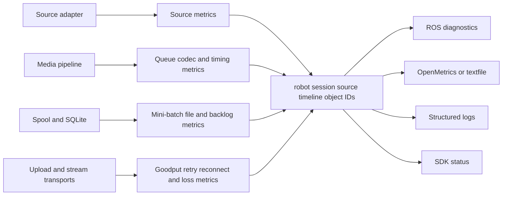

Every alert includes source, timeline, and ingestion mode. Mini-batch alerts also correlate to a spool/remote object ID; stream alerts correlate to the upstream session and lost time interval.

## 4. Data transformation flows

### 4.1 Media-path selection

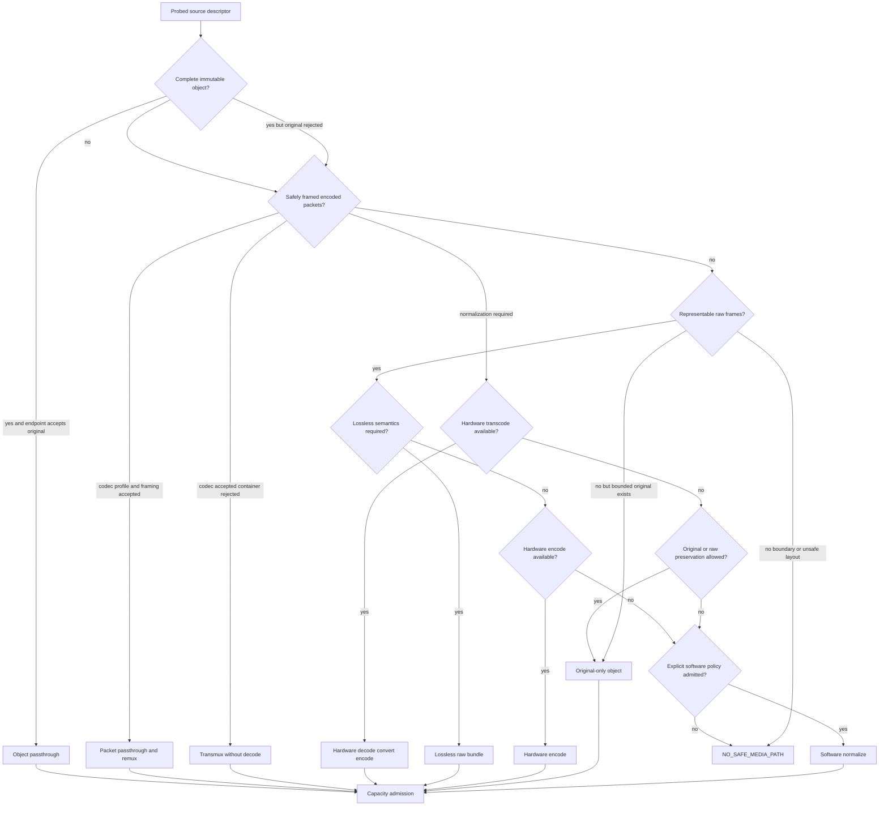

Semantic preservation is evaluated before cost. Among semantically valid choices, prefer object passthrough, packet passthrough, zero-copy hardware, bounded-copy hardware, raw bundle, then software processing.

### 4.2 Ingestion mode routing

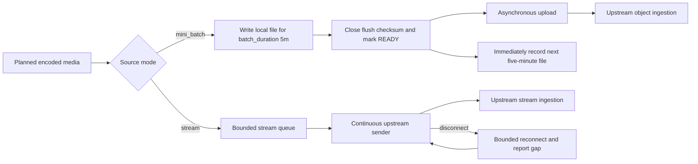

The modes are mutually exclusive for one source pipeline. `mini_batch` never uploads a growing file; `stream` never waits for a five-minute boundary. An automatic, silent fallback between modes is forbidden.

### 4.3 Canonical transformation paths

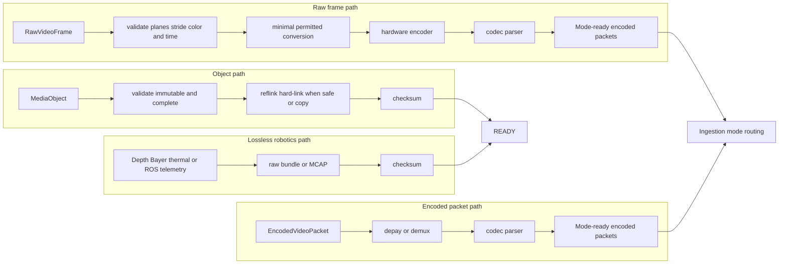

The encoded path never inserts a decoder unless the selected immutable `MediaPlan` explicitly names a transcode path. Frame/packet outputs proceed to the mode router: `mini_batch` muxes them into a five-minute file, while `stream` forwards them continuously. Complete objects and sensor bundles proceed directly to the mini-batch spool.

### 4.4 Original and normalized derivative lanes

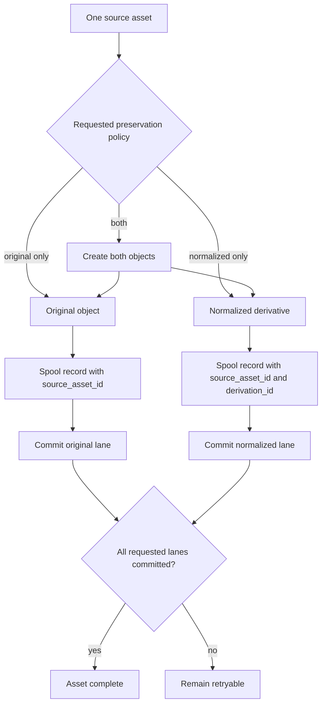

This object-commit flow applies to `mini_batch`. Committing a normalized derivative must never mark the original lane complete when both were requested; `stream` uses its live session state instead.

## 5. Code structure dependencies

### 5.1 Rust crate dependency graph

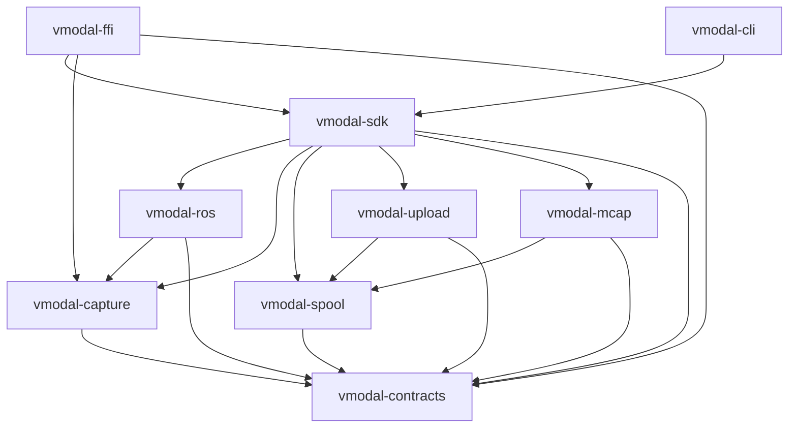

Required rules:

- `vmodal-contracts` is the dependency leaf and owns no ROS, GStreamer, database, network, or C++ types.
- `vmodal-sdk` is the orchestration facade; lower crates never depend back on it.
- `vmodal-ffi` depends on the Rust core. The Rust core never depends on the compatibility facade.
- `vmodal-ros` implements source adapters against the trait owned by `vmodal-capture`; `vmodal-capture` does not depend on ROS.
- A dependency cycle is an architecture failure, not something to resolve with global state.

### 5.2 External library containment

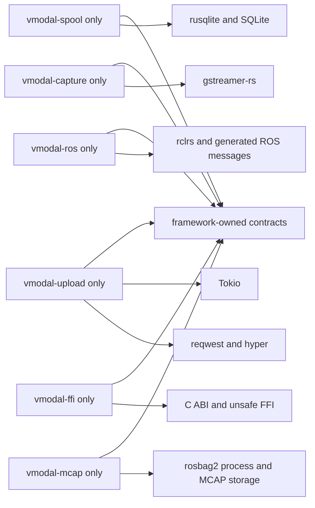

This containment allows an external library to be replaced without changing `vmodal-sdk` signatures or persisted media contracts.

### 5.3 Repository and service coupling

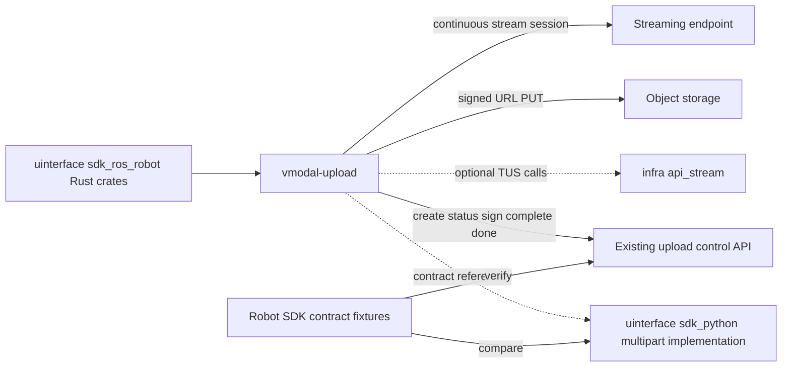

`sdk_python` is the mini-batch upload-contract reference, not a runtime dependency. Route or payload changes must update the Rust file transport and its fixtures in the same change. Stream-session contracts are validated independently against the selected streaming endpoint.

### 5.4 C/C++ compatibility boundary

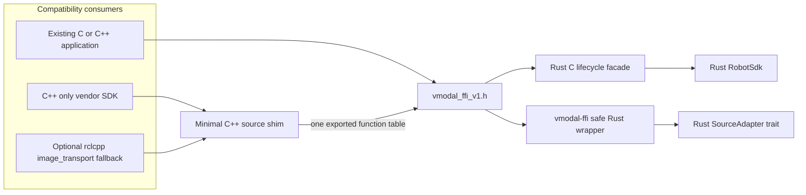

Only opaque handles, fixed-width fields, byte slices, explicit lengths, synchronization handles, typed status codes, and release callbacks cross the boundary. No C++ exception or Rust panic may unwind across it.

### 5.5 FFI buffer ownership

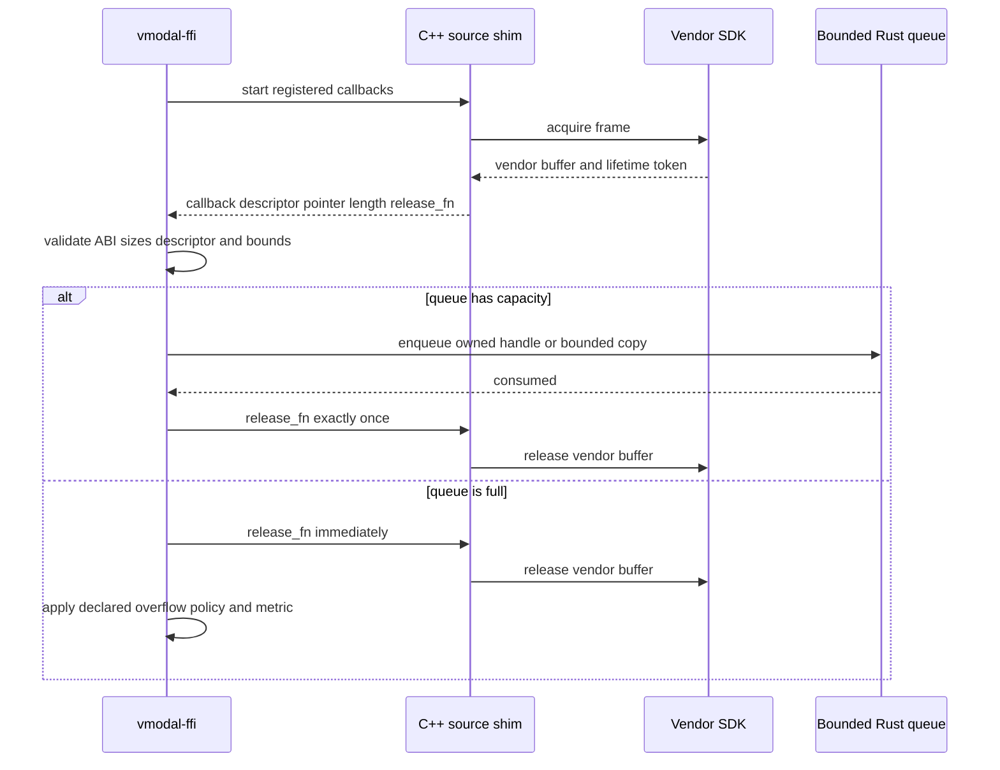

Every conformance test must prove release on success, rejection, cancellation, shutdown, and adapter error.

## 6. Reliability and lifecycle flows

### 6.1 Mini-batch spool-object state machine

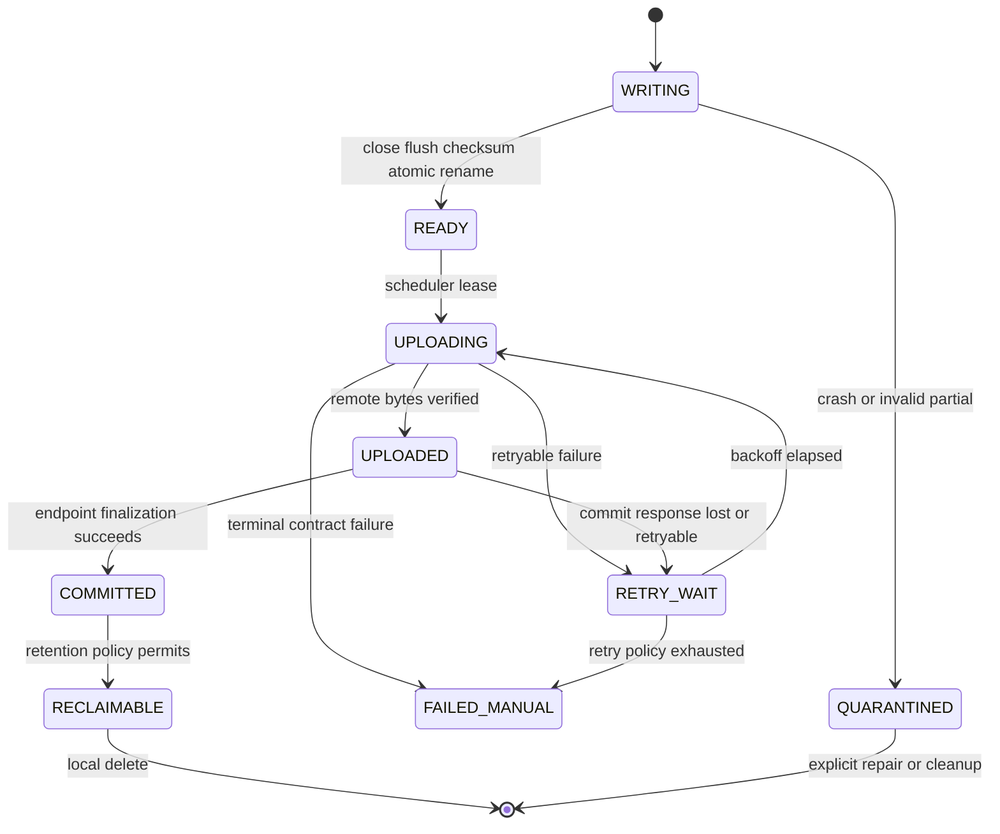

This state machine applies only to `mode: mini_batch`. Only `.ready` immutable five-minute files may enter `UPLOADING`; only remotely verified and finalized objects may enter `COMMITTED`.

### 6.2 Multipart upload control and data planes

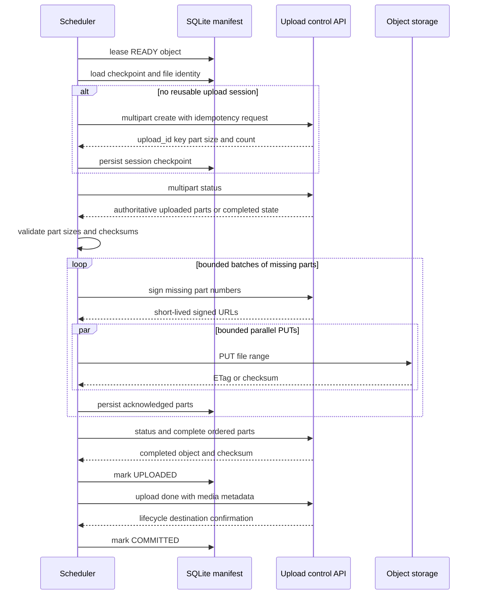

Media bytes bypass the API process. A lost response is reconciled from remote status rather than guessed from local state.

### 6.3 Continuous stream session

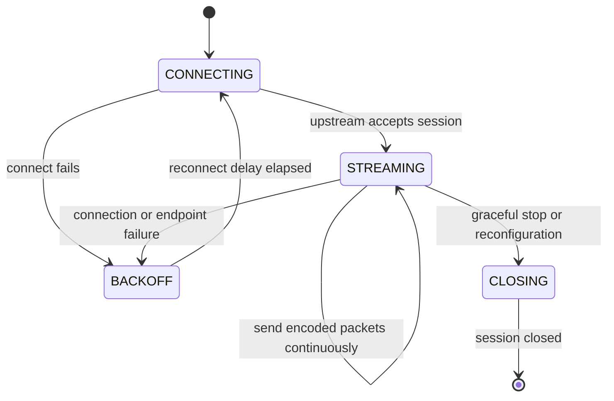

This state machine applies only to `mode: stream`. The sender uses a bounded queue while connecting or recovering. If the queue fills, it reports the exact loss interval or stops the source according to policy; it does not create an implicit local mini-batch file.

### 6.4 Crash and restart recovery

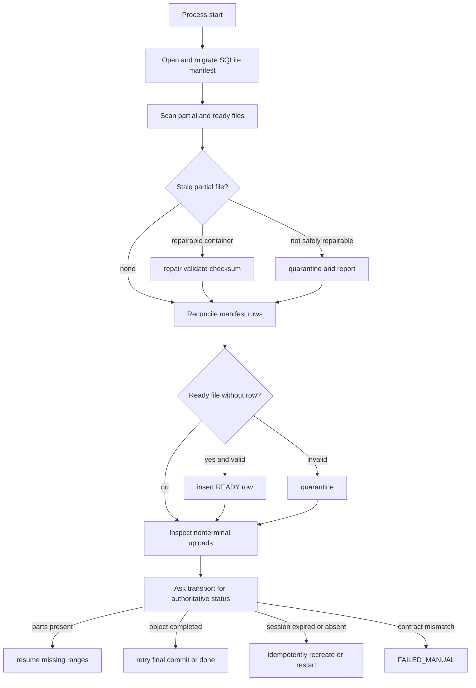

Recovery must never infer remote success solely from a local `UPLOADING` or `UPLOADED` row.

### 6.5 Backpressure and capacity exhaustion

```mermaid
flowchart TD
    SAMPLE[Periodic resource sample] --> MODE{Ingestion mode}
    MODE -->|mini_batch| HEALTHY{Disk spool and upload within budget?}
    MODE -->|stream| SHEALTHY{Uplink and stream queue within budget?}
    HEALTHY -->|yes| RUN[Continue capture and asynchronous upload]
    HEALTHY -->|no| DISK{Upload reads harming capture writes?}
    DISK -->|yes| REDUCE[Reduce upload concurrency]
    DISK -->|no| DRAIN{Network headroom available?}
    DRAIN -->|yes| INCREASE[Increase bounded upload concurrency]
    DRAIN -->|no| ADAPT{Adaptive quality authorized?}
    ADAPT -->|yes| LOWER[Close segment and activate lower profile]
    ADAPT -->|no| HIGH{Spool high watermark?}
    HIGH -->|yes| SHED[Reject or stop optional sources]
    HIGH -->|no| RUN
    SHED --> CRIT{Spool critical watermark?}
    CRIT -->|no| DEGRADED[Report degraded and predicted time to full]
    CRIT -->|yes| POLICY{Explicit terminal policy}
    POLICY -->|stop_capture| STOP[Stop affected source and finalize]
    POLICY -->|drop_oldest_uncommitted| DROP[Delete and count declared loss]
    POLICY -->|adaptive_quality| LOWER

    SHEALTHY -->|yes| SRUN[Continue streaming]
    SHEALTHY -->|no| SOVER{Adaptive quality authorized?}
    SOVER -->|yes| SLOWER[Start lower stream profile at safe boundary]
    SOVER -->|no| SPOLICY{Stream overflow policy}
    SPOLICY -->|reconnect_and_report_loss| SLOSS[Reconnect and count lost interval]
    SPOLICY -->|stop_source| SSTOP[Stop affected stream]
```

There is no implicit frame, file, packet, or oldest-file deletion. Every loss follows an explicit mode-specific policy and is counted by source, mode, and reason.

### 6.6 Disconnect and dynamic-format change

```mermaid
stateDiagram-v2
    [*] --> ACTIVE
    ACTIVE --> FINALIZING: source offline caps changed or timestamp regressed
    FINALIZING --> READY: mini_batch closes valid file
    FINALIZING --> STREAM_CLOSED: stream closes session and records gap
    FINALIZING --> QUARANTINED: mini_batch file cannot be recovered
    READY --> REPROBE
    STREAM_CLOSED --> REPROBE
    QUARANTINED --> REPROBE
    REPROBE --> REPLAN: new descriptor or source restored
    REPROBE --> BACKOFF: still unavailable
    BACKOFF --> REPROBE: reconnect deadline
    REPLAN --> READMIT: immutable new MediaPlan
    READMIT --> PREROLL: capacity reserved
    READMIT --> STOPPED: capacity or endpoint rejected
    PREROLL --> ACTIVE: keyframe timing and caps valid
    PREROLL --> BACKOFF: source path failed
```

Resolution, codec, profile, memory kind, clock domain, or ownership changes create a new descriptor revision and, when continuity is broken, a new timeline generation.

### 6.7 Graceful shutdown

```mermaid
sequenceDiagram
    actor Operator
    participant SDK
    participant Sources
    participant Pipelines
    participant Spool
    participant Upload

    Operator->>SDK: stop graceful with optional timeout
    SDK->>Sources: stop accepting new buffers
    SDK->>Pipelines: send EOS
    alt mode is mini_batch
        Pipelines->>Spool: finalize current five-minute file or raw bundle
        Spool->>Spool: flush rename ready and transact manifest
        SDK->>Upload: optionally flush committed backlog
        Upload-->>SDK: committed or durable resumable backlog
    else mode is stream
        Pipelines->>Upload: close continuous upstream session
        Upload-->>SDK: final stream status and reported gaps
    end
    SDK->>Upload: stop new leases and persist checkpoints
    SDK-->>Operator: stopped with backlog status
```

Shutdown may leave durable mini-batch `READY` or retryable objects, but it must not leave an object falsely marked committed. Stream shutdown closes the upstream session and does not invent a local recovery file.

## 7. Maintenance and verification flows

### 7.1 Where a change belongs

```mermaid
flowchart TD
    CHANGE[Requested change] --> TYPE{What changes?}
    TYPE -->|public lifecycle or status| SDK[vmodal-sdk]
    TYPE -->|canonical descriptor or persisted contract| CONTRACTS[vmodal-contracts]
    TYPE -->|ROS type QoS clock or calibration mapping| ROS[vmodal-ros]
    TYPE -->|source media path or GStreamer behavior| CAPTURE[vmodal-capture]
    TYPE -->|manifest migration recovery or retention| SPOOL[vmodal-spool]
    TYPE -->|file upload or stream protocol| UPLOAD[vmodal-upload]
    TYPE -->|raw bundle or rosbag2 lifecycle| MCAP[vmodal-mcap]
    TYPE -->|C caller or C++ vendor compatibility| FFI[vmodal-ffi and cpp_compat]

    CONTRACTS --> IMPACT[Run cross-crate compatibility impact]
    SPOOL --> MIGRATE[Add migration and crash fixtures]
    UPLOAD --> SYNC[Cross-check sdk_python and endpoint contract]
    FFI --> ABI[Preserve ABI or increment version]
    ROS --> DISTRO[Run every supported ROS distribution]
    CAPTURE --> CORPUS[Run format corpus and capacity tests]
```

Utility logic belongs in the lowest crate that owns its invariant. Do not duplicate contract parsing or state transitions in the CLI, ROS adapter, or C++ shim.

### 7.2 Adding a new source adapter

```mermaid
flowchart LR
    NEED[New source requirement] --> EXIST{Existing typed adapter?}
    EXIST -->|yes| CONFIG[Add configuration and fixture]
    EXIST -->|no| GST{Supported by GStreamer?}
    GST -->|yes| TEMPLATE[Add validated Rust pipeline template]
    GST -->|no| ROS{Generated ROS message available?}
    ROS -->|yes| RUST[Add typed Rust SourceAdapter]
    ROS -->|no| CAPI{Vendor C API available?}
    CAPI -->|yes| RUSTFFI[Add narrow Rust FFI binding]
    CAPI -->|no| CPP{C++ only and safe in process?}
    CPP -->|yes| CPPSHIM[Add minimal C ABI shim]
    CPP -->|no| SIDECAR[Add isolated sidecar]

    CONFIG --> HARNESS[Shared adapter conformance harness]
    TEMPLATE --> HARNESS
    RUST --> HARNESS
    RUSTFFI --> HARNESS
    CPPSHIM --> HARNESS
    SIDECAR --> HARNESS
    HARNESS --> RATE[Capacity and one-hour rate test]
    RATE --> MATRIX[Update generated capability matrix]
```

Uploader, spool, and canonical contracts should remain unchanged unless the new source exposes a semantic that the versioned descriptor genuinely cannot represent.

### 7.3 Contract-change impact

```mermaid
flowchart TD
    CONTRACT[Change in vmodal-contracts] --> VERSION{Backward compatible?}
    VERSION -->|yes| REV[Increment descriptor or schema revision]
    VERSION -->|no| MAJOR[Add new contract version and migration]

    REV --> ADAPTERS[All source adapters]
    MAJOR --> ADAPTERS
    REV --> MANIFEST[SQLite schema and migration]
    MAJOR --> MANIFEST
    REV --> UPLOAD[Endpoint metadata serialization]
    MAJOR --> UPLOAD
    REV --> FFI[C ABI size-versioned structures]
    MAJOR --> FFI
    REV --> DOCS[Proposal flow and endpoint docs]
    MAJOR --> DOCS

    ADAPTERS --> FIXTURES[Golden descriptor fixtures]
    MANIFEST --> FIXTURES
    UPLOAD --> FIXTURES
    FFI --> FIXTURES
    DOCS --> REVIEW[Cross-component consistency review]
    FIXTURES --> REVIEW
```

Unknown compatible fields must be preserved where the contract allows extensions; they must not be silently discarded by one adapter or FFI path.

### 7.4 Verification and release gates

```mermaid
flowchart LR
    BUILD[Build pinned Rust and optional C++ targets] --> UNIT[Crate unit tests]
    UNIT --> CONTRACT[Canonical and endpoint contract tests]
    CONTRACT --> ABI[C and C++ ABI tests]
    ABI --> CORPUS[ROS and media format corpus]
    CORPUS --> RECOVERY[Crash restart and network recovery]
    RECOVERY --> CAPACITY[One-hour mini-batch catch-up and stream reconnect capacity]
    CAPACITY --> SOAK[24-hour bounded-memory soak]
    SOAK --> MATRIX[Generate hardware capability matrix]
    MATRIX --> SECRET[Secret-detection release gate]
    SECRET --> RELEASE[Release artifact]

    DISTROS[Each supported ROS distribution] --> BUILD
    HARDWARE[Each supported hardware profile] --> CAPACITY
```

A release fails if any source silently drops archival data, any persisted state cannot recover, any C/C++ buffer leaks or double-releases, or the measured deployment lacks the required production headroom.

### 7.5 Documentation synchronization

```mermaid
flowchart TD
    CODE[Code or contract change] --> SUBJECT{Affected subject}
    SUBJECT -->|input format or ROS mapping| COMPAT[Compatibility tables and input diagrams]
    SUBJECT -->|crate boundary| DEPS[Package tree and dependency diagrams]
    SUBJECT -->|state or recovery| STATES[Spool recovery and shutdown diagrams]
    SUBJECT -->|endpoint protocol| UPLOAD[File-upload or stream flow and sdk_python cross-check where applicable]
    SUBJECT -->|C ABI| CPP[C++ part FFI diagrams and ABI tests]
    SUBJECT -->|capacity policy| PRESSURE[Admission backpressure and acceptance diagrams]

    COMPAT --> CHECK[Check proposal and flow document agree]
    DEPS --> CHECK
    STATES --> CHECK
    UPLOAD --> CHECK
    CPP --> CHECK
    PRESSURE --> CHECK
```

The proposal defines the contracts and decisions; this document visualizes them. Update both in the same change whenever behavior or ownership moves across a component boundary.
