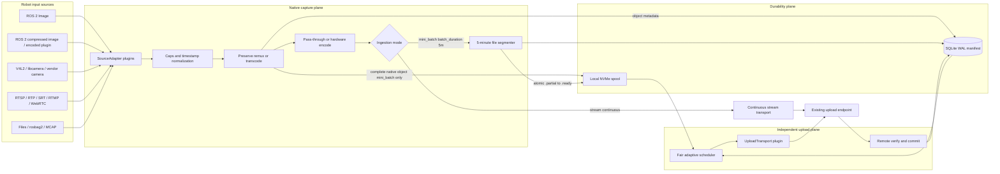
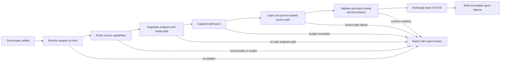

# ROS Robot Video Upload SDK — Architecture Proposal v1


Date: 2026-09-05
Status: Proposed
Primary constraint: maximum sustained input capacity without silent data loss

## 0. ROS robotics compatibility at a glance

### 0.1 Verdict and compatibility labels

**Verdict:** this architecture is workable for most standard ROS 2 robotics inputs, provided “support” is split into two deliberate paths:

1. Image/video data enters the native media path and becomes a playable segment, a lossless raw bundle, or an unchanged original object.
2. Other ROS topics—camera calibration, TF, IMU, LiDAR, radar, odometry, navigation, joint state, detections, and custom messages—remain timestamped ROS data in a synchronized rosbag2/MCAP sidecar.

This is an architecture assessment, not a claim that all rows are implemented in Phase 1. The compatibility labels used throughout this proposal are:

| Label | Meaning |
|---|---|
| `NATIVE_MEDIA` | A built-in source adapter can map the input into `RawVideoFrame`, `EncodedVideoPacket`, or `MediaObject` without changing its meaning. |
| `SIDECAR_MCAP` | The input is preserved as a serialized ROS topic in the synchronized rosbag2/MCAP sidecar; the media pipeline does not interpret it as video. |
| `BRIDGE_REQUIRED` | A supported ROS/Gazebo bridge or separate adapter process must first expose the input as a ROS 2 topic. |
| `PLUGIN_REQUIRED` | The type, memory ownership, or wire framing is vendor/package-specific and needs a `SourceAdapter` or recorder plugin. |
| `CONDITIONAL` | The architecture can carry the input, but actual operation depends on installed type support, transport/codec plugins, QoS compatibility, hardware, and endpoint capabilities. |
| `OUT_OF_SCOPE` | The SDK does not record this interface as an input, normally because it is a control-plane API rather than a timestamped data stream. |

The practical compatibility target is **standard topic data**, not every API of every ROS package. ROS services, actions, parameters, node lifecycle, and launch files are not capture inputs. An action’s ordinary feedback/status topics may be recorded, but replaying a bag does not recreate the original service/action server behavior.

Compatibility is qualified per supported ROS distribution. Message definitions and helper APIs evolve—for example, newer `sensor_msgs` releases add planar YUV encoding helpers that older releases do not contain—so Humble, Jazzy, Kilted, or another selected release must each have its own build and conformance result. Passing on Rolling alone is not a compatibility guarantee for an LTS deployment.


### 0.2 ROS systems and ecosystem compatibility

| System or producer | Typical interface presented to the SDK | Compatibility | Required integration and boundary |
|---|---|---|---|
| ROS 2 camera nodes and drivers | `sensor_msgs/msg/Image`, `CompressedImage`, `CameraInfo` and `image_transport` topics | `NATIVE_MEDIA` + `SIDECAR_MCAP`, `CONDITIONAL` | Images use the media adapter; calibration is preserved alongside them. Installed transport plugins, QoS, encoding, and runtime media capabilities are probed before activation. |
| ROS 2 `common_interfaces` producers | `sensor_msgs`, `geometry_msgs`, `nav_msgs`, `stereo_msgs`, `trajectory_msgs`, `diagnostic_msgs`, and related topics | `SIDECAR_MCAP` | Serializable topics are recorded losslessly as ROS data. Only image-like inputs selected as media sources enter the GStreamer path. |
| ROS 1 nodes and rosbag1 archives | ROS 1 image/common messages or `.bag` files | `BRIDGE_REQUIRED`, `CONDITIONAL` | Use a separate ROS 1 sidecar or a supported `ros1_bridge` host. Custom types require matching ROS 1/ROS 2 interface mappings built into the bridge. A rosbag1 file may be uploaded unchanged as `MediaObject`, but semantic replay/extraction needs ROS 1 tooling or conversion. |
| Gazebo Sim | Gazebo Transport messages exposed through `ros_gz_bridge` / `ros_gz_image` | `BRIDGE_REQUIRED` | Once bridged to standard ROS 2 topics, camera data follows the native media path and other sensor/state data follows MCAP. Direct Gazebo Transport ingestion is not built in. Preserve `/clock` and record using the selected simulation-time policy. |
| Nav2, MoveIt 2, and other ROS 2 stacks | Standard and package-specific ROS topics | `SIDECAR_MCAP`, `CONDITIONAL` | Camera topics remain native media; maps, plans, poses, trajectories, joint states, diagnostics, and custom stack messages remain ROS data. Custom interface packages/type support must be present where required for recording and replay. |
| Autoware and similar autonomy stacks | `sensor_msgs/Image`, `PointCloud2`, `Imu`, `NavSatFix`, standard geometry topics, and stack-specific messages | `NATIVE_MEDIA` + `SIDECAR_MCAP`, `CONDITIONAL` | Standard camera topics work through the normal image adapter. Point clouds and vehicle/perception messages remain in MCAP. Stack-specific media or zero-copy types need a plugin. |
| Cameras publishing standard ROS topics | RGB, mono, Bayer, depth, thermal, stereo images plus `CameraInfo` | `NATIVE_MEDIA`, `CONDITIONAL` | Standard CPU-backed `Image` messages map directly. Lossless raw-bundle preservation is the safe default for depth/Bayer/thermal data when a display codec would change semantics. Vendor controls and accelerated memory types may need a plugin. |
| ROS 2 type-adapted or vendor zero-copy pipelines | NITROS-like types, loaned buffers, CUDA/NVMM/DMABUF, or vendor message packages | `PLUGIN_REQUIRED` | A normal `sensor_msgs/Image` compatibility output can be subscribed to when available. Keeping zero-copy behavior requires an adapter that defines allocator, fence, and buffer-lifetime rules. |
| Non-ROS camera/network sources | V4L2, libcamera, RTSP/RTP, SRT, RTMP, WebRTC, files | `NATIVE_MEDIA` or `PLUGIN_REQUIRED` | These use the typed native/GStreamer adapters in section 6 and do not require conversion into ROS messages. |


Source:

  The assessment follows the official ROS common interfaces
  (https://github.com/ros2/common_interfaces), image message contracts
  (https://github.com/ros2/common_interfaces/blob/rolling/sensor_msgs/msg/Image.msg),
  rosbag2 behavior (https://github.com/ros2/rosbag2/blob/rolling/README.md), ROS 1
  bridge constraints (https://github.com/ros2/ros1_bridge), and Gazebo ROS integration
  (https://gazebosim.org/docs/harmonic/ros2_integration/).


### 0.3 Standard ROS input/message compatibility

| Input family | Representative ROS type or format | Compatibility | Canonical handling | Important condition |
|---|---|---|---|---|
| Raw camera image | `sensor_msgs/msg/Image` | `NATIVE_MEDIA` | `RawVideoFrame` | Preserve `header.stamp`, `header.frame_id`, dimensions, `encoding`, endianness, row `step`, and exact bytes. Encoding support is discovered, not guessed. |
| Compressed still image | `sensor_msgs/msg/CompressedImage` from `compressed_image_transport` | `NATIVE_MEDIA`, `CONDITIONAL` | JPEG frames may be wrapped as MJPEG without pixel decode when valid; JPEG/PNG/TIFF may otherwise be decoded for an explicitly admitted derivative or preserved losslessly in a bundle/MCAP | The message `format` string must be parsed according to the producing transport. `CompressedImage` is not assumed to contain an arbitrary video codec. |
| Compressed depth image | `sensor_msgs/msg/CompressedImage` from `compressed_depth_image_transport` using PNG or RVL | `NATIVE_MEDIA`, `CONDITIONAL` | Preserve as depth data in a lossless raw bundle and MCAP; optionally decode through the matching transport plugin | Never relabel compressed depth as ordinary PNG video or silently quantize it into a display codec. |
| Other image transports | Theora, Zstd, and third-party `image_transport` plugins | `PLUGIN_REQUIRED`, `CONDITIONAL` | Subscribe through the matching installed transport plugin, then map its declared ROS message type to raw frames, encoded packets, or a lossless bundle | Topic suffix alone is insufficient. Plugin and message type are discovered at runtime. |
| Camera calibration | `sensor_msgs/msg/CameraInfo` | `SIDECAR_MCAP` | Preserve the original message and index it by `source_id`, `header.stamp`, and coordinate `frame_id` | Calibration can change; do not copy only one startup sample into a static video descriptor. Image and `CameraInfo` frame IDs must agree. |
| Stereo/disparity | Left/right `Image` + `CameraInfo`; `stereo_msgs/msg/DisparityImage` | `NATIVE_MEDIA` + `SIDECAR_MCAP` | Isolated media source per selected image; calibration/disparity in MCAP or a dedicated lossless adapter | Preserve timestamps, optical frames, and left/right association. Do not silently mux unrelated timelines. |
| Depth, Bayer, thermal, scientific image | Standard `Image` encodings or vendor-defined encoding strings | `NATIVE_MEDIA`, `CONDITIONAL` | Raw frame when representable; otherwise lossless raw bundle/original lane | A normalized playable derivative is optional and must not replace a requested lossless original. |
| Point cloud and planar scan | `sensor_msgs/msg/PointCloud2`, `LaserScan`, `MultiEchoLaserScan` | `SIDECAR_MCAP` | Serialized ROS topic | These are robotics data, not video. Preserve fields/schema, coordinate `frame_id`, timestamp, and QoS metadata. |
| IMU, GNSS, environment, robot state | `Imu`, `NavSatFix`, `FluidPressure`, `MagneticField`, `BatteryState`, `JointState`, and similar `sensor_msgs` | `SIDECAR_MCAP` | Serialized ROS topic | Use source/acquisition timestamps when present and retain the original message unchanged. |
| TF, geometry, navigation, trajectory | `/tf`, `/tf_static`, `geometry_msgs`, `nav_msgs`, `trajectory_msgs` | `SIDECAR_MCAP` | Serialized ROS topic | Preserve `/tf_static` transient-local behavior, all frame IDs, and clock domain. QoS incompatibility must be observable. |
| Perception results and diagnostics | `vision_msgs`, `diagnostic_msgs`, markers, and package-specific detections | `SIDECAR_MCAP`, `CONDITIONAL` | Serialized ROS topic | The defining interface packages/schema must be available where required; do not flatten arbitrary messages into `side_data`. |
| Custom ROS 2 topic | Any discoverable serializable `.msg` type | `SIDECAR_MCAP`, `CONDITIONAL` | Generic rosbag2 serialized recording | Recording is broader than semantic interpretation. Replay/conversion still depends on the recorded type definition, serialization format, and available type support. |
| Encoded video ROS topic | Package/vendor H.264, H.265, AV1, or other packet message | `PLUGIN_REQUIRED` | `EncodedVideoPacket` | ROS common interfaces do not define one universal encoded-video packet contract. The adapter must map codec configuration, packet/access-unit boundaries, PTS/DTS, keyframes, and ownership explicitly. |
| ROS 2 recording file | Closed standalone MCAP or other rosbag2 storage file | `NATIVE_MEDIA` as an immutable original object; `CONDITIONAL` for topic extraction/replay | `MediaObject` and/or offline topic adapter | Topic extraction requires the corresponding storage/serialization plugins and message definitions where applicable. |
| ROS 2 recording directory | Closed rosbag2 directory containing metadata and one or more storage files | `PLUGIN_REQUIRED`, `CONDITIONAL` | Deterministic immutable package, or a future ordered object-set adapter | A mutable directory is not one `MediaObject`. V1 must package it into one immutable file; it must not upload only one member and report the whole bag complete. |

### 0.4 Exact ROS image-field mapping

The ROS image adapter must apply this mapping before a source can be reported as compatible:

| ROS field | SDK field or behavior |
|---|---|
| `header.stamp` | `capture_time_ns`; preserve the ROS clock domain and use an explicit fallback only when invalid |
| `header.frame_id` | `coordinate_frame_id`; never reuse it as an image sequence number |
| `height`, `width` | `MediaDescriptor.height`, `.width` |
| `encoding` | `MediaDescriptor.format_name` plus the lossless native field `ros:encoding` |
| `is_bigendian` | `MediaDescriptor.endianness` |
| `step` | Full row length in bytes. Validate total storage using the selected ROS distribution’s encoding definition; ordinary packed formats use `step * height`, while planar formats such as NV12/NV21 have an encoding-defined storage-height multiplier. Derive every plane offset/size and do not assume one tightly packed plane. |
| `data` | A lifetime-scoped plane buffer or one bounded ownership copy |
| paired `CameraInfo` | Original MCAP sidecar message associated by source, timestamp, and coordinate frame |

For `CompressedImage`, preserve `header`, parse the entire transport-defined `format` string, and retain it as `ros:compressed_format`. Derive codec/pixel-format fields only when the relevant transport specification or adapter proves the interpretation.

## 1. Executive decision

Build the SDK as a **Rust-first, capture-first ingestion pipeline** with exactly two per-source modes:

1. `mode: mini_batch` — record `batch_duration: 5m` of video to a local file, finalize it as an immutable spool object, and let a separate upload agent send that file upstream asynchronously. Capture of the next batch continues while prior files upload.
2. `mode: stream` — send encoded video upstream continuously through a streaming transport. This path does not wait for a local batch file to close and does not use the spool as its normal data path.

`mini_batch` is the durable store-and-forward mode. `stream` is the low-latency mode and depends on live uplink availability; its bounded queue and reconnect policy must be explicit because it cannot promise offline retention unless a separate, explicitly configured recording branch is added.

Rust owns the public SDK API, configuration, canonical media contracts, source planning, spool state machine, upload transports, and diagnostics. C++ is not a core process or public object model. It is restricted to a thin compatibility layer for a C++-only vendor SDK, a deployment where `rclrs` fails a required ROS-distribution gate, or an existing C++ application calling the Rust library through a versioned C ABI.

The mode router is the architectural center. In `mini_batch`, the durable local spool absorbs network outages and endpoint throttling, makes restart/resume deterministic, and prevents upload latency from propagating into ROS camera callbacks. In `stream`, a bounded streaming queue decouples callbacks from the network sender, but disconnected intervals are not recoverable from disk by default.

A new video source enters through a versioned Rust `SourceAdapter` trait. Standard ROS topics and GStreamer-supported devices/protocols require configuration only. A vendor-specific source adds an in-tree Rust adapter, a small C-ABI compatibility shim, or an isolated sidecar—not changes to the capture, spool, or upload core. Before activation, every source is probed, matched against endpoint capabilities, assigned an exact media path, and admitted against encoder, memory, disk, spool, and uplink budgets.

Format breadth is a separate requirement from source breadth. The SDK therefore accepts three canonical transfer forms: raw frames, encoded elementary-stream packets, and complete immutable media objects. It preserves the source-native object whenever possible and creates a normalized derivative only when the endpoint or downstream consumer requires one. This prevents the SDK's installed decoder/encoder set from becoming an unnecessary rejection boundary.



This design optimizes for aggregate ingest rate, source flexibility, recoverability, and low development cost from mature OSS. It intentionally does not make a cloud media proxy such as SRS or MediaMTX part of the required upload path.

## 2. Interpretation of “maximal capacity”

“Maximum” cannot be one fixed bitrate because the limit depends on the robot hardware, source formats, encoder availability, disk, uplink, and endpoint. In this proposal it means:

- Sustain the largest aggregate input bitrate the deployed hardware can receive and encode/remux.
- Support many concurrent sources without one source blocking the others.
- Avoid unnecessary decode, colorspace conversion, memory copies, and re-encode.
- In `mini_batch`, continue capture during temporary network or endpoint failure, subject to configured spool capacity.
- In `stream`, continuously forward video while connected and expose reconnects and any lost interval explicitly.
- Bound every memory queue. `mini_batch` backlog belongs on disk; `stream` never creates an unbounded in-memory backlog.
- Never silently discard archival data. If capacity is exhausted, report a typed degraded/fatal state and apply an explicit configured policy.
- Resume after process restart without uploading completed bytes again when the endpoint protocol permits it.
- Make the measured hardware envelope and overload behavior part of release acceptance.

The first bottleneck still wins. The active mode determines which resources are in the path:

```text
mini_batch_capacity = min(
  input_bus_capacity,
  memory_copy_and_encode_capacity,
  spool_write_capacity,
  spool_read_plus_write_capacity,
  uplink_capacity,
  endpoint_acceptance_capacity
)

stream_capacity = min(
  input_bus_capacity,
  memory_copy_and_encode_capacity,
  uplink_capacity,
  streaming_endpoint_acceptance_capacity
)
```

The SDK must expose measurements for every term rather than reporting only an end-to-end FPS value.

## 3. Findings from `info.md` and the repository

The source note correctly identifies several reusable ideas:

- Compress at the edge, preferably with hardware acceleration.
- Preserve capture timestamps across media conversion.
- Use bounded queues and avoid TCP head-of-line blocking for live preview.
- Treat ROS image QoS compatibility as an explicit integration concern.
- Use MCAP when the requirement is complete ROS telemetry capture rather than only a playable video.
- Keep protocol translation out of camera drivers.

However, the note combines three different products: archival upload, live teleoperation, and cloud ROS compute offload. They require different loss, latency, and retry behavior. The ROS upload SDK should therefore not select SRT, WebRTC, FogROS, SRS, or MediaMTX as a universal backbone.

Repository components that should be reused or mirrored are:

- [`sdk_python` multipart upload](../sdk_python/src/vmodal/resources/collections.py) already defines direct signed object-store upload, bounded file reads, per-part retries, concurrency, checkpoints, status reconciliation, completion, and a final `upload/done` step. It is the API-contract reference for the new SDK.
- [`sdk_python` robust upload specification](../sdk_python/docs/todo/upload_robust.md) documents the intended create/sign/status/complete/abort contract and the invariant that media bytes bypass the API process.
- [`infra/api_stream`](../../infra/api_stream/README.md) already offers authenticated TUS session creation and a resumable Python client, then feeds completed media into its existing Stream-to-R2 lifecycle.
- [`infra/api_stream` specification](../../infra/api_stream/docs/spec.md) already documents restart recovery, bounded upload concurrency, idempotent object placement, queue-based completion, and live recording behavior.
- [`sdk_smartglass`](../sdk_smartglass/docs/todo/specs_client.md) has useful bounded encoded-queue, codec-config, keyframe, timestamp, reconnect, and metrics patterns. Its deliberate “drop while disconnected” behavior is correct for live viewing but must not be copied into the archival path.

Two current constraints must be resolved by configuration rather than copied into the new core:

1. The current Python `video_upload()` implementation rejects files above 100 MiB even though its robust-upload design targets much larger multipart objects. V1 ROS segments can stay below the active client limit, but the core must learn the endpoint’s object/part limits during capability negotiation and must not hard-code 100 MiB.
2. The current `api_stream` final Stream-to-R2 copy is a single write and documents a sub-5-GiB object limit. TUS recordings sent through that path must be segmented below that limit unless the downstream copy becomes multipart.

## 4. Design principles

### 4.1 Two explicit ingestion modes

Every video source must select exactly one `mode`:

| Mode | Local behavior | Upstream behavior | Failure semantics |
|---|---|---|---|
| `mini_batch` | Write one local file per `batch_duration`; default and V1 operational value is `5m` | Upload each closed file asynchronously while the next file is recorded | Closed files survive process/network interruption and resume from the spool |
| `stream` | No batch file is created on the normal path | Send encoded packets continuously with bounded buffering | A network interruption triggers reconnect; packets that cannot fit the bounded queue are reported as lost and are not replayed |

`batch_duration` is required/defaulted to `5m` for `mini_batch` and is invalid for `stream`. Changing `mode` closes the active mini-batch file or streaming session at a safe codec boundary and starts a new timeline generation.

An optional local display or preview output is auxiliary; it is not a third ingestion mode and cannot replace the selected upstream path.

### 4.2 Capture and upload are separate failure domains

The capture process must not make endpoint calls. In `mini_batch`, its only coupling to the asynchronous upload process is a versioned spool-object manifest plus immutable files. In `stream`, encoded packets cross a bounded handoff to an independent stream sender, which owns the upstream connection and reconnect policy.

Consequences:

- Endpoint slowdown cannot block camera callbacks.
- The uploader can restart or be upgraded while capture continues.
- A robot may operate offline until the spool reaches its retention limit.
- Tests can load the uploader with generated files without running ROS or GStreamer.
- Tests can load the capture plane with a null endpoint and verify exact segment output.

### 4.3 Preserve encoded video

The default policy is `passthrough_if_accepted`:

- H.264/H.265/AV1 input is depayloaded and parsed, then remuxed without decoding if the endpoint accepts the codec and profile.
- Raw frames are encoded once with the best available hardware encoder.
- JPEG `CompressedImage` frames may be wrapped as MJPEG without pixel decode when framing, timestamps, and the endpoint permit it. PNG, TIFF, and compressed-depth payloads are decoded only for an explicitly permitted derivative; otherwise they are preserved in a lossless bundle/MCAP.
- Software encoding is an explicit fallback, never an unnoticed automatic choice.
- A complete file or source-produced segment may be uploaded unchanged even when the SDK cannot decode it, provided the endpoint accepts original/opaque media objects.
- An unsupported codec/profile produces a capability error only when neither safe original-object preservation nor an accepted conversion path exists.

This is the largest capacity multiplier in the design. Protocol conversion should normally be packet-level remuxing, not transcoding.

### 4.4 One isolated pipeline per source

Each source owns a GStreamer pipeline, encoder generation, timestamp state, mode state, and error state. A `mini_batch` source also owns its file sequence; a `stream` source owns its upstream session/reconnect generation. Multiple cameras are not muxed by default. This provides failure isolation and independent upload or streaming progress across sources.

### 4.5 Backpressure boundary follows the mode

In `mini_batch`, only short bounded queues exist before disk. A finalized immutable spool object is the unit of retry, scheduling, verification, retention, and deletion; a growing file is never uploaded. In `stream`, a bounded packet queue feeds the streaming transport directly. When that queue is full, the configured stream loss/stop policy applies immediately; data is never buffered without limit.

## 5. Proposed package architecture

```text
uinterface/sdk_ros_robot/
├── Cargo.toml                   # Rust workspace
├── Cargo.lock                   # pinned release dependency graph
├── package.xml                  # ROS/colcon package metadata
├── crates/
│   ├── vmodal-sdk/              # primary public Rust API
│   ├── vmodal-contracts/        # media, segment, source, and upload contracts
│   ├── vmodal-ros/              # rclrs subscriptions, QoS, clocks, diagnostics
│   ├── vmodal-capture/          # source planning and GStreamer lifecycle
│   ├── vmodal-spool/            # SQLite manifest, recovery, retention
│   ├── vmodal-upload/           # async file uploader and continuous stream sender
│   └── vmodal-cli/              # operator CLI
├── cpp_compat/
│   ├── include/vmodal_ffi_v1.h  # only stable non-Rust ABI; valid C and C++
│   ├── src/vendor/              # optional C++-only vendor SDK shims
│   ├── src/ros_fallback/        # optional minimal rclcpp source shim
│   └── CMakeLists.txt
├── launch/
├── config/
├── tools/
├── tests/
├── testdata/
├── install.sh
├── start.sh
├── env.sh
├── test.sh
└── cli.sh
```

Recommended ROS packages:

| Package | Language | Responsibility |
|---|---|---|
| `vmodal_robot_sdk` | Rust | Primary application interface and lifecycle ownership |
| `vmodal_video_capture` | Rust | `rclrs` source adapters, GStreamer pipelines, timestamp normalization, encoding, segmentation |
| `vmodal_video_spool` | Rust | SQLite manifest, file transitions, recovery, retention, disk pressure |
| `vmodal_video_upload` | Rust | Mini-batch async upload scheduler plus continuous stream sender/transports |
| `vmodal_video_msgs` | ROS interfaces | Start/stop/status controls and diagnostics only; never carries video payload |
| `vmodal_video_mcap` | Rust/launch | Lossless raw-frame bundles plus managed rosbag2/MCAP sidecar; enabled for the full robotics-capture profile and optional only for video-only deployments |
| `vmodal_cpp_compat` | C++ with C ABI | Optional vendor/ROS fallback shim; contains no spool, upload, policy, or configuration business logic |

Rust is the default for the hot path and the public interface. Use `rclrs`, `gstreamer-rs`, an async Rust HTTP client, and a Rust SQLite binding so source ownership, cancellation, retry state, and resource lifetimes remain in one language. Python may be used for tooling or an early endpoint-contract proof, but it must not sit between a high-rate source and the spool.

`rclrs` is isolated inside `vmodal-ros` because its upstream API is still evolving. Pin the Rust toolchain, `rclrs`/generated message versions, GStreamer bindings, and `Cargo.lock` for each supported ROS distribution. The public `vmodal-sdk` types must not expose `rclrs`, generated ROS, GStreamer, Tokio, SQLite, or HTTP-client types. If a target distribution cannot pass the Rust ROS gate, replace only `vmodal-ros` with the minimal `rclcpp` C-ABI shim; capture, spool, upload, and the public Rust API remain unchanged.

## 6. Source adapter architecture

### 6.1 Stable adapter boundary

Every source adapter produces one of three canonical payload contracts. The in-process interface is a Rust trait; the optional C++ compatibility layer maps its C ABI into the same trait. All three payloads use the same revisioned descriptor, so uncommon formats do not require fields to be added to the hot-path object one at a time:

```text
MediaDescriptor v1
  descriptor_revision
  media_class             # raw_video, encoded_video, media_object
  mime_type
  format_name             # pixel format, codec, or container name
  native_descriptor       # optional lossless string/map, e.g. serialized GstCaps
  width, height
  frame_rate_num, frame_rate_den, variable_frame_rate
  pixel_aspect_num, pixel_aspect_den
  sample_bits, stored_bits, endianness, packing
  planes[]
    offset_bytes, stride_bytes, size_bytes
  chroma_subsampling, chroma_site
  color_primaries, transfer_function, matrix, color_range
  interlace_mode, field_order, orientation
  view_count, multiview_mode
  hdr_metadata
  memory_kind             # CPU, DMABUF, CUDA, NVMM, VAAPI, vendor surface
  drm_fourcc, drm_modifier
  codec
    name, tag, profile, level, tier
    stream_format, alignment
    codec_config, config_revision
  container
    name, fragmented, seekable
  protection_scheme, encrypted
  tracks[]                # complete-object inventory when known
  extension_fields        # namespaced, size-bounded compatibility map

RawVideoFrame v1
  source_id
  source_instance, timeline_generation
  capture_time_ns
  receive_monotonic_ns
  frame_sequence
  coordinate_frame_id
  descriptor_revision
  synchronization_fence
  side_data               # bounded per-frame metadata, including dynamic HDR
  plane_buffers[]         # lifetime-scoped views; not serialized

EncodedVideoPacket v1
  source_id
  source_instance, timeline_generation
  track_id
  coordinate_frame_id
  capture_time_ns
  receive_monotonic_ns
  pts_ns, dts_ns
  duration_ns, time_base_num, time_base_den
  sequence
  descriptor_revision
  flags                   # keyframe, config, discontinuity, corrupt, eos
  temporal_layer, spatial_layer
  side_data               # bounded packet/frame metadata
  buffer_handle           # one encoded access unit or documented packet unit

MediaObject v1
  source_id
  source_instance, timeline_generation
  object_sequence
  capture_start_ns, capture_end_ns
  descriptor_revision
  immutable_path_or_handle
  size_bytes
  checksum_algorithm, checksum
  completeness            # complete_file or independently_bounded_segment
```

The descriptor is framework-owned, not a copy of a single multimedia API. Format, codec, container, and extension names are open, namespaced strings rather than closed enums, so an unknown `vendor:name` can be preserved without pretending it is understood. `native_descriptor` preserves information that the normalized schema does not yet understand, but it is not authoritative for cross-adapter behavior. Vendor, ROS, and GStreamer object types must not cross this boundary. Buffer lifetime, plane layout, memory kind, and per-buffer synchronization are explicit so zero-copy can be used where it is real and a bounded copy can be made where ownership requires it.

`MediaObject` is essential for maximum format acceptance and maximum throughput. It carries an already complete file or source-produced segment directly to the durable spool without demux, decode, or re-encode. It must never point to a growing or externally mutable file. An arbitrary continuous byte stream is not a `MediaObject`: it must first be safely framed by the source, parsed into `EncodedVideoPacket`, or rejected because blind byte splitting cannot guarantee recoverable objects.

The lifecycle boundary is also versioned:

```text
SourceAdapter v1
  descriptor() -> SourcePluginDescriptor
  probe(source_spec) -> SourceCapabilities
  open(source_spec, media_plan) -> OpenedSource
  start(media_sink, event_sink)
  pause() -> PauseResult
  resume()
  request_keyframe() -> RequestResult
  health() -> SourceHealth
  stop(graceful=true)
```

`probe()` must not start indefinite capture or publish frames into the live pipeline. `start()` emits exactly the payload kind selected by `MediaPlan`: `RawVideoFrame`, `EncodedVideoPacket`, or `MediaObject`; it never emits vendor objects. All methods must be cancellation-safe, and `stop()` must be idempotent.

Rust source adapters are compiled into the release binary or run as versioned sidecars; they are not loaded through an unstable Rust dynamic-library ABI. Out-of-tree C/C++ adapters use the single versioned C ABI in `vmodal_ffi_v1.h`. That boundary carries fixed-width scalars, byte slices, opaque handles, and explicit buffer-release callbacks only—never Rust containers, C++ STL types, ROS messages, GStreamer objects, exceptions, or allocator-owned objects.

### 6.2 Supported inputs

| Input class | V1 adapter | Capacity behavior |
|---|---|---|
| ROS 2 `sensor_msgs/Image` | Direct `rclrs` subscription to the raw/base topic feeding GStreamer `appsrc` | Raw path; compose with the camera driver when possible and use hardware encode |
| ROS 2 `sensor_msgs/CompressedImage` | Direct `rclrs` subscription to the resolved compressed topic | Preserve and parse the transport `format`; JPEG may use a no-pixel-decode MJPEG path, while PNG/TIFF/compressed-depth requires a lossless bundle or an explicitly permitted decode/normalize path |
| ROS 2 non-core `image_transport` payload | Type-specific Rust adapter when its message/framing contract is available; minimal C++ `image_transport` shim otherwise | Theora, Zstd, and third-party transports are accepted only after their declared message type, framing, and decode/pass-through behavior are identified; a topic suffix is not a media contract |
| ROS 2 `sensor_msgs/CameraInfo` | Synchronized rosbag2/MCAP sidecar | Preserve changing calibration keyed by source, acquisition timestamp, and coordinate frame; never treat it as video payload |
| ROS 2 non-image and custom topics | Generic rosbag2/MCAP recorder | Preserve serialized TF, IMU, point cloud, scan, odometry, joint, navigation, perception, diagnostic, and custom-topic data without forcing it through GStreamer |
| Custom encoded ROS topic | Rust `SourceAdapter` using its generated `rclrs` message type | Preferred ROS path for encoded camera drivers; use the C-ABI ROS fallback only when the target distribution fails the Rust gate |
| V4L2 / USB / CSI camera | Native GStreamer source | Bypasses ROS serialization; preferred for maximum device throughput |
| libcamera | Native GStreamer/libcamera source where available | Preserve DMA-backed buffers where the platform permits |
| RTSP / RTP | GStreamer source, depayloader, parser | Pass through compatible codecs; do not use `uridecodebin` by default |
| SRT / RTMP | GStreamer source and demux/depay | Useful for an upstream encoder or remote robot subsystem |
| WebRTC | Provider-specific signaling plugin plus GStreamer WebRTC | Not a generic URI; signaling remains adapter-owned |
| Local media file or explicitly packaged directory | File/object adapter producing one or more `MediaObject` values | Reflink/hard-link immutable files into the spool when safe; otherwise copy. A directory requires an ordered object manifest or deterministic immutable package; decoding is not required |
| rosbag2 / MCAP playback | ROS topic adapter or offline extractor | Deterministic replay and migration path |
| Vendor SDK / thermal / depth camera | Rust adapter for C APIs; minimal C++-to-C-ABI shim or sidecar for C++-only SDKs | Keeps vendor dependencies and C++ types out of the Rust core |
| Arbitrary GStreamer source | Validated pipeline-fragment adapter | Escape hatch for sources not yet represented by a typed adapter |

ROS 1 should be supported through a separate ROS 1 adapter process or the standard ROS bridge, not by mixing ROS 1 and ROS 2 dependencies into the capture binary.

### 6.3 How a new video source is handled — critical path

Adding a source is a staged operation. The SDK does not connect an unknown producer directly to the recording pipeline.



The existing sources continue running throughout probe, admission, and preroll. A rejected new source cannot consume their reserved encoder, memory, or disk budget after rollback.

#### 6.3.1 Extension ladder

Use the lowest-cost integration layer that satisfies the source:

| Source situation | Integration work | Examples | Capacity level |
|---|---|---|---|
| Existing typed adapter, new instance | Add one `sources[]` configuration entry | Another ROS image topic, V4L2 device, RTSP URL, local file | Highest reuse; no SDK code change |
| GStreamer-supported but not yet typed | Add a validated Rust `gstreamer-rs` pipeline template/configuration | Specialized RTP depayloader, unusual capture card | High; remains inside native GStreamer |
| New ROS message containing encoded video | Add a small Rust adapter using the generated `rclrs` message type | Vendor H.264 access-unit message | High when payload ownership/copy is controlled |
| New vendor SDK with C API | Generate or hand-write a narrow Rust FFI binding inside its adapter crate | Industrial or thermal-camera C SDK | Highest potential without adding C++ |
| New vendor SDK with C++-only API | Add a minimal C++ shim implementing `vmodal_ffi_v1.h` | ZED or another C++-only camera SDK | Compatibility path; no vendor/C++ type crosses the ABI |
| ABI, license, or runtime-incompatible SDK | Add an isolated adapter sidecar | Proprietary process-only SDK, ROS 1-only driver | Compatibility path; shared memory preferred over sockets carrying copied frames |

The generic GStreamer escape hatch is not a shell command. Configuration selects approved element factories and properties, or is validated before construction. A frequently used pipeline graduates to a typed adapter with a documented capability contract.

#### 6.3.2 Source registration

Every configured source has a stable logical `source_id` and a versioned `SourceSpec`:

```text
SourceSpec v1
  source_id
  kind                  # ros_image, ros_encoded, v4l2, rtsp, vendor:zed, ...
  locator               # topic, URI, device path, bag path, or plugin config
  mode                  # mini_batch or stream; required
  batch_duration        # mini_batch only; default 5m
  desired_streams       # video track(s) selected from the source
  qos_policy            # ROS sources only
  timestamp_policy
  media_policy          # preserve_original, passthrough, hardware, software_explicit
  quality_constraints   # resolution/FPS/bitrate bounds
  reconnect_policy
  overflow_policy
  plugin_options
```

Rules:

- `source_id` is unique within a robot session and becomes part of spool-object and remote idempotency keys.
- `mode` is exactly `mini_batch` or `stream`. `batch_duration` defaults to `5m` in `mini_batch`; setting it in `stream` fails configuration validation.
- `stream` requires a frame/packet path that the selected transport can send continuously. A complete `MediaObject`, raw bundle, or rotated MCAP sidecar uses `mini_batch` because it is transferred as a closed file.
- Credentials or opaque vendor handles stay inside the adapter; they never enter `RawVideoFrame`, `EncodedVideoPacket`, `MediaObject`, or the spool-object manifest.
- The source cannot select an upload path or remote object key.
- Unknown configuration fields and incompatible adapter ABI versions fail validation instead of being guessed. Unknown media formats may proceed only through a safely described raw-bundle/original-object path; they are never silently mapped to a known format.
- Changing the physical locator while retaining a logical `source_id` creates a new `source_instance` and timeline generation.
- A multi-track source is probed once, but each selected video track receives an isolated child source instance and pipeline; tracks are not silently combined.

#### 6.3.3 Probe and capability discovery

The adapter factory resolves `kind` to exactly one plugin and calls `probe()`. The result is factual, not aspirational:

```text
SourceCapabilities v1
  plugin_name, plugin_version, adapter_abi_version
  reachable
  stream_descriptors[]
    media_descriptor
    payload_kinds[]       # raw frame, encoded packet, complete object
    width, height, min_fps, max_fps, variable_frame_rate
    measured_or_declared_bitrate_bps
    has_keyframes, can_request_keyframe
    timestamp_domain, timestamp_quality
    dynamic_caps_possible
  can_pause, can_reconnect
  estimated_copy_bytes_per_second
  estimated_cpu_percent, estimated_gpu_percent
  required_hardware_blocks[]
```

Probe behavior by source type:

- ROS: resolve the topic/type, inspect publisher QoS and offered encoding, and sample only enough messages to validate caps and timestamp behavior.
- Device/vendor SDK: enumerate formats, frame rates, memory types, and hardware codec interoperability.
- Network URI: perform bounded connection/SDP/header discovery and identify tracks, codecs, clocks, and reconnect behavior.
- File/bag: inspect container, tracks, duration, timestamps, and mutability without decoding the entire file.

Probe has a deadline and cancellation token. It releases every file descriptor, subscription, device handle, and temporary GStreamer object before returning or transfers explicit ownership to `open()`.

#### 6.3.4 Media-path negotiation

The planner combines `SourceCapabilities`, endpoint capabilities, installed GStreamer elements, current hardware availability, and the requested ingestion mode. It first removes mode-incompatible paths—complete objects/raw bundles require `mini_batch`, while `stream` requires continuously sendable frames or packets—then chooses the first valid path in this order:

1. `object_passthrough` — upload a complete source-native file/segment unchanged; no multimedia processing.
2. `encoded_passthrough` — codec/profile/framing is accepted; depayload/parse/remux only.
3. `encoded_transmux` — codec is accepted but container/framing changes; no decode.
4. `raw_hardware_encode` — raw source enters an accepted hardware encoder with the smallest possible conversion.
5. `hardware_transcode` — decode/convert/encode with compatible hardware blocks.
6. `raw_bundle_preservation` — write unsupported, lossless, or non-display raw frames into bounded MCAP/frame-bundle objects; requires sufficient disk/uplink and content-agnostic endpoint storage.
7. `software_encode` — only when the source explicitly permits it and the capacity model accepts it.
8. `opaque_object_preservation` — preserve a complete source object even though the SDK cannot interpret it; requires an endpoint that advertises content-agnostic original-object storage.
9. Reject with `NO_SAFE_MEDIA_PATH` only when the SDK cannot establish safe object/packet boundaries, or the endpoint rejects every preserved and normalized representation.

The resulting immutable `MediaPlan` records every expected conversion and copy:

```text
MediaPlan v1
  source_id, source_instance, timeline_generation
  mode, batch_duration
  selected_track
  payload_kind, descriptor_revision
  input_descriptor, output_descriptor
  adapter_native_caps
  path_kind
  gstreamer_elements[]
  expected_memory_transitions[]
  encoder_name, encoder_session_count
  segment_container, segment_duration, segment_max_bytes  # mini_batch only
  preserve_original, create_normalized_derivative
  estimated_input_bps, estimated_output_bps
  raw_queue_bytes, encoded_queue_bytes
  reasons[]
```

The negotiated plan is visible in status and logs. The SDK must never silently replace a requested pass-through path with CPU encoding.

Endpoint capabilities may come from a live query, a still-valid cached response, or a versioned static deployment contract. For `mini_batch`, this permits deliberate offline capture. Its contract advertises original-object acceptance, normalized codec/container acceptance, MIME/extension restrictions, per-object size, multipart/chunk rules, metadata limits, and commit semantics. For `stream`, the contract advertises live protocols, codec/profile/framing, bitrate, latency, authentication, and reconnect behavior; activation must establish a usable live endpoint. A new format is not admitted unless the applicable mode contract proves a safe path.

#### 6.3.5 Capacity admission before activation

Admission is a reservation, not a warning. The manager calculates the incremental cost of the new `MediaPlan` and combines it with reservations for active sources:

```text
new_raw_memory = maximum_raw_frame_bytes * raw_queue_depth
new_encoded_memory = encoded_queue_max_bytes
new_spool_rate = mode == mini_batch ? estimated_output_bps / 8 : 0
new_offline_bytes = new_spool_rate * required_offline_seconds

admit only if:
  encoder_session_available
  AND cpu/gpu budget has production headroom
  AND memory_reserved + new_raw_memory + new_encoded_memory <= memory_budget
  AND (mode != mini_batch OR disk_write_reserved + new_spool_rate <= measured_safe_disk_write)
  AND (mode != mini_batch OR mixed_disk_io remains feasible during upload)
  AND (mode != mini_batch OR spool_retention remains feasible under the configured outage model)
  AND (mode != stream OR steady_uplink_goodput >= estimated_output_bps)
  AND endpoint source/object/concurrency limits are satisfiable
```

In `mini_batch`, uplink below the steady-state bitrate does not necessarily block capture when the spool is sized for offline operation, but status immediately reports negative drain rate and predicted time to full. In `stream`, steady uplink below the encoded bitrate fails admission because there is no disk backlog to absorb the deficit.

Admission failures are typed and quantitative, for example:

```text
ENCODER_SESSIONS_EXHAUSTED requested=1 available=0
DISK_WRITE_BUDGET_EXCEEDED requested=180MB/s available=145MB/s
SPOOL_RETENTION_UNSATISFIABLE required=1.4TB available=900GB
ENDPOINT_CODEC_UNSUPPORTED codec=h265 profile=main10
```

#### 6.3.6 Preroll and atomic activation

After admission, the manager builds the source in isolation:

1. Reserve its resource budget.
2. Call `open()` with the immutable `MediaPlan`.
3. For frame/packet paths, construct and preroll the GStreamer pipeline without publishing a `.ready` object. For `MediaObject`, validate completeness, immutability, readability, size, and checksum behavior without decoding it.
4. Confirm actual descriptor/caps match the plan.
5. Validate increasing timestamps or create an explicit timestamp-repair policy.
6. For encoded input that will be segmented, wait for codec configuration and a keyframe or request one.
7. For `mini_batch`, open a `.partial` file/bundle or stage the immutable source object and persist the source instance/timeline generation. For `stream`, establish the bounded sender and upstream session.
8. Atomically publish `ACTIVE` status and begin archival capture/import.

Any failure stops and destroys the candidate pipeline, releases the reservation, and leaves existing sources untouched. A partially opened file is removed or quarantined and cannot enter the upload queue; a partially opened stream session is closed.

#### 6.3.7 Runtime hot-add, update, and removal

`reload_sources()` computes a configuration diff:

- **Add:** probe, negotiate, admit, preroll, then activate the new source.
- **Remove:** stop accepting frames and send EOS; finalize and mark the current file `READY` in `mini_batch`, or close the upstream session in `stream`; then stop the adapter and release resources.
- **Metadata-only update:** apply without restarting media.
- **Mode, quality, or codec update:** close the current mini-batch file or streaming session, build a new `MediaPlan`, and start a new timeline generation.
- **Locator/driver update:** start a new `source_instance`; never append its packets to the previous instance’s open segment.

Hot-add does not renumber existing source segments. Upload ordering is per source, so a new source cannot reorder or block already captured data from another source.

#### 6.3.8 Source events and changing formats

An adapter reports typed events rather than modifying the pipeline behind the manager:

| Event | Required behavior |
|---|---|
| `SOURCE_OFFLINE` | Close/quarantine the current mini-batch file or close the stream session and report its gap; enter per-source reconnect and leave other sources active |
| `SOURCE_ONLINE` | Re-probe abbreviated capabilities, request/wait for keyframe, and begin a new timeline generation |
| `CAPS_CHANGED` | Close at a safe boundary, renegotiate and re-run admission before accepting the new format |
| `TIMESTAMP_REGRESSION` | Start a new timestamp generation or fail according to timestamp policy; never hide it |
| `KEYFRAME_MISSING` | Request a keyframe or reject the encoded path after a bounded deadline |
| `SOURCE_BACKPRESSURE` | Pause when supported; otherwise apply the explicit overflow policy and count loss |
| `DEVICE_REMOVED` | Release the device, retain source identity, and reconnect with bounded backoff |
| `ADAPTER_FATAL` | Stop only the affected source and retain all finalized spool data |

Resolution, FPS, codec, profile, and clock-domain changes must never occur silently inside one mini-batch file or stream session. V1 closes the current file/session at a safe boundary and increments `timeline_generation`.

#### 6.3.9 Source isolation and ownership

- Each adapter owns its source handles and releases them on all stop/failure paths.
- Each active source owns one pipeline and bounded queues; no shared unbounded fan-in exists.
- A vendor plugin that can crash the process or requires an incompatible runtime runs as a sidecar.
- Native plugins use references/DMABUF/vendor surfaces only for the documented callback lifetime.
- The core makes one bounded ownership copy when a buffer cannot safely outlive the callback.
- Preview consumers receive a branch after the archival ownership boundary and cannot retain capture buffers indefinitely.
- Per-source watchdogs detect no-data, stalled callback, stalled encoder, and stalled segment-finalization states independently.

#### 6.3.10 Adding a plugin: required deliverables

A genuinely new adapter is incomplete until it provides:

1. Plugin descriptor and versioned configuration schema.
2. `probe/open/start/stop/health` implementation.
3. Exact buffer-ownership and timestamp-domain documentation.
4. Supported codec/pixel-format/memory-kind table.
5. Deterministic fake source or recorded fixture.
6. Tests for invalid configuration, missing device, disconnect/reconnect, cancellation, and idempotent stop.
7. Dynamic-caps and timestamp-regression tests when the source can produce them.
8. Backpressure test proving bounded memory and the declared pause/drop/stop behavior.
9. One-hour rate test at 1.25× the declared production bitrate or source count.
10. Mini-batch file validation with `ffprobe`/GStreamer plus manifest/upload checks, and continuous-stream framing/reconnect validation.
11. Resource-leak test across repeated add/remove cycles.
12. A capacity report stating copies, encoder sessions, CPU/GPU load, memory, and maximum sustained input/output bitrate.

The conformance harness is shared by all adapters. It consumes the public `SourceAdapter` interface, so vendor tests do not duplicate capture, spool, or upload test logic.

#### 6.3.11 Examples

Adding another RTSP camera normally requires only configuration:

```yaml
sources:
  - id: loading_bay_camera
    kind: rtsp
    locator: rtsp://camera.example/primary
    mode: mini_batch
    batch_duration: 5m
    media_policy: passthrough
    timestamp_policy: preserve_with_monotonic_fallback
    reconnect_policy: continuous
    overflow_policy: stop_source
```

The RTSP adapter probes SDP, discovers H.264, verifies the endpoint accepts the profile, reserves estimated bitrate/disk/spool capacity, prerolls through depay/parser/muxer, waits for an IDR, and then activates five-minute local files with asynchronous upload. Selecting `mode: stream` would instead reserve uplink/queue capacity and connect the continuous stream transport. No adapter code changes.

Adding a proprietary camera that emits DMA-backed H.265 requires one plugin. Its adapter maps the vendor frame descriptor to `EncodedVideoPacket`, declares DMABUF lifetime and codec framing, and implements keyframe/reconnect controls. The same planner, admission controller, mode router, mini-batch spool/uploader, and stream sender remain unchanged.

### 6.4 Maximum input format/type coverage — critical requirement

**Assessment:** the original two-contract design did not accept the widest practical set of video formats. It covered many connector types, but `RawFrame(width, height, stride, pixel_format)` could not faithfully describe multi-plane, high-bit-depth, HDR, interlaced, Bayer, depth, stereo, or modifier-backed surfaces, and `EncodedPacket(codec, framing)` could not fully describe variable-frame-rate, multi-track, layered, or uncommon encoded streams. It also forced every complete media file through the installed parser/decoder stack.

The revised three-contract design in section 6.1 removes those avoidable restrictions. It is intended to accept the widest practical input set, but it must not claim literal support for every format. Actual acceptance is the intersection of:

```text
accepted_input = source_accessible
                 AND safely_framed_or_complete
                 AND representable_by_media_contract
                 AND (endpoint_accepts_original
                      OR installed_stack_can_normalize_to_endpoint)
                 AND admitted_by_capacity_model
```

The endpoint is therefore a hard boundary. If it accepts only H.264 in MP4, the SDK cannot honestly promise universal format acceptance; every other input must be converted and is limited by available decoders/encoders. For maximum coverage, the endpoint contract must accept an original media object as `application/octet-stream` or its detected MIME type, plus a manifest, even when it cannot preview or index that object.

#### 6.4.1 Required dual-lane endpoint contract

The upload layer should expose two independently negotiated lanes:

1. **Original lane:** content-agnostic object storage for a complete source file, source-created segment, lossless raw-frame bundle, or opaque proprietary media object. Required metadata includes declared/detected MIME type, original name, size, checksum, time range, `MediaDescriptor`, and source identity.
2. **Normalized lane:** endpoint-approved H.264/H.265/AV1/MJPEG or other derivative in MP4, Matroska, MPEG-TS, or another advertised container for playback, search, thumbnails, or downstream analysis.

The lanes may carry the same object, only the original, only the normalized derivative, or both. Related objects use stable `source_asset_id`, `derivation_id`, descriptor revision, and checksums. Remote commit of the normalized object must never be interpreted as successful preservation of the original when both were requested.

This dual-lane contract has two important effects:

- A new but well-framed format can be captured and uploaded before the SDK learns how to decode it.
- The highest-throughput path is often a reflink/copy plus multipart upload; no decode, colorspace conversion, or encode capacity is consumed.

#### 6.4.2 Coverage dimensions

Coverage is evaluated across all dimensions below. Recognizing only the source URI or codec name is insufficient.

| Dimension | Examples the descriptor and planner must handle | Preferred handling |
|---|---|---|
| Source/transport | ROS 2 topics, ROS 1 sidecar, V4L2, libcamera, vendor SDK, RTSP/RTP, SRT, RTMP, WebRTC, HLS/DASH, HTTP(S), files, directories, rosbag2/MCAP | Typed adapter first; validated GStreamer adapter second; sidecar for incompatible runtimes |
| Raw pixel family | RGB/BGR and alpha variants; planar, semi-planar, and packed YUV; grayscale; 8/10/12/16-bit; Bayer; depth; thermal | Preserve planes/strides/bit depth/color data; zero-copy when memory types interoperate; hardware encode only when semantically valid |
| Encoded video | H.264/AVC, H.265/HEVC, AV1, VP8/VP9, MJPEG, JPEG 2000, MPEG-2/4, ProRes, FFV1, Theora, and vendor codecs | Pass through or transmux; use installed decoders only when normalization is required; preserve opaque complete objects otherwise |
| Container/object | MP4/MOV/CMAF, Matroska/WebM, MPEG-TS, AVI, MXF, FLV, Ogg, elementary streams, image sequences, MCAP/rosbag2, proprietary files | Upload complete objects unchanged first; otherwise typefind and demux without decode |
| Timing | Constant/variable FPS, B-frames, non-zero start, discontinuities, clock changes, missing PTS/DTS | Explicit time base, PTS/DTS/duration, capture clock, discontinuity, and timeline generation |
| Scan/view/color | Progressive/interlaced, field order, rotated video, stereo/multiview, HDR metadata, full/limited range, color primaries/transfer/matrix | Preserve in `MediaDescriptor`; reject normalization that would silently change semantics |
| Memory representation | Contiguous CPU, multi-plane CPU, DMABUF with DRM modifier, CUDA, NVMM, VAAPI, vendor surface | Negotiate allocator/import compatibility and fences; otherwise make one measured bounded copy |
| Track structure | One or many video tracks, thumbnails, alpha/depth companion tracks, ancillary metadata | Inventory tracks; select explicitly; isolate output timelines; never silently discard unselected required tracks |

The names above are coverage targets, not a claim that every deployment image supports native processing of every entry. A complete, immutable file in any container can still use the original lane without parser support. Frame/packet inputs require enough structure to preserve their boundaries and descriptor accurately.

#### 6.4.3 Runtime capability levels

The SDK generates a capability report at startup and after plugin/hardware changes. Each probed stream receives exactly one primary status:

| Status | Meaning |
|---|---|
| `ZERO_COPY_NATIVE` | Accepted without a CPU copy; memory producer and next element share a compatible allocator/surface |
| `BOUNDED_COPY_NATIVE` | Accepted through the native format with a declared bounded ownership copy |
| `OBJECT_PASSTHROUGH` | Complete media object uploads unchanged; parsing is optional |
| `PACKET_PASSTHROUGH` | Elementary stream is parsed/depayloaded/remuxed without decode |
| `HARDWARE_NORMALIZED` | Accepted after a measured hardware decode/convert/encode path |
| `SOFTWARE_NORMALIZED` | Accepted after an explicitly enabled and admitted software path |
| `ORIGINAL_ONLY` | Safely preserved, but the local stack cannot decode/preview/normalize it |
| `UNSUPPORTED` | Cannot safely access/frame/preserve it, or the endpoint refuses every possible representation |

The report includes source adapter version, normalized descriptor, serialized native caps, selected track, installed GStreamer element factories and versions, actual sink/source pad caps, hardware devices and session limits, endpoint limits, selected path, expected copies, and the exact reason for any fallback. “GStreamer supports it” is never used as a static boolean because plugin packages and hardware elements differ by build and device.

#### 6.4.4 OSS discovery and processing stack

Use GStreamer Core plus the deployment-approved Base/Good/Bad/Ugly plugin set and the GStreamer libav plugin. Pin their versions in the robot image and produce the runtime report from the installed registry.

- Use typefinding plus `urisourcebin`/typed source elements to identify input without assuming a filename extension.
- Use `parsebin` and explicit depayloaders/demuxers/parsers to reach encoded elementary streams without decoding.
- Use `decodebin3` only in the explicitly selected normalization path; automatic decode is not part of the default capture path.
- Use GStreamer libav as a broad software codec fallback, subject to deployment packaging and licensing decisions.
- Prefer platform/vendor plugins for DMABUF, NVMM, VAAPI, CUDA, and hardware codec paths.
- Preserve serialized negotiated caps for audit/debug, while converting them to the framework-owned `MediaDescriptor` at the adapter boundary.

The plugin registry is an implementation resource, not the API contract. Adding or removing an OSS plugin may change the runtime capability report but must not change `SourceAdapter`, spool, or upload interfaces.

#### 6.4.5 How a newly encountered format is handled

A new format on an existing source adapter normally requires no new source plugin. It follows this path:

1. The adapter typefinds/probes it and constructs the fullest possible `MediaDescriptor`, retaining unknown native fields in the namespaced extension map.
2. The planner searches the installed registry for an object-pass-through, packet-pass-through, transmux, hardware, raw-bundle, or explicit software path.
3. The endpoint adapter checks original-lane and normalized-lane acceptance independently.
4. Capacity admission evaluates copies, raw byte rate, parser/codec cost, disk growth, and upload rate for each candidate.
5. The cheapest semantics-preserving admitted path is prerolled and validated. A complete original may be activated as `ORIGINAL_ONLY` even if local preview is unavailable.
6. If no safe path exists, only that source is rejected with a typed reason containing the descriptor, missing element/capability, and endpoint restriction.

A code change is required only when the source cannot expose its bytes through an existing adapter, the normalized schema cannot express a required semantic, or a vendor-specific ownership/control operation is needed. A new descriptor field is added compatibly through a contract revision; a one-off codec enum is not added merely to carry an object unchanged.

Dynamic format change uses the same process. `CAPS_CHANGED` closes the active segment/object, increments the descriptor revision and timeline generation as needed, re-runs planning and admission, and activates a new path atomically. Existing sources remain unaffected.

#### 6.4.6 Capacity-first format policy

Broader format support must not quietly reduce maximal input capacity. Candidate paths are ranked by measured deployment cost, with semantic constraints applied first:

```text
complete object passthrough
  < encoded packet passthrough/remux
  < zero-copy hardware encode/transcode
  < bounded-copy hardware encode/transcode
  < raw lossless bundle when storage/uplink permit
  < software decode/convert/encode
```

The order is not absolute: preserving Bayer, depth, thermal, HDR, alpha, or scientific imagery may forbid a lossy display codec, while a disk-limited robot may be unable to admit a raw bundle. The planner records why it selected a more expensive path. It never inserts CPU decode, color conversion, bit-depth reduction, chroma subsampling, frame dropping, or lossy encoding without a policy that explicitly permits that semantic change.

For unknown raw layouts that are representable but not encodable, a bounded MCAP or equivalent framed bundle can preserve each `MediaDescriptor` revision and plane payload losslessly. This is an original object, not a universally playable video. Its very high byte rate is subject to the same capacity admission and spool sizing as every other path.

#### 6.4.7 Hard limits and explicit non-claims

The SDK cannot guarantee acceptance when:

- a proprietary/encrypted source exposes neither accessible decoded frames nor storable complete objects;
- a continuous unknown byte stream has no trustworthy packet, frame, or independently complete object boundary;
- corrupt or contradictory metadata makes buffer sizes/strides unsafe;
- a required vendor surface cannot be mapped, retained, synchronized, or copied safely;
- the endpoint rejects the original object and the robot lacks a valid normalization path;
- aggregate raw/encoded bitrate exceeds admitted memory, encoder, disk, spool, uplink, or endpoint capacity.

These cases fail or stop only the affected source with a typed, observable reason. They are not reported as codec drops, generic pipeline errors, or apparent healthy capture.

#### 6.4.8 Format conformance and regression corpus

Release artifacts include a machine-readable supported-format matrix generated on the target hardware, not only a hand-written list. The shared corpus covers at minimum:

- single- and multi-plane RGB/YUV at 8/10/12/16-bit, odd strides, padding, and non-default colorimetry;
- grayscale, Bayer, depth, thermal, HDR, alpha, interlaced, rotated, stereo/multiview, and variable-frame-rate samples;
- common and uncommon encoded codecs with B-frames, configuration changes, missing timestamps, and corrupt packets;
- MP4/MOV, fragmented MP4/CMAF, Matroska/WebM, MPEG-TS, AVI, MXF, Ogg/FLV, elementary streams, image sequences, and opaque proprietary fixtures;
- multi-track files, dynamic caps, reconnects, truncated inputs, files with misleading extensions, and very large objects;
- CPU and every supported device-memory path, including modifier/stride mismatches and synchronization tests.

For each fixture, tests assert descriptor fidelity, selected path, copy count, timestamp preservation, segment/object recoverability, checksum identity for original pass-through, endpoint metadata, restart recovery, and measured sustained bitrate. Parser/decoder availability and successful preview are reported separately from successful original preservation.

### 6.5 QoS and timestamps

For ROS 2 image subscriptions:

- Inspect offered publisher QoS before creating the subscription.
- Default to the sensor-data profile (`BEST_EFFORT`, small depth) and allow an explicit override.
- Emit a clear incompatible-QoS error; never leave a source apparently healthy while receiving no frames.
- Preserve `header.stamp` as acquisition time when it is valid.
- Preserve `header.frame_id` separately as the optical coordinate frame; do not overload it as a frame sequence identifier.
- Preserve associated `CameraInfo` messages in MCAP and validate their frame association instead of freezing only the first calibration value into a media descriptor.
- Also record a monotonic receive timestamp and a clock-domain identifier.
- Never replace acquisition time with inference completion or upload time.
- Treat timestamp regression or encoder restart as a new timeline generation and record the discontinuity.

### 6.6 GStreamer construction

Use GStreamer as a library, not shell-launched `gst-launch` in production. Build pipelines from typed configuration and inspect negotiated caps.

Typical paths are:

```text
already encoded:
  source -> depay/demux -> codec parser

raw, hardware path:
  source -> minimal conversion -> hardware encoder -> codec parser

raw, compatibility path:
  source -> conversion -> software encoder -> codec parser

mini_batch sink:
  codec parser -> file segmenter (batch_duration=5m) -> local spool -> async uploader

stream sink:
  codec parser -> bounded stream queue -> continuous upstream transport
```

Use `appsrc` for ROS/vendor buffers, with explicit caps, time format, byte/time limits, and blocking/backpressure behavior. Disable expensive signal emission where direct API calls are sufficient. Each source pipeline has independent queues and a dedicated callback group so a slow source cannot starve others.

## 7. Mini-batch file and spool design

### 7.1 Batch file format

This section applies to `mode: mini_batch`. Its durable/upload unit is a `SpoolObject`. Default to independently playable fragmented MP4 files for common H.264/H.265 video. Allow Matroska when it better preserves an input codec or ancillary track. Use GStreamer `splitmuxsink` with:

- split at a time or size threshold;
- closed GOPs and keyframe-aligned boundaries;
- asynchronous finalization;
- robust muxing where supported;
- a forced keyframe request before a time-based boundary when the encoder supports it.

Two additional object forms bypass ordinary video muxing:

- A complete source `MediaObject` is reflinked, hard-linked only when immutability is guaranteed, or copied to a same-filesystem `.partial` staging path, checksummed, then atomically renamed `.ready`.
- `raw_bundle_preservation` writes bounded lossless MCAP/frame-bundle objects containing the descriptor revision, timestamps, and exact plane payload. It is used for Bayer, depth, thermal, scientific, or unknown-but-representable raw layouts when normalization would lose required information.

Neither form is advertised as independently playable unless validation proves it. The manifest distinguishes original, normalized, and raw-bundle objects.

The endpoint capability response selects the codec, container, target duration, and maximum object size. Initial operational defaults:

| Setting | Default | Reason |
|---|---:|---|
| Batch duration | 5 minutes | Required mini-batch interval; each closed file is uploaded asynchronously |
| Segment target size | 64 MiB for the current SDK path; otherwise 256 MiB | Stay below known V1 limits while allowing larger negotiated objects |
| GOP / keyframe interval | 2 seconds | Recoverable boundaries and seekability |
| Open spool-object suffix | `.partial` | Never eligible for upload |
| Closed spool-object suffix | `.ready` | Immutable and eligible for upload |
| Raw queue | 2–3 frames per source | Bounds very large raw-frame memory |
| Encoded queue | Bounded by bytes and duration | Avoids bitrate-dependent memory surprises |

The five-minute duration and size threshold are boundary targets because a file may need to wait briefly for an appropriate keyframe. The SDK must reserve overshoot space. Upload of batch N starts only after its file is closed and marked `READY`, while capture writes batch N+1.

### 7.2 Durable manifest

Use SQLite in WAL mode. It records spool-object state only, not media bytes. A minimal record is:

```text
SpoolObjectRecord v1
  robot_id, session_id, source_id
  object_seq, object_kind, timeline_generation
  source_asset_id, derivation_id, original_object_id
  local_path, mime_type, container, codec
  descriptor_revision, track_ids
  capture_start_ns, capture_end_ns
  monotonic_start_ns, monotonic_end_ns
  size_bytes, checksum_algorithm, checksum
  state
  upload_transport, remote_upload_id, remote_object_id
  uploaded_bytes, attempt_count, next_attempt_ns
  created_ns, updated_ns
  last_error_code
```

State transitions:

```text
WRITING -> READY -> UPLOADING -> UPLOADED -> COMMITTED -> RECLAIMABLE
                \-> RETRY_WAIT --/
                \-> FAILED_MANUAL
```

Rules:

1. Write to a same-filesystem `.partial` path.
2. Finalize and close the muxer, bundle writer, or object-staging handle.
3. Flush according to the selected durability mode.
4. Atomically rename to `.ready`.
5. Insert/update `READY` in one manifest transaction.
6. Upload only immutable `.ready` files.
7. Mark `COMMITTED` only after remote size/integrity verification and endpoint finalization.
8. Delete according to retention policy only from `COMMITTED`.

On startup, reconcile files and manifest rows. A stale `.partial` file is quarantined or repaired when the container supports recovery; it is never silently presented as complete.

### 7.3 Telemetry and non-video sensor data

Do not force `CameraInfo`, IMU, TF, point clouds, and arbitrary messages into video metadata. Depth, Bayer, and thermal tracks explicitly configured as media sources use the lossless raw-bundle/original lane; otherwise sensor topics belong in a synchronized `rosbag2` MCAP sidecar:

- use MCAP `fastwrite` when write throughput is the overriding constraint, then post-process off the capture hot path;
- use `zstd_fast` when CPU and disk benchmarks prove adequate;
- rotate MCAP on approximately the same time boundaries as video segments;
- place session/source/timeline identifiers in both manifests so downstream processing can join by time.

For a pure video product this sidecar is disabled. For complete robotics data capture it is strongly recommended.

When sidecar files rotate, repeat the latest transient-local messages—especially `/tf_static` and maps—into each new bag using the supported rosbag2 repeat-transient-local behavior or an equivalent recorder API. Without this, a standalone uploaded segment may lack the transforms or map needed to interpret it. For simulation, record `/clock`, select `use_sim_time` before recording starts, and do not write messages before the first valid simulated clock value.

## 8. Upstream transport architecture

### 8.1 Stable transport interface

```text
UploadTransport v1
  capabilities() -> EndpointCapabilities
  create_or_resume(spool_object, idempotency_key) -> UploadSession
  upload(session, file_ranges, progress_callback) -> UploadResult
  status(session) -> RemoteStatus
  commit(session, spool_object_metadata) -> CommitResult
  abort(session) -> void

StreamTransport v1
  capabilities() -> StreamEndpointCapabilities
  connect(source, descriptor) -> StreamSession
  send(session, encoded_packets) -> StreamProgress
  health(session) -> StreamHealth
  reconnect(session) -> StreamSession
  close(session) -> void
```

The capture process knows none of these methods. `UploadTransport` serves closed files in `mini_batch`; `StreamTransport` serves continuous encoded packets in `stream`. Each plugin owns endpoint paths, authentication, retry/reconnect classification, and remote IDs.

The idempotency key should be derived from stable identity, for example:

```text
robot_id / session_id / source_id / object_seq / content_checksum
```

The server remains authoritative for object keys and user ownership. The SDK must not infer success only from a local checkpoint.

### 8.2 Transport choices

| Transport | Role | Throughput and recovery | Recommendation |
|---|---|---|---|
| Signed object-store multipart | `mini_batch` file upload | Parallel parts, failed-part retry, resume and direct data path | **Default for `mini_batch`**; mirror the `sdk_python` contract |
| TUS 1.0 | `mini_batch` resumable file upload to `infra/api_stream` or another TUS server | Sequential offsets within one object; parallelize across independent files | Supported V1 adapter; best when Cloudflare Stream processing/lifecycle is desired |
| Generic HTTP `PUT`/`POST` | `mini_batch` compatibility with a simple existing endpoint | Entire-file retry unless endpoint provides range semantics | Fallback only; keep files within endpoint limits |
| SRT/RTMPS/WebRTC live contribution | `stream` continuous ingestion | Low latency and reconnectable; disconnected intervals are not locally replayed by default | **Required transport class for `stream`**; exact protocol is selected from endpoint capabilities |

For `stream`, the sender opens one upstream session per source/timeline, forwards codec configuration and encoded packets continuously, reports connection and dropped-packet metrics, and reconnects with bounded backoff. It must not silently switch to `mini_batch`; mode fallback requires explicit configuration.

For the primary multipart adapter:

- send media bytes directly to signed data-plane URLs;
- keep API calls small and control-plane only;
- use one long-lived Rust async HTTP client with connection pooling and a bounded set of Tokio upload tasks; the initial implementation should use `reqwest`/`hyper`, but the crate type must not leak into `UploadTransport`;
- retry only failed parts with exponential backoff plus jitter and `Retry-After` support;
- persist remote upload ID, acknowledged parts, checksums/ETags, and expiry;
- reconcile with remote status after restart;
- verify remote object length and the strongest checksum supported by the endpoint;
- call the endpoint’s final `done`/commit operation before local deletion.

For TUS:

- use `HEAD` to reconcile the authoritative remote offset;
- use `PATCH` from that offset;
- persist the one-time upload URL only in the protected spool state;
- use the endpoint-advertised chunk constraints;
- parallelize different segments, not chunks of the same TUS resource unless the server advertises and the adapter implements concatenation;
- keep the existing `infra/api_stream` limits and final R2-copy limit visible as capabilities.

### 8.3 Scheduler

The upload scheduler is global to the robot and uses:

- bounded global concurrency;
- bounded per-host concurrency;
- round-robin fairness across sources;
- oldest-ready-first within each source;
- adaptive part/chunk size and concurrency based on measured goodput, RTT, retry rate, CPU, and spool read latency;
- endpoint `429`, `Retry-After`, and quota signals;
- a disk-I/O governor so backlog catch-up cannot starve active segment writes.

Static high concurrency is not automatically higher capacity. It can increase random disk reads, endpoint throttling, and cellular loss. Defaults are only starting points; the soak benchmark selects the deployed values.

## 9. Capacity model and sizing

For each raw source:

```text
raw_bytes_per_frame = sum(descriptor.planes[].size_bytes)
raw_bits_per_second = raw_bytes_per_frame * frames_per_second * 8
```

For tightly packed single-plane formats, `width × height × bits_per_pixel × FPS` is a planning fallback. The negotiated plane sizes are authoritative because padding, chroma planes, packing, and modifiers change the real memory traffic. For example, 3840 × 2160 RGB8 at 60 FPS is about 11.94 Gbit/s before padding and protocol overhead. This is why a native device-to-hardware-encoder path matters; routing several such streams through serialized ROS messages and CPU colorspace conversion is not a credible maximum-capacity design.

For `mini_batch`:

```text
R_spool    = sum of selected encoded, raw-bundle, and object-import rates
spool_size >= (R_spool / 8) * maximum_offline_seconds * safety_factor
uplink_steady >= R_spool
uplink_for_catchup >= R_spool * (1 + outage_seconds / desired_catchup_seconds)
disk_io_during_upload >= capture_write_rate + upload_read_rate + safety_headroom
```

For `stream`:

```text
uplink_steady >= R_stream
stream_queue_bytes <= configured_stream_queue_limit
stream_queue_duration <= configured_stream_queue_duration
```

Example: eight 25-Mbit/s streams produce 200 Mbit/s, or 25 MB/s. Eight offline hours require about 720 GB before filesystem reserve and safety margin. To recover that eight-hour backlog during the next four hours while capture continues requires about 600 Mbit/s of usable uplink.

Capacity must be declared per deployment:

```text
target_sources
target_aggregate_input_bps
target_aggregate_encoded_bps
maximum_offline_duration
desired_catchup_duration
available_spool_bytes
minimum_sustained_disk_write_bps
minimum_sustained_disk_mixed_io_bps
minimum_uplink_goodput_bps
```

Startup preflight rejects an obviously impossible configuration, such as required offline retention larger than usable spool or configured raw sources exceeding the measured encoder-session limit.

## 10. Overload and data-loss policy

`mini_batch` defaults to `no_silent_drop`. `stream` cannot guarantee offline retention; it uses a bounded queue and must report each dropped packet/frame interval or stop the source according to policy.

Pressure handling order:

1. Disable or shed the optional preview branch.
2. Reduce upload concurrency if it is harming capture disk latency.
3. Increase upload concurrency only when network and disk headroom exist.
4. Apply a pre-authorized lower bitrate/resolution profile only when the source policy allows adaptive quality.
5. At the spool high watermark, emit `DEGRADED_SPOOL_PRESSURE` and stop accepting optional sources.
6. At the critical watermark, either stop the affected capture with `CAPACITY_EXHAUSTED` or delete data according to an explicit retention policy. There is no implicit oldest-file deletion.

Available configured terminal policies:

- `stop_capture` — safest for evidence/data integrity;
- `drop_oldest_committed_local_copy` — normal after remote commit;
- `drop_oldest_uncommitted` — allowed only when the application explicitly prefers recent data;
- `adaptive_quality` — reduce bitrate before loss when semantically acceptable.

Every lost frame, packet, segment, and byte estimate is counted with a reason and source ID.

For `stream`, pressure handling is shorter: adapt quality only when authorized; otherwise reconnect and report loss or stop the source according to `disconnect_policy`. It never spills into mini-batch storage implicitly.

## 11. Public SDK behavior

The application-facing surface should be small:

```text
configure(config_path)
start(session_metadata)
stop(graceful=true)
pause(source_id?)
resume(source_id?)
status() -> status for sources, mode, spool, upload/stream and endpoint
flush(timeout?) -> wait for committed mini_batch backlog
reload_sources(config_path)
```

These operations are implemented first as the Rust `vmodal-sdk` API and return framework-owned result/status types. Async implementation details remain private. The C/C++ compatibility facade exposes only the same lifecycle operations through an opaque handle and a versioned control request/response; it does not expose media buffers, Rust futures, ROS executors, or GStreamer objects.

ROS services/actions may expose these operations, while `cli.sh` provides operator commands. Media bytes never traverse a ROS service.

Illustrative configuration:

```yaml
session:
  robot_id: robot-017
  collection_name: factory-a

spool:
  path: /var/lib/vmodal-video/spool
  max_bytes: 2000GiB
  high_watermark_pct: 85
  critical_watermark_pct: 95
  terminal_policy: stop_capture

upload:
  transport: vmodal_multipart
  endpoint: https://existing.example/api
  max_concurrency: 8
  verify: strongest_available

sources:
  - id: front_camera
    kind: ros_image
    locator: /front/image_raw
    mode: mini_batch
    batch_duration: 5m
    transport_hint: raw
    qos: sensor_data
    media_policy: hardware
    quality_constraints:
      codec: h264
      bitrate_bps: 25000000

  - id: rear_rtsp
    kind: rtsp
    locator: rtsp://camera/stream
    mode: stream
    media_policy: passthrough_if_accepted
    stream:
      transport: srt
      queue_duration: 2s
      disconnect_policy: reconnect_and_report_loss

telemetry:
  mcap:
    enabled: true
    preset: fastwrite
    topics: [/tf, /tf_static, /imu/data]
```

Configuration is versioned. Runtime status reports both requested and negotiated values: `mode`, `batch_duration` for `mini_batch`, normalized media descriptor, native caps, support level, memory kind, codec/profile, encoder name, bitrate, FPS, source drops, stream connection/reconnect state, spool backlog, upload/stream goodput, retries, endpoint throttle time, and estimated hours until spool exhaustion where applicable.

## 12. Process lifecycle and recovery

Startup order:

1. Open and migrate the manifest.
2. Reconcile spool files and manifest rows.
3. Query endpoint capabilities.
4. Probe source caps and hardware encoder sessions.
5. Validate capacity configuration and free disk reserve.
6. Start the mini-batch upload agent and stream sender.
7. Start each capture pipeline through its selected mode independently.

Graceful stop:

1. Stop accepting new source buffers.
2. Send end-of-stream through every active pipeline.
3. Finalize current mini-batch files/bundles and complete any atomic object imports.
4. Persist mini-batch `READY` state and close active stream sessions.
5. Optionally wait for mini-batch `COMMITTED` state according to the requested timeout.
6. Stop upload/stream work and close the manifest.

Crash recovery never assumes a local `UPLOADING` state means remote failure or success. The upload adapter asks the endpoint for authoritative status and resumes or commits idempotently.

## 13. Observability

Minimum per-source metrics:

- received frames/packets/bytes;
- source sequence gaps and ROS QoS incompatibility events;
- raw-to-encoded latency and encoder utilization;
- input, encoded, and spooled bitrate;
- selected ingestion mode, mini-batch duration/file state, or stream connection/reconnect state;
- keyframe interval and timestamp discontinuities;
- queue bytes/duration/high-water marks;
- spool objects opened/finalized/quarantined/lost, separated by original, normalized, and raw-bundle kind.

Minimum global/upload metrics:

- spool used/free bytes and estimated time to full;
- ready/uploading/retry/committed spool-object counts and oldest age;
- active transfers, goodput, retry bytes, and wasted retransmit bytes;
- remote throttle and `Retry-After` duration;
- capture disk write latency and upload disk read latency;
- endpoint verification strength and failures;
- streaming goodput, reconnect count, queue pressure, and lost intervals.

Expose ROS diagnostics for local operators and a Prometheus/OpenMetrics endpoint or textfile output for fleet monitoring. Logs carry `robot_id`, `session_id`, `source_id`, `object_seq`, and safe remote IDs.

## 14. Acceptance and performance gates

The architecture is not accepted on feature tests alone. Release requires a hardware-specific capacity report.

### 14.1 Contract tests

- Every source adapter produces one valid canonical payload form with a complete, revisioned `MediaDescriptor`, ownership, and timestamps.
- Every supported ROS distribution builds from its pinned Rust toolchain and `Cargo.lock`, passes the same `rclrs` message/QoS/clock tests, and reports whether the Rust ROS adapter or the explicit C++ fallback is active.
- The public Rust API compiles without exposing `rclrs`, generated ROS messages, GStreamer, Tokio, HTTP-client, SQLite, or C++ types.
- The C ABI is checked from both C and C++ for ABI version/structure size, fixed-width field layout, unknown-field tolerance, null/length validation, exception and panic containment, and exactly-once buffer release.
- The Rust and optional C++ source paths run through the same `SourceAdapter` conformance harness and produce byte-equivalent canonical descriptors for identical fixtures.
- ROS `Image` fixtures cover RGB/BGR/mono, generic typed encodings, Bayer, packed YUV, planar YUV, depth, endianness, padded `step`, invalid buffer size, acquisition timestamp, and optical `frame_id` mapping.
- ROS `CompressedImage` fixtures cover the complete transport `format` strings for JPEG, PNG, TIFF, compressed-depth PNG/RVL, empty legacy format, and an unknown third-party transport; no case is guessed to be H.264/H.265.
- Changing `CameraInfo` calibration is preserved and associated with the correct source, acquisition timestamp, and optical frame.
- The rosbag2/MCAP sidecar round-trips representative `sensor_msgs`, `/tf`, `/tf_static`, `geometry_msgs`, `nav_msgs`, `trajectory_msgs`, diagnostics, and one custom message without semantic field loss.
- Every rotated sidecar remains interpretable on its own because required transient-local state is repeated; simulated-time tests preserve `/clock` and reject pre-clock samples according to policy.
- QoS incompatibility is detected explicitly.
- Passthrough does not decode/re-encode compatible H.264/H.265 input.
- Object passthrough is byte-identical by checksum even when the local stack has no parser/decoder for it.
- Multi-plane layout, bit depth, colorimetry, time base, track identity, and dynamic descriptor changes survive capture into the manifest/object contract.
- No implicit colorspace, bit-depth, frame-rate, track, HDR, depth, or Bayer semantic loss is permitted.
- Each closed segment is independently decodable and begins on a valid random-access boundary.
- Original/raw-bundle objects that are not intended to be playable are validated for framing, checksums, descriptors, and restart recovery instead of decodability.
- The endpoint sees stable idempotency and metadata across retries.
- SDK route and response fixtures match the `sdk_python` reference contract.
- `mini_batch` closes a valid file at the five-minute target, begins the next batch without waiting for upload, and asynchronously commits the prior file.
- `stream` sends continuously without waiting for a local file boundary, uses bounded buffering, and reports reconnect gaps without silently changing mode.

### 14.2 Recovery tests

- Kill capture during a mini-batch file write; prior ready files remain valid and the partial file is quarantined/recovered.
- Kill uploader during every upload state; restart resumes without duplicate committed objects.
- Disconnect the network for the configured offline duration; capture remains within the declared loss policy.
- Disconnect `stream`; reconnect behavior and the unrecoverable interval match the configured policy and metrics.
- Return `408`, `409`, `423`, `429`, and `5xx`; retries and `Retry-After` are bounded and correct.
- Lose the final commit response; reconciliation detects remote completion.
- Reboot with a nearly full spool; high/critical watermark policy is deterministic.

### 14.3 Capacity tests

For a declared deployment target `R_target` and `N_target`:

- sustain `N_target` sources at `R_target` aggregate for at least one hour;
- sustain a five-minute 2× burst if the source and encoder configuration claims burst support;
- run a network outage and catch-up while new capture continues;
- demonstrate bounded RSS over a 24-hour soak;
- demonstrate no unexplained frame/packet/segment loss;
- keep capture write latency within the selected segmenter budget during maximum upload concurrency;
- record CPU, GPU/encoder, RAM, disk write, mixed disk I/O, network goodput, temperature, and power;
- identify the first saturated component and retain at least 20% operational headroom below it for production configuration.

If an absolute target has not yet been selected, the benchmark sweeps source count, resolution, FPS, bitrate, and upload concurrency until the first bottleneck is measured. “Supports 4K” is not an acceptance result; aggregate sustained bitrate and loss are.


  ### Key changes:

  - Rust owns ROS integration, GStreamer capture, contracts, SQLite spool, uploads,
    diagnostics, and CLI.

  - rclrs is isolated and pinned per ROS distribution because upstream currently
    provides no API stability guarantee. (rclrs
    (https://github.com/ros2-rust/ros2_rust))

  - Media processing uses the official GStreamer Rust bindings

    (https://gstreamer.freedesktop.org/documentation/rust/stable/latest/docs/gstreamer/index.html).

  - C++ is limited to vendor SDK and rclcpp/image_transport fallback shims.
  - Compatibility uses a small versioned C ABI because Rust’s native ABI is not
    stable. (Rust ABI reference
    (https://doc.rust-lang.org/reference/items/external-blocks.html))

  - Removed the previous pluginlib, C++20, and libcurl core assumptions.
  - Added Rust/C ABI compatibility tests and per-distribution build gates.

  The requested bottom sections are at:

  - uinterface/sdk_ros_robot/01_prop_v1.md:1327
  - uinterface/sdk_ros_robot/01_prop_v1.md:1361


## 15. Delivery phases

### Phase 0 — contracts and capacity fixture

- Freeze the Rust-owned `MediaDescriptor`, three canonical media payloads, `SourceAdapter`, `SpoolObjectRecord`, `UploadTransport`, `StreamTransport`, and minimal `vmodal_ffi_v1.h` contracts.
- Pin the Rust toolchain, `Cargo.lock`, `rclrs`/generated message crates, and GStreamer bindings for each target ROS distribution.
- Build a synthetic Rust/GStreamer source that generates deterministic timestamps and hashes.
- Prove the Rust ROS path on the first target distribution; enable the minimal C++ ROS shim only if a documented required capability fails.
- Add endpoint capability fixtures for signed multipart, TUS, and generic PUT, including original-only, normalized-only, and dual-lane behavior.
- Establish the target-hardware format corpus and generate the first runtime capability matrix.
- Benchmark disk and one hardware encoder before selecting defaults.

### Phase 1 — high-capacity vertical slice

- Rust `rclrs` raw-image adapter and native `gstreamer-rs` V4L2 adapter.
- H.264 passthrough plus one hardware-encoder family on the target robot.
- Rust MP4 segmenting, SQLite spool, crash recovery, and diagnostics.
- Rust async signed-multipart transport matching the `sdk_python` contract.
- Both ingestion modes: five-minute local-file `mini_batch` with asynchronous upload, and continuous upstream `stream` using the first selected transport (SRT by default) with bounded buffering/reconnect reporting.
- Minimal C/C++ lifecycle-facade compile test; no C++ media implementation unless the target hardware requires a vendor shim.
- One-hour capacity and outage/catch-up test.

### Phase 2 — source expansion

- Rust ROS compressed/custom encoded adapters.
- RTSP/RTP/SRT/file inputs and arbitrary validated `gstreamer-rs` adapter.
- Additional hardware encoders selected by deployment demand.
- MCAP sidecar and aligned session manifest.
- TUS adapter reusing `infra/api_stream` behavior.
- C-ABI or isolated sidecar adapters only for C++-only vendor SDKs selected by deployment demand.

### Phase 3 — additional live protocols and preview

- Additional RTMPS/WebRTC stream transports and optional preview output after the shared encoder.
- GOP-aware lossy queue and reconnect logic informed by `sdk_smartglass`.
- Optional SRS/MediaMTX/`ros_camera_server` integration.
- Prove that preview failure or overload has zero effect on archival capture.

## 16. Alternatives considered

| Alternative | Why it is not the primary architecture |
|---|---|
| Stream every ROS image over DDS to the cloud | Raw images consume extreme bandwidth; WAN behavior and subscriber QoS couple capture to connectivity |
| Use `ros_camera_server` as the entire SDK | Strong live-streaming starting point and useful reference, but durable endpoint upload, spool state, remote commit, and restart recovery remain separate requirements |
| Use SRS or MediaMTX as the mandatory gateway | Useful when selected for `stream`, but adds a hop and operational component to simple `mini_batch` upload |
| Store everything only in MCAP | Best for full ROS fidelity, but ordinary video endpoints and media tools expect playable media objects; use MCAP as a synchronized sidecar |
| Upload one indefinitely growing file | Hard to resume and verify, creates a large crash-loss domain, and conflicts with finite upload protocols |
| Upload directly from camera callbacks | Endpoint latency and retries become camera backpressure; network failure causes data loss or unbounded RAM |
| C++ as the primary SDK implementation | Mature ROS/vendor integration, but it makes C++ types and build/toolchain coupling the main contract. Rust remains the core; C++ is retained only where a target integration proves it is required. |
| Python in the capture hot path | Fast to develop but adds avoidable copies/runtime scheduling at the highest data rate; keep Python for tools and contract proofs |
| One giant multi-camera container | Couples unrelated source failures and prevents simple per-source scheduling and retries |

## 17. Decisions still needed before implementation

These choices change configuration and acceptance numbers, not the architecture:

1. Target robot hardware and OS, including available hardware encoders and maximum simultaneous encode sessions.
2. ROS 2 distributions to support first and whether ROS 1 is required at launch.
3. Required source count, resolutions, frame rates, and whether “no loss” applies to raw frames or only encoded output.
4. Maximum offline duration and installed NVMe capacity/endurance.
5. Actual endpoint protocol and its original-object/MIME acceptance, codec/container, object-size, chunk/part, concurrency, metadata, and verification capabilities.
6. Whether the endpoint requires one continuous logical video or accepts ordered independent segments plus a manifest.
7. Whether complete telemetry/TF/depth must accompany video through MCAP.
8. Whether adaptive quality is allowed under disk/network pressure.

## 18. Recommendation summary

Proceed with the Phase 1 vertical slice using Rust, pinned `rclrs`, and `gstreamer-rs`. Implement both explicit paths: local NVMe plus SQLite WAL and signed multipart for five-minute `mini_batch` files, and a bounded continuous stream sender with the first selected live transport. Keep all public/domain contracts Rust-owned and expose the small C ABI for existing C++ callers. Add owned C++ implementation only behind that boundary when a C++-only vendor SDK or a failed target-distribution Rust gate requires it. Keep TUS, additional stream protocols, cloud media gateways, and MCAP as adapters or sidecars rather than coupling them into the core.

With the revised `MediaDescriptor`, three payload contracts, dual original/normalized lanes, runtime capability report, and original-object fallback, the design accepts the widest practical set of video inputs without pretending that every deployment can process every format. Literal universal acceptance is impossible when bytes are inaccessible, boundaries are unknowable, capacity is insufficient, or the endpoint rejects both original and normalized forms.

The key capacity decisions are: preserve complete source objects, bypass ROS for native cameras when possible, pass through encoded media, hardware-encode only once, and isolate every source. `mini_batch` moves backlog to disk and uploads sealed five-minute files asynchronously; `stream` forwards through a bounded queue continuously. Both paths make conversion, pressure, and loss behavior explicit and measurable.

## 19. OSS and protocol references

- [ROS 2 `image_transport` overview](https://github.com/ros-perception/image_common/blob/rolling/image_transport/doc/overview.rst) — plugin-based raw/compressed image subscription.
- [ROS 2 `common_interfaces`](https://github.com/ros2/common_interfaces) and [`sensor_msgs/Image`](https://github.com/ros2/common_interfaces/blob/rolling/sensor_msgs/msg/Image.msg) — standard robotics message families and the exact raw-image field contract.
- [ROS 2 image encodings](https://github.com/ros2/common_interfaces/blob/rolling/sensor_msgs/include/sensor_msgs/image_encodings.hpp) and [`sensor_msgs/CameraInfo`](https://github.com/ros2/common_interfaces/blob/rolling/sensor_msgs/msg/CameraInfo.msg) — standard pixel-encoding names, acquisition timestamps, optical frames, and calibration fields.
- [`sensor_msgs/CompressedImage`](https://github.com/ros2/common_interfaces/blob/rolling/sensor_msgs/msg/CompressedImage.msg) — transport-defined compressed payload format and acquisition/optical-frame header semantics.
- [rosbag2 recording and storage/serialization plugins](https://github.com/ros2/rosbag2/blob/rolling/README.md) — generic topic recording, QoS overrides, simulation time, transient-local repetition, splitting, MCAP storage, and serialization constraints.
- [`ros1_bridge`](https://github.com/ros2/ros1_bridge) — ROS 1/ROS 2 bridge behavior, build-time interface mappings, and supported-host constraints.
- [Gazebo ROS 2 integration](https://gazebosim.org/docs/harmonic/ros2_integration/) — exposing supported Gazebo Transport messages as ROS 2 topics through `ros_gz_bridge`.
- [ROS 2 QoS settings](https://docs.ros.org/en/humble/Concepts/Intermediate/About-Quality-of-Service-Settings.html) — sensor-data profile and compatibility rules.
- [GStreamer `appsrc`](https://gstreamer.freedesktop.org/documentation/app/appsrc.html) — injecting application/ROS buffers with bounded queue controls.
- [`rclrs` / ROS 2 for Rust](https://github.com/ros2-rust/ros2_rust) — Rust ROS 2 messages, subscriptions, QoS, clocks, graph queries, loaned messages, dynamic messages, and the upstream warning that the API does not yet provide stability guarantees.
- [GStreamer Rust bindings](https://gstreamer.freedesktop.org/documentation/rust/stable/latest/docs/gstreamer/index.html) and Rust [`AppSrc`](https://gstreamer.freedesktop.org/documentation/rust/stable/latest/docs/gstreamer_app/struct.AppSrc.html) — safe Rust APIs for GStreamer and application-fed media buffers.
- [GStreamer raw-video media types](https://gstreamer.freedesktop.org/documentation/additional/design/mediatype-video-raw.html) and [`GstVideoInfo`](https://gstreamer.freedesktop.org/documentation/video/video-info.html) — plane layout, strides, colorimetry, interlace, frame rate, and other raw-video semantics reflected in `MediaDescriptor`.
- [GStreamer media types and typefinding](https://gstreamer.freedesktop.org/documentation/plugin-development/advanced/media-types.html) — runtime identification and caps-based format negotiation.
- [GStreamer playback components](https://gstreamer.freedesktop.org/documentation/playback/index.html) — `parsebin`, `decodebin3`, and URI source building blocks used selectively by the planner.
- [GStreamer libav plugin](https://gstreamer.freedesktop.org/documentation/libav/index.html) — broad optional software decoder coverage.
- [GStreamer `splitmuxsink`](https://gstreamer.freedesktop.org/documentation/multifile/splitmuxsink.html) — time/size splitting at keyframe boundaries and asynchronous finalization.
- [GStreamer `rtspsrc`](https://gstreamer.freedesktop.org/documentation/rtsp/rtspsrc.html) and [`srtsrc`](https://gstreamer.freedesktop.org/documentation/srt/srtsrc.html) — reusable network source elements.
- [`ros_camera_server`](https://github.com/StefanFabian/ros_camera_server) — ROS/GStreamer live-source and output reference.
- [`rosbag2_storage_mcap`](https://github.com/ros2/rosbag2/blob/rolling/rosbag2_storage_mcap/README.md) — ROS 2 MCAP writer profiles, including `fastwrite` and chunked compression.
- [MCAP project](https://github.com/foxglove/mcap) — serialization-agnostic robotics log format and libraries.
- [Rust FFI and `repr(C)`](https://doc.rust-lang.org/nomicon/ffi.html) — explicit C calling convention, data layout, opaque handles, ownership, callbacks, and unwind constraints for the compatibility boundary.
- [Rust ABI reference](https://doc.rust-lang.org/reference/items/external-blocks.html) — the native Rust ABI has no stability guarantee, which is why dynamic compatibility uses a C ABI rather than Rust trait objects.
- [`reqwest::Client`](https://docs.rs/reqwest/latest/reqwest/struct.Client.html), [Tokio](https://tokio.rs/tokio/topics), and [`rusqlite`](https://docs.rs/rusqlite/latest/rusqlite/) — Rust connection pooling, bounded async orchestration, and SQLite access for the upload/spool implementation.
- [TUS resumable upload protocol 1.0](https://tus.io/protocols/resumable-upload/1-0-x) — authoritative offset reconciliation and resumable `PATCH` uploads.
- [`tusd`](https://github.com/tus/tusd) — OSS reference server with local, S3, and S3-compatible storage support.
- [Cloudflare Stream resumable uploads](https://developers.cloudflare.com/stream/uploading-videos/resumable-uploads/) — current TUS chunk constraints used by `infra/api_stream`.
- [Cloudflare R2 upload methods](https://developers.cloudflare.com/r2/objects/upload-objects/) — single versus multipart behavior, resumability, parallelism, and part limits.

## C++ part

C++ exists only for compatibility. There is no public C++ class hierarchy and no C++ implementation of configuration, planning, GStreamer orchestration, spooling, upload, retry, retention, or diagnostics.

| Path | C++ responsibility |
|---|---|
| `cpp_compat/include/vmodal_ffi_v1.h` | One versioned C header usable from C or C++; opaque handles and fixed-width types only |
| `cpp_compat/src/vendor/` | Optional wrappers around SDKs that expose only C++ APIs |
| `cpp_compat/src/ros_fallback/` | Optional `rclcpp`/`image_transport` subscription shim for a target ROS distribution or non-core image transport that fails the required Rust gate |
| `cpp_compat/tests/` | C and C++ compile/link, layout, buffer-lifetime, error, and ABI-version tests |

The public compatibility facade is implemented by the Rust library and kept to four C symbols conceptually:

```c
uint32_t vmx_ffi_version(void);
vmx_status_t vmx_sdk_create(const uint8_t *config, size_t config_len, vmx_sdk_t **out);
vmx_status_t vmx_sdk_command(vmx_sdk_t *sdk, const uint8_t *request, size_t request_len,
                             uint8_t *response, size_t response_cap, size_t *response_len);
void vmx_sdk_destroy(vmx_sdk_t *sdk);
```

`vmx_sdk_command` carries versioned control-plane requests for start, stop, pause, resume, status, flush, and source reload. Caller-owned request/response buffers avoid cross-allocator deallocation. Media bytes never use this control facade.

An optional C++ source-adapter library exports one additional symbol, `vmx_source_get_api_v1()`, returning a size-versioned function table for create, probe, start/control, stop, and destroy. Frames are delivered through registered callbacks with explicit pointer/length, memory-kind, synchronization, and exactly-once release functions. The Rust wrapper converts that table into the normal Rust `SourceAdapter` trait.

C/C++ boundary rules:

- Use `extern "C"`, fixed-width integers, explicit lengths, `abi_version`, and `struct_size` on extensible structures.
- Keep C++ objects opaque. Never pass STL containers, references, templates, exceptions, ROS/GStreamer/vendor classes, or compiler-owned RTTI across the ABI.
- Catch every C++ exception inside the shim and return a typed status. No exception or Rust panic may unwind across the C ABI.
- State which side owns every handle and buffer. `destroy`, `stop`, and release callbacks must be null-safe where documented and idempotent where required.
- Prefer a separate sidecar with shared memory or file-descriptor passing when a vendor runtime can crash, blocks indefinitely, has incompatible dependencies, or cannot meet the in-process lifetime contract.
- Compile each shim with the compiler/standard required by its vendor SDK; the stable external contract remains the C header, not that C++ ABI.

## Rust part

Rust is the implementation and API source of truth.

| Crate | Rust responsibility |
|---|---|
| `vmodal-sdk` | Small public `RobotSdk` lifecycle API and framework-owned status/error types |
| `vmodal-contracts` | Versioned `MediaDescriptor`, media payload, source, spool, endpoint, and upload contracts |
| `vmodal-ros` | `rclrs` subscriptions, generated message mapping, QoS discovery, clocks, `CameraInfo`, and diagnostics |
| `vmodal-capture` | `SourceAdapter` trait, admission planning, `gstreamer-rs` pipelines, segmenting, and per-source recovery |
| `vmodal-spool` | SQLite WAL manifest, atomic file transitions, reconciliation, retention, and disk-pressure policy |
| `vmodal-upload` | Tokio scheduler, shared async HTTP client, multipart/TUS transports, retry, reconciliation, verification, and commit |
| `vmodal-mcap` | Raw bundles and lifecycle control for the rosbag2/MCAP sidecar |
| `vmodal-ffi` | C compatibility facade and safe wrapper around optional C++ adapter function tables; all FFI `unsafe` code is concentrated here |
| `vmodal-cli` | Operator commands calling only the public `vmodal-sdk` API |

Rust boundary and concurrency rules:

- Public `vmodal-sdk` signatures use only framework-owned Rust types. They do not expose ROS, GStreamer, Tokio, HTTP, SQLite, or FFI implementation types.
- `SourceAdapter` and `UploadTransport` are Rust traits for in-tree implementations. Do not expose trait objects as a dynamic-library ABI; compile adapters into the release or use the versioned C ABI/sidecar protocol.
- Run ROS execution, each GStreamer source pipeline, durable spool work, and network upload in explicit failure domains. A ROS callback validates metadata and performs only a bounded handoff; it never waits for disk or network I/O.
- Give each source a bounded channel and independent state. Use Tokio only for async control/network work, and move blocking filesystem, checksum, SQLite, and vendor calls to dedicated threads or bounded blocking work.
- Preserve buffer ownership with RAII. Any `unsafe` needed for ROS loaned buffers, GStreamer memory, DMABUF, or the C ABI stays in small reviewed modules behind safe contracts.
- Pin the Rust toolchain and dependency graph per supported ROS distribution, build with `ament_cargo`/colcon integration, and run the same contract/capacity suite for every distribution and hardware target.
- The C++ fallback is selected at build/deployment time and is visible in runtime capabilities. It must never be activated silently after a Rust-path failure.
