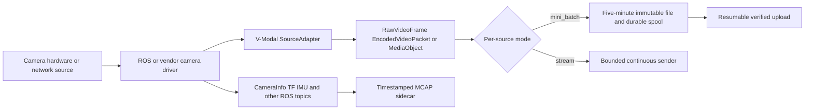

# Camera Interface and Driver Stack Comparison

Date: 2026-09-05

Status: Architecture comparison; implementation claims are explicitly separated from proposed behavior

Compared sources:

- [`01_prop_flow_v1.md`](01_prop_flow_v1.md): V-Modal target flows and component boundaries.
- [`info.md`](info.md): reference architectures and tools, including AWS Kinesis Video Streams, `ros_camera_server`, WebRTC/SRT, FogROS 2, `web_video_server`, MCAP/Foxglove, SRS, ZLMediaKit, and MediaMTX.
- [`01_prop_v1.md`](01_prop_v1.md): source-of-truth proposal referenced by the flow document, used to resolve phase and compatibility details.

## 1. Executive conclusion

The proposed V-Modal stack is not just a camera driver and not just a live-stream server. It is intended to be the ingestion layer between camera-producing software and upstream V-Modal services:

Its strongest intended differentiator is the combination of:

- broad camera/source adaptation;
- semantics-preserving media normalization;
- explicit archival and live modes;
- durable offline-capable upload for archival data;
- synchronized preservation of robotics telemetry;
- per-source isolation, capacity admission, and observable loss behavior.

The reference stacks in `info.md` usually optimize one narrower problem:

- Kinesis Video Streams: managed cloud video ingestion;
- `ros_camera_server` or WebRTC/SRT: low-latency camera streaming;
- FogROS 2: cloud execution of ROS nodes;
- MCAP/Foxglove: lossless robotics recording and inspection;
- SRS, ZLMediaKit, or MediaMTX: cloud protocol conversion and fan-out.

The V-Modal proposal combines parts of the edge responsibilities of those systems, but it does not replace their cloud services, browser viewers, compute offload, or media-gateway fan-out.

Most importantly, this is a comparison of **proposed capability**. `sdk_ros_robot` currently contains architecture documents only. The Rust crates, ROS nodes, C/C++ shims, stream sender, spool, and tests described in the proposal do not yet exist in this directory. Operationally, the current SDK cannot yet connect to or upload from a camera.

## 2. What “camera interface” means in each stack

There are four distinct layers that `info.md` sometimes groups together:

| Layer | Responsibility | Examples from `info.md` | V-Modal position |
|---|---|---|---|
| Camera driver | Own the device, configure it, and publish frames | Vendor SDK, ROS camera driver | Consumes its output; does not normally replace it |
| Edge media adapter | Subscribe/capture, encode, timestamp, and send | `ros_camera_server`, `ffmpeg_pipeline`, Kinesis ROS nodes | Primary scope of `vmodal-ros` and `vmodal-capture` |
| Durable recorder/uploader | Retain data through outages and commit it remotely | Kinesis buffering, MCAP recording | Primary scope of mini-batch spool, upload, and MCAP sidecar |
| Cloud gateway/compute | Fan out protocols, host viewers, or run ROS compute | SRS, MediaMTX, ZLMediaKit, FogROS 2 | External endpoint; optional integration, not core SDK scope |

Therefore, the closest comparison for the camera-facing part is `ros_camera_server` plus a durable uploader and MCAP recorder. SRS, MediaMTX, and FogROS 2 are complementary downstream systems rather than direct replacements for the proposed robot-side SDK.

## 3. Camera-facing interface comparison

| Capability | Proposed V-Modal stack | Other approaches in `info.md` | Assessment |
|---|---|---|---|
| Standard ROS 2 raw images | Typed `rclrs` adapter maps `sensor_msgs/msg/Image` into `RawVideoFrame` | Kinesis ROS nodes and ROS streaming servers subscribe to image topics | Designed, not implemented |
| ROS compressed images | Transport-aware parsing; JPEG may pass without decode, while depth/PNG/TIFF retain lossless semantics | `ros_camera_server` and web/video bridges primarily optimize displayable compressed video | Broader proposed semantics, Phase 2 implementation |
| Native camera access | GStreamer adapters for V4L2 and libcamera avoid an unnecessary ROS hop | GStreamer/FFmpeg edge stacks use the same general pattern | Designed for Phase 1, not implemented |
| Network camera input | RTSP/RTP/SRT/RTMP/WebRTC can enter through typed GStreamer adapters when framing is provable | Media tools commonly support these protocols | Input breadth is proposed; it does not imply matching output transports |
| Vendor camera SDK | Rust adapter for C APIs; narrow C ABI shim or isolated sidecar for C++-only SDKs | Vendor-specific integration is normally written directly in C++ | Good isolation design, but every vendor still needs integration and tests |
| Raw image layout | Preserves dimensions, encoding, endianness, row step, planes, colorimetry, and buffer ownership | Reference overview discusses compression but not a full canonical raw contract | Stronger contract design if implemented |
| Timestamps | Preserves acquisition time, clock domain, PTS/DTS, discontinuities, and timeline generations | `ros_camera_server` is described as carrying ROS time in RTP metadata; FogROS/DDS preserves ROS message time | V-Modal is more explicit about archival and restart correlation |
| Coordinate frames | Keeps `header.frame_id` as `coordinate_frame_id`; never treats it as a sequence number | General ROS tools preserve message headers | Correct ROS behavior is designed and test-gated |
| Camera calibration | Preserves changing `CameraInfo` in MCAP and associates it by source, time, and frame | Live media servers generally do not retain full changing calibration | A meaningful robotics-specific advantage |
| QoS handling | Probe and report ROS QoS incompatibility before activation | `info.md` identifies BEST_EFFORT versus RELIABLE mismatch as a common failure | Explicitly designed, not yet verified on a ROS distribution |
| Hardware encoding | Probe and admit a concrete hardware path through GStreamer | Jetson NVENC, Intel VAAPI, and hardware GStreamer pipelines are common reference choices | Conditional on hardware/plugins; no universal zero-copy claim |
| Depth, Bayer, thermal, scientific imagery | Preserve losslessly as raw bundle/original when a display codec would change meaning | Live-stream stacks tend to prioritize RGB/mono display video | Stronger preservation model, but not automatically viewable |
| Camera controls | No proposed generic exposure, focus, gain, trigger, PTZ, synchronization, or firmware API | Usually owned by the camera/vendor driver | Out of scope; V-Modal is a consumer of driver output |

## 4. Architecture comparison by framework

### 4.1 Managed Kinesis-style ingestion

| Dimension | Proposed V-Modal | Kinesis-style stack described in `info.md` |
|---|---|---|
| Edge input | ROS, native devices, network streams, immutable files, vendor adapters | Primarily ROS images encoded and passed to the Kinesis Producer SDK |
| Cloud coupling | Transport interface targets V-Modal upload/stream endpoints | Tightly integrated with AWS Kinesis and adjacent AWS services |
| Archival behavior | Five-minute immutable objects, SQLite WAL, resumable reconciliation, explicit remote commit | Fragmented managed video ingestion and cloud retention |
| Offline recovery | Explicit disk spool and restart state machine | Product-managed buffering behavior, dependent on Kinesis configuration/SDK |
| Live path | Separate bounded stream mode | Streaming is the main ingestion model |
| Robotics telemetry | Synchronized MCAP sidecar | Requires application-specific packaging or separate AWS data path |
| AI/ML integration | No inference or managed vision service in the SDK | Native path to AWS analytics/ML services is a core advantage |
| Portability | Intended to be endpoint- and vendor-neutral | AWS-specific |

V-Modal can be better for controlled, resumable V-Modal object ingestion and preservation of heterogeneous robotics data. It cannot currently provide Kinesis's managed cloud service, cloud retention, or native AWS AI integrations.

### 4.2 `ros_camera_server`, WebRTC, SRT, and RTP edge streaming

| Dimension | Proposed V-Modal | Live ROS camera stack described in `info.md` |
|---|---|---|
| Primary objective | Archival ingestion and continuous streaming behind one source contract | Lowest practical camera-to-operator latency |
| Camera integration | ROS image adapters plus non-ROS and vendor adapters | ROS image topics into generated GStreamer pipelines |
| Transport | First selected live transport is proposed as SRT; additional WebRTC/RTMPS are Phase 3 | WebRTC, SRT, or RTP are direct first-class outputs |
| Browser viewing | Requires an upstream endpoint/gateway and viewer | Often directly oriented toward an operator web UI |
| Archival durability | Durable mini-batch spool with upload reconciliation | Not the principal responsibility |
| Format fidelity | Original, normalized, and lossless robotics lanes | Usually selects a display-oriented encoded stream |
| Backpressure | Separate disk-backed archival policy and bounded live-loss policy | Live queues generally drop or adapt for latency |

V-Modal's target design is broader and safer for archival capture. It cannot yet match the proven, ready-to-use teleoperation path of an existing live-stream package. WebRTC output, preview fan-out, and `ros_camera_server` integration are explicitly Phase 3 items rather than current capability.

### 4.3 FogROS 2

FogROS 2 and the proposed SDK solve different problems.

| Dimension | Proposed V-Modal | FogROS 2 description in `info.md` |
|---|---|---|
| Main abstraction | Camera/media ingestion with upload and stream transports | A ROS graph extended onto cloud compute |
| Cloud workload | Remote V-Modal lifecycle begins after ingestion | ROS nodes such as SLAM or perception execute in the cloud |
| Network behavior | Object upload or explicit media stream | DDS/VPN-mediated ROS connectivity and compressed topic transport |
| Failure contract | Durable spool for mini-batch; explicit gaps for stream | Distributed ROS node/network behavior |
| SDK responsibility | Capture fidelity, capacity, recovery, and commit | Placement and connectivity of ROS computation |

V-Modal can supply recorded or live media to a cloud service. It cannot launch cloud ROS nodes, extend DDS discovery, migrate compute, or make a remote VM behave like part of the local ROS graph.

### 4.4 `web_video_server`

`web_video_server` is a convenient ROS-to-browser presentation layer. It is narrower and much closer to a development/monitoring tool than to the proposed ingestion pipeline.

- V-Modal adds planned durable upload, recovery, multiple source classes, lossless lanes, and endpoint commit.
- `web_video_server` offers a more immediate HTTP/browser viewing path.
- V-Modal does not currently expose an MJPEG/H.264 browser server or a local operator UI.

### 4.5 MCAP and Foxglove

MCAP is complementary to the V-Modal media path:

- V-Modal proposes MCAP for `CameraInfo`, TF, IMU, LiDAR, odometry, diagnostics, detections, and custom ROS topics.
- Playable video remains a media object when that is useful; depth/scientific data can remain lossless.
- The session manifest correlates media objects and MCAP by source and time.

The SDK does not replace Foxglove's visualization, hosted data platform, schema tooling, or interactive inspection. It also does not claim that replaying MCAP recreates ROS services, actions, parameters, node lifecycle, or launch behavior.

### 4.6 SRS, ZLMediaKit, and MediaMTX

These are cloud/on-premise media gateways. They accept streams and expose multiple downstream protocols or viewers.

| Capability | Proposed V-Modal edge SDK | Media gateway |
|---|---|---|
| Subscribe to ROS topics | Yes, proposed | No, normally needs an edge adapter |
| Preserve ROS telemetry | Yes, proposed through MCAP | Not a normal media-gateway function |
| Send one upstream stream | Yes, proposed | Yes, as an ingest client/server relationship |
| Convert one stream to many protocols | No | Core capability |
| Serve WebRTC/HLS/RTSP/RTMP viewers | No | Core capability |
| Durable camera-side spool through WAN outage | Mini-batch only | Usually not the robot-side responsibility |
| Cloud-side recording/fan-out | External to SDK | Common capability |

The proposal intentionally keeps these gateways optional. A deployment may connect V-Modal `stream` mode to one of them, but the SDK itself cannot dynamically create viewer endpoints, transmux into every delivery protocol, or fan one feed out to multiple consumers.

## 5. What the proposed V-Modal stack can do

The following are valid **design capabilities**, provided their phases are implemented and pass the required hardware/ROS gates:

### Camera and source ingestion

- Consume standard ROS 2 `Image` and transport-qualified `CompressedImage` topics.
- Consume V4L2/libcamera devices without forcing camera bytes through ROS.
- Accept validated network sources and closed immutable media/MCAP objects.
- Extend to vendor C/C++ cameras behind one stable `SourceAdapter` contract.
- Isolate each camera in its own bounded pipeline so one source failure does not stop others.
- Hot-add, update, remove, pause, resume, and reprobe sources through one SDK lifecycle.

### Data correctness

- Preserve camera acquisition time, coordinate frame, raw layout, color/depth semantics, codec timing, keyframes, and object identity.
- Keep time-varying calibration and non-video ROS data in a correlated MCAP sidecar.
- Pass through or transmux compatible encoded video without decoding.
- Preserve an unchanged original or lossless raw bundle when normalization would lose meaning.
- Create original and normalized derivative lanes without confusing their completion states.
- Detect format/timestamp changes and start a new descriptor or timeline instead of silently mixing incompatible media.

### Delivery and reliability

- In `mini_batch`, continuously create five-minute files while older closed files upload asynchronously.
- Keep archival backlog on disk, recover after restart, reconcile remote status, and avoid guessing whether an upload completed.
- Support signed multipart first and TUS through a later transport adapter.
- In `stream`, forward encoded packets continuously through bounded memory and report reconnect loss intervals.
- Apply explicit disk/network pressure policies instead of silently dropping data.
- Expose per-source ROS diagnostics, media/spool/upload metrics, and structured correlation identifiers.

### Compatibility and maintenance

- Keep ROS, GStreamer, SQLite, HTTP, and C++ types outside the stable public contract.
- Use Rust for the core and a versioned C ABI for existing C/C++ applications or C++-only camera SDKs.
- Probe installed codecs, transports, memory types, hardware encoders, and endpoint acceptance before activating a source.
- Test each supported ROS distribution and hardware target rather than claiming support from one build.

## 6. What it cannot do, or cannot safely claim

### Cannot do today

The present `sdk_ros_robot` directory has no executable implementation. It cannot currently:

- subscribe to a ROS camera topic;
- open a V4L2/libcamera device;
- encode, segment, stream, or upload video;
- write or recover a spool database;
- record an MCAP sidecar;
- load a vendor camera SDK;
- expose the proposed Rust or C APIs;
- pass any of the proposed compatibility, recovery, capacity, or soak tests.

### Outside the intended product boundary

Even after implementation, the core SDK is not intended to:

- configure arbitrary camera hardware controls or replace a vendor/ROS camera driver;
- provide a browser operator UI or local MJPEG server;
- run cloud perception, Rekognition, SLAM, VLA, or other inference workloads;
- extend the ROS graph into cloud VMs like FogROS 2;
- act as SRS/MediaMTX/ZLMediaKit and fan out one stream into many protocols;
- semantically interpret every ROS topic placed in MCAP;
- recreate services, actions, parameters, lifecycle nodes, or launch behavior during replay;
- ingest Gazebo Transport or ROS 1 natively without a bridge/sidecar;
- guarantee hard real-time scheduling.

### Conditional or impossible blanket claims

The SDK cannot truthfully promise:

- every camera or vendor SDK without an adapter;
- every ROS distribution from one `rclrs` build;
- zero-copy for ordinary ROS messages or unknown vendor memory;
- every codec, container, pixel format, or `image_transport` plugin;
- automatic handling of an encoded ROS topic without a packet/framing adapter;
- playable video for depth, Bayer, thermal, or unknown scientific formats without a semantics-changing derivative;
- continuous live delivery during an uplink outage;
- offline retention in `stream` mode unless an explicit separate recording branch is added;
- automatic silent fallback between `stream` and `mini_batch`;
- unlimited sources, bitrate, disk backlog, or hardware encoder sessions;
- successful upload when the endpoint accepts neither the original nor a supported normalized form.

Source protocol support must not be confused with destination protocol support. For example, accepting RTSP or WebRTC as a GStreamer input does not mean that the initial SDK can publish RTSP or WebRTC. The first proposed live output is SRT; other live transports are later-phase work.

## 7. Proposed capability timeline

| State/phase | Camera-interface capability |
|---|---|
| Current repository state | Documents only; no runnable camera integration |
| Phase 0 | Freeze contracts, build synthetic media source, verify first ROS distribution, benchmark one hardware encoder |
| Phase 1 | ROS raw-image and V4L2 input, H.264 passthrough, one hardware encoder family, MP4 mini-batch spool, signed multipart upload, first SRT stream transport |
| Phase 2 | ROS compressed/custom encoded inputs, RTSP/RTP/SRT/file inputs, more hardware encoders, MCAP sidecar, TUS, selected vendor adapters |
| Phase 3 | Additional RTMPS/WebRTC outputs, preview branch, optional SRS/MediaMTX/`ros_camera_server` integration |

Nothing in a later phase should be presented as a current capability until its adapter, endpoint contract, recovery behavior, and hardware/ROS test matrix pass.

## 8. Bottom-line positioning

The proposed software should be positioned as a **robot camera ingestion and delivery SDK**, not as a universal camera driver, WebRTC product, cloud media server, or cloud robotics runtime.

Compared with the stacks in `info.md`, its intended advantage is correctness across the complete edge data lifecycle: acquire from many camera interfaces, preserve ROS timing and calibration, choose a safe media representation, isolate sources, retain archival data through outages, and commit it to V-Modal without silent loss.

Its present disadvantage is execution maturity: the comparison stacks cited in `info.md` already have working implementations for their narrower use cases, while V-Modal is still at the proposal stage. The shortest credible path is the Phase 1 vertical slice, after which claims should be limited to the exact ROS distribution, camera source, hardware encoder, upload endpoint, and stream transport demonstrated by the acceptance tests.

## 9. Web research: similar ROS camera-ingestion frameworks

Research date: 2026-09-05

Method: current official documentation, official repositories, and project papers were preferred over aggregators and forum answers.

### 9.1 Search result

No single drop-in open-source framework was found that provides the complete proposed V-Modal combination:

- ROS and native-camera ingestion;
- raw, encoded-packet, and immutable-object contracts;
- lossless original and normalized media lanes;
- a durable, restartable local spool with authoritative remote commit;
- a synchronized MCAP robotics sidecar;
- continuous low-latency streaming;
- vendor-camera C/C++ isolation;
- per-source capacity admission and explicit loss policies.

This is an inference from the projects reviewed, not proof that no such project exists. The closest products divide into three groups:

1. End-to-end commercial robot platforms: Formant, Transitive Robotics, Foxglove, Roboto, and InOrbit.
2. Open-source camera-edge components: `ros_camera_server`, Isaac ROS Compression, rosbag2/MCAP, and the archived AWS Kinesis ROS 2 connector.
3. Downstream media gateways: SRS, MediaMTX, and ZLMediaKit, already discussed above.

### 9.2 Similarity shortlist

The similarity rating measures functional overlap with the V-Modal proposal, not general product quality.

| Framework | Similarity | Strong overlap with V-Modal | Main difference |
|---|---|---|---|
| Formant Agent and platform | Very high, commercial | ROS 1/2 ingestion, USB/IP cameras, H.264, persistent edge buffering, on-demand upload, WebRTC teleoperation, telemetry, and cloud UI | Cloud-platform contract is proprietary; its documented ring buffers overwrite oldest data when full and its telemetry layer deliberately throttles samples |
| Transitive Robotics Video Recorder + WebRTC Video | Very high, commercial/beta | ROS topics, V4L2, RTSP, custom GStreamer inputs, segment recording, selective cloud upload, hardware encoding, WebRTC, and web playback | Video Recorder is beta; default local retention is a rolling one-hour policy, and the published contract does not provide V-Modal's MCAP correlation or verified multipart state machine |
| Foxglove Data Platform + Foxlet/SDK | High for recorded robotics data | On-robot MCAP recording, unreliable-link upload resumption, edge staging, indexed cloud storage, visualization, and ROS live bridge | MCAP/log lifecycle is the center; it is not a general camera normalization and multi-transport stream sender |
| `ros_camera_server` | High for the edge live-media plane | ROS 2/V4L2/RTP/thermal input, GStreamer planning, shared encoders, hardware acceleration, SRT/WebRTC/RTP output, timestamps, and pipeline recovery | No durable cloud upload, remote object commit, MCAP telemetry lifecycle, or offline archival spool |
| Roboto Upload Agent and data platform | Medium-high for file ingestion | Device-side automatic upload plus ROS 1/2, MCAP, DB3, and ordinary video ingestion into indexed datasets | Starts mainly from closed files; it does not provide the proposed camera capture, encoder, segmenter, or live sender |
| InOrbit Robot SDK/Agent | Medium for fleet integration | ROS topic mapping, C++/Python SDKs, connection handling, offline buffering, adaptive sampling, video processing, and cloud monitoring | Documented camera configuration is oriented toward sampled still images; full video is a separate offering and archival media fidelity is not its central contract |
| NVIDIA Isaac ROS Compression | Medium as a performance component | ROS image input, NITROS transport negotiation, and accelerated H.264 encode/decode on NVIDIA hardware | Hardware-specific codec component only; no upload, spool, cloud commit, or general source framework |
| AWS `kinesisvideo-ros2` | Medium as a legacy reference | ROS `Image` subscription, optional H.264 encoding, Kinesis upload, playback, archival, and Rekognition integration | Repository was archived in 2022, targets ROS 2 Dashing, and explicitly says offline caching was not implemented |

### 9.3 Closest end-to-end analogue: Formant

Formant is the closest broad product comparison. Its agent can ingest ROS streams directly, supports non-ROS sources through an Agent SDK, and exposes separate telemetry and real-time teleoperation paths. Its camera documentation covers USB devices and IP sources over RTSP, RTMP, UDP, and ONVIF, with H.264 encoding performed on the robot when needed. Its teleoperation path uses WebRTC. [Formant ingestion overview](https://docs.formant.io/docs/getting-started-ingesting-telemetry-data), [video-source configuration](https://docs.formant.io/docs/getting-started-add-a-video-stream), [teleoperation architecture](https://docs.formant.io/docs/getting-started-teleoperation)

Formant also has a real disk-backed edge behavior: the agent maintains persistent buffers for live and on-demand datapoints/assets, and an operator or API can request later ingestion. This resembles V-Modal's separation between local capture and cloud delivery. The important semantic difference is that Formant documents FIFO overwrite when a configured buffer fills and configurable ingestion throttling that drops excess datapoints. V-Modal's proposal instead treats silent archival loss as unacceptable and requires an explicit stop, degrade, or declared-loss policy. [Formant buffering and throttling](https://docs.formant.io/docs/how-telemetry-streams-work), [on-demand streams](https://docs.formant.io/docs/on-demand-streams)

What V-Modal could reuse conceptually:

- separate telemetry-ingestion and WebRTC teleoperation paths;
- per-device configuration and cloud-visible stream status;
- persistent on-demand storage for disconnected robots;
- a unified operator view across video, localization, and robot health.

What should remain different:

- no automatic FIFO overwrite for archival video;
- no rate-based silent dropping in `mini_batch`;
- retain V-Modal's canonical media descriptors, checksums, remote reconciliation, and explicit object state machine.

### 9.4 Closest camera recording/streaming analogue: Transitive Robotics

Transitive Robotics has the closest published camera feature set. Its Video Recorder continuously records selected tracks in segments and uploads them immediately or selectively. It accepts V4L cameras, RTSP streams, ROS topics, and custom GStreamer source pipelines, and supplies a cloud playback/calendar UI. Its documented local-retention default is one hour. [Transitive Video Recorder](https://transitiverobotics.com/caps/transitive-robotics/video-recorder/)

Its WebRTC/teleoperation stack adds ROS 1/2 image sources, USB/GigE/IP cameras, several simultaneous cameras, automatic NVIDIA/Rockchip/Intel hardware encoding, adaptive bitrate, and peer-to-peer browser delivery. It can also consume pre-encoded H.264, while warning that doing so removes WebRTC congestion control unless the stream is transcoded. [Transitive video configuration](https://www.transitiverobotics.com/caps/transitive-robotics/remote-teleop/Video%20Configuration/), [remote teleoperation](https://transitiverobotics.com/caps/transitive-robotics/remote-teleop/)

Relative to Transitive, V-Modal's intended advantages are stronger archival state, endpoint-neutral transport contracts, lossless scientific-image handling, and correlated MCAP telemetry. Transitive's current advantages are implementation maturity, ready browser components, WebRTC congestion behavior, teleoperation controls, and a working hardware-encoder matrix.

### 9.5 Closest open-source camera-edge framework: `ros_camera_server`

`ros_camera_server` is the most directly reusable open-source reference for the live camera plane. Its current repository documents:

- V4L2, ROS 2 image, RTP/UDP, and SeekThermal inputs;
- ROS 2, RTP, SRT, and WebRTC outputs;
- H.264/H.265 and selected raw/JPEG paths;
- shared encoder stages across outputs;
- NVIDIA NVENC, Intel VA-API, and Rockchip MPP detection;
- embedded capture timestamps, latency tracking, health checks, and pipeline repair.

It currently requires at least ROS 2 Jazzy. These capabilities make it a strong behavior and performance benchmark for `vmodal-capture`, especially source probing, GStreamer graph construction, encoder sharing, timestamp carriage, and stream recovery. [Official `ros_camera_server` repository](https://github.com/StefanFabian/ros_camera_server)

It is not a replacement for the complete V-Modal SDK because it does not own the proposed five-minute durable spool, signed multipart/TUS reconciliation, remote commit, retention state machine, or MCAP sidecar. The best integration choice is to reuse or benchmark its media-path ideas while keeping V-Modal's upload and persistence contracts independent.

### 9.6 Closest robotics recording and cloud-data platforms

#### Foxglove

Foxglove covers the widest recorded-data lifecycle. Its current platform documentation describes on-robot SDK/MCAP recording, live ROS visualization through Foxglove Bridge, edge staging for constrained links, and Foxlet directory monitoring with automatic upload resumption. Uploaded recordings are indexed by device, time, and topic and can be visualized or exported. [Foxglove Data Platform](https://docs.foxglove.dev/docs/data), [ROS 2 integration](https://docs.foxglove.dev/docs/getting-started/frameworks/ros2)

Foxglove is therefore a strong reference or possible destination for V-Modal's MCAP lane. It is less similar to the media core because its primary artifact is a self-contained robotics log, not a negotiated original/normalized camera object plus an independent continuous stream.

#### Roboto

Roboto provides device/dataset APIs, a first-party upload agent, and cloud ingestion for ROS 1 bags, ROS 2 MCAP/DB3, MP4, AVI, MKV, and other robot-data formats. Its upload agent scans configured directories and can run continuously, while its platform indexes uploaded ROS topics and supports downstream actions. [Roboto upload agent](https://docs.roboto.ai/learn/upload_agent.html), [supported formats](https://docs.roboto.ai/learn/formats.html), [SDK and CLI](https://docs.roboto.ai/learn/sdk.html)

Roboto is a close comparison for the post-recording upload and dataset lifecycle. V-Modal is broader on the camera edge because it proposes to own live source probing, encoding, segment finalization, and streaming before files exist.

#### InOrbit

InOrbit's Robot SDK and agent support ROS/ROS 2 topic mapping, C++ and Python bindings, connection handling, offline buffering, adaptive sampling, and video processing. Its published `RobotCamera` configuration sends sampled still images from a ROS topic; its main documentation says full video encoding/streaming is a separate offering. [InOrbit developer documentation](https://developer.inorbit.ai/docs), [agent camera documentation](https://www.inorbit.ai/docs)

This makes InOrbit a closer reference for fleet monitoring and operator visibility than for lossless high-rate camera ingestion.

### 9.7 Useful component, not complete framework: NVIDIA Isaac ROS Compression

Isaac ROS Compression provides accelerated H.264 encoding and decoding using NVENC/NVDEC and NITROS type adaptation. NVIDIA explicitly positions it for reducing camera storage and offload volume, including event recorders and rosbag capture. Its documented support is tied to tested NVIDIA/ROS combinations rather than being a portable upload SDK. [Isaac ROS Compression](https://nvidia-isaac-ros.github.io/v/release-3.2/repositories_and_packages/isaac_ros_compression/index.html)

For Jetson targets, this is a strong candidate behind a V-Modal hardware-specific adapter or benchmark. It should not leak NITROS types into `vmodal-contracts`, and it does not remove the need for V-Modal's spool, uploader, endpoint negotiation, and MCAP correlation.

### 9.8 Legacy reference: AWS Kinesis Video Streams ROS 2

The AWS ROS package remains architecturally relevant: it subscribed to `sensor_msgs/Image`, optionally encoded H.264, sent video to Kinesis for playback/archival/analytics, and could return Rekognition results to ROS. However, the official repository was archived on 2022-02-12, lists ROS 2 Dashing, states that offline caching was not implemented, and is no longer supported by AWS as a cloud extension. It should be treated as a historical contract example, not as a current dependency choice. [Official archived `kinesisvideo-ros2` repository](https://github.com/aws-robotics/kinesisvideo-ros2)

### 9.9 Practical recommendation for V-Modal

The web search changes the competitive picture in two ways:

1. The proposal's architecture is differentiated, but the individual features are established elsewhere. Formant and Transitive prove demand for combined robot video ingestion, edge buffering/recording, live WebRTC, and cloud review.
2. V-Modal should not claim novelty for ROS camera capture, GStreamer planning, hardware encoding, MCAP upload, or browser streaming separately. Its defensible distinction is the explicit combination of data fidelity, durable object commit, endpoint neutrality, and synchronized robotics context.

Recommended implementation references:

| V-Modal area | Best external reference | Why |
|---|---|---|
| GStreamer source/output planning | `ros_camera_server` | Closest open-source ROS camera hub with current multi-input/output and hardware paths |
| Teleoperation and congestion behavior | Transitive WebRTC Video; Formant teleoperation | Current deployed camera-to-browser systems with network adaptation |
| Durable robotics log lifecycle | Foxglove SDK/MCAP/Foxlet | Recording, edge staging, resumable upload, indexing, and visualization |
| Directory-based upload agent | Roboto Upload Agent; Foxlet | Existing device-side discovery and autonomous file-upload patterns |
| NVIDIA zero-copy/hardware encoding | Isaac ROS Compression/NITROS | Hardware-specific high-throughput ROS image path |
| Explicit loss-policy contrast | Formant persistent ring buffers | Clear example of FIFO overwrite/throttling behavior that V-Modal deliberately handles differently |
| Managed-cloud historical contract | AWS Kinesis ROS 2 | Useful ROS-image-to-cloud example, but archived and unsuitable as a new base |

The best Phase 1 strategy remains a small V-Modal vertical slice, but it should benchmark against `ros_camera_server` on the same camera and hardware. Phase 2 should test V-Modal MCAP outputs and upload behavior against the operator experience offered by Foxglove/Roboto. Phase 3 should compare live latency, reconnection gaps, and adaptive bitrate against Transitive and Formant rather than evaluating only whether a WebRTC session connects.

## 10. Reddit research: 20 camera-vision pain points in robotics

Research date: 2026-09-05

Evidence scope: public Reddit discussions in `r/ROS`, `r/robotics`, `r/computervision`, `r/JetsonNano`, and related engineering communities. These are practitioner anecdotes and questions, not a statistically representative survey. A Reddit report identifies a failure mode worth designing or testing for; it does not establish its prevalence or prove its root cause.

V-Modal response labels:

- `DESIGNED`: the proposal contains a direct architectural response, although it is not implemented yet.
- `PARTIAL`: V-Modal can preserve, detect, isolate, or report the problem, but cannot remove the underlying cause.
- `OUT_OF_SCOPE`: the camera driver, hardware, optics, calibration tool, or perception application must solve it.

### 10.1 Pain-point matrix

| # | Pain point reported on Reddit | Why it hurts a robotics camera stack | V-Modal response and current gap |
|---:|---|---|---|
| 1 | **Camera selection is a multi-dimensional tradeoff.** Teams struggle to find one device combining global shutter, external trigger, outdoor depth, required resolution/FPS, a stable interface, and acceptable cost. [Camera recommendations](https://www.reddit.com/r/robotics/comments/1dzldp7/camera_recommendations/), [recommended depth camera](https://www.reddit.com/r/ROS/comments/1rk0tsr/recommended_depth_camera/) | A camera that passes a desktop demo may fail the real motion, lighting, synchronization, or integration requirement. | `PARTIAL`: capability probing and admission can reject an unsuitable runtime path, but V-Modal does not choose hardware or validate trigger/outdoor performance before purchase. A deployment-qualified camera matrix is still required. |
| 2 | **Driver, OS, ROS-distribution, and dependency compatibility is fragile.** Users report cameras working in a vendor viewer but not through ROS, missing drivers, and package/library mismatches. [RealSense D455 and ROS Noetic](https://www.reddit.com/r/ROS/comments/1btr4ln/intel_real_sense_d455_is_not_working_with_ros1/), [ROS/OS dependency coupling](https://www.reddit.com/r/ROS/comments/1gd0e0f/what_does_ros_do_under_the_hood_that_makes_it_so/) | The physical camera can be healthy while the ROS adapter silently produces nothing; upgrades can invalidate a previously working image path. | `PARTIAL`: versioned `SourceAdapter` boundaries and per-distribution build gates are designed for this. No supported-distribution or camera-driver matrix exists today. |
| 3 | **USB bandwidth saturates quickly with multiple cameras.** Users encounter bus-allocation failures and dropped frames when several high-rate USB cameras share a controller. [Jetson multi-camera USB bandwidth](https://www.reddit.com/r/JetsonNano/comments/1atjm5c/usb_bandwidth_issues_with_cameras_on_jetson_orin/), [multiple camera streams on Jetson](https://www.reddit.com/r/computervision/comments/ev5hb3/capturing_multiple_camera_streams_on_jetson_nano/) | Nominal per-port USB speed is misleading when ports share a host controller; one added camera can destabilize every source. | `PARTIAL`: capacity admission and per-source bitrate metrics should expose exhaustion and refuse unsafe activation. The SDK cannot add bus capacity or determine physical USB topology reliably without platform-specific probes. |
| 4 | **USB power and link stability cause resets and freezes.** Reports describe camera blinking, quality degradation, random resets, and recovery only after a power cycle when other sensors are connected. [Jetson USB power issue](https://www.reddit.com/r/ROS/comments/1gvsg4u/nvidia_jetson_orin_nano_usb_power_issues/), [depth-camera reliability discussion](https://www.reddit.com/r/robotics/comments/1ct8w67/current_best_depth_camera/) | These faults resemble software bugs and may corrupt a timeline or leave a capture pipeline blocked indefinitely. | `PARTIAL`: source-offline events, bounded recovery, reprobe, new timeline generations, and isolation are designed. V-Modal cannot correct power delivery, cables, electromagnetic interference, or a camera that requires a physical power cycle. |
| 5 | **Raw RGB and depth overwhelm Wi-Fi.** Even compressed depth topics can exceed practical wireless capacity, especially amid interference; advertised link rate is not sustained application goodput. [Husky RGB/depth over Wi-Fi](https://www.reddit.com/r/ROS/comments/1ua5euc/image_compression_for_husky_a200/), [real-time CV over a network](https://www.reddit.com/r/computervision/comments/1fua0k1/how_feasible_is_doing_real_time_cv_over_a_network/) | DDS traffic competes with control and telemetry, while retransmission or buffering raises latency and memory use. | `DESIGNED`: encoded passthrough/hardware encode, bounded `stream`, disk-backed `mini_batch`, uplink admission, and goodput metrics directly address this. V-Modal still cannot guarantee live delivery when the radio lacks capacity. |
| 6 | **QoS, RMW, bridge, and container choices change throughput or prevent connections.** Reddit examples show BEST_EFFORT versus RELIABLE mismatches, Gazebo bridges missing target FPS, and recorder performance changing with the DDS backend. [QoS mismatch around `image_proc`](https://www.reddit.com/r/ROS/comments/1lht25v/issue_with_image_proc_pacakge/), [Gazebo camera bridge throughput](https://www.reddit.com/r/ROS/comments/1uedzfj/ros_gz_bridge_unable_to_bridge_960x640_30fps/), [rosbag2/RMW performance](https://www.reddit.com/r/ROS/comments/1otb1pn/ros2_bags_bad_performance/) | The topic exists but delivers too slowly—or not at all—with little indication whether the cause is QoS, serialization, Docker, simulation rate, or middleware. | `DESIGNED`: QoS discovery, explicit incompatibility diagnostics, bounded callback handoff, and per-distribution tests are required. RMW/container tuning remains deployment-specific and has no implementation or benchmark yet. |
| 7 | **CPU, memory bandwidth, serialization, and buffer copies become the first bottleneck.** A four-depth-camera discussion reports forced resolution reduction and asks whether image copies or memory bandwidth are limiting the system. [Four-camera point-cloud performance](https://www.reddit.com/r/ROS/comments/1rpjxoy/realtime_3d_monitoring_with_4_depth_cameras_point/) | More CPU cores do not fix memory-copy saturation; decode/convert/re-encode can consume the compute needed for perception and control. | `DESIGNED`: passthrough before transcode, bounded ownership copies, hardware paths, per-source isolation, and capacity measurements address the hot path. Literal zero-copy remains conditional on ROS/vendor memory ownership and fences. |
| 8 | **Hardware encoding is fragmented by board, JetPack, codec API, and build flags.** Users report uncertainty about NVENC availability, OpenCV builds without GStreamer, FFmpeg/GStreamer differences, and camera plugins tied to JetPack releases. [Four-camera encoding on Orin Nano](https://www.reddit.com/r/JetsonNano/comments/1pdfx65/does_the_jetson_orin_nano_8gb_actually_handle_4/), [Jetson camera/GStreamer compatibility](https://www.reddit.com/r/JetsonNano/comments/1ig8nfz/jetson_orin_nano_super_camera_advice/), [NVENC integration](https://www.reddit.com/r/JetsonNano/comments/j57xsz/nvenc_hw_encode_error_ffmpeg_on_jetson_nano/) | A configuration may unexpectedly fall back to software, overload the CPU, or fail only on the production board image. | `DESIGNED`: factual probing, immutable media plans, explicit software fallback, and hardware-specific release reports are the right response. No encoder family is implemented or qualified yet. |
| 9 | **Recording high-rate vision data overwhelms disks and creates enormous bags.** Reddit reports include dropped messages, severe external-drive slowdown, and multi-camera/lidar recordings reaching hundreds of gigabytes per hour. [rosbag2 performance](https://www.reddit.com/r/ROS/comments/1otb1pn/ros2_bags_bad_performance/), [high-bandwidth ROS logging](https://www.reddit.com/r/ROS/comments/xwnhkm/looking_for_a_high_bandwidth_logging_solution/) | Slow storage or mixed capture/upload I/O destroys temporal correlation and can fail long after a short bench test succeeds. | `DESIGNED`: separate capture/upload failure domains, SQLite spool state, disk reservation, mixed-I/O metrics, watermarks, and one-hour/24-hour tests directly address this. Real NVMe sizing and endurance are still undecided. |
| 10 | **End-to-end latency is hard to define, measure, and meet.** Users distinguish glass-to-memory, inference, display, and glass-to-glass delays, with encoded RTSP camera paths adding roughly multiple frames in some setups. [Ultra-low-latency camera discussion](https://www.reddit.com/r/computervision/comments/1ptcv40/ultralow_latency_solutions/), [latency target discussion](https://www.reddit.com/r/computervision/comments/v4ldxi/what_is_the_optimum_latency_for_a_camera_vision/) | Optimizing one stage can hide queueing elsewhere; average FPS says little about control-loop age or operator experience. | `PARTIAL`: V-Modal proposes per-stage latency, queue-duration, capture-time, and stream-gap metrics. It defines no universal latency SLA and has no working stream transport to measure today. |
| 11 | **Frame delivery jitter and burstiness break real-time consumers even when average FPS is correct.** A Jetson Ethernet-camera user observes unstable intervals at 50 FPS; camera/ISP processing can also produce gaps followed by clustered frames. [UDP camera capture jitter](https://www.reddit.com/r/JetsonNano/comments/1r92ei9/ethernet_video_capture_with_jetson_orin_nano/), [LiDAR/camera synchronization](https://www.reddit.com/r/ROS/comments/1g0fr6z/lidarcamera_hardware_synchronization/) | Bursty delivery increases control latency, destabilizes fusion, and makes queue sizing from average bitrate unsafe. | `PARTIAL`: timestamp-discontinuity detection, bounded queues, source metrics, and new timeline generations expose the problem. V-Modal cannot remove jitter created inside the camera, ISP, driver, or network. |
| 12 | **Acquisition timestamps are confused with arrival or post-processing timestamps.** Reddit discussions ask whether a sensor stamps at capture or after processing and note that ISP/encode/decode work can shift timestamps. [Camera/radar timestamp discussion](https://www.reddit.com/r/ROS/comments/1bwjjzq/timestamp_synchronisation_between_two_sensors/), [camera timestamp irregularity](https://www.reddit.com/r/ROS/comments/1g0fr6z/lidarcamera_hardware_synchronization/) | A perfectly delivered frame can still be fused against the wrong robot pose if its timestamp describes receipt rather than exposure. | `DESIGNED`: `capture_time_ns`, clock-domain metadata, PTS/DTS, and an explicit invalid-time fallback are core contracts. If the driver never exposes true acquisition time, V-Modal can only label the fallback; it cannot reconstruct the missing timestamp. |
| 13 | **Multi-camera and cross-sensor synchronization requires an end-to-end clock/trigger design.** Users struggle with inconsistent camera/radar offsets, message-filter thresholds that discard data, and PTP/GPS setups that still show visible motion offsets. [Camera/radar synchronization](https://www.reddit.com/r/ROS/comments/1bwjjzq/timestamp_synchronisation_between_two_sensors/), [hardware synchronization on Jetson](https://www.reddit.com/r/computervision/comments/1udiro2/how_important_is_hardwaretriggered_camera/) | Software launch order and approximate matching do not create simultaneous exposure; drift and processing latency can invalidate sensor fusion. | `PARTIAL`: V-Modal preserves clock domains and correlates media/MCAP timelines, but it does not configure PTP/PPS, generate hardware triggers, estimate temporal offsets, or synchronize exposure. This is a major boundary to document. |
| 14 | **Calibration is difficult to create, distribute, associate, and keep valid over a robot's lifetime.** Reddit users describe calibration tools as environment-sensitive, encounter `camera_info` synchronization problems, and ask how to handle calibration drift after deployment. [Calibration in the wild](https://www.reddit.com/r/computervision/comments/17no344/camera_calibration_in_the_wild/), [`camera_info` and `image_proc`](https://www.reddit.com/r/ROS/comments/1lht25v/issue_with_image_proc_pacakge/), [ROS calibration tooling](https://www.reddit.com/r/ROS/comments/1v1gdgc/i_built_calibon_a_browserbased_camera_calibration/) | Wrong intrinsics/extrinsics produce systematic localization, projection, depth, and grasp errors that may look like model failures. | `PARTIAL`: the proposal correctly preserves changing `CameraInfo` by source/time/frame instead of freezing one sample. It does not calibrate cameras, validate reprojection error, detect mechanical drift, or manage a calibration approval workflow. |
| 15 | **Resolution, FPS, visual quality, and compute budget conflict.** Multi-camera systems reduce resolution to stay real time; embedded perception may process camera frames more slowly than the robot's control/sensor loop. [Four-depth-camera monitoring](https://www.reddit.com/r/ROS/comments/1rpjxoy/realtime_3d_monitoring_with_4_depth_cameras_point/), [robotics compute-rate discussion](https://www.reddit.com/r/robotics/comments/1mmyzdl/investing_1m_to_fix_robotics_development_looking/) | Lowering quality may remove small features or depth accuracy, while keeping full input can starve control, logging, or inference. | `PARTIAL`: capacity admission and authorized adaptive-quality plans can select a sustainable media path. V-Modal does not schedule perception models or determine the minimum task-valid resolution/FPS. |
| 16 | **Rolling shutter, motion blur, and robot vibration corrupt measurements.** Users report image blur on moving ground robots and warn that inexpensive rolling-shutter cameras can make visual SLAM diverge during rotation. [Robot vibration and blur](https://www.reddit.com/r/robotics/comments/opnv7a/camera_stabilizer_for_ground_robot/), [camera limitations for visual SLAM](https://www.reddit.com/r/robotics/comments/1akx6wt/cheap_webcam_to_test_visual_slam_algorithms_with/), [stereo-camera SLAM discussion](https://www.reddit.com/r/computervision/comments/sh2od2/cheapish_stereo_camera_suggestions_for_visual_slam/) | The bytes are valid but the scene geometry is temporally distorted or featureless, so downstream odometry and detection fail. | `OUT_OF_SCOPE`: V-Modal can preserve timestamps and source metadata but cannot change the shutter, exposure time, lens mount, vibration isolation, or camera placement. The capability matrix should record shutter type and trigger support. |
| 17 | **Lighting, exposure, flicker, and sensor noise change across deployment environments.** Reddit practitioners report settings that work in darkness failing under bright light, reflections confusing auto-exposure, mains-powered light flicker, and unstable features from noisy indoor images. [Industrial-camera exposure](https://www.reddit.com/r/computervision/comments/18mxqkq/industrial_cameras_post_processing/), [auto-exposure corner cases](https://www.reddit.com/r/computervision/comments/vd4faz/autoexposure_adjustment_algorithms/), [noisy visual-SLAM images](https://www.reddit.com/r/computervision/comments/1quscl6/experience_with_noisy_camera_images_for_visual/) | The same camera/model behaves differently by site, time of day, and motion; extra denoising increases latency. | `OUT_OF_SCOPE`: capture may preserve exposure metadata if the adapter supplies it, but generic exposure/illumination control and image restoration are not in the proposal. They remain camera-driver and perception responsibilities. |
| 18 | **Depth technology fails differently in sunlight, darkness, low texture, and with motion.** Reddit comparisons describe active IR saturation in strong light, ToF multipath/motion artifacts, and passive stereo becoming unreliable on flat featureless surfaces. [Low/chaotic-light depth cameras](https://www.reddit.com/r/robotics/comments/1ds4lli/depth_camera_technologies_for_low_lightchaotically/), [depth-camera tradeoffs](https://www.reddit.com/r/robotics/comments/1ct8w67/current_best_depth_camera/), [outdoor stereo discussion](https://www.reddit.com/r/ROS/comments/pdfoqn/tell_me_about_the_stereo_vision_solution_that_blew/) | A generic “depth camera supported” label hides environment-dependent holes, range errors, and modality-specific failure modes. | `PARTIAL`: V-Modal's lossless raw-bundle policy avoids corrupting depth semantics, but it neither measures environmental suitability nor repairs bad depth. Compatibility reports should separate transport compatibility from sensing validity. |
| 19 | **Transparent, reflective, thin, and mixed-material objects create missing or jittery depth.** Users report holes on glass and shiny metal, unstable point clouds, and noise around thin objects. [Reflective-object depth failures](https://www.reddit.com/r/ECE/comments/1qz1vth/anyone_here_dealt_with_depth_cameras_completely/), [multi-camera point-cloud jitter](https://www.reddit.com/r/ROS/comments/1rpjxoy/realtime_3d_monitoring_with_4_depth_cameras_point/) | Manipulation and collision pipelines may receive no usable geometry exactly where accurate depth is most important. | `OUT_OF_SCOPE`: V-Modal can retain the raw depth, RGB, calibration, and failure interval for later processing; it does not perform depth completion, denoising, point-cloud fusion, or safety validation. |
| 20 | **Compression and perception requirements conflict, while real-world occlusion/domain shift remain.** ROS users want inter-frame compression for bandwidth but warn that artifacts can damage SLAM; production-CV discussions cite clutter, occlusion, camera quality, and lighting shifts that break benchmark-strong models. [Compression versus SLAM fidelity](https://www.reddit.com/r/ROS/comments/1ua5euc/image_compression_for_husky_a200/), [production computer-vision failures](https://www.reddit.com/r/computervision/comments/1u2va4g/whats_one_thing_in_computer_vision_that_works/), [warehouse occlusion example](https://www.reddit.com/r/computervision/comments/1rr9osd/im_a_warehouse_worker_who_taught_myself_cv_to/) | A transport-efficient video can be unsuitable training or SLAM data, and perfect transport cannot make an occluded object visible or eliminate model shift. | `PARTIAL`: original/normalized dual lanes and lossless bundles address transport-induced fidelity loss. `OUT_OF_SCOPE`: V-Modal does not solve occlusion, dataset representativeness, model generalization, detection errors, or inference fallback. |

### 10.2 What Reddit changes in the V-Modal priorities

The Reddit sample supports the proposal's major architectural choices—bounded queues, encoded passthrough, hardware probing, QoS checks, acquisition-time preservation, per-source isolation, and disk-backed mini-batch upload—but it also exposes missing operational contracts.

Before calling Phase 1 production-ready, add these explicit requirements:

1. **Source-health contract:** report USB/source disconnects, reset loops, frame stalls, actual versus requested FPS, and whether recovery required process restart or physical intervention.
2. **Transport-capacity report:** show USB controller path when discoverable, ROS topic bitrate, copy count or memory-kind transitions, queue age, encode rate, disk latency, and network goodput per source.
3. **Timestamp provenance:** label every time as sensor acquisition, driver, ROS receipt, pipeline, or fallback time; never expose an arrival timestamp as proven exposure time.
4. **Synchronization boundary:** state clearly that V-Modal preserves and correlates time but does not provide hardware triggering, PTP/PPS setup, or temporal calibration.
5. **Calibration lifecycle:** store every `CameraInfo` revision and association, plus provenance and validity interval; do not claim that storage alone verifies calibration accuracy.
6. **Hardware-fallback visibility:** expose the selected encoder, memory type, copy path, and exact reason for software fallback before a source becomes active.
7. **Task-fidelity policy:** make operators choose whether a source is for viewing, SLAM, training, scientific/depth preservation, or both. Do not automatically apply a display codec to a measurement stream.
8. **Camera capability metadata:** record shutter type, trigger support, nominal clock source, interface/bus, depth technology, and environmental qualification where known.

### 10.3 What the SDK should not promise

The Reddit evidence reinforces that a reliable ingestion SDK cannot make an unreliable sensor physically reliable. Marketing and runtime status should not imply that V-Modal solves:

- USB power, cabling, or electromagnetic interference;
- missing vendor drivers or unsupported ROS/OS combinations;
- exposure, optics, vibration, rolling shutter, or illumination;
- camera/lidar hardware synchronization;
- intrinsic or extrinsic recalibration;
- sunlight, low-texture, transparent, or reflective depth failures;
- point-cloud fusion, depth completion, denoising, or SLAM;
- perception occlusion, domain shift, or model accuracy.

The credible claim is narrower: V-Modal can be designed to ingest what the camera/driver actually provides, preserve its semantics and timing evidence, isolate failures, expose capacity limits, retain archival data under a declared policy, and deliver it upstream without inventing correctness that the source never had.
