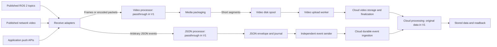

# VModal robotics ingestion SDK — production inflow proposal

Date: 2026-09-05

Status: Proposed architecture; this document does not implement the robotics runtime.

## Objective

**Version 1 establishes the complete ingestion architecture, with processing components operating as passthrough by default. Version 2 improves processing inside those same components.** Version 1 already receives production video/sensor inflow continuously and uploads arbitrary JSON metadata in real time. Live reception, independent delivery, bounded resources and recovery are working MVP capabilities.

The version boundary is processing sophistication. Component boundaries, input contracts and delivery paths are established in Version 1 and retained in Version 2. A processing stage initially returns its input unchanged; it does not need a separate service, plugin system or elaborate implementation.

The SDK consumes data already published by ROS, another application, or a network source. It does not open camera devices, configure exposure/FPS, trigger acquisition, or control the robot. Producers do not need to record files before using the MVP.

Video can reach the cloud as short mini-batches. JSON is a separate event stream: send immediately or in short transport batches, without waiting for a video segment to close or upload. Closed files remain a supplemental input.

## Scope and framework choices

This updates the architecture in [02_comparison.md](02_comparison.md), using [00_source.md](00_source.md). It replaces the earlier file-only MVP and clip-bound metadata model.

| Framework/pattern | Reuse | MVP boundary |
|---|---|---|
| ROS 2 | Subscribe to existing image and metadata topics | Receive only; no camera driver ownership |
| GStreamer / ros_camera_server media patterns | Reception, parsing, muxing and encoding components | One media backend; no custom codecs |
| ReductStore ingestion patterns | Bounded binary I/O and small-record batching | Local files and SQLite suffice; no required edge database server |
| rosbag2 / MCAP / Foxglove | Typed robotics recording where needed | Optional archival packaging, not required for arbitrary JSON |
| Transitive recorder pattern | Continuous segment creation independent of upload | Video segmentation must not delay metadata |
| Existing VModal Python SDK | Auth, video upload, multipart checkpoints, finalization | Extend shared SDK for missing event contracts |
| LeRobot, HFlow, ARES, LanceDB, Rerun | Training, curation and visualization | Later integrations; no mandatory MVP dependencies |

Reference evidence: [ReductStore ingestion](https://www.reduct.store/docs/guides/data-ingestion) describes incremental binary writes and batching; the [MCAP specification](https://mcap.dev/spec) describes timestamped messages; [Transitive recorder](https://transitiverobotics.com/caps/transitive-robotics/video-recorder/) and [ros_camera_server](https://github.com/StefanFabian/ros_camera_server) provide recording/media-path references. These inform the design, not claims of implemented VModal capability. Recording timestamps does not synchronize physical clocks.

## Overall architecture — established in Version 1



One deployable Python package, optional ROS bindings, one media backend, SQLite state and ordinary media files. GStreamer/native workers perform media operations. ROS callbacks hand off bounded data; encoding, disk flush and network work happen outside them. Independent video and event senders prevent a blocked video request from holding JSON behind it.

| Component | Input → output | Ownership |
|---|---|---|
| Receive adapter | ROS/network/application input → frame, packet or JSON event | QoS, source descriptors, buffer ownership, timestamp provenance |
| Video processor | Media record → media record | Identity operation in V1; optional explicit transforms in V2 |
| JSON processor | JSON event → JSON event | Identity operation in V1; optional derived/enriched events in V2 |
| Media packager | Frame/packet → immutable segment and timing manifest | Passthrough, required encoding/muxing and bounded segmentation |
| JSON intake | JSON value + transport context → journaled event | Syntax validation, stable identity, payload preservation |
| Local persistence | Segments/events → recoverable records | Quotas, recovery and acknowledgement state |
| Independent senders | Pending records → cloud receipts | Retry, deduplication, bandwidth/concurrency limits |
| Cloud ingestion | Media objects or JSON events → durable receipts | Preserve original data, deduplicate; process asynchronously later |
| Cloud processing/readback | Stored originals → available records or derived records | Original readback in V1; optional indexing, correlation and derived output in V2 |

No plugin framework, on-robot broker, C ABI, Rust rewrite or fleet control plane is needed for the MVP. Add process isolation only when measured workloads justify it.

### Same components, different processing depth

| Component | Version 1: passthrough/minimal implementation | Version 2: better processing within the same boundary |
|---|---|---|
| Source adapters | Receive published bytes/messages and describe them | More formats, better probing and optimized buffer handling |
| Video processor | Return original frame/packet/object unchanged | Optional resizing, codec conversion, compression tuning or quality checks |
| JSON processor | Return arbitrary payload unchanged | Optional validation profiles, normalization or enrichment into derived events |
| Timing/correlation | Carry source timestamps, clock IDs and caller references | Build richer frame/event indexes and explicit time mappings where evidence permits |
| Packaging | Minimum framing, segmentation and serialization needed by transport | More efficient batching, container choices and compression |
| Buffer/retention policy | Keep accepted data pending acknowledgement; fixed limits | Configurable priorities, event selection and retention policies |
| Delivery | Independent video/JSON senders with bounded retries | Better scheduling, congestion handling and throughput |
| Cloud processing | Persist originals and expose basic readback | Optional indexing, enrichment, correlation and downstream processing |
| Status | Counters, queue age, receipts and errors | Richer diagnostics, quality metrics and performance analysis |

These are logical boundaries in one small implementation. In V1, video/JSON processing can each be a plain identity function; timing handling copies available fields; retention uses a fixed policy. Persistence, transport, error handling and readback are real implementations, since passthrough still must deliver production data reliably.

Processing preserves envelope identity and source provenance. V2 transforms produce explicitly linked derivatives instead of overwriting originals. Optional processing cannot block the independent original JSON delivery path; expensive work runs asynchronously after persistence.

## Version 1 production inputs

The public interface supports three media forms — **raw frame, encoded packet, opaque media object** — and a separate **JSON event**. Adapters map inputs into these contracts; adding formats must not require another uploader.

| Input | Version 1 behavior | Minimal processing |
|---|---|---|
| ROS 2 sensor_msgs/Image | Subscribe directly; qualify RGB8/BGR8/mono8 first | Required layout conversion and video encoding only |
| ROS 2 CompressedImage | Standard JPEG/PNG reception with declared encoding | Preserve compressed content where practical; convert only for the selected destination |
| Encoded application/ROS packets | Push API; explicit custom ROS message mapping; H.264 baseline, H.265 when qualified | Parse access units and remux, avoiding decode/re-encode |
| Published RTSP video | Receive through the same media backend | Depacketize and remux compatible streams |
| Application raw buffers | Push frames with layout/timing descriptors | Same packager as ROS |
| Arbitrary JSON events | Direct push, JSON text topic, or configured ROS-message-to-JSON mapper | Envelope and transport serialization only |
| Closed media files | MP4, MOV, MKV, WebM, AVI, MPEG-TS, etc., according to destination support | Upload unchanged when supported |
| Depth, Bayer, thermal or unknown binary media | Opaque archival path with encoding/layout descriptors when qualified | Never silently replace measurements with display video |

Release a tested matrix of input protocol/message type, encoding, container, backend build and destination. Broad interface support does not imply every decoder exists on every board. Unknown data is explicitly rejected before acceptance or archived through a verified opaque-object destination, never mislabeled as playable video.

A generic-object cloud contract is required in Version 1 if its initial deployment includes opaque/raw archival inputs. The existing video API does not prove that contract exists. Other protocols/codecs extend the same interfaces in Version 2.

Qualify one ROS 2 distribution initially and check QoS compatibility. Do not invoke camera parameter services to make a source fit available capacity. Report pressure and apply the declared overflow policy.

## Version 1 passthrough behavior

Version 1 processors leave content unchanged. Other components perform essential transport/correctness operations:

- Preserve encoded media; parse and mux it into uploadable segments.
- Encode raw display frames only when necessary, using one configured, measured encoder path. Label lossy output as a derivative; raw-byte retention needs an archival representation.
- Preserve arbitrary JSON without selecting fields, flattening schemas, interpreting sensor values, aggregating or downsampling events.
- Add identity, timestamp provenance, sequence, media descriptors and integrity information.
- Persist, retry, deduplicate and report delivery state.

No inference, embeddings, semantic enrichment, sensor fusion, resampling, calibration computation, automatic quality adaptation or training exports in Version 1. Hardware encoding is allowed when necessary for production throughput; broad hardware-family coverage is later work.

Passthrough refers to content processing, not literal forwarding of every network byte. Depacketization, adding an envelope, packaging and durable delivery are necessary plumbing. Raw frames can use an opaque archival destination; if the selected destination requires encoded video, a fixed, explicitly configured encoding step is the minimal transport adaptation. No automatic content optimization is implied.

## Data contracts

### Proposed SDK surface

These are proposed operations, not existing callable methods.

| Operation | Contract |
|---|---|
| open_source(source_id, descriptor) | Register source type, media properties and clock context |
| push_frame(source_id, frame, timing) | Hand off a raw frame to a bounded queue |
| push_packet(source_id, packet, timing) | Hand off framed encoded data with codec/keyframe information |
| push_json(source_id, payload, timing=None, event_id=None) | Submit any valid JSON value independently of video |
| submit_file(source_id, path, timing=None) | Supplemental closed-file input |
| status(source_id=None) | Source health, queue pressure, durable/cloud receipts and errors |
| flush(timeout) / close() | Drain to a deadline or stop while retaining durable backlog |

Push operations return accepted/rejected immediately plus a receipt handle. **Accepted in RAM, durable locally, and acknowledged by cloud are distinct states.** Receipt completion exposes later states; callers needing durable handoff wait outside the ROS callback. Acquire buffer ownership or copy before returning acceptance.

Raw descriptors include dimensions, encoding, stride/planes and endianness. Encoded descriptors include codec initialization, access-unit framing, keyframe information, PTS/DTS and time base. Opaque media includes MIME/encoding and interpretation metadata. Descriptor changes rotate segments.

### Arbitrary real-time JSON

The application owns the payload. It may be an object, array, string, number, boolean or null, with arbitrary nested keys and schema changes. No video filename, clip ID or fixed sensor schema is required. Reject invalid JSON, including NaN/Infinity, and duplicate object keys to avoid ambiguous preservation.

The SDK adds its own transport envelope:

```json
{
  "envelope_version": 1,
  "event_id": "robot07-boot19-imu-000123",
  "robot_id": "robot07",
  "session_id": "boot19",
  "source_id": "imu",
  "sequence": 123,
  "source_time_ns": "121000000000",
  "clock_id": "robot07-boot19-ros",
  "time_origin": "ros_header",
  "received_time_utc": "2026-09-05T10:00:00.123Z",
  "payload": {
    "angular_velocity": [0.01, 0.02, 0.0],
    "vendor_fields": {"mode": "walking", "diagnostic": null}
  }
}
```

Robot/session context is configured once; callers supply their JSON and optional timing/identity. JSON text inputs retain original UTF-8 payload text, including large number literals; transport carries that validated text without a lossy parse/reserialize cycle. The example displays the decoded logical payload. Parsed-value inputs preserve the value provided by the caller's serializer; precision lost before submission cannot be recovered. Envelope nanosecond timestamps use decimal strings.

Limits are **per event/request, not per clip**. Propose a configurable 1 MiB default per event within the published server maximum. Oversized input returns an explicit error, never truncation; larger events require a qualified large-event/object path. High rates use transport batching of unchanged events, not content reduction.

Metadata-only sources work without video. Events may arrive before, during or after related footage and remain independently retrievable. Optional caller references link to a camera/frame; default correlation uses session/source and source-time ranges. No one-event-per-frame or one-row-per-clip constraint.

### Time and identity

- Preserve source time and clock domain; unknown source time stays null. Receipt time is separate.
- Sequence records per-source ingestion order; event-time order can differ. Late events append independently.
- Sessions distinguish clock resets/restarts; durable IDs survive upload retries.
- Video manifests store actual [start, end) source intervals, segment IDs, descriptor revisions and media PTS mapping where available.
- Unsynchronized clocks remain distinct. Do not invent exposure time, UTC alignment or physical synchronization.
- Preserve supplied calibration/CameraInfo revisions as timestamped metadata; validation and calibration algorithms are outside the SDK.

## Version 1 delivery

### Video: continuous reception and short mini-batches

Receive continuously and finalize self-contained segments asynchronously. Default target: approximately **2 seconds**, configurable for bitrate and keyframe interval. Segments must preserve initialization data and valid encoded boundaries. Passthrough duration depends on suitable keyframes; see the [FFmpeg segment documentation](https://ffmpeg.org/ffmpeg-formats.html#segment_002c-stream_005fsegment_002c-ssegment). The selected media backend must pass equivalent decodability checks.

A long source GOP can increase video delay. Report it; either accept it or explicitly configure SDK encoding of received data. Do not change the camera. Bound segment bytes and keyframe wait; if valid packaging cannot meet limits, report an error/gap rather than emit an oversized or corrupt segment.

Upload starts when a segment closes. Video availability includes segment, queue, transfer and finalization delays. Packet-level live viewing may come later; continuous production inflow is required now.

### JSON: independent real-time delivery

Journal immediately, then send through a reused HTTP connection to a small event-batch API. No broker or WebSocket is required initially. Immediate mode sends one event; default batching flushes at **50 ms maximum wait** or a configured count/byte threshold, whichever comes first. Large valid events may use individual requests.

Proposed connected-operation qualification target: **p95 SDK-receipt-to-cloud-durable-ack ≤ 250 ms**, measured under the declared network and production workload. Include journal flush, scheduling, transmission and server persistence. This is a release target to test, not an existing guarantee or hard real-time claim. Report p99 and maximum lag too.

The event sender has independent requests, deadlines and scheduling. Limit video bandwidth/concurrency to reserve metadata capacity. During replay, allocate capacity to current events as well as historical backlog; consumers tolerate sequence gaps until older events arrive.

Offline operation becomes durable store-and-forward with visible lag. Cloud real-time delivery is impossible during disconnection; local reception continues within finite capacity.

## Cloud coupling and existing SDK reuse

These observations come from the local implementation review, not live backend verification.

| Component | Reuse | Limitation |
|---|---|---|
| [collections.video_upload()](../sdk_python/src/vmodal/resources/collections.py) | Finalized media upload, auth, multipart recovery | Enforces 100 MiB per file; segment below that limit |
| Same file, upload_metadata_jsonl() | Optional searchable clip summaries later | Video mode requires a video filename; not the arbitrary real-time event channel |
| [SDK documentation](../sdk_python/docs/docs_ref/sdk_doc.md) | Upload/checkpoint/finalization contracts | Uploaded bytes, materialization and indexing are separate |
| [Shared coupling reference](../../docs/doc_ref/00_coupling_flow.md) | Authenticated user/destination configuration | No separate hard-coded robot bucket layout |

**A generic durable event-ingestion contract is a Version 1 requirement.** Its availability is not established by the video metadata method. Implement/qualify it in the backend and reference Python SDK, then use it from the robotics wrapper. Do not defer real-time metadata to fit an existing clip-oriented endpoint.

Required semantic contract; the endpoint URL is chosen during integration:

- Accept batches of envelopes and opaque validated JSON without requiring any media to exist.
- Persist originals before acknowledgement; identify accepted, duplicate, rejected and retryable event IDs.
- Deduplicate by authenticated tenant plus stable event ID. Same ID/content returns the original receipt; changed content conflicts.
- Support reconciliation and source/time/sequence readback to verify delivery.
- Publish limits, error semantics and a deduplication lifetime covering supported retry/replay retention.
- Keep indexing and enrichment out of synchronous acknowledgement.

One durable event table/store is sufficient initially: transport identity/time columns plus original JSON payload text. Do not introduce sensor-specific columns or per-payload schema migrations. This is a proposed backend capability, not a claim about the existing DB.

Video has its own segment identities and receipts. Either lane can succeed while the other is unavailable. Correlation may temporarily be incomplete; do not hold durable metadata back. No atomic cross-lane transaction is required.

## Production reliability and capacity

Each event and each video segment has an independent lifecycle:

```text
RECEIVED_IN_MEMORY → DURABLE_LOCAL → PENDING_SEND → ACKNOWLEDGED
                                      ↘ RETRY_WAIT / BLOCKED
```

Finalize video files atomically and persist SQLite references; reconcile files/rows at startup. Journal JSON with stable IDs before sending, using short group commits within the latency budget. Existing SDK checkpoints own multipart part state.

Delete only SDK-owned acknowledged data under retention policy. Lost receipts trigger lookup/idempotent retry, never blind append or deletion. Data accepted only in RAM can be lost on power failure; expose and measure that window.

| Condition | Required MVP behavior |
|---|---|
| Slow/stuck video upload | Event sender continues; bounded video backlog |
| Network outage/transient error | Persist, retry with bounded backoff/jitter, expose lag |
| Lost acknowledgement/restart | Stable IDs and reconciliation; no duplicate logical records |
| Partial batch acceptance | Retire only acknowledged event IDs; retry unresolved records |
| Full video quota | Preserve pending data; reject/drop new video under declared policy; retain reserved metadata capacity |
| Full metadata quota | Explicit rejection/counters; retain durable events; no silent eviction |
| Full callback queue | Nonblocking rejection and counted gaps; never stall robot control |
| Source disconnect/corrupt output | Bounded reconnect; finalize valid partial media or quarantine and report gaps |
| Malformed JSON event | Reject that event; valid events continue |
| Clock/format change | Rotate session/descriptor as appropriate, retain provenance |

Use per-source queues and separate video/metadata disk budgets with a small health-record reserve. Record rejection counts even when the event lane is full. Capacity admission considers CPU/encode, disk and network load for the target deployment.

For scale: four encoded 8 Mbit/s streams produce about 14.4 GB/hour. JSON at 1,000 events/s averaging 1 KB adds about 3.6 GB/hour before overhead. Batching saves requests, not payload bytes. Size disk for required outages and reserve event bandwidth; backlog drains only when upload capacity exceeds continuing inflow.

Minimal status: source activity, received/durable/acknowledged/rejected counts, queue bytes/age, disk headroom, metadata ack latency, video lag, retries and gap intervals.

## Implementation phases and acceptance gates

### Phase 1 / Version 1 — production ingestion MVP

Establish and wire every component boundary above. Processing stages use identity/minimal behavior while delivery infrastructure works end to end.

Required scope:

1. Direct ROS 2 image reception, raw/encoded push inputs, and published RTSP reception through one media backend.
2. Minimal media packaging/required encoding, short segments and continuous upload.
3. Arbitrary real-time JSON input, independent durable journal/sender, metadata-only sources and high-rate events.
4. Generic cloud event persistence, deduplication and readback through the shared Python SDK.
5. Multiple-source isolation, finite buffering, explicit overflow/gaps, reconnect and restart recovery.
6. One qualified deployment/ROS distribution/encoder configuration, with measured throughput and latency.

Implementation order: freeze component contracts and wire passthrough processors; qualify cloud video/event contracts; implement independent persistence/delivery lanes; connect push inputs and ROS/RTSP adapters; validate production load/recovery. All of these belong to Version 1.

Keep modules small: contracts, receivers, media, persistence, senders and thin CLI. Reuse existing components; put utilities in utils.py. This proposal changes no runtime or backend code.

Version 1 release gates:

- Verify that every stage is wired end to end with processors in passthrough mode. JSON payloads and encoded media content remain unchanged except for declared transport packaging; any required raw encoding is explicitly identified.
- Sustain declared source count, resolution/FPS/bitrate and JSON rate in a representative 24-hour soak with bounded resources.
- Meet metadata latency under active video load and an intentionally stalled video upload.
- Read back arbitrary nested JSON, arrays/scalars/null, schema changes and metadata-only events without a video filename.
- Preserve JSON text with large numbers and source timestamp provenance.
- Verify raw layout handling, compressed/encoded inputs, independently decodable segments, format changes and size limits.
- Interrupt processes/network before and after durable commits/acknowledgements; verify replay, partial batch handling and deduplication.
- Fill each quota independently; verify metadata reservation, explicit rejections and source isolation.
- Test late events, clock resets and metadata reaching the cloud before its video.

Tests follow repository conventions: simple assertions, test1()…test_all(), Fire CLI, and existing SDK tests where shared behavior changes. Mocked tests do not replace deployed readback and load validation.

### Phase 2 / Version 2 — improve the existing processors

Replace selected identity/minimal implementations with useful processing, using the component mapping above. Preserve Version 1's public input contracts, independent JSON delivery, persistence and receipt semantics. Each enhancement is opt-in and can be disabled to recover Version 1 passthrough behavior.

| Enhancement | Added value |
|---|---|
| Video processor: optional quality checks, resizing and codec conversion | Optimize derived media for a selected use case |
| JSON processor: optional normalization, validation and enrichment | Add useful derived metadata while retaining arbitrary original JSON |
| More codecs/protocols/ROS distributions and hardware families | Broader qualified deployments |
| MCAP/raw archival and richer timing indexes | Typed sensor replay and frame/event association |
| Optional transformations/metadata validation profiles | Derived normalized output while originals remain available |
| Selective/event-triggered upload and explicit retention | Reduce traffic with visible exclusions |
| Improved scheduling/hardware paths | Higher measured source counts and throughput |
| Event subscriptions and richer cloud queries | Live consumers/debugging over durable events |

Enrichment, sampling and lossy conversion remain opt-in. Version 2 does not narrow the arbitrary JSON contract.

Version 2 acceptance: run the same inputs through passthrough and enhanced modes; verify original readback, derivative provenance, unchanged delivery contracts, measurable processing benefit and bounded resource use. A failed optional processor reports its own error while original ingestion continues. Do not make the real-time JSON acknowledgement wait for enrichment.

### Phase 3 — optional ecosystem and live viewing

Add packet-level video output to a qualified media service when subsegment latency/browser viewing is required. Reuse the existing independent JSON lane. Live video transmission does not acknowledge metadata or archival storage.

Other optional additions: fleet configuration, cloud training exports, analytics and visualization integrations. Camera control, physical synchronization and calibration algorithms remain outside the SDK in every phase.

## Open integration qualifications

Record actual source/workload profiles, media formats, event API limits, deduplication/readback semantics, connected latency measurements and outage retention budgets before claiming production readiness. These qualify Version 1; they do not move production inflow or arbitrary real-time JSON out of its scope.
