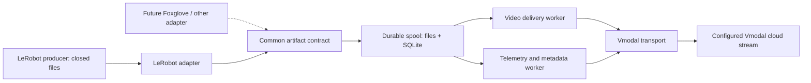

# MVP spec: LeRobot → Vmodal stream upload

Status: robot-side MVP implemented under `uinterface/sdk_ros_robot/lerobot`; generic cloud artifact and revision endpoints remain an integration gate.

## Implementation map

The implementation follows the boundaries in this specification:

1. `contracts.py` defines versioned artifact, revision, receipt, adapter, and transport contracts.
2. `adapters/lerobot.py` accepts only explicit `.ready.json` handoffs for LeRobot v3 and preserves source references without importing LeRobot or parsing Parquet.
3. `spool.py` assigns persistent dataset identity, derives stable artifact/revision IDs, copies bytes atomically, and stores delivery state and receipts in SQLite.
4. `runner.py` schedules one video lane and one telemetry/metadata lane with independent deadlines, bounded retry, reconciliation, and graceful drain.
5. `transports/vmodal.py` reuses `collections.video_upload(reduce_size=False)` for qualified MP4 delivery and explicitly blocks unqualified generic artifact/revision operations.
6. `cli.py` provides Fire commands for `run`, `status`, and `flush`; the package has only Fire as a required third-party dependency.
7. The fake-data suite covers two cameras, shared multi-episode mappings, original-byte readback, independent lanes, lost responses, restart reconciliation, quota/size rejection, cleanup, opaque artifacts, and public-package export.

The production integration gate in section 4 is still open. The SDK does not route original Parquet or metadata snapshots through clip-description endpoints and does not report a dataset revision complete without a durable revision receipt.

## 1. Objective and scope

Run a small uploader on the robot OS that continuously delivers finalized LeRobot MP4 files, telemetry Parquet files, and the metadata needed to interpret them to a configured Vmodal cloud stream.

Here, **stream upload means incremental delivery as files become ready**, with bounded streaming reads during transfer. The producer owns recording and file rotation. Upload latency includes the producer's file-finalization delay; uploading a growing MP4 or a live camera packet stream is outside this MVP.

This is a deliberately narrower implementation slice than [03_new_version.md](03_new_version.md). It retains separate input, persistence, and delivery boundaries, but does not require its live ROS image, RTSP, encoding, or arbitrary real-time JSON features. ROS can run alongside the uploader without becoming a core dependency.

MVP includes one LeRobot adapter, durable local pending state, independent video/telemetry delivery, recovery, and delivery status. Camera control, transcoding, inference, training, dashboards, and format conversion are outside scope. Foxglove/MCAP and live telemetry can later use the same core contracts.

## 2. Architecture

One Python package, one process, SQLite for small state records, and ordinary files for payloads. Reuse the reference Python SDK for supported Vmodal operations.



The two workers share delivery logic but have independent bounded scheduling and request deadlines. A slow video transfer must not prevent ready telemetry from uploading. They may be tasks or threads inside the same process; separate services are unnecessary.

### Proposed code layout

Relative to `uinterface/sdk_ros_robot/lerobot`:

```text
src/vmodal_robot/
    contracts.py          # Small versioned records and adapter/transport interfaces
    adapters/
        lerobot.py        # LeRobot discovery, readiness, source metadata mapping
    spool.py              # Durable handoff, SQLite state, quotas, recovery
    runner.py             # Scheduling, retry policy, lifecycle, status
    transports/
        vmodal.py         # Reference SDK wrapper and cloud contract mapping
    utils.py              # Shared filesystem and hashing helpers
    cli.py                # Thin Fire CLI: run, status, flush
docs/
tests/
env.sh                    # Existing config conventions; no duplicate SDK settings
```

These are module boundaries, not separate packages or a plugin framework. The CLI wires concrete objects together. Constructors receive dependencies explicitly; avoid global clients, shared mutable configuration, and inheritance hierarchies.

| Module | Owns | Dependency rule |
|---|---|---|
| Adapter | Source format/version, ready-file discovery, provenance | Emits common records; never calls cloud APIs or changes delivery state |
| Contracts | Artifact, dataset revision, receipt, narrow interfaces | Depends on the standard library only; no ROS, LeRobot, or SDK types |
| Spool | Accepted bytes, durable identity, pending state, retention | Knows artifacts, not LeRobot schemas or HTTP routes |
| Runner | Admission, worker scheduling, retry timing, shutdown | Uses adapter and transport interfaces; never parses source files |
| Vmodal transport | Auth reuse, destination mapping, upload, reconciliation | Knows the reference SDK; never discovers source files |

Only two extension interfaces are needed initially: an adapter yielding ready artifacts/revisions, and a transport delivering or reconciling an artifact receipt. Keep the spool concrete until a second implementation is needed. Multipart part checkpoints remain owned by the reference SDK, not duplicated in SQLite.

## 3. Input and data contract

Qualify **LeRobot dataset v3** first and reject unsupported versions clearly. LeRobot v3 stores telemetry in Parquet, camera video in MP4, and episode relationships in metadata; individual files can contain multiple episodes. Use the source metadata and path templates rather than assuming one filename equals one episode. See the official [LeRobotDataset v3 documentation](https://huggingface.co/docs/lerobot/lerobot-dataset-v3).

Preserve original MP4, Parquet, and metadata bytes. Do not flatten telemetry into clip descriptions or convert it into a training representation. Preserve relative dataset paths, feature schemas, task information, episode indexes, camera keys, row ranges, and video time offsets through the original metadata. Large mapping tables remain artifacts rather than expanded in RAM.

| Common record | Minimum information |
|---|---|
| Artifact | Contract version, stable artifact ID, dataset ID, source ID, kind (`video`, `telemetry`, `metadata`, future `opaque`), relative path, content type, byte length, checksum, immutable local reference |
| Dataset revision | Stable revision ID, source format/version, destination, exact artifact references including metadata snapshots, open/complete status |
| Timing/provenance | Source clock and units where available, optional time range, source-specific references in a namespaced extension |
| Receipt | Artifact ID, remote reference, durable acknowledgement/status, integrity information or reconciliation result |

Allocate dataset identity once and persist it across restarts. Derive artifact identity from dataset identity, relative path, and content checksum; retries reuse it. Same bytes in unrelated datasets remain separate logical artifacts. Changed metadata produces a new immutable artifact and revision, never overwrites a previously accepted revision.

Keep source time separate from upload time. Do not infer wall time, synchronization, or frame alignment from file modification times or nominal FPS. Unknown timing remains explicitly unknown. The adapter owns source-specific interpretation; the uploader carries it unchanged.

### Readiness and ownership

The producer must explicitly publish closed, immutable files and a consistent metadata snapshot, through an atomic ready manifest or equivalent completion handoff. Polling a ready directory is sufficient. A file whose size has stopped changing is not proof of completion.

The spool accepts an artifact only after its bytes and state are recoverable. Default to a bounded copy into SDK-owned storage: write temporary file, flush, rename, then commit the SQLite reference. On restart, reconcile orphan files and incomplete records. A no-copy mode requires an explicit producer retention/immutability contract; do not rely on a hard link to protect bytes from in-place writes.

MP4 and Parquet files may become ready independently. Deliver each immediately when ready; publish a dataset revision as complete only after all referenced artifacts and its consistent metadata snapshot have durable cloud receipts. Recording can continue into the next revision. The producer must finalize often enough for the agreed upload latency.

## 4. Vmodal boundary and integration gate

Use the existing authenticated destination configuration. Map the robot's dataset/source identities to the configured collection and stream in `transports/vmodal.py`; keep cloud object keys and HTTP routes out of adapters.

Local implementation reference: [Python SDK collections resource](../../sdk_python/src/vmodal/resources/collections.py), [SDK routes](../../sdk_python/src/vmodal/routes.py), and [shared coupling reference](../../../docs/doc_ref/00_coupling_flow.md).

- `collections.video_upload()` already streams local files through signed uploads and supports multipart checkpoint handling. Keep `reduce_size=False` to preserve source bytes.
- Its current implementation enforces `MAX_VIDEO_UPLOAD_BYTES`. Validate against that limit before accepting a deployment profile; producer shards must fit it. Oversized LeRobot files require a qualified shared-SDK/backend extension, not silent splitting or lossy resizing in this wrapper.
- `upload_metadata_jsonl()` is not evidence of an endpoint accepting original LeRobot Parquet, metadata snapshots, or independent telemetry. Do not route those bytes through a video-description API.

**Required cloud stream semantics, to verify or implement before the MVP ships:**

1. Store the original video, telemetry, and metadata artifacts with stable IDs, content types, relative paths, and dataset/revision association.
2. Acknowledge durable storage separately from asynchronous indexing. Return a stable receipt; an HTTP transfer success alone must not mark the dataset complete.
3. Reconcile uncertain outcomes by artifact ID. Repeating the same ID/content returns the same logical result; conflicting content fails explicitly. Deduplication retention must cover the supported replay window.
4. Publish/read a revision manifest, with completeness validated against its referenced durable artifacts. Permit incomplete revisions while recording continues.
5. Provide readback sufficient to verify byte integrity and reconstruct video/telemetry/episode relationships.

Exact endpoint URLs, request schemas, limits, and receipt behavior are integration deliverables, not invented here. Verify them against the deployed service and upstream route definitions; add missing operations to the reference Python SDK before the robotics wrapper uses them. The MVP is blocked from release if generic artifact storage or reconciliation is unavailable. No packet-level streaming protocol is required for this file-based scope.

## 5. Delivery, recovery, and resource bounds

Lifecycle: `READY → SENDING → ACKNOWLEDGED`, with `RETRY_WAIT` for transient failure and `BLOCKED` for an artifact requiring intervention. Local acceptance means durable local storage; cloud acknowledgement means verified durable remote acceptance.

- Persist identity and destination before sending. After a crash or lost response, reconcile `SENDING` with the cloud, then resume or retry with the same ID. Delivery is at least once; logical deduplication requires the cloud contract above.
- Use bounded backoff with jitter and per-request timeouts. Report permanent format/contract errors without looping forever or blocking unrelated artifacts. Resume auth through the reference SDK.
- Bound memory, disk bytes, queued record count, discovery batches, and upload concurrency. Start with one video and one telemetry/metadata worker; cap multipart concurrency too. Use chunked reads and hashes; never read an entire dataset into memory.
- Reserve spool capacity and transfer bandwidth for telemetry/metadata. At quota exhaustion, reject new handoffs with a visible reason while retaining accepted pending data. Do not block robot control or silently delete backlog.
- Delete only SDK-owned acknowledged artifacts under retention policy. Keep lightweight receipts until revision completion and the configured replay window permit cleanup. Never delete producer files.
- On shutdown, stop admission, drain until a deadline, and retain durable backlog. Status exposes pending bytes/count/oldest age by lane, blocked records, retries, last receipt, rejected handoffs, and disk headroom.

No required PyTorch, full LeRobot runtime, ROS bindings, GStreamer, pandas, broker, or edge database service. Treat Parquet as bytes for transfer; if source mapping needs Parquet parsing, isolate the optional reader in the LeRobot adapter and process bounded batches. Reuse HTTP connections where supported by the reference SDK.

Choose disk capacity from measured input bytes/second × required outage duration plus working space. Qualify memory and CPU on the target robot; memory must remain bounded as backlog grows. Network capacity must exceed continuing input to drain an outage backlog.

## 6. Extension and refactoring rules

- A future Foxglove/MCAP adapter emits original files as `opaque` artifacts with format descriptors and source references. It reuses the spool, runner, and transport once that media type is qualified by the cloud contract.
- A future live telemetry adapter may produce bounded immutable batches. If per-event acknowledgement is required, add a versioned event contract; do not force it into video metadata or file receipts.
- Add source-specific parsing only inside adapters. Add endpoint changes only inside the transport/reference SDK. Add persistence changes only inside the spool with a schema migration.
- Keep transforms out of the MVP. Later transforms produce linked derivatives and retain originals; they must not change artifact identity in place.
- Test interfaces with small fixtures and a fake transport. Do not introduce a registry, dynamic plugin loading, generic workflow engine, or multiple services for hypothetical sources.

## 7. MVP acceptance

1. Upload a small v3 fixture with two cameras, telemetry, metadata, and multiple episodes sharing files. Read back identical bytes and reconstruct the original episode mappings.
2. Observe successive producer handoffs reaching the same configured stream without restarting the uploader. Incomplete files are never accepted.
3. Stall video delivery and verify ready telemetry/metadata still advances within the configured resource budgets.
4. Interrupt transfer, lose a cloud response, and restart after each persistence boundary. Verify recovery, stable identity, no false completion, and one logical remote artifact per ID.
5. Exhaust spool capacity and submit unsupported/oversized inputs. Verify explicit rejection, preserved pending bytes, and unchanged producer files.
6. Run sustained input plus an outage/recovery cycle on the target robot. Record peak memory/CPU, spool usage, delivery lag, and backlog drain rate against declared deployment limits.
7. Demonstrate an opaque-file fake adapter through the same core without changing spool or scheduling code. Confirm the normal runtime imports no training or ROS stack.

Use the repository's simple assertion-based test conventions and immutable fixtures. This document defines acceptance criteria; implementation and live endpoint qualification remain separate work.
