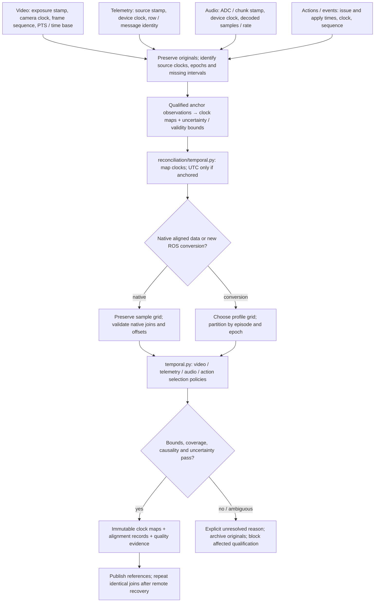
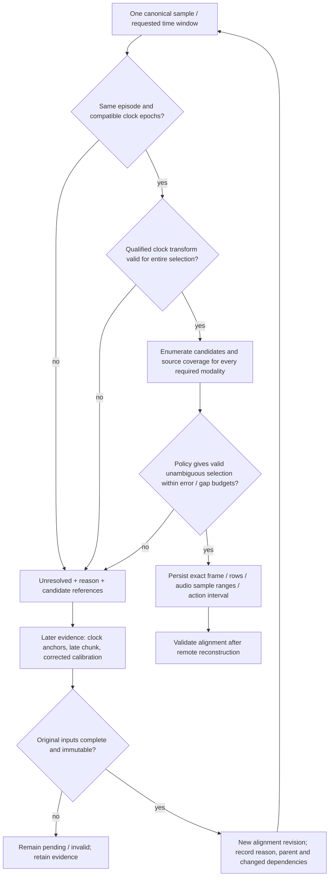
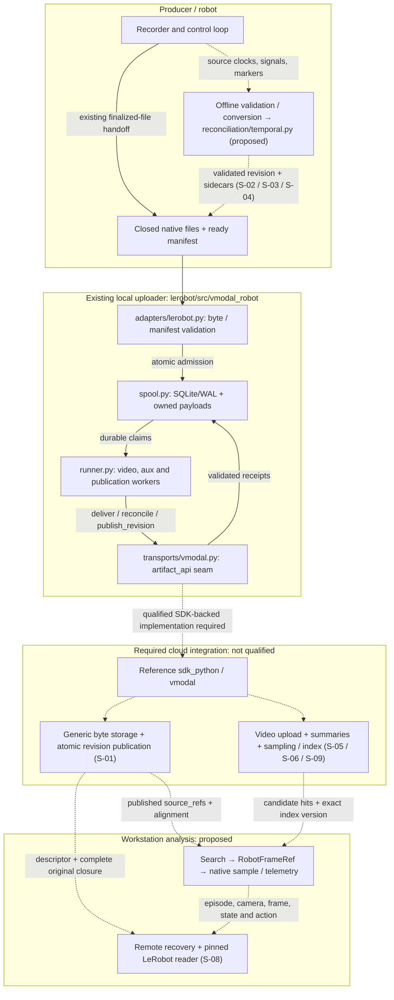
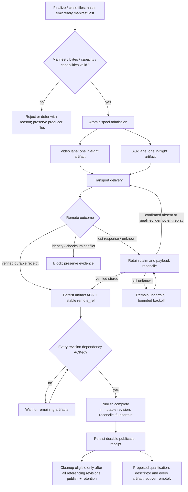
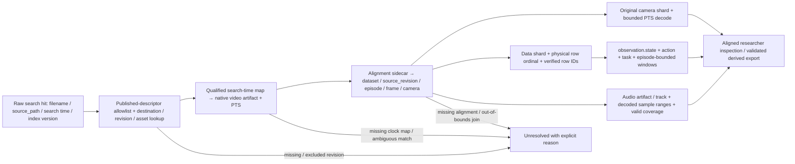
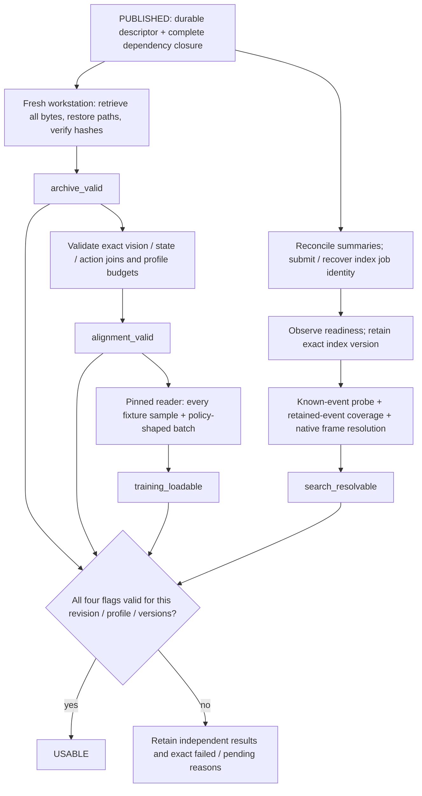
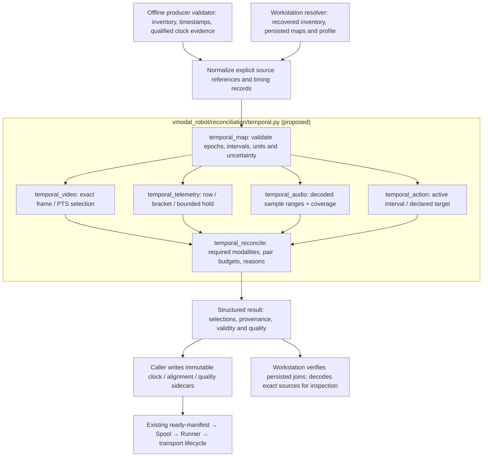

# sdk_ros_robot — Time-aligned video, telemetry and audio after upload

Date: 2026-10-11. Status: local temporal/recovery implementation plus remaining
qualification backlog. Proposals below remain unqualified unless explicitly
identified as implemented here.

## Implementation evidence — 2026-10-11

The `vmodal-robotics` 0.2.0 package implements section 1.7 in
`lerobot/src/vmodal_robot/reconciliation/temporal.py`: exact rational clock
mapping, epoch/interval validation, video/telemetry/audio/action selection,
conservative error and pairwise budgets, deterministic source reconciliation,
and structured unresolved reasons. Producer and workstation callers share the
same JSON adapter; no ROS, LeRobot, decoder, database or network dependency is
required by the temporal core.

`reconciliation/dataset.py` verifies explicit native scanner output and complete
immutable inventories, writes alignment/quality sidecars and atomic ready
manifests, binds descriptors to verified artifact receipts, and reconstructs
original paths and identical joins from independent remote-reader artifacts.
It preserves original bytes and distinguishes mapping-only correction revisions
from the native capture revision. `markers.py` adds the public `mark` function,
CLI, durable bounded append/rotation, offline replay and qualified sample
attachment. See [the implemented workflow](../../lerobot/docs/researcher_workflow.md)
and [marker contract](../../lerobot/docs/markers.md) for APIs and runnable examples.

Plain-assert temporal, dataset and marker tests exercise known source identities,
clock drift/resets, ambiguity, causality, audio gaps/trim, action uncertainty,
corrupt/interrupted downloads, corrections and recovery after producer removal.
These use synthetic timing/native scanner data and a mock byte archive. They
establish local correctness and standalone packaging, not a deployed cloud
contract or native LeRobot reader/decoder qualification.

Remaining gates include generic SDK-backed storage/discovery/publication,
idempotent metadata/index coordination, a pinned real native scanner/reader and
policy batch, deployed search/sampler qualification, priority/aging scheduling,
ROS subscriber/hotkey integration, native subset conversion and remote episode
tombstones. Stock `VmodalTransport.from_env()` remains fail-closed. Recovery
reports keep `training_loadable` and `search_resolvable` false until the required
external evidence exists; successful upload/recovery does not imply `USABLE`.

## Folder and file map

Selected files that **exist** in this checkout. Paths start at
`uinterface/sdk_ros_robot/`; omitted files and generated outputs are not shown.
The analysis area currently contains design documents, not a resolver package.

```text
sdk_ros_robot/
├── README.md                         # Integration entry point
├── lerobot/                          # Existing vmodal-robotics uploader package
│   ├── README.md
│   ├── pyproject.toml
│   ├── env.sh                        # Uploader configuration
│   ├── install.sh
│   ├── cli.sh                        # vmodal-robot: run / status / flush
│   ├── test.sh
│   ├── docs.py                       # API reference generation
│   ├── src/vmodal_robot/
│   │   ├── cli.py                    # CLI configuration and lifecycle
│   │   ├── contracts.py              # Artifact / revision / receipt contracts
│   │   ├── adapters/lerobot.py        # Discover and validate ready manifests
│   │   ├── spool.py                  # Durable admission, claims, ACKs, cleanup
│   │   ├── runner.py                 # Recovery and independent workers
│   │   ├── transports/vmodal.py      # Qualified artifact_api integration seam
│   │   └── utils.py                  # Shared file/hash helpers
│   ├── docs/
│   │   ├── implementation_v1.md      # Local evidence and remaining cloud gates
│   │   ├── transport_contract.md     # Receipts, replay, publication, retention
│   │   ├── search_qualification.md   # Sampling and retrieval qualification
│   │   └── search_profile.json       # Currently unqualified search profile
│   ├── examples/
│   │   ├── search_acceptance.py
│   │   └── measure_cloud_latency.py
│   └── tests/
│       ├── utils_datafake.py
│       ├── test_lerobot.py
│       ├── test_spool.py
│       ├── test_runner.py
│       └── test_vmodal.py
├── docs/
│   ├── 01_data_interface.md
│   ├── 02_data_interface_raw.md
│   └── 03_interface_rev3.md
├── google_intrinsic/readme.md        # Integration design area
├── rosbag/todo.md                    # ROS bag integration backlog
└── todo/
    ├── inside_ros/
    │   ├── 00_new_researcher.md       # This backlog: capture → usable dataset
    │   ├── 00_new_engineer.md
    │   └── full/
    │       ├── 02_data_interface_raw.md
    │       └── 03_interface_rev3.md
    └── ranalysis/
        ├── README.md
        └── todo/00_new_analysis.md    # RobotFrameRef, resolution and analysis
```

The reference API is the sibling `uinterface/sdk_python/src/vmodal/`, especially
`resources/collections.py`, `resources/indexes.py`, `resources/searches.py`,
`resources/images.py`, and `routes.py`. Future validation/conversion belongs in
offline producer tooling; recovery, resolution and export belong in workstation
analysis. Reuse the existing uploader files above for admission and transport.

### Implemented Python component files

The temporal component is implemented inside the existing native Python
package. Its contract is in
[section 1.7](#17-python-component-reconciliationtemporalpy); the implementation
also includes `reconciliation/dataset.py` and its producer/recovery tests.

```text
sdk_ros_robot/lerobot/
├── src/vmodal_robot/
│   └── reconciliation/
│       ├── __init__.py               # Package boundary; minimal public exports
│       └── temporal.py               # Clock mapping and multimodal time joins
└── tests/
    ├── test_temporal.py              # Plain-assert temporal contract checks
    └── utils_datafake.py             # Reuse existing file for timing fixtures
```

`vmodal_robot.reconciliation.temporal` is the implemented import path. Producer
validation and workstation analysis reuse this component through the installed
package. Recording/control loops do not call it. Keep the existing `Spool`,
`Runner` and transport responsible for durable delivery reconciliation.

### Dataset and handoff files

This is a **contract layout**, not a directory committed under this SDK. Native
paths come from the pinned producer's metadata; sidecar names below are examples
of proposed additions, not adapter-required filenames.

```text
<producer-output>/
├── <closed-native-revision>/
│   ├── meta/
│   │   ├── info.json                 # Version, features, FPS and path templates
│   │   ├── episodes/                 # Episode bounds and shard references
│   │   └── <task-and-stats-files>     # Producer-specific native paths
│   ├── data/<parquet-shards>         # Complete state/action and sample rows
│   ├── videos/<camera>/<mp4-shards>   # Original encoded camera observations
│   ├── <audio-artifacts>/            # Original sound, if recorded; proposed path
│   └── <sidecars>/                   # Proposed immutable metadata artifacts
│       ├── clock_maps.parquet        # Proposed clock anchors, drift, epochs, bounds
│       ├── alignment.parquet         # Sample ↔ video PTS / telemetry rows / audio ranges
│       ├── quality.json              # Profile, versions, skew and failures
│       └── markers.jsonl             # Closed source-event records, if present
└── <revision>.ready.json             # Atomic handoff after finalization/hashing

<remote-revision>/                   # Proposed backend contract, not a URL
├── <published-descriptor>            # Paths, IDs, hashes, closure, source_refs
└── <stable-artifact-references>      # Exact bytes, including reused dependencies
```

End goal: **uploaded data are usable**. From a fresh workstation, a researcher
must retrieve the original dataset, reconcile video, telemetry, actions and
recorded sound on an evidenced common timeline, resolve each observation to its
exact source bytes and episode, and load the recovered revision with
the pinned LeRobot reader for inspection and training. Upload success alone is
insufficient. Search thumbnails and metadata summaries are discovery products;
the full-resolution video, complete telemetry, original sound and native metadata
remain the dataset of record.

**Primary P0: temporal correctness.** A visually plausible match is insufficient:
every required modality needs a qualified clock mapping, a bounded selection
policy, and a reproducible source reference. Audio is a time interval containing
many samples, telemetry may need bounded interpolation, and video is selected by
PTS. Temporal reconciliation determines whether these refer to the same physical
moment. Remote delivery reconciliation separately determines whether their bytes
and revision were stored; both are required. See [the alignment contract](#16-multimodal-time-alignment-and-reconciliation-p0).

**P0** = unblocks the loop, **P1** = core researcher value,
**P2** = productivity / scale, **P3** = later. Feature IDs are preserved across
both backlogs so dependencies remain traceable.

Detailed solutions for every issue follow in [section 7](#7-critical-solutions-by-issue).
They are design proposals only; this document does not claim implementation or
backend qualification. Sections 1–2 define the contracts and section 5 defines
the evidence required to accept a solution.

## Component and data flows

The first two diagrams describe the **proposed P0 temporal pipeline**. The
component-ownership diagram then uses **solid arrows** for the existing local
upload lifecycle and **dashed arrows** for proposed or backend-gated integrations.
Later diagrams explicitly state their scope. No diagram qualifies a deployed
backend or adds a public API endpoint.

### P0: reconcile independent source clocks before joining modalities



Processing occurs offline after capture. Recorder timestamps are retained as
evidence; the uploader must not repair alignment by retiming or resampling bytes.

### P0: temporal reconciliation and late corrections



Identical inputs, profile and transform versions reproduce the same decision.
Late evidence never rewrites a published alignment table. Retiming existing
native samples requires a separately validated derived dataset; a mapping-only
correction still creates a new immutable alignment/descriptor revision.

### Component ownership



Cloud work starts after local handoff and stays outside the control loop. The
existing transport delegates to a supplied `artifact_api`; it does not provide
the generic cloud implementation. Stock `from_env()` still fails before spool
creation. Search products and original dataset storage may use different paths,
but both must preserve the same destination and artifact/revision mapping.

### Upload, reconciliation and publication

This flow combines the **existing local lifecycle** with the **proposed remote
qualification gate** (S-01 / S-07 / S-13). Video and aux lanes progress
independently; publication waits for every referenced artifact.



An artifact ACK proves storage under the receipt contract; publication establishes
the revision commit. Neither establishes indexing, exact joins or training
loadability. Cleanup never owns producer files. Uncertain publication follows
the same stored / absent / unknown distinction as artifact reconciliation.

### Search hit to exact video, telemetry, action and sound

This is the **proposed analysis flow** shared with the analysis backlog
(S-03 / S-04 / S-08). Joins use persisted mappings and verified bounds.



Search milliseconds, episode-relative seconds and MP4 PTS remain distinct.
Shared shards require per-episode/per-camera intervals; dataset-wide `index`
is never assumed to be a file-local row ordinal. Thumbnails support discovery;
recovery and training consume the original artifacts.

### Independent checks for researcher usability

These are **proposed evidence flags**, not existing spool states or backend
response fields. Publication starts two validation branches (section 5 / S-07 /
S-08); index readiness alone does not complete either branch.



Training loadability and search qualification stay independent. A dataset with
no UTC anchor can pass training checks while wall-clock search remains
unqualified. Retry the failed or confirmed-absent stage; retain verified originals
when only indexing or visibility fails.

## 0. Current baseline (what exists today)

`lerobot/` package `vmodal-robotics` (CLI `vmodal-robot`) **exists**:
producer writes `*.ready.json` → LeRobot adapter validates bytes → durable
SQLite/WAL spool → independent video and aux lanes → `Transport.deliver /
reconcile / publish_revision` → revision published after every artifact ACK.
CLI: `run`, `status`, `flush`.

Hard limits that shape this backlog:

- Stock `VmodalTransport.from_env()` fails by design: no generic artifact +
  revision backend is qualified. Today nothing reaches a VModal collection
  through the stock CLI. See [implementation status](../../lerobot/docs/implementation_v1.md)
  and the [transport contract](../../lerobot/docs/transport_contract.md).
- Current admission validates finalized bytes and manifest structure; it does
  not establish semantic vision/telemetry alignment or LeRobot loadability.
- The current adapter supports `source_version=v3`. v2.1 needs an explicit,
  validated conversion or a separately qualified adapter; do not relabel it v3.

Contract rule: `uinterface/sdk_python` is the reference API. Every feature that
calls VModal goes through `vmodal` (sdk_python) — no raw HTTP in this package.

The [analysis backlog](../ranalysis/todo/00_new_analysis.md) owns RobotFrameRef
and the search-resolution contract.
Capture and upload must retain artifact IDs, manifest `source_refs`, and timing
so those downstream features can resolve frames after payload cleanup.

## 1. Required data contract: video + telemetry + audio + LeRobot

### 1.1 Immutable, reconstructable revision

LeRobot v3 can store several episodes in one Parquet or MP4 shard. Episode
boundaries come from relational metadata, not filenames. Preserve the native
layout and offsets described by the [LeRobot v3 format](https://huggingface.co/docs/lerobot/lerobot-dataset-v3).

Every usable revision must contain a complete dependency closure:

| Artifact | Required content and check |
| --- | --- |
| `meta/info.json` | Actual format/codebase version, FPS, feature keys, dtypes, shapes, named dimensions, and data/video path templates. |
| Native task metadata | Task-index to instruction mapping in the pinned producer's actual format/path; do not assume a JSONL or Parquet filename across versions. |
| `meta/episodes/` | Episode lengths, tasks, data shard references and bounds, per-camera video shard references and timestamp bounds. |
| Native statistics metadata | Required global/per-episode statistics for that producer/reader and normalization; preserve original values. |
| `data/` Parquet | Full rows, including `index`, `episode_index`, `frame_index`, `timestamp`, `task_index`, `observation.state`, and `action` for the training profile. Preserve additional features. |
| Camera artifacts | Every declared required camera at original resolution/encoding, with decodable frames at the recorded offsets. Missing optional modalities remain explicit. |
| Audio artifacts, when recorded | Original audio bytes/tracks, channel identities, decoded sample counts/rates, acquisition timestamps, gaps and timing maps. Audio is a proposed extension; native LeRobot reader support must be qualified for the selected feature profile. |
| Alignment and provenance sidecars | Exact frame/row/clock mapping, units, calibration references, quality results, and producer/reader/config versions. These are proposed additions. |
| Published revision descriptor | Relative paths, sizes, SHA-256, artifact IDs, stable remote references, metadata snapshot, dependency closure, and sidecar references. |

The revision may reuse earlier immutable artifacts only if its published
descriptor resolves those dependencies remotely. A telemetry-only handoff or a
manifest containing only `meta/info.json` is not a complete training dataset.
Preserve original relative paths even when storage names use artifact IDs.

Use the actual producer's finalization API before hashing and emitting
`*.ready.json`; for the documented v3 writer this includes `dataset.finalize()`
to close buffered Parquet writers. See [LeRobot finalization requirements](https://huggingface.co/docs/lerobot/lerobot-dataset-v3#always-call-finalize-before-pushing).
Do not snapshot files that the recorder will append to later.

### 1.2 Canonical sample and exact joins

- Sample identity is `(dataset_id, source_revision, episode_index, frame_index)`;
  add `camera_key` for each vision observation. `index` is the dataset-wide row
  index, not an episode-local frame index. Dataset keys alone are not unique.
- The canonical LeRobot sample uses episode-relative `timestamp` in seconds.
  Keep integer source-clock timestamps in nanoseconds in the sidecar and derive
  float seconds only for the reader. Preserve producer timestamps on native
  LeRobot input; do not resample already aligned data during upload.
- Validate row IDs, lengths, ordering, required features and task references
  against native metadata. Check timestamp spacing against the recorded FPS and
  the pinned reader's tolerance. Never fix a failure by merely widening tolerance.
- Resolve data shard plus **physical row ordinal** from metadata and verified
  row IDs. Distinguish dataset-wide ranges from file-local `[start, end)` row
  ranges; never assume a dataset index is a physical row offset.
- Resolve each camera's video shard and `[from_timestamp, to_timestamp)` episode
  interval. `t_file_s = episode_video_from_s + timestamp` applies only when that
  camera's validated mapping establishes it. Never choose an episode from the
  last start offset alone without checking the corresponding end bound.
- Decode by presentation timestamp (PTS), not decode order. Nominal
  `round(timestamp * fps)` is a cross-check for validated constant-rate input,
  not the authoritative frame lookup. Variable-rate input needs an explicit
  timestamp map and a validated LeRobot export before it is training-usable.
- Preserve one mapping record per sample/camera with video artifact ID, PTS,
  episode/frame identity, telemetry artifact ID and physical row ordinal,
  original source timestamps, applied clock transform, and observed skew.
  Missing or ambiguous joins return a reason; they never select another episode.

### 1.3 ROS capture and action semantics

For future ROS ingestion, select a documented canonical sample grid and perform
alignment off the control loop. Record source topic/type, `header.stamp` where
available, receive time, clock domain and clock-reset epoch. Receive time is a
fallback with measured latency uncertainty, not a substitute for sensor time.

| Signal | Required alignment policy |
| --- | --- |
| Camera | Select an exposure/source-time frame within the configured skew bound; preserve its original timestamp and reuse/drop status. |
| Joint/state/force | Use declared interpolation or nearest-sample policy with maximum age/gap. Interpolate only valid continuous signals in a common clock domain. |
| Discrete state/events | Use bounded causal hold or event interval semantics; do not linearly interpolate booleans, faults or contact states. |
| Action | Declare commanded vs measured, absolute vs delta, frame of reference, units, ordering, and whether row `i` applies at `t_i` or over `[t_i, t_i+1)`. Preserve issue/apply timestamps and measured delay. |
| Pose/IMU | Declare coordinate frames, quaternion order and appropriate interpolation; retain camera intrinsics/extrinsics and their calibration version. |
| Audio/sound | Resolve a declared observation/event window to decoded sample ranges using qualified source-clock and media timing maps; preserve channel layout, rate, chunk gaps, codec delay/trim and coverage. Never replace missing sound with unlabeled silence. |

Distinguish `observation.state` from `action`; do not derive training actions from
measured state unless the derived dataset declares that transformation. Record
joint/component names and units (rad, m, N, etc.), robot/task/policy IDs and
episode outcome. Camera feature keys such as `observation.images.wrist` must
match `meta/info.json` exactly; document RGB/depth encoding and scaling.

Each capture profile must specify required modalities, camera/telemetry skew
bounds, maximum sample age/interpolation gap, clock uncertainty/drift budget,
reader tolerance and allowed missing/reused-frame rate. Measure p50/p95/max skew,
drop/reuse counts, duplicate rows, timestamp regressions and gaps per episode and
camera. No unbounded forward fill, zero-filled missing actions, cross-episode
interpolation, silent frame duplication or NaN replacement. Invalid data can be
archived with reasons, but must fail the training-usable gate until a separately
versioned, validated derived dataset is produced.

### 1.4 Clock contract and search time

Keep source acquisition time, episode-relative seconds, media PTS/time bases
and audio sample clocks distinct. For a synchronized epoch, declare the transform
`unix_ns = scale * source_ns + offset_ns` with method, uncertainty and validity
interval. NTP/PTP discipline, ROS `/clock`, simulation time and unsynchronized
monotonic time are distinct. Record resets as new epochs; never invent UTC for
an unanchored clock. Such data may still be aligned for training but are not
qualified for wall-clock search filters.

**A concatenated v3 video is not necessarily continuous wall-clock footage.**
Episodes can have real capture gaps that the MP4 omits. Preserve a per-episode,
per-camera PTS-to-capture-time map. One file-start UTC anchor is valid only for
continuous footage with a verified clock/rate relationship. Otherwise qualify
either a backend supporting that map or separate per-episode search assets with
their own anchors. Derived search assets retain source artifact/PTS mapping and
their own IDs/checksums; they do not replace native training shards.

Convert to unix milliseconds only at the VModal boundary; retain nanoseconds
and a rounding policy in the sidecar. Search timestamps can be millisecond
quantized and sampled. A hit maps to a recorded PTS within a qualified error
bound, then to the exact sample/row. Ambiguous matches return `unresolved`.

### 1.5 Persisted proposal fields and compatibility

Put new clock/alignment references inside artifact `source_refs`, which the
existing adapter accepts, or in a referenced immutable metadata artifact.
Suggested fields: `capture_start_unix_ms` (continuous footage only),
`clock_source`, `clock_offset_ms`, `clock_uncertainty_ms`, `clock_epoch`,
`alignment_ref`, and `quality_report_ref`. Offset and uncertainty are separate.
The sidecar carries per-episode intervals and transforms for shared shards.
Do not add arbitrary top-level fields and assume the adapter persists them;
current `timing` maps only `source_clock`, `start`, and `end`.

These are proposed extensions, not implemented guarantees. Optional references
may preserve manifest `contract_version=1`; a required semantic change needs a
versioned compatibility check. Legacy data lacking a qualified map return
`unresolved: missing_alignment` or `no_clock_anchor`. Published descriptors and
sidecars must survive spool cleanup and be retrievable without the robot.

### 1.6 Multimodal time alignment and reconciliation (P0)

**Success criterion:** from remote artifacts alone, reconstruct a requested
episode sample or time interval and identify the original video frame, telemetry
inputs, action interval and audio sample ranges. Each required selection must
satisfy its declared error, coverage and causality budgets. Similar timestamps,
equal stream lengths, successful playback and successful upload are insufficient.
This extends F-37/S-03 and F-03/S-04; it is proposed work.

#### Capture the meaning of each timestamp

- **Video, per camera:** capture device clock/epoch, exposure stamp and its
  start/mid/end meaning, sequence, exposure duration and receive time; preserve
  rolling-shutter timing when relevant. Retrieve by original artifact, track,
  decoded frame identity, integer PTS/rational time base, episode bounds and
  acquisition-time map.
- **Telemetry / IMU / force / pose:** capture measurement stamp, device clock/
  epoch, sequence, units, coordinate frame, receive time and validity. Retrieve
  the original shard/message and physical ordinal; interpolation retains both
  bracket rows and weight.
- **Audio, per microphone/track:** capture device clock/epoch, timestamp of a
  specified sample in the chunk, sample count/rate, channels, sequence and receive
  time. Declare acquisition versus software-delivery timing. Retrieve original
  artifact/track/chunk and decoded `[sample_start, sample_end)` per channel with
  the sample-time map and decoder/trim convention.
- **Command / actuator action:** capture issue time, known apply time or uncertain
  apply interval, sequence, clock/epoch, representation and hold semantics.
  Retrieve the command record and effective interval; measured actuator response
  remains a separate observation.
- **Event / marker:** capture event identity, timestamp meaning, clock/epoch,
  origin and uncertainty, including operator reaction delay when relevant.
  Retrieve the original event and bounded attachment result or unattached reason.

Container timing describes media presentation, while source stamps describe
acquisition; retain both and the evidenced mapping between them. Do not compare
receive timestamps across modalities as though their transport/buffering delays
were identical. PTS is expressed in a time base, and audio frames contain multiple
samples per channel. See [FFmpeg frame timing fields](https://ffmpeg.org/doxygen/trunk/structAVFrame.html).
Clock domains and playback timelines require explicit conversion; a synchronized
playback pipeline alone does not prove sensor acquisition alignment. See
[GStreamer synchronization design](https://gstreamer.freedesktop.org/documentation/additional/design/synchronisation.html).

#### Establish clocks before selecting samples

1. Choose a session reference clock and identify every source clock and reset
   epoch. A reference can be relative and still support aligned training; UTC
   requires an additional qualified anchor. ROS simulation time is distinct
   from system and steady time and can pause or jump. Follow the
   [ROS clock design](https://design.ros2.org/articles/clock_and_time.html).
2. Preserve paired clock observations or hardware synchronization evidence.
   Proposed interval mapping:
   `t_ref_ns = ref_anchor_ns + scale * (t_source_ns - source_anchor_ns)`.
   Persist anchors, scale/drift, validity interval, method, residuals, uncertainty
   bound and transform version. One offset cannot correct sustained rate drift;
   one observation cannot establish drift. Map each device separately unless
   evidence proves it shares the reference clock.
3. Use qualified piecewise mappings when drift changes; validate continuity
   within an epoch. Split at genuine clock resets, device restarts or invalid
   synchronization. Distinguish late/out-of-order delivery from an actual reset
   using recorded sequence/epoch evidence. No extrapolation outside qualified
   validity bounds or joins across resets, episodes or missing intervals.
4. Keep timestamp units/rational media time bases explicit. Preserve integer
   source values and anchored differences; record rounding at format boundaries.
   A camera's PTS timeline and an audio device's sample clock each need their
   own acquisition mapping, even when muxed into one MP4.
5. Measure timing across the full capture, including start/middle/end and shard
   boundaries. Calibrated flash/contact/tone or hardware-trigger fixtures can
   provide anchors; account for sensor exposure, acoustic propagation, actuator
   delay and marker-generation delay. A correlation peak or clap is supporting
   evidence only until its ambiguity and physical timing uncertainty are bounded.

#### Reconcile modalities with distinct policies

- **Video:** choose a frame using the declared nearest/causal policy and camera
  exposure semantics; persist signed skew, candidate bounds and any reuse.
  Resolve actual PTS rather than `frame_number / fps`; handle dropped/VFR frames
  explicitly. Equal-distance or uncertainty-overlapping candidates need a
  qualified deterministic policy or recorded identity; otherwise unresolved.
- **Telemetry:** nearest selection needs a maximum age/skew. Continuous
  interpolation needs two valid same-epoch samples within the maximum gap;
  persist both ordinals and weight. Discrete states use bounded causal hold;
  pose interpolation follows its coordinate/rotation contract. Missing or stale
  data remains missing rather than silently forward-filled.
- **Sound:** choose a declared window, such as `[t_i - window_ns, t_i)` for a
  causal observation, and invert the qualified audio sample-time map. Persist
  all contributing artifact/track/chunk sample ranges and actual boundary times.
  Measure coverage and gaps/overlaps; windows may span contiguous chunks but
  never bridge an unqualified gap or clock reset. Preserve codec priming, trim
  and encoder/decoder delay evidence so decoded sample zero is unambiguous.
  Nominal sample rate alone does not establish alignment over long recordings.
- **Actions:** distinguish the command issued near `t_i` from the command active
  at `t_i` and from a future supervised target. Record the chosen target policy,
  effective interval and apply-time uncertainty. A pending command is not proof
  of its physical application; never substitute measured state for the action.
- **Causality:** an offline symmetric interpolation, later nearest frame, or
  centered audio window may use future evidence. Permit it only in a declared
  offline profile. A deployment-compatible causal profile must bound acquisition
  time and, if required, actual availability time; it cannot use future sensor
  samples to improve apparent alignment.

Apply a conservative error bound to each point join:
`abs(mapped_source_time - target_time) + source_uncertainty + target_uncertainty
+ mapping_or_quantization_error <= modality_budget`.
Document which error terms already include others to avoid double counting;
do not treat a statistical residual as a guaranteed bound. For interpolated
signals also validate bracket gap and task-specific interpolation error. For
audio validate both window boundaries and complete required coverage. Budgets
are per modality/task, not one tolerance enlarged until every join passes.

#### Persist decisions and reconcile late evidence

An alignment record binds canonical sample/window identity to the immutable
source revision, modality key, original artifact reference, source clock/epoch,
raw timestamp, common-reference time, transform ID, exact frame/row/sample
selection, policy version, signed skew, uncertainty, coverage and validity reason.
Before admission, use original relative paths plus checksums; the published
descriptor binds spool-generated IDs without modifying the hashed sidecar.
Clock maps, alignment records and reports are required remote dependencies.

For streaming capture, declare bounded buffering and a lateness/completeness
rule; never call an in-memory nearest match final while required chunks are
still open or missing. Finalized offline input supplies the closed inventory.
Deduplicate by source identity and checksum, retaining conflicts; arrival order
must not determine the join. Re-running identical closed inputs must reproduce
the same selections and report.

Late chunks, improved anchors or corrected latency/calibration produce a new
alignment revision with parent reference and a change report. Revalidate affected
joins and downstream search/export flags; retain unaffected source bytes. If
native rows or media are retimed/resampled, produce a separately validated
derived dataset with regenerated metadata. Never overwrite published mappings
or merely increase tolerance. Unknown mappings return reasons such as
`unknown_clock_relation`, `outside_transform_interval`, `clock_epoch_mismatch`,
`ambiguous_frame`, `telemetry_gap`, `audio_gap`, `unknown_audio_origin`,
`action_apply_unknown`, or `uncertainty_exceeds_budget`.

#### Worked sample and acceptance evidence

Illustrative **offline** profile: target `t_i = 100 ms` in one qualified common
epoch, 5 ms camera budget, and a causal 20 ms audio window. These are example
values, not production defaults.

- **Camera:** recorded frame maps to 98 ms: signed skew −2 ms. With 0.8 ms
  source uncertainty and 0.2 ms target uncertainty including mapping/quantization,
  bound = 3 ms; pass the 5 ms example budget. Store actual PTS and artifact.
- **Telemetry:** valid rows at 98 and 103 ms bracket the target: weight =
  `(100−98)/(103−98) = 0.4`. Store both; pass only if gap/error budgets permit.
  A causal profile cannot use the 103 ms row.
- **Sound:** window `[80,100) ms`. Only under a qualified continuous 48 kHz
  map with decoded sample zero at reference zero and no unaccounted trim/drift:
  range `[3840,4800)`, 960 samples per channel. Store actual chunks, coverage and
  boundary error.
- **Action:** a command issued at 97 ms but applying at 101 ms is pending at
  the target. The active action comes from the preceding qualified effective
  interval; a future training target needs explicit separate semantics.

Acceptance needs independent ground-truth timing and negative fixtures: inject
fixed offset, sustained drift, jitter, late/reordered chunks, dropped frames,
audio gaps/overlaps, codec-origin errors, unequal camera clocks, clock resets and
uncertain command application. Known offset/drift must be recovered within the
declared bound; ambiguity or exceeded budgets must invalidate the affected join.
Repeat after remote-only reconstruction and after a versioned alignment correction.
Report per-modality/pairwise skew and uncertainty, window coverage, unmatched/
reused counts and reasons. Pairwise checks matter because two modalities can
each pass a loose grid budget while exceeding their joint task budget.

Audio delivery needs the qualified generic artifact seam and an accepted artifact
kind; this proposal does not claim an existing `audio` manifest kind or a public
audio-upload endpoint. New kinds require versioned adapter/transport compatibility.
Preserve audio even when it is not a LeRobot training feature. Required audio
needs a qualified consumer/profile and retrieval contract; optional audio absence
is explicit and does not silently become required. ASR word/segment timestamps,
spectrograms and sound-event detections are derived annotations: they must map
back through the exact audio window and clock transform to original sound.

### 1.7 Python component: reconciliation/temporal.py

**Implemented:** `lerobot/src/vmodal_robot/reconciliation/temporal.py`, with a minimal
`reconciliation/__init__.py`, for the temporal contract in section 1.6. This is
the implementation target for F-37/S-03 and the clock-mapping portion of F-03/S-04.
The files and functions below are shipped; the workflow guide documents their
dataclass/JSON interfaces and runnable local verification. Backend and real
reader qualification remain separate from this component's local evidence.

**Success criterion:** the producer validator and remote-workstation resolver
call the same component with identical source inventory, clock maps and profile,
and receive identical exact selections, uncertainty and unresolved reasons.
The component must be usable without ROS, LeRobot, pandas, PyTorch, media
decoders, a database or a network connection.

#### Responsibility and dependency direction

`temporal.py` owns timestamp/epoch validation, qualified clock conversion,
modality-specific selection, error/coverage checks and deterministic reconciliation
results. Keep related pure helpers and small in-memory dataclasses in this one
file initially; split only when a concrete responsibility justifies another file.
It consumes supplied clock evidence/maps rather than silently estimating offsets
from arbitrary signal correlation.

Producer/analysis callers own reading ROS bags/native metadata, collecting clock
anchors, decoding/inventorying media, and preparing normalized inputs. They also
own writing versioned sidecars and reports. Reuse existing `utils.py` for file
utilities and existing artifact/revision contracts for source identity. Persisted
schema/path definitions follow the repository's central contract owners; the
temporal component must not invent independent table or storage-path conventions.

The uploader admits finalized files and transports sidecars as immutable
dependencies. `runner.py`, `spool.py` and `transports/vmodal.py` continue to own
remote stored/absent/unknown reconciliation, ACKs, publication and retention.
They do not recompute temporal matches or change source timestamps during retry.



The producer branch writes handoff sidecars; the workstation branch verifies or
creates an explicit new alignment revision. Ordinary inspection does not trigger
uploads. Media I/O happens in callers after the selected references are known.

#### Small explicit input and output contracts

- **Clock maps:** source and reference clock/epoch IDs, integer anchors, exact
  scale representation, validity interval, bounded uncertainty, evidence and
  immutable transform ID. Reject a missing relation, invalid rate or interval;
  never default different source clocks to identity conversion.
- **Profile:** immutable profile ID/version, required modality keys, target
  grid/window semantics, per-modality and pairwise budgets, maximum ages/gaps,
  causal versus offline policies and explicit reuse/absence rules. Unknown
  required budgets produce a pending/invalid result, not permissive defaults.
- **Source records:** revision/episode, modality key, clock/epoch, acquisition
  time/uncertainty, optional availability time, original relative path/checksum
  or resolved artifact ID, sequence/ordinal and modality-specific media timing.
  Audio records include decoded sample origin/rate/count and gap/trim evidence;
  actions include issue/apply intervals. Reuse existing identity contracts.
- **Request:** canonical sample identity or half-open reference-time window,
  episode/reference epoch and profile. Native samples retain their original
  grid; conversion callers explicitly provide a new grid.
- **Result:** valid/pending/unresolved status, exact selected source references,
  interpolation weights or sample ranges, signed skew, conservative uncertainty,
  coverage/reuse flags, profile/transform/input revision references and reason
  codes. A required failed modality makes the overall result invalid; optional
  missing modalities remain explicit. Do not substitute empty data as success.

Use a small set of in-memory records such as `ClockMap`, `TemporalProfile` and
`TemporalResult`; avoid duplicating the existing artifact/revision models.
Results select references and weights, allowing callers to read vectors/pixels/
sound from unchanged sources. The core does not silently repair or resample data.

#### Implemented functions in temporal.py

- `temporal_map(clock, source_ns, source_epoch)`: validate the source/reference
  relationship and validity bounds, then return mapped time, uncertainty and
  transform identity. Retain rational/anchored arithmetic until the declared
  rounding boundary; no floating conversion of large absolute nanoseconds.
- `temporal_video(request, frames, clocks, profile)`: apply the declared frame
  policy, resolve ties/ambiguity and return exact source frame/PTS with skew,
  uncertainty and reuse evidence.
- `temporal_telemetry(request, rows, clocks, profile)`: select a bounded nearest
  row, continuous bracket or discrete hold. Return source ordinals and weight;
  keep signal-specific interpolation and units/frame validation explicit in the
  caller. Never bridge invalid rows, gaps, episodes or epochs.
- `temporal_audio(request, chunks, clocks, profile)`: resolve a window to ordered
  decoded sample ranges, retaining boundary errors and coverage/gaps/overlaps.
  Reject unknown decoded origin, unqualified drift and uncovered required sound.
- `temporal_action(request, commands, clocks, profile)`: resolve the declared
  active-command or supervised-target semantics. Unknown physical apply time
  cannot pass an active-action contract requiring known application.
- `temporal_reconcile(request, sources, clocks, profile)`: invoke the selectors,
  check required-modality and pairwise budgets, and aggregate exact results and
  reasons. Validate deterministic source ordering/deduplication; conflicting
  duplicate identities remain visible rather than last-write-wins.

Expected missing/ambiguous data returns structured reasons. Malformed contracts,
unsupported policies and conflicting identities raise explicit validation errors;
callers do not suppress them with a blanket exception handler. No file writes,
network calls or hidden mutable session state occur in these functions.

#### Integration and verification blocks

1. Define the input/output contracts and qualified clock mapping first. Reuse
   the existing Python package layout, logging imports and project conventions;
   document real usage when the implementation is present.
2. Implement and verify each selector independently against known source
   identities, then aggregate with `temporal_reconcile`. Preserve the same
   policy and uncertainty definitions used in section 1.6.
3. Wire offline producer validation to emit immutable sidecars only after a
   complete successful required-modality result. Invalid sources may be archived
   with their report; they cannot acquire a training-valid label.
4. Wire remote analysis to reconstruct those inputs and verify identical joins.
   Corrected evidence generates new sidecar/descriptor revisions, never mutates
   old outputs. Keep publication and cleanup gates in the existing uploader.
5. Add `lerobot/tests/test_temporal.py`; reuse timing generators in the existing
   `tests/utils_datafake.py`. Use plain `test1()` … `testN()` assertions,
   `test_all()` and Fire access according to project test conventions, with
   `dirtest = "ztmp/ztests"` for any outputs. Read golden fixtures without
   modifying them; no pytest or new environment.
6. Verify known offset/drift and interval/epoch rejection; exact video ties and
   causal selection; telemetry brackets/gaps; audio range/trim/coverage errors;
   action apply uncertainty; and required/optional modality aggregation. Check
   reordered inputs produce identical results and conflicting identities fail.
   Repeat the worked sample and remote-recovered joins, including a corrected
   alignment revision. Existing cloud qualification remains a separate gate.

## 2. VModal upload endpoint alignment specification

Reference: [SDK reference overview](https://v-modal.github.io/vmodal_sdk/),
[SDK collections source](https://github.com/v-modal/vmodal_sdk/blob/main/src/vmodal/resources/collections.py),
[indexes](https://github.com/v-modal/vmodal_sdk/blob/main/src/vmodal/resources/indexes.py),
[searches](https://github.com/v-modal/vmodal_sdk/blob/main/src/vmodal/resources/searches.py), and
[images](https://github.com/v-modal/vmodal_sdk/blob/main/src/vmodal/resources/images.py).
Generated reference signatures can lag implementation: checked on 2026-10-11
against [SDK collections source](https://github.com/v-modal/vmodal_sdk/blob/main/src/vmodal/resources/collections.py),
[route constants](https://github.com/v-modal/vmodal_sdk/blob/main/src/vmodal/routes.py),
and the upstream private backend files
`vmx_avideo/infra/search_api_ui/routers/apionly_routes.py`, `apionly_upload.py`,
and `apionly_serve_img.py` (source references, unavailable in the standalone SDK).
The upstream API is the route authority. Use SDK methods rather than raw HTTP
or internal routes.

### 2.1 Supported calls and exact destination mapping

Manifest `destination=collection/stream` maps to `collection_name` /
`sub_collection_name` on video upload and `group_name` / `stream_name` on
metadata, index and search calls. Preserve those values in the revision and
every resolver record; do not independently derive different destinations.

Paths below use `/api/external/v1` plus the listed suffix. Signed object-store
PUTs are managed by the SDK and use the returned URL.

| Stage | Existing SDK call | Endpoint / requirement |
| --- | --- | --- |
| Native video | `c.collections.video_upload(...)` | Signed-upload flow, not a direct call to `/collection/upload`. Set `mode="vid_file"`, `modality="vid_raw"`, `reduce_size=False`, `re_process=False`. |
| Single-upload allocation | Managed by `video_upload` | `POST /collections/external_upload_get_signed_url`, then object PUT. Allocation/PUT alone do not finalize the asset. |
| Resumable upload | Managed by `video_upload` | `POST /collections/external_upload_multipart/create`, `POST /collections/external_upload_multipart/sign_parts`, `POST /collections/external_upload_multipart/complete`, `POST /collections/external_upload_multipart/abort`; `GET /collections/external_upload_multipart/status`. |
| Video finalization | Managed by `video_upload` | `POST /collection/upload/done`; supplies `video_filename`, metadata and `start_datetime_user`. Persist the resulting destination and timing fields. |
| Video-level metadata | `c.collections.upload_metadata_jsonl(path=..., mode="vid_file", group_name=..., stream_name=..., write_mode="append", allow_overlap=False)` | `POST /collection/upload/metadata`; the file is JSONL, not native telemetry Parquet. |
| Index submission | `c.indexes.create_index(mode="vid_file", group_name=..., stream_name=...)` | `POST /indexation/job/create`; store `job_id`, deduplicate revision-triggered submissions. |
| Index observation | `c.indexes.index_status(job_id)` / `jobs_list(...)` | `GET /indexation/job/{job_id}` / `GET /indexation/jobs`; status alone is not a successful retrieval probe. |
| Search | `c.searches.search_video(mode="vid_file", group_name=..., stream_name=..., version_lancedb=...)` | `POST /search`; preserve raw hit, filename, `source_path`, `ts_unix_13digits` and index version. |
| Sampled image retrieval | `c.images.get_url(...)` and image retrieval helpers | `POST /image/get_url` and related image routes; thumbnails do not reconstruct the complete dataset. |

Video payload filename and preferred `video_filename` must both use the full
`<artifact_id>.mp4`; record the actual returned filename/destination and validate
that metadata references the registered identity. Same basenames from different
cameras/shards must never collide. Identity stability is required but does not
by itself prove backend idempotency.

The current SDK rejects source videos above **104,857,600 bytes (100 MiB)**
before upload, even with multipart enabled. Preflight the effective minimum of
SDK, admission and qualified backend limits. Oversized native shards block this
path; do not silently transcode, truncate, or change dataset bytes to fit. A
future split/export must be a derived dataset with regenerated offsets, metadata,
checksums and qualification. `video_upload_bulk` is a flat-directory convenience
helper and does not traverse the native LeRobot layout or publish its closure.

### 2.2 Upload timestamp contract

The existing `video_upload` accepts `start_datetime_user`, an offset-aware
datetime string, together with `video_filename`; it is not necessary to invent
a new public `start_ts_unix_user_ms` request parameter. For qualified continuous
footage, derive that string from the persisted capture anchor, pass it through
SDK finalization, and check returned `start_ts_unix_user_ms` and
`timestamp_source` against the requested value. Qualify actual sampler rebasing
and returned `ts_unix_13digits` with known frames after indexing.

Keep `re_process=False` for replay; changing an existing anchor is an explicit
correction requiring backend-supported reprocessing and new provenance. For
non-contiguous shards, apply section 1.4 rather than assigning a false wall clock
to later episodes. Neither upload time nor filename-derived time is capture time.

### 2.3 Metadata JSONL is a video summary, not the telemetry store

For `mode="vid_file"`, the current handler requires `video`, maps it to the
video asset identity (`source_asset_file`), accepts direct description/title/
duration columns, and packs extra keys into `info_json`. Use **one complete
summary per video identity** with dataset/revision/camera IDs, covered episodes,
task/outcome summaries, alignment/quality references, and original-artifact refs.

Do not implement analysis F-04 by uploading one row per timestamp for the same
video through this endpoint: the identity is the video, not `(artifact_id, ts)`.
Duplicate identities may collide, and repeated asset metadata replaces
`info_json` rather than accumulating a time series. `allow_overlap=False` is a
collision check, not a per-frame idempotency guarantee; `overwrite` is not a
revision-scoped retry mechanism. Qualify replay/reconciliation, preserve existing
metadata fields in a complete summary (especially `start_datetime_user`,
`start_ts_unix_user_ms` and timestamp provenance created by finalization), and
never use overlap flags to hide an uncertain outcome. Replacing `info_json` must
not erase the clock anchor that the sampler needs.

Keep complete state/action vectors in native Parquet and exact per-frame joins
in an immutable alignment sidecar. Allowlisted scalar summaries can aid search,
but nested `info_json` filtering, numeric range filters, metadata propagation
to sampled frames, and per-frame metadata joins all require deployed evidence.
Do not claim `query_metadata` can filter full telemetry until that gate passes.

### 2.4 Required backend capabilities still missing

Video upload and JSONL ingestion do not establish generic storage/retrieval for
telemetry, all native `meta/` files, sidecars, or revision commits. Reuse the
existing qualified `artifact_api` seam for unchanged bytes, remote SHA-256
verification, durable receipts, stable retrieval references, artifact/revision
idempotency and reconciliation. Presigned URL helpers alone do not qualify it.
Do not invent public artifact or revision endpoint URLs in this spec.

Backend qualification must prove that a fresh workstation can discover a
published revision, enumerate its full dependency closure and retrieve every
artifact. Expiring URLs may be renewed through stable remote references. The
publication commit must include descriptors and `source_refs`, not only IDs
that require a surviving robot spool. Same ID/different bytes is a conflict;
lost responses must not create duplicate assets, metadata, revision commits or
index jobs. Until these capabilities and timestamp/search behavior pass, stock
transport remains blocked and the full post-upload usability goal is unmet.

## 3. Capture and ingestion backlog

### F-01 (P0) Qualified VModal stock transport — Gate G1

- Problem: researchers cannot get robot data into a searchable collection with
  the shipped CLI.
- Feature: wire `VmodalTransport.from_env()` to a qualified backend following
  section 2. Video lane → `c.collections.video_upload`; telemetry, native
  metadata and alignment sidecars → qualified generic storage. Publish a complete
  retrievable revision descriptor, then upload video summaries and index.
- Contract: receipts must carry remote verified checksum and stable remote
  ref (current `_receipt` rules stay unchanged).
- Dependency: **needs backend** — generic artifact storage and idempotent
  revision publication; until then only video + metadata JSONL paths exist.
- Done when: a disposable live collection passes all section 5 checks, including
  kill-after-upload-before-ACK, remote-only dataset reconstruction and LeRobot
  loading. One searchable MP4 is insufficient.
- Solution: S-01, S-05 and S-07 below.

### F-03 (P0) Clock mapping, drift and wall-clock anchors

- Problem: video, sound, telemetry and actions may use different clocks; VModal
  hits use unix ms while LeRobot uses episode-relative seconds. Missing clock
  relations block temporal joins; wall-clock search also requires a UTC anchor.
- Feature: persist clock anchors, rate drift, validity interval, epoch and
  separate uncertainty in `source_refs`/sidecars, as in sections 1.4–1.6.
  For continuous footage, derive
  SDK `start_datetime_user` from `capture_start_unix_ms`; verify finalization,
  sampler rebasing and search timestamps. Shared shards need per-episode maps.
- Contract: optional v1 fields do not establish alignment by themselves;
  unanchored wall-clock hits return `unresolved: no_clock_anchor`.
- Done when: known start/middle/end frames resolve within the declared tolerance,
  including clock resets and real gaps between episodes.
- Solution: S-04 below.

### F-37 (P0) Video/telemetry/audio time reconciliation before publication

- Feature: validate finalized native samples and produce the immutable alignment
  sidecar and quality report in section 1. ROS conversion uses explicit signal
  policies and writes a separately versioned LeRobot dataset. Reconcile source
  clocks before joining modalities; include sound when declared by the profile.
- Dependency: shared `reconciliation/temporal.py` component (section 1.7), pinned
  producer/reader, feature schema, calibration and explicit capture profile;
  processing stays off the robot control loop.
- Done when: required camera/state/action/audio joins are reproducible for every
  admitted sample/window; offsets, drift, resets, gaps, stale telemetry, codec
  origins and ambiguous actions fail with exact source references and reasons.
- Solution: S-02 and S-03 below.

### F-38 (P0) Remote-only recovery and usable-data qualification

- Feature: publish descriptors/sidecars and retrieve the original dataset onto a
  clean workstation. Coordinate F-12/F-13/F-16/F-20 in the analysis backlog.
- Contract: sampled search results resolve to native sample identities; dataset
  reconstruction uses original artifacts, not the sampled image index.
- Done when: full revision recovery, exact checksum comparison, pinned LeRobot
  loading, and state/action/camera batch consumption pass without the producer
  directory, spool payloads or robot-local database.
- Solution: S-08 below.

### F-06 (P1) Event markers (operator and code)

- Problem: the interesting moment (grasp failed, collision, e-stop, human
  intervention) is known at capture time but lost.
- Feature: three marker sources, all writing an append-only local event file
  that ships as a metadata artifact:
  - CLI / hotkey: `vmodal-robot mark "grasp slipped" --tag failure`.
  - ROS 2 node subscribing to a configurable topic (e.g. `/vmodal/mark`,
    `std_msgs/String`) and to standard signals (e-stop, controller errors,
    `diagnostics` level ERROR).
  - Python call `vmodal_robot.mark(label, tags)` usable from teleop scripts.
- Markers retain source time/clock epoch and, when anchored, `ts_unix_ms`;
  attachment uses the validated sample map and a bounded window.
  They also raise upload priority (F-21).
- Constraint: marker write is a single local append; no network call, safe to
  call inside a recording process.
- Solution: S-10 below.


### F-10 (P2) Simulation data ingestion

- Problem: researchers compare sim vs real; sim rollouts (Isaac, MuJoCo,
  LeRobot sim envs) are separate silos.
- Feature: same manifest contract with `source_kind=sim`, `sim_engine`,
  `seed`, `scene_config_hash`. Sim and real can share one collection and be
  filtered by metadata.
- Sim time must stay distinct from UTC; mark any synthetic search timeline as
  synthetic. Training joins use simulation timestamps and epochs.
- Solution: S-11 below.


## 4. Upload scheduling

### F-21 (P1) Priority upload for flagged data

- Problem: on a limited link, a whole day of nominal runs blocks the three
  failure episodes the researcher needs now.
- Feature: manifest `priority` (0–9), auto-raised by markers (F-06) or failure
  tags; video lane picks higher priority first, FIFO within a priority. No
  change to the ACK/publication invariants.
- Dependency: **local only** (spool scheduler change; keep aux lane
  independence).
- Solution: S-12 below.


## 5. Post-upload acceptance: when the data are usable

These are proposed acceptance checks, not evidence that the backend is qualified.
Use a disposable collection and pinned producer, SDK, backend/sampler, index and
LeRobot reader versions. Report upload, publication, index and usability results
separately. Proposed researcher states extend, rather than replace, spool states:

`ACKNOWLEDGED → PUBLISHED → INDEXING → SEARCHABLE → USABLE`

`USABLE` requires both remote dataset validation and qualified search resolution.
Record independent `archive_valid`, `alignment_valid`, `training_loadable`, and
`search_resolvable` flags with reasons. A loadable unsynchronized-clock dataset
may be training-usable while wall-clock search remains unqualified. These flags
are proposed researcher metadata, not existing SDK/backend response fields.

1. **Representative fixture.** At least two episodes and two cameras sharing
   shards, repeated basenames in different camera/chunk paths, known action/state
   sequences, task/outcome metadata, and visible markers at start/middle/end.
   Include a real wall-clock gap between episodes and, for audio profiles, known
   microphone chunks and calibrated cross-modal events. An example test profile uses
   a 30 Hz canonical grid and a 10 ms maximum acquisition skew; these numbers
   are fixture choices, not production defaults or the reader's decode tolerance.
2. **Pre-upload semantics.** Read all declared shards; check schema, finite
   required values, units/component order, episode lengths, row identities,
   camera PTS bounds, clock transforms and action alignment. Confirm every
   required modality meets its sample/window policy, error and coverage budgets;
   include telemetry brackets, audio sample ranges and pairwise skew checks.
3. **Durable remote closure.** Deliver and publish every original artifact,
   metadata snapshot and sidecar. Retrieve each through its stable reference and
   compare size/SHA-256. HTTP success or an ETag alone is insufficient.
4. **Fresh-workstation round trip.** Rebuild native paths from the remote
   descriptor in an empty directory, with no robot/spool access. Load through
   the pinned LeRobot reader, decode every sample in the small fixture, verify
   exact telemetry/action values and task mappings, and consume one policy-shaped
   batch containing all required cameras, `observation.state` and `action`.
   Original MP4 bytes must match; decoded pixels match the local native decode
   under the declared decoder tolerance. Also check temporal action windows and
   episode-boundary padding/masks to prevent training across unrelated episodes.
   For declared sound, recover exact original bytes, reproduce decoded sample
   ranges under the pinned decoder/trim convention, and validate window timing,
   channels and gap coverage through the qualified audio consumer.
5. **Search and resolution.** Wait for index readiness, record `version_lancedb`,
   then search the known visual events and validate returned identities against
   the native frame map. Every returned hit must resolve or carry an explicit
   failure reason. All required labeled event intervals must have a retained
   searchable sample; report semantic retrieval recall separately from coverage.
   The current short-event sampling failure remains a blocker, not a waived test.
6. **Faults and replay.** Kill after object PUT and before ACK, after metadata
   ingestion and before its response, and during publication/index submission;
   restart and verify no duplicate logical assets/revisions/jobs. Interrupt a
   partial revision: it must not become `USABLE`. Check recovery after permitted
   local spool cleanup while the remote descriptor remains available.
   Replay temporal joins with reordered source delivery; selections must remain
   identical. Late anchors/chunks require a new alignment revision and explicit
   invalidation/requalification of affected downstream results.
7. **Negative cases.** Missing camera/meta/task files, bad checksums, wrong row
   ranges/PTS offsets, timestamp regressions, ROS clock resets, VFR without a
   qualified map, excessive camera skew, stale/interpolated-across-gap telemetry,
   audio gaps/overlaps, incorrect trim/origin, sustained clock drift, causality
   violations, unknown action application, missing actions, oversize shards and
   ambiguous search times must fail the
   appropriate gate with structured reasons; preserve evidence for repair.

Store a per-revision report containing versions/config hashes, artifact receipts,
dependency closure, counts/skew metrics, validation errors, sample identities,
search/index provenance and round-trip results. Local fake receiver tests cannot
replace the disposable live upload/download qualification.

## 6. Delivery order and remaining qualification questions

- P0: qualify source-clock relations and per-modality time reconciliation first
  (section 1.6, F-37/F-03), including required sound and action timing;
  qualify storage/publication F-01 and recovery F-38; coordinate analysis
  F-02/F-04/F-12/F-13 before reporting post-upload usability.
- P1: add event markers and qualify event-aware sampling F-07, then aligned
  inspection and native LeRobot subset export. Preserve full telemetry; metadata
  downsampling affects discovery summaries only.
- Which deployed backend retrieves generic bytes and revision descriptors with
  verified receipts and idempotent reconciliation? This still blocks stock G1.
- Does the deployed sampler use the finalized anchor as expected, and how are
  non-contiguous episode search assets/maps represented? F-03 requires evidence.
- Which metadata fields/operators propagate to indexed frames? Per-frame joins
  and numeric telemetry queries remain backend gates despite JSONL acceptance.
- What sampler policy preserves short robot events at acceptable cost? Coordinate
  with the [search qualification record](../../lerobot/docs/search_qualification.md).
- What capture skew, dropout, action latency and decode tolerances are accepted
  for each robot/task profile? Record explicit budgets before qualification.
- Collection naming remains a product choice (`project/task` collection and
  `robot_id` or `robot_id__session` stream); use manifest destination meanwhile.
- Per-file/per-row deletion (engineer F-35) remains unqualified; collection-level
  deletion does not establish episode-level retention semantics.

## 7. Critical solutions by issue

Implementation ownership below means where a future change belongs. Reuse the
existing adapter, `Spool`, `Runner`, reference SDK resources and transport seam;
do not build a second upload queue. Validation/conversion dependencies belong in
an offline producer/qualification tool, keeping the lean uploader independent
of ROS, pandas, PyTorch and LeRobot at runtime.

| Issue covered | Detailed solution | Owner / dependency |
| --- | --- | --- |
| F-01: generic artifacts, verified receipts and complete publication are missing | S-01 | Backend + reference SDK + robot transport |
| Incomplete/mutable snapshots, stale statistics, v2.1 compatibility | S-02 | Producer / offline validator |
| F-37: video/telemetry/audio joins, action intervals, causality and quality budgets | S-03 | Shared reconciliation/temporal.py + producer / analysis callers |
| F-03: independent clocks, drift/uncertainty, resets, episode gaps and media/sample timing | S-04 | Shared reconciliation/temporal.py + capture evidence / search asset preparation |
| Destination/filename collisions, SDK upload limits, bulk-upload misuse and documentation drift | S-05 | Robot transport + reference SDK / documentation |
| F-04: video JSONL cannot hold per-frame telemetry; metadata querying is unqualified | S-06 | Metadata preparation + backend qualification + analysis |
| F-02: ACK differs from searchable/usable; response loss and duplicate index jobs | S-07 | Backend + uploader recovery + analysis coordinator |
| F-38/F-12/F-13/F-16/F-20: recovery, frame resolution, telemetry inspection and export | S-08 | Workstation analysis + qualified remote retrieval |
| F-07: short events disappear; sampler policy and cost are undecided | S-09 | Sampler backend + qualification |
| F-06: event identity/timing and attachment are lost | S-10 | Recorder-side marker writer + offline alignment |
| F-10: simulation and real data use incompatible clocks/semantics | S-11 | Simulation producer + profile validation |
| F-21: urgent episodes wait behind nominal video backlog | S-12 | Existing spool scheduler |
| Collection naming, F-35 episode deletion, retention and loss of provenance after cleanup | S-13 | Destination config + backend + analysis |

### 7.1 S-01 — Qualify unchanged artifact storage and atomic revision publication

**Critical decision:** qualify one backend for both original dataset recovery
and revision discovery before enabling stock transport. A successful video
upload is only one operation in that contract.

1. Reuse `VmodalTransport`'s `artifact_api` contract for artifact delivery,
   reconciliation and revision publication. The backend must store every
   declared artifact kind without rewriting bytes. Video indexing uses the
   existing SDK upload flow; generic artifacts need qualified SDK-backed
   operations. If the reference SDK lacks those operations, define the backend
   contract and add its SDK surface first; do not bypass it with robot-side HTTP.
2. Identify each stored artifact by destination and full artifact ID, retaining
   original relative path, length and expected SHA-256. Conditional creation or
   an equivalent atomic identity check must make an identical retry return the
   same logical object; a checksum mismatch is a conflict, not a replacement.
3. Establish the checksum from received remote bytes, or a qualified server-side
   checksum verified against those bytes. Return the existing receipt fields
   only after durable storage. Until a cheaper server verification is qualified,
   a full read-back/hash is the acceptance baseline; an echoed request hash or
   multipart ETag cannot substitute for it.
4. Build the complete descriptor after all referenced artifacts have verified
   ACKs. Include resolved dependency descriptors, `source_refs`, metadata and
   alignment/quality references. Publish it atomically under the revision ID
   with a descriptor checksum. Readers see either no commit or one complete
   commit, never a partially updated artifact list.
5. Provide durable artifact/revision lookup plus revision enumeration scoped to
   the destination. Lookup must distinguish stored, confirmed absent and unknown.
   Revision discovery and stable download references must work from a machine
   that has never seen the robot spool.

**Failure handling:** keep uncertain claims and payloads until lookup or qualified
idempotent replay resolves them. Preserve conflict evidence. Do not change
`from_env()` capability checks to turn an unqualified backend into a working CLI.

**Proof required:** retrieve every artifact kind and the descriptor from the
disposable destination; repeat delivery/publication with lost responses and
confirm exactly one logical object/commit per identity. Qualification must cover
the declared maximum sizes and the actual native producer layout.

### 7.2 S-02 — Publish a closed, complete native dataset snapshot

**Critical decision:** the commit unit is a closed dataset revision, not a
directory observed while recording. Continuous recording must rotate immutable
shards/snapshots instead of handing off still-open files.

1. Pin producer and reader versions and identify the real native schema from
   `meta/info.json`. Resolve all referenced data, camera, task, episode and
   statistics files using that schema's path templates and relational metadata.
   Generate a dependency inventory; a filesystem listing alone is insufficient.
2. Finalize the writer, close media and metadata, then validate the inventory.
   For reused shards, bind the revision to their exact immutable checksums.
   Hash only finalized files and atomically emit the ready manifest last.
3. Verify that episode lengths, data-row bounds, camera intervals, task IDs and
   normalization statistics describe the same snapshot. An older `meta/info.json`
   or statistics file alongside newer data is a revision error, not a warning.
4. For supported native v3, preserve bytes and metadata. For v2.1 or incompatible
   layouts, run the pinned upstream converter offline into a separate output
   dataset; retain the original revision and conversion provenance. Revalidate
   and load the output before it becomes eligible for upload.
5. Persist clock/alignment references through existing `source_refs` and explicit
   metadata artifacts. Required semantic extensions need reader/validator
   compatibility checks. Treat legacy missing provenance as unknown; never
   fabricate exposure times, action semantics or calibration from filenames.

**Failure handling:** reject incomplete/mutating handoffs before admission and
preserve producer files. A repaired or converted snapshot receives a new source
revision; immutable conflicting revisions are never edited in place.

**Proof required:** finalize a representative producer snapshot, load it locally,
then recover the exact same inventory remotely. Mutating a referenced file or
removing task/camera/statistics metadata must prevent a usable revision.

### 7.3 S-03 — Validate exact multimodal samples and training semantics

**Component:** `lerobot/src/vmodal_robot/reconciliation/temporal.py` (section 1.7)
owns temporal decisions; producer and analysis callers own source I/O and
feature/reader validation. Reuse the same functions on both sides of upload.

**Critical decision:** reconcile the physical acquisition timeline first, then
validate each observation/action sample and required audio window using the
contract in section 1.6. Include every required camera and modality.

1. Define a versioned robot/task capture profile before conversion. It specifies
   required feature keys, joint/component ordering, units, coordinate frames,
   calibration, action representation and timing, canonical FPS, and separate
   acquisition-skew, sample-age, interpolation-gap, audio-coverage and reader-decode
   budgets; declare offline versus causal selection and required modality pairs.
   Derive budgets from the task's tolerated motion/label error and sensor/control
   rates; retain measured uncertainty. The fixture's 10 ms is not a universal
   choice. Unknown budgets keep alignment qualification pending.
2. For native LeRobot, enumerate actual rows and camera PTS without resampling.
   Build a map from episode/frame IDs to telemetry shard plus physical ordinal
   and to each camera's shard/PTS. Check global row IDs separately; require one
   valid mapping for every required sample/camera and validate interval bounds.
   For recorded sound, inventory decoded tracks/chunks, qualify their sample-time
   maps and decoder origins, then attach exact sample ranges for declared windows.
3. For ROS, convert a finalized recording offline. Map clocks first, partition
   by episode/clock epoch, and only then select or interpolate observations on
   the canonical grid. Preserve source timestamps and selection provenance.
   Continuous interpolation needs two valid same-epoch samples within the gap
   budget; categorical signals use bounded hold. No extrapolation across outages.
4. Define the supervised target explicitly: which command is paired with the
   observation, when it was issued/applied, and whether it targets the current
   instant or following interval. Preserve commanded and measured values as
   distinct features. Action sequences follow declared command semantics; do
   not interpolate discrete commands or use a future command accidentally.
   Check units/order before accepting any state/action vector.
5. Produce an immutable alignment table with sample identity, telemetry
   artifact/ordinal, camera artifact/PTS, source timestamps and epochs, applied
   transform reference, signed skew, uncertainty, coverage, validity and repair/
   reuse flags. Persist telemetry bracket rows/weights, audio artifact/track/chunk
   sample ranges and action effective intervals rather than only a nearest time.
   Keep raw
   integer PTS plus its time base when available to avoid rounding ambiguity.
   Before admission, the producer uses original relative path plus checksum for
   artifact references and its source revision for sample identity. The spool's
   dataset/artifact IDs are bound by the published descriptor; the workstation
   resolves those references through it. Do not require a producer to guess
   spool-generated IDs or rewrite a checksummed sidecar after admission.
6. Produce per-episode/per-modality and required-pair quality results. Every
   required sample in an accepted training dataset must meet its profile.
   Bad samples can stay in the
   archive with reasons; an approved exclusion/repair produces a separate dataset
   with regenerated IDs, offsets, lengths, tasks and statistics as necessary.
   Do not silently drop rows from a native shard while leaving its metadata intact.

**Failure handling:** include revision, episode/frame, camera, source artifact,
observed error and exceeded budget in each finding. Resolve missing/ambiguous
joins explicitly. Check action windows and boundary masks as well as single rows.

**Proof required:** known camera markers and state/action sequences must resolve
correctly at start/middle/end and across shared-shard boundaries. Inject stale
telemetry, reordered components, wrong units, duplicate IDs, wrong PTS offsets,
audio gaps/codec origins and future-data leakage into a causal profile;
all must fail the appropriate check without modifying original bytes.

### 7.4 S-04 — Reconcile device clocks, drift, resets and media timelines

**Component:** `reconciliation/temporal.py` validates and applies qualified clock
maps. Capture/qualification tooling supplies synchronization evidence; search
asset preparation owns media transformations and SDK-facing timestamp anchors.

**Critical decision:** qualify each source-clock-to-reference mapping with
bounded uncertainty before joining video, telemetry, audio or actions. Use
per-episode search assets first when a shared shard omits real capture gaps;
a single VModal start anchor cannot represent that capture timeline.

1. Record source clock IDs, clock epochs, paired clock observations and bounded
   uncertainty during capture. Estimate a transform only over a validity interval
   with evidence. Use anchored time differences when calculating drift so large
   absolute nanosecond values do not lose precision unnecessarily.
   Include separate camera, microphone, telemetry and controller clock relations,
   qualified rate drift and media/sample origins; apply section 1.6's interval,
   uncertainty and late-evidence rules. No UTC anchor does not imply no relative
   alignment; an unknown relation between required clocks does block that join.
2. At resets/discontinuities, end the current alignment interval, invalidate
   buffered joins and start a new epoch. An uninitialized ROS clock is invalid;
   simulation pause/backward jumps are not ordinary elapsed UTC. This follows
   the [ROS clock design](https://design.ros2.org/articles/clock_and_time.html).
3. Persist each episode/camera's native PTS interval and acquisition-time map.
   For continuous footage, convert the anchor into an offset-aware
   `start_datetime_user`, pass the stable filename, and validate finalization's
   returned anchor. Keep the original transform/precision in the sidecar.
4. For a shared shard with gaps, retain the native shard in generic storage and
   prepare separate search clips offline. Each clip has its own artifact ID,
   actual PTS map, UTC anchor and source-reference interval. If extracting a clip
   changes frame timing or pixels, record the transformation and validate the
   correspondence; never assume byte-copy clipping gives exact episode bounds.
5. Resolve a hit through the registered search asset and its qualified timeline,
   then its native-camera map, then the exact telemetry row. Use a bound that
   includes timestamp quantization, clip/sampler mapping error and clock
   uncertainty where capture-time conversion is involved. Multiple eligible
   samples remain unresolved unless a recorded sampler identity disambiguates.

**Failure handling:** unanchored data can retain training validity but cannot
claim wall-clock search resolution. A future backend supporting piecewise maps
must pass the same gap/reset tests before replacing the per-episode clip approach.

**Proof required:** two episodes separated by a known real-time gap must return
their true capture times. Replay with an unchanged anchor must preserve identity;
an anchor correction requires explicit reprocessing/provenance and revalidation.

### 7.5 S-05 — Make upload identity, size and endpoint use explicit

**Critical decision:** original dataset storage and searchable media can have
different delivery paths, but both must preserve an explicit identity mapping.

1. Parse `destination` once and persist its collection/stream values. Use those
   same values on SDK uploads, metadata, indexing and search. Use full artifact
   IDs for payload names and record the actual registered names/remote paths.
   Treat filename sanitization or identity changes as a mapping failure unless
   the returned identity is explicitly retained and qualified.
2. Preflight sizes and capabilities before admitting a revision. Videos passed
   to the current `video_upload` must satisfy the 100 MiB cap even with multipart.
   Multipart retries do not solve a rejected source-size limit.
3. For oversized originals, require a separately qualified generic storage path
   with a sufficient declared limit, preserving the complete native MP4. Prepare
   smaller search derivatives where needed. If that storage path is unavailable,
   block/defer the revision with the exact size and limiting capability.
   A native training-dataset split is a separate validated export, never an
   uploader's implicit repair.
4. Upload each inventoried media artifact through the public SDK. Persist object
   allocation, finalization and receipt outcomes separately. Do not use the
   flat-directory bulk helper as proof that nested dataset dependencies uploaded.
5. Before future SDK changes, compare parsed upstream route definitions and SDK
   constants and run the required route tests. Update authored reference inputs
   and regenerate HTML for signature drift; do not hand-edit generated pages.
   New generic capabilities require reviewed contracts, not guessed URL suffixes.

**Proof required:** same-basename cameras/shards and lost upload responses retain
distinct stable identities; oversized files fail before partial dataset admission.
Every uploaded asset remains traceable to its original artifact and revision.

### 7.6 S-06 — Keep metadata summaries separate from complete telemetry

**Critical decision:** use current video JSONL for asset summaries only. Preserve
the complete time series as native Parquet plus the alignment table.

1. Construct one complete summary for each registered video identity, preserving
   finalization's timestamp fields and all fields already owned by that asset.
   Include immutable descriptor/alignment references and bounded episode/task/
   outcome summaries. Avoid repeated rows distinguished only by frame timestamp.
2. Make summary ownership explicit: one writer assembles the complete record;
   other annotations are immutable sidecars folded into a later approved summary.
   Shared source videos must not have competing revision writers replacing
   `info_json`; retain per-revision detail in descriptors or distinct search assets.
3. Default to append without overlap. On an uncertain outcome, reconcile the
   asset's stored summary/identity against the expected digest. Current collision
   behavior does not provide that proof. If backend lookup/idempotent summary
   ingestion is missing, keep the operation pending and add that capability;
   do not automatically switch to overwrite or overlap-enabled retries.
4. Until per-frame backend filtering is qualified, search for visual candidates,
   resolve them, fetch their native telemetry and apply exact scalar predicates
   locally. Page candidate results and label the result set as candidate-limited;
   filtering a visual top-k is not an exhaustive telemetry query.
5. To support exhaustive time-series queries later, define a backend table keyed
   by dataset/revision/episode/frame with typed scalars, explicit timestamps and
   source references. Qualify ingestion idempotency, camera/time joins, supported
   operators, null behavior and index-version propagation before exposing it
   through the reference SDK. Keep vectors and original Parquet available.

**Proof required:** summary replay preserves the capture anchor, one video has
one owned summary, and known telemetry predicates agree with native rows. No
claim of range filtering or exhaustive coverage precedes deployed evidence.

### 7.7 S-07 — Recover every remote stage and qualify actual visibility

**Critical decision:** progress is evidence per stage. Local upload ACK,
publication, summary ingestion, index readiness and usability need separate
durable records and independent failures.

1. Keep existing spool artifact/revision states. Add proposed researcher-stage
   records keyed by revision and destination, with receipts, summary digest,
   index job ID, exact index version and last validation result. Derive displayed
   `USABLE` from its required flags; never infer it from an empty runnable queue.
2. After a complete revision is published, reconcile the summaries and submit
   one index operation for a defined batch of revisions/assets. Persist batch
   membership and operation identity so a coordinator restart cannot redefine
   which revisions a job covers.
3. A crash can happen after the backend creates a job but before its ID is saved.
   A local "submitted" flag alone cannot prevent duplicates. Require backend
   request identity/idempotency or lookup by a unique correlated operation key.
   Without it, keep a lost submission uncertain; do not blindly resubmit.
4. Poll qualified ready/failed states using a bounded observation interval and
   deadline. On readiness, perform a known-asset/event search and resolve it
   against the expected revision. An older collection hit cannot establish the
   new revision's visibility. Store the resulting index version and provenance.
   Backend auto-indexing may expose assets before publication; researcher
   queries must check the published-descriptor allowlist and reject incomplete
   revision hits. Raw index visibility never overrides the publication gate.
5. Persist index failure, missing visibility and failed dataset checks separately
   from durable storage. Retry only the failed/confirmed-absent stage; do not
   re-upload verified originals to repair an index failure.

**Failure handling:** timeouts retain evidence and remain pending/unknown. Same
identity/different content blocks. State/receipt recovery follows existing
`Runner` reconciliation behavior; no blanket SQL reset or unconditional retry.

**Proof required:** kill between remote side effects and local receipts at every
stage. Reconcile to one logical effect, recover the correct job/version and prove
new-revision visibility. Report capture-to-usable latency with missing stages
explicit; query latency alone cannot measure post-upload usability.

### 7.8 S-08 — Reconstruct and consume the dataset from a fresh workstation

**Critical decision:** the remote descriptor is the entry point for recovery.
Robot-local manifests and cached thumbnails must not be recovery dependencies.

1. Discover a published revision by destination and stable revision identity.
   Verify its descriptor digest and enumerate the exact dependency inventory,
   including reused artifacts. Resolve stable references to renewable downloads.
2. Download into a temporary reconstruction directory, restore original relative
   paths, and verify every length/SHA-256. Resume only verified members; expose
   the dataset as recovered only when the complete inventory passes validation.
3. Rebuild the portable frame index from the descriptor/alignment sidecars.
   Resolve search asset → native camera artifact/PTS → sample → telemetry ordinal.
   Reuse `reconciliation/temporal.py` with recovered clock maps/profile to verify
   the exact joins and any required audio windows; do not introduce a second
   workstation-only matching policy.
   Inspect nearby telemetry/action windows with episode/clock bounds enforced.
   Return precise unresolved reasons when a required mapping is missing.
4. Load the recovered native layout with the pinned LeRobot reader. In the small
   acceptance fixture, read every sample, all required cameras, tasks, states
   and actions; consume the intended policy-shaped batch and temporal windows.
   This proves compatibility and sample consistency, not policy performance.
5. For a curated subset, prefer whole episodes first. Create a distinct derived
   dataset; regenerate contiguous row/frame IDs where required, episode/video
   bounds, task mappings and subset statistics with the pinned writer/tooling.
   Retain original sample references. Arbitrary frame rows cannot be called a
   valid temporal training dataset without an explicit segmentation policy.
6. Publish a qualification report bound to descriptor checksum, profile,
   producer/reader/decoder versions and exact index version. Set training and
   search flags independently and invalidate only affected flags after changes.

**Failure handling:** checksum/download/reader errors keep recovery incomplete.
Do not fall back silently to robot files, a different Hub dataset, unverified
cached bytes or a looser timestamp tolerance to make loading succeed.

**Proof required:** recovery and frame/telemetry inspection pass without producer
or spool access; policy-shaped data agree with the original fixture. Repeat after
permitted spool cleanup. Subset exports pass the same reader and boundary checks.

### 7.9 S-09 — Preserve short events before selecting a production sampler

**Critical decision:** an event must survive frame selection before semantic
search can retrieve it. The existing terminal-event loss is a P0 usability gate
for those events even though sampler feature F-07 is listed as P1.

1. Reuse the labeled short-clip qualification set and add episode/shard boundaries
   and markers. Specify the shortest event duration that must be discoverable
   and a labeled interval coverage target before choosing candidate density.
2. Evaluate a candidate policy that retains valid first/last frames per episode,
   marker frames and a bounded dense window around markers. Deduplicate identical
   selected PTS without allowing perceptual similarity filtering to remove
   required event samples. Derive regular candidate spacing from event duration;
   verify it on offset events, not only conveniently aligned examples.
3. Current public upload cannot be assumed to carry forced timestamps/sampler
   hints. Expose and qualify that backend capability through the reference SDK.
   Until then, local sampler experiments are evidence only; uploading short
   clips alone is not a qualified workaround for terminal-frame filtering.
4. Record expected selected PTS, deployed retained rows and source mapping in the
   sampling report. Measure interval coverage separately from held-out text/image
   retrieval recall. Both are needed for the researcher workflow.
5. Compare retained frames, index/storage cost, indexing time and visibility lag
   per policy on the same clips. Choose the lowest-cost policy meeting the event
   coverage and retrieval budgets; retain its version so changes trigger
   requalification of affected search flags.

**Proof required:** all required labeled intervals in the fixture survive the
deployed index and resolve to native samples; semantic recall meets the declared
target. A locally successful sampler does not qualify deployed selection.

### 7.10 S-10 — Make markers durable and attach them to qualified samples

**Critical decision:** a marker is a source event with its own identity, not a
free-text field overwritten on a video asset.

1. Define marker ID, source/episode hint, source timestamp/clock epoch, label,
   tags and origin (operator/ROS/code). Use the same lightweight record contract
   for all three writers; perform no network, hashing or search in the loop.
2. Append locally and rotate a closed marker artifact for each handoff. Choose
   and document a bounded persistence policy appropriate to recorder latency;
   an in-memory enqueue is not durable. Failed writes or queue overflow must be
   visible, and marker durability must not be advertised beyond that policy.
3. After finalization, convert marker time using S-04 and attach it through S-03
   within a declared same-episode/epoch window. Preserve the source event even
   when no frame is eligible; record `unattached` with a reason rather than
   guessing the closest episode.
4. Use marker references for sampling requirements, summaries and upload priority.
   Late markers go into a new annotation revision referencing immutable source
   samples; they never modify already hashed media or telemetry artifacts.

**Proof required:** replay deduplicates marker IDs, failures remain visible, reset
boundaries never produce cross-epoch attachments, and uploaded markers resolve
from a workstation without the recorder's event file.

### 7.11 S-11 — Keep simulation data reproducible and clock-correct

**Critical decision:** simulation enters the same dataset contract only after
feature/action semantics match a declared profile; clock appearance alone does
not make it equivalent to real capture.

1. Persist engine/version, seed, scene/config hashes, robot model/calibration,
   policy/control settings, simulator step duration and source kind in metadata.
   Record reset epochs and simulation time; wall runtime is separate provenance.
2. Generate observations/actions on a documented simulation grid and validate
   exact keys, shape, units, coordinates, component order and action timing.
   Preserve physical/normalized action representations separately when needed.
3. Do not claim UTC for simulation time. If search requires a wall-like timeline,
   use an explicitly synthetic per-run/episode mapping and retain original
   simulation time. Synthetic assets cannot satisfy real capture-date filters.
4. Share a collection with real data only under a qualified source-kind/profile
   filter. Before that filter is proven, isolate sim into a separate stream and
   restrict queries to that stream; label mixed training exports deliberately.

**Proof required:** resets and variable simulation speed preserve sample joins,
compatible exports load with the pinned reader, and real-data queries cannot
silently include synthetic-clock results.

### 7.12 S-12 — Prioritize complete urgent revisions without starving telemetry

**Critical decision:** prioritize the dependencies needed to make an urgent
episode usable, not only its camera MP4.

1. Persist proposed revision priority at admission and derive each artifact's
   effective priority from its referencing unpublished revisions. Shared
   artifacts use the highest active referencing priority; retain one artifact
   identity and receipt. Late markers use an audited priority update/new
   annotation record, not mutations of hashed artifact content.
   Define an explicit adapter-to-spool priority field with a default for legacy
   handoffs and persistent migration. The current adapter does not guarantee
   that an arbitrary top-level manifest `priority` is read or retained.
2. Extend the existing spool claim ordering per lane with priority and stable FIFO
   tie-breaks. Keep one in-flight artifact per lane and independent aux service.
   Do not cancel an ambiguous in-flight transfer merely to promote another item.
3. Prevent starvation with a declared maximum wait/aging policy and measure oldest
   pending age. Required metadata, alignment tables and publication work for
   promoted revisions must receive service alongside their video dependencies.
4. Keep publication eligibility unchanged: every referenced artifact must ACK.
   Surface why an urgent revision remains incomplete (missing dependency,
   uncertain receipt, size limit or backend block), not just its scheduler rank.

**Proof required:** an urgent episode's complete closure overtakes nominal ready
work, telemetry progresses during slow video transfer, low-priority work receives
bounded service when capacity permits, and restart preserves ordering/identity.

### 7.13 S-13 — Preserve destination identity, provenance and shared-shard retention

**Critical decision:** naming is configuration; deletion and retention must
respect every revision/episode that references shared bytes.

1. Use the explicit manifest destination as the authority now. A recommended
   initial convention is project/task-family collection and stable robot stream;
   session identity stays in descriptors unless session-specific streams are
   deliberately configured. Validate destination values once and preserve them
   throughout the pipeline. A renamed destination is an explicit migration with
   new qualification, not an implicit resolver lookup fallback.
2. Persist descriptors, source mappings, receipts and reports remotely before
   allowing spool cleanup. Existing cleanup's publication-ACK dependency remains;
   qualify what that ACK proves. During rollout, keep sufficient configured local
   retention until the remote recovery gate passes; retention alone is not proof.
3. For episode deletion, require a remotely durable tombstone scoped to dataset,
   revision and episode plus an idempotent operation identity. Apply it to search,
   dataset discovery/export and replay, and verify removal/visibility behavior
   on the exact index versions. Local spool deletion cannot establish this.
4. Do not physically delete a shared native video/Parquet shard while other
   retained episodes/revisions reference it. A logical tombstone excludes an
   episode from new researcher results/exports but leaves its shared bytes.
   If physical removal is required, derive and validate replacement shards and
   metadata for retained episodes, migrate references, then reclaim old objects
   only after no retained dependency needs them. Report logical exclusion and
   physical removal separately.
5. Until the backend offers qualified episode/asset deletion, support explicit
   local curation exclusions only, labeled as such. Do not approximate episode
   deletion by deleting a whole collection or by broad metadata overwrite.

**Proof required:** cleanup leaves remote recovery intact; deleting/excluding one
episode does not break another episode sharing its shards. Tombstone replay is
stable, old search hits carry explicit exclusion reasons, and physical deletion
claims are backed by dependency and retrieval checks.

## 8. Non-goals

- No cloud call, upload, hashing, or search inside the robot control, safety,
  or recording loop.
- No mandatory format conversion; native LeRobot / MCAP bytes stay the source
  of truth.
